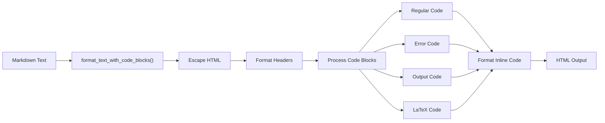
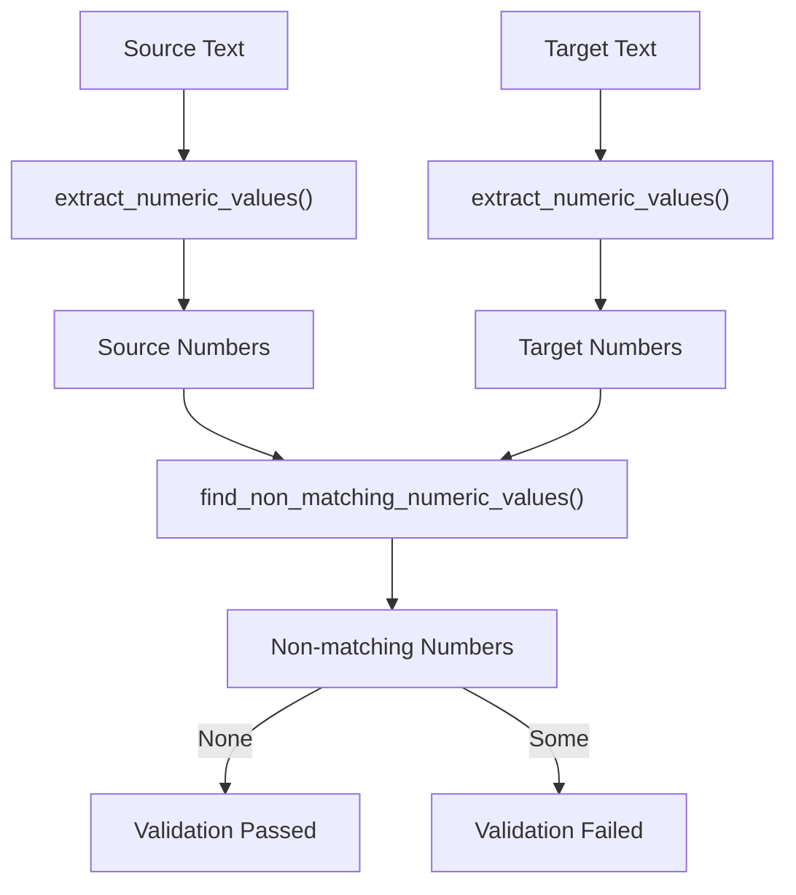
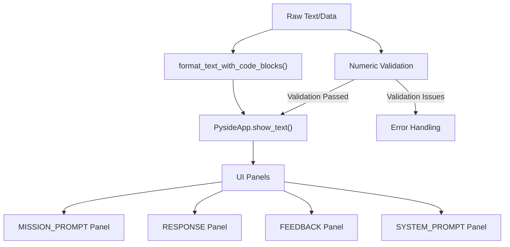
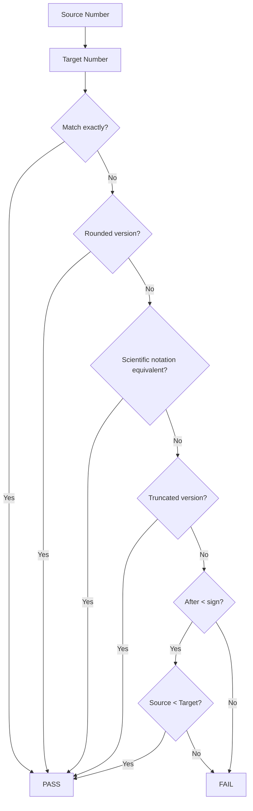

<!-- source: DeepWiki mcp.deepwiki.com · repo Technion-Kishony-lab/data-to-paper · page 6.2 Text Formatting Utilities · fetched 2026-10-26 -->

# Text Formatting Utilities

<details>
<summary>Relevant source files</summary>

The following files were used as context for generating this wiki page:

- [tests/functional/interactive/test_pyside_app.py](tests/functional/interactive/test_pyside_app.py)
- [tests/functional/utils/test_check_numeric_values.py](tests/functional/utils/test_check_numeric_values.py)

</details>


## Purpose and Scope

The Text Formatting Utilities in the data-to-paper framework provide functionality for formatting and validating text content displayed in the user interface. These utilities focus on two main areas:

1. Converting markdown text with code blocks into formatted HTML for display in the UI
2. Extracting and validating numeric values within text to ensure accuracy in scientific reporting

These utilities are primarily used by the user interface components. For information about the overall UI system, see [User Interface](#6) and [PySide App](#6.1).

## Text Formatting with Code Blocks

The primary text formatting utility is the `format_text_with_code_blocks` function, which transforms markdown text into HTML with proper formatting for different types of content, including syntax highlighting for code blocks.

### Key Features

- Converts markdown formatting to HTML
- Provides syntax highlighting for code blocks
- Supports custom block types (output, error)
- Formats LaTeX code blocks
- Preserves monospace formatting for inline code
- Handles HTML escaping to prevent rendering issues
- Supports header formatting (H1-H4)

### Usage Example

The function is typically used to format text before displaying it in UI panels:

```python
formatted_text = format_text_with_code_blocks(
    text,               # Input text (markdown)
    is_html=True,       # Output as HTML
    from_md=True,       # Input is markdown
    do_not_format=[]    # Optional list of block types to leave unformatted
)
app.show_text(PanelNames.RESPONSE, formatted_text, is_html=True)
```

Sources: [tests/functional/interactive/test_pyside_app.py:10](). [tests/functional/interactive/test_pyside_app.py:150]().

### Text Formatting Process



Sources: [tests/functional/interactive/test_pyside_app.py:133-134]().

## Numeric Value Utilities

The framework includes several utilities for extracting and validating numeric values in text, which is particularly important for ensuring accuracy in scientific reporting.

### Key Components

- **extract_numeric_values**: Extracts all numeric values from a text string
- **find_non_matching_numeric_values**: Identifies numeric values in a source text that don't match those in a target text
- **add_one_to_last_digit**: Increments the last digit of a numeric string
- **truncate_to_n_digits**: Truncates a number to a specified number of significant digits
- **is_after_smaller_than_sign**: Checks if a number appears after a "smaller than" sign in text

### Numeric Value Validation Process



Sources: [tests/functional/utils/test_check_numeric_values.py:3-4](), [tests/functional/utils/test_check_numeric_values.py:44-68]().

### Supported Number Formats

The numeric utilities can handle various number formats:

| Format | Example | Notes |
|--------|---------|-------|
| Integers | `123`, `1234` | Can include commas in display format |
| Decimals | `1.02`, `10.00` | Supports variable precision |
| Scientific | `12e+03`, `4.72e-05` | Supports various display formats including LaTeX |
| Negative | `-100.2`, `-0.0007732` | Full support for negative values |
| Percentages | `90.02%` | Converted from decimal form |

Sources: [tests/functional/utils/test_check_numeric_values.py:7-14](), [tests/functional/utils/test_check_numeric_values.py:44-66]().

## Integration with User Interface

The text formatting utilities integrate with the PySide-based user interface to ensure proper display of formatted content.

### UI Integration Flow



Sources: [tests/functional/interactive/test_pyside_app.py:142-148](), [tests/functional/interactive/test_pyside_app.py:9-10]().

## Code Block Type Support

The `format_text_with_code_blocks` function supports different types of code blocks with special formatting:

| Block Type | Purpose | Formatting |
|------------|---------|------------|
| `python` | Python code | Syntax highlighting for Python |
| `output` | Command output | Plain monospace formatting |
| `error` | Error messages | Special formatting for errors |
| `latex` | LaTeX code | Preserves LaTeX formatting |
| Default | Generic code | Basic monospace formatting |

Sources: [tests/functional/interactive/test_pyside_app.py:75-120]().

## Numeric Validation Behavior

The numeric validation utilities employ several strategies to compare numbers:

1. **Rounding Tolerance**: Small differences due to rounding are accepted
2. **Scientific Notation Equivalence**: Different representations of the same number are treated as equal
3. **Digit Truncation**: Truncation of trailing digits is permitted
4. **Format Flexibility**: Numbers can be formatted differently (commas, scientific notation) while being logically equivalent
5. **Context Awareness**: Special handling for numbers after comparison operators like "<"

### Validation Rules



Sources: [tests/functional/utils/test_check_numeric_values.py:44-68](), [tests/functional/utils/test_check_numeric_values.py:71-76]().