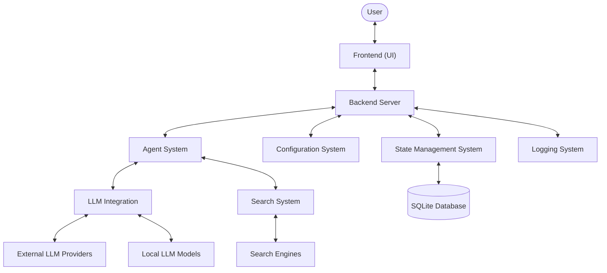
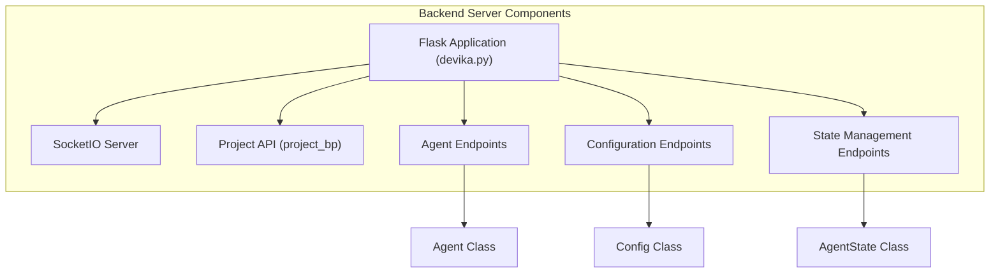
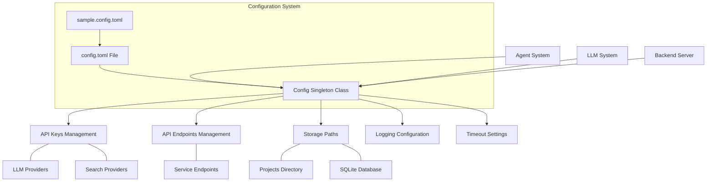
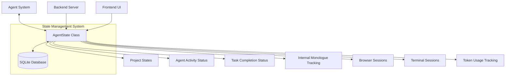
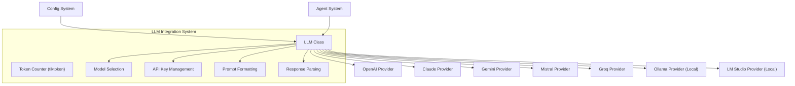
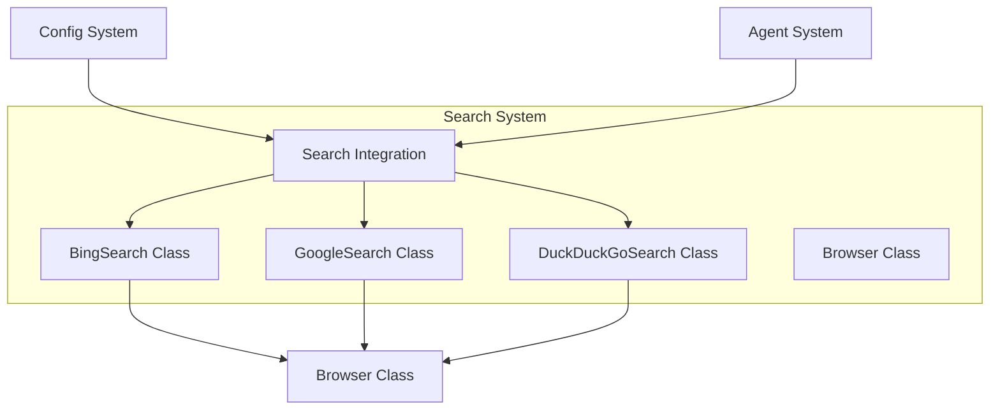
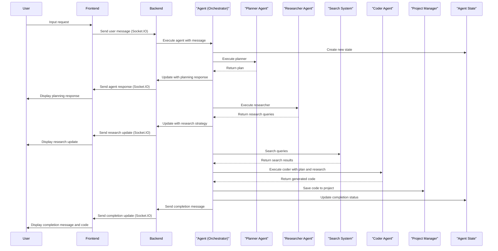
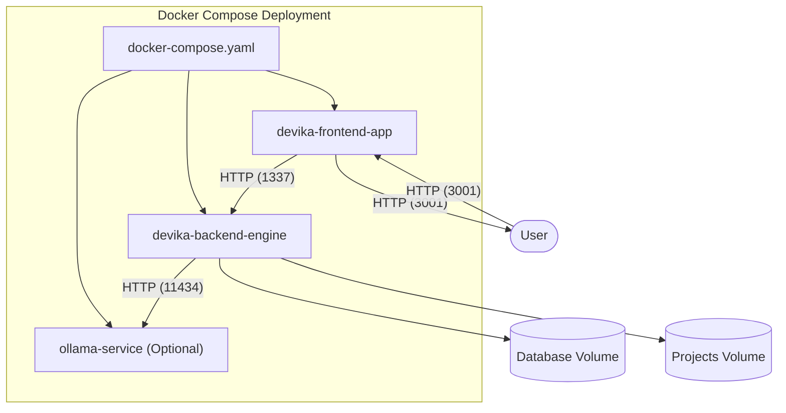

<!-- source: DeepWiki mcp.deepwiki.com · repo stitionai/devika · page 2 System Architecture · fetched 2026-10-26 -->

# System Architecture

Relevant source files

The following files were used as context for generating this wiki page:

- [.gitignore](.gitignore)
- [README.md](README.md)
- [devika.py](devika.py)
- [src/agents/agent.py](src/agents/agent.py)
- [src/config.py](src/config.py)

This document provides a high-level overview of Devika's system architecture, explaining how different components interact to create a cohesive agentic AI software engineering system. For detailed information about specific subsystems, please refer to the corresponding subsections: [LLM Integration Architecture](#2.1), [Agent System Architecture](#2.2), and [Frontend Architecture](#2.3).

## Architectural Overview

Devika is built using a modular, service-oriented architecture with clear separation of concerns. The system consists of several key components that work together to provide an AI assistant capable of understanding requirements, researching solutions, writing code, and assisting with software development tasks.

Sources: [devika.py:1-210](), [README.md:51-53]()

## Core Components

### Backend Server

The backend server is built using Flask and Socket.IO to provide both RESTful API endpoints and real-time communication capabilities. It serves as the central hub connecting the frontend with the agent system, configuration management, and state tracking.

Key components in the backend:

- **Flask Application**: Serves as the main web server, handling HTTP requests and responses
- **Socket.IO Server**: Enables real-time bidirectional communication between the client and server
- **Project API**: Manages project-related operations through a dedicated Blueprint
- **Agent Endpoints**: Interfaces with the Agent System to process user requests
- **Configuration Endpoints**: Provides access to configuration settings
- **State Management Endpoints**: Tracks and reports on agent state

Sources: [devika.py:11-35](), [devika.py:52-204]()

### Configuration System

The Configuration System manages all settings through a centralized `Config` class implemented as a singleton. This ensures consistent access to configuration throughout the application.

The Config class:
- Loads settings from `config.toml` with fallback to `sample.config.toml` if not found
- Provides getters and setters for all configuration values
- Includes configuration for API keys, endpoints, storage locations, and operational parameters
- Updates configuration in real-time when settings are changed through the UI

Sources: [src/config.py:1-196](), [devika.py:187-199]()

### State Management System

The State Management System tracks the current state of agents, projects, and interactions through the `AgentState` class. It maintains:

- Agent activity status (active/inactive)
- Completion status of tasks
- Internal monologue content
- Browser session information
- Terminal session history
- Token usage statistics

Sources: [devika.py:114-178](), [src/agents/agent.py:297-300]()

### Agent System

The Agent System is the core intelligence of Devika, orchestrating specialized agents to handle different aspects of software development. The `Agent` class serves as the orchestrator, coordinating the activities of specialized agent components.

```mermaid
graph TD
    subgraph "Agent System"
        AgentClass["Agent Class (Orchestrator)"]
        PlannerAgent["Planner Agent"]
        ResearcherAgent["Researcher Agent"]
        FormatterAgent["Formatter Agent"]
        CoderAgent["Coder Agent"] 
        ActionAgent["Action Agent"]
        InternalMonologueAgent["Internal Monologue Agent"]
        AnswerAgent["Answer Agent"]
        RunnerAgent["Runner Agent"]
        FeatureAgent["Feature Agent"]
        PatcherAgent["Patcher Agent"]
        ReporterAgent["Reporter Agent"]
        DecisionAgent["Decision Agent"]
    end
    
    AgentClass --> PlannerAgent
    AgentClass --> ResearcherAgent
    AgentClass --> FormatterAgent
    AgentClass --> CoderAgent
    AgentClass --> ActionAgent
    AgentClass --> InternalMonologueAgent
    AgentClass --> AnswerAgent
    AgentClass --> RunnerAgent
    AgentClass --> FeatureAgent
    AgentClass --> PatcherAgent
    AgentClass --> ReporterAgent
    AgentClass --> DecisionAgent
    
    AgentClass --> ProjectManager["Project Manager"]
    AgentClass --> AgentState["Agent State"]
    AgentClass --> BrowserSearch["Browser Search"]
    
    BrowserSearch --> BingSearch["Bing Search"]
    BrowserSearch --> GoogleSearch["Google Search"] 
    BrowserSearch --> DuckDuckGoSearch["DuckDuckGo Search"]
```

Key agent components:
- **Planner**: Creates step-by-step plans for tasks
- **Researcher**: Identifies information needs and formulates search queries
- **Formatter**: Formats information for processing by other agents
- **Coder**: Generates code based on requirements and research
- **Action**: Determines appropriate actions based on user interactions
- **Internal Monologue**: Maintains agent's internal thinking process
- **Feature**: Implements new features in existing code
- **Patcher**: Fixes bugs and issues in code
- **Reporter**: Generates documentation and reports

Sources: [src/agents/agent.py:1-66](), [src/agents/agent.py:269-366]()

### LLM Integration

The LLM Integration System provides a unified interface to multiple language model providers, including both cloud-based and local options.

The LLM Integration System:
- Supports multiple LLM providers through a common interface
- Manages API keys and endpoints for each provider
- Tracks token usage for cost monitoring
- Handles timeout and retry logic for API calls

Sources: [src/agents/agent.py:41-63](), [devika.py:64-65]()

### Search System

The Search System enables Devika to perform web searches to gather information for research and problem-solving. It supports multiple search engines:

The Search System:
- Interfaces with multiple search engines (Bing, Google, DuckDuckGo)
- Uses a browser automation component to extract information from web pages
- Processes and formats search results for agent consumption

Sources: [src/agents/agent.py:79-116]()

## Data Flow and Process

The following diagram illustrates the typical data flow for a user request in Devika:

Sources: [src/agents/agent.py:269-366](), [devika.py:77-103]()

## Implementation Details

### Backend Server (Flask & Socket.IO)

The main backend server is implemented in `devika.py`, which sets up a Flask application with Socket.IO integration:

- The server listens on port 1337
- Socket.IO is used for real-time communication with the frontend
- REST API endpoints handle various operations:
  - Project management
  - Agent state retrieval
  - Configuration management
  - Browser and terminal session management
  - Token usage tracking
  - Logging and diagnostics

The backend exposes multiple endpoints for interaction with the frontend:

| Endpoint | Method | Description |
|----------|--------|-------------|
| `/api/data` | GET | Retrieves project list, available models, and search engines |
| `/api/messages` | POST | Retrieves messages for a specific project |
| `/api/is-agent-active` | POST | Checks if an agent is active for a project |
| `/api/get-agent-state` | POST | Gets the latest state for a project |
| `/api/get-browser-snapshot` | GET | Retrieves a browser snapshot |
| `/api/get-browser-session` | GET | Gets the browser session for a project |
| `/api/get-terminal-session` | GET | Gets the terminal session for a project |
| `/api/token-usage` | GET | Retrieves token usage statistics |
| `/api/settings` | GET/POST | Gets or updates configuration settings |

Sources: [devika.py:28-205]()

### Configuration Management

The configuration system is implemented as a singleton class in `src/config.py`. It:

- Loads configuration from `config.toml` (creating it from `sample.config.toml` if not found)
- Provides getters and setters for all configuration values
- Persists configuration changes to disk
- Maintains settings for:
  - API keys for various services
  - API endpoints
  - Storage paths
  - Logging settings
  - Timeout configurations

Sources: [src/config.py:5-196]()

### Agent Orchestration

The Agent class in `src/agents/agent.py` serves as the main orchestrator for Devika's intelligence:

- Initializes all specialized agent components
- Maintains the flow of execution through different phases
- Handles first-time execution and subsequent interactions differently
- Manages context and state through the AgentState system
- Coordinates web searches through the search system
- Tracks contextual keywords for better understanding of user requests

The main execution flow is handled by the `execute` method, which:
1. Plans the approach using the Planner agent
2. Updates internal monologue to track thought process
3. Identifies research needs via the Researcher agent
4. Performs web searches if needed
5. Generates code using the Coder agent
6. Updates project files and state

For subsequent interactions, the `subsequent_execute` method determines the appropriate action based on the current context:
- Answer questions
- Run code
- Deploy a project
- Add features
- Fix bugs
- Generate reports

Sources: [src/agents/agent.py:36-366]()

## Deployment Architecture

Devika can be deployed using Docker Compose, which orchestrates three containers:

The deployment architecture consists of:
- **Backend Container**: Runs the Flask server with the core Devika logic
- **Frontend Container**: Serves the SvelteKit UI application
- **Ollama Container**: (Optional) Provides local LLM capabilities for environments without access to cloud APIs

Sources: [README.md:57-129]()

## Summary

Devika's system architecture follows a modular, loosely-coupled approach with clear separation of concerns. The core components - Agent System, LLM Integration, Search System, and State Management - work together through the Backend Server to provide a seamless experience for users interacting through the Frontend.

The architecture emphasizes:
- **Flexibility**: Supporting multiple LLM providers and search engines
- **Extensibility**: New agents can be added to enhance capabilities
- **State Management**: Persistent tracking of agent activities and project state
- **Real-time Communication**: Socket.IO enables immediate feedback to users

For more detailed information about specific subsystems, refer to the dedicated wiki pages for each component.

---

