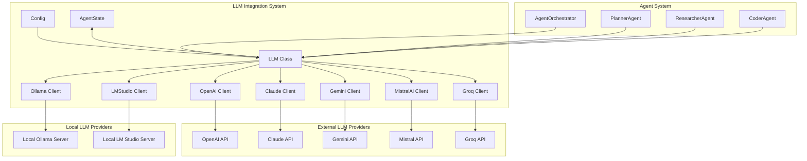
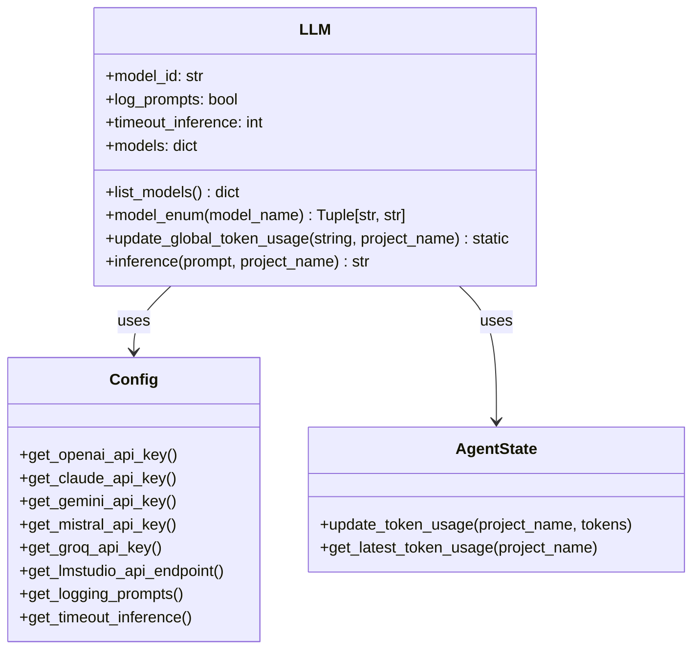
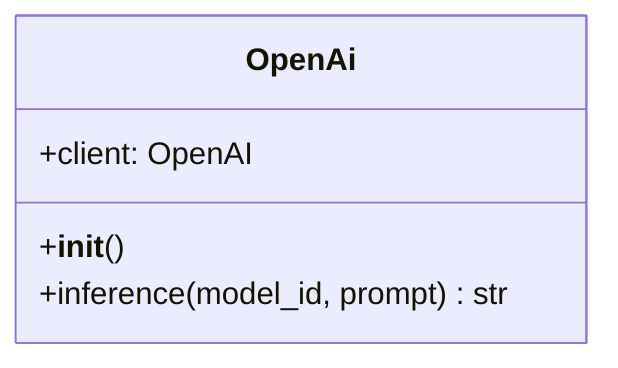
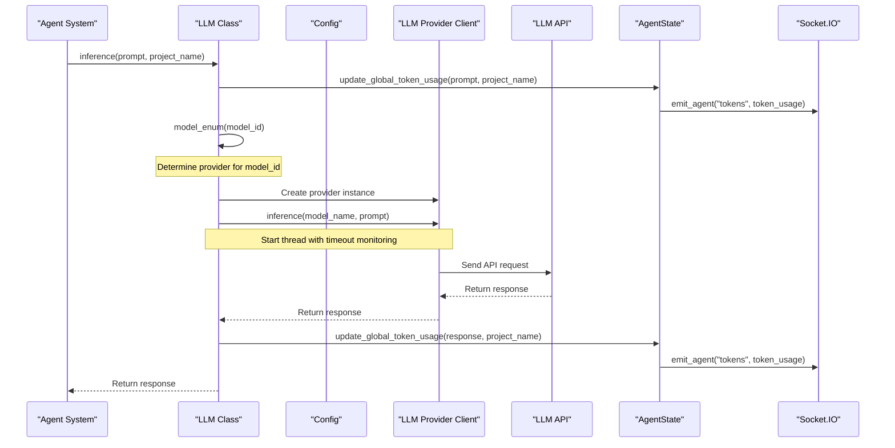
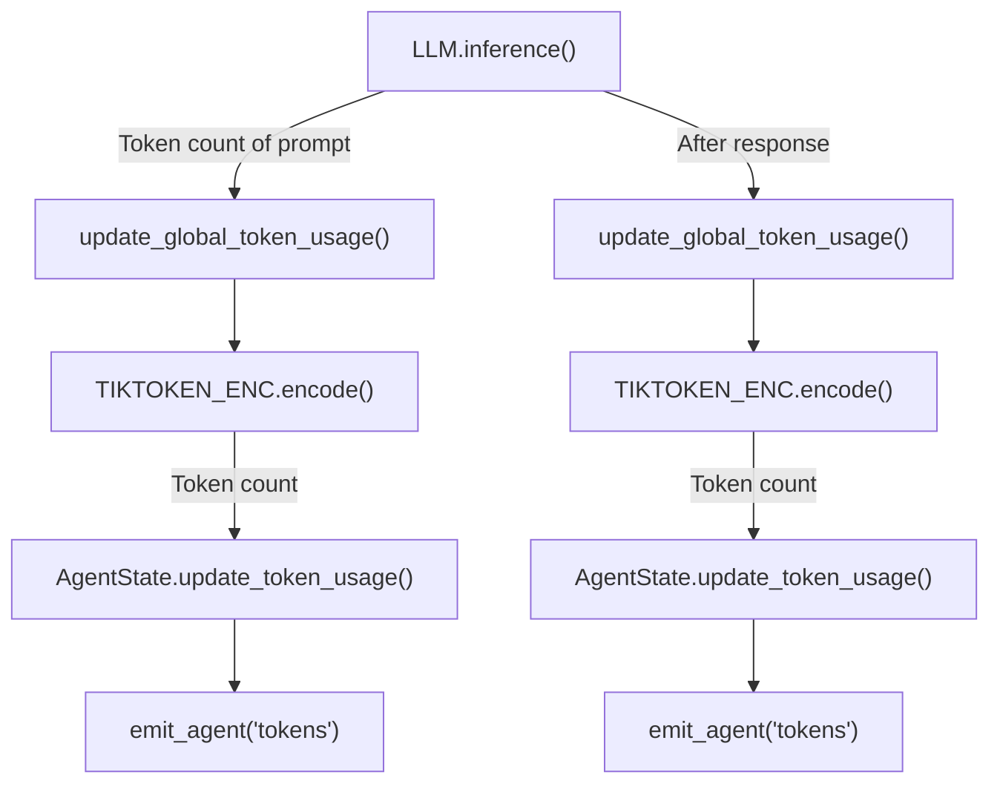
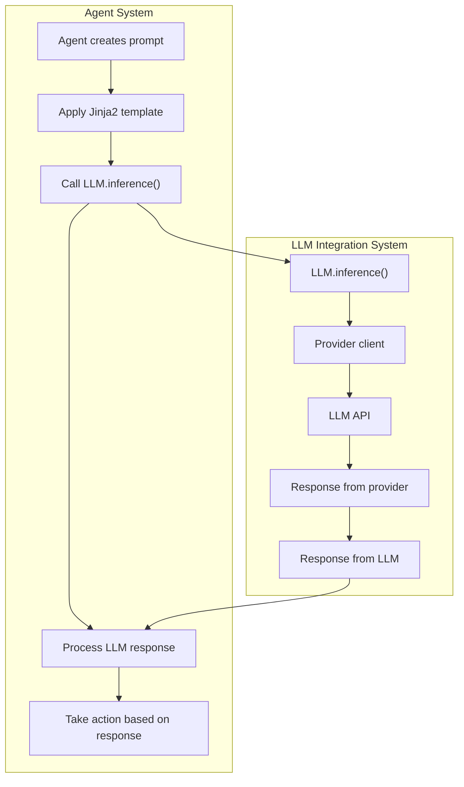

<!-- source: DeepWiki mcp.deepwiki.com · repo stitionai/devika · page 2.1 LLM Integration Architecture · fetched 2026-10-26 -->

# LLM Integration Architecture

Relevant source files

The following files were used as context for generating this wiki page:

- [sample.config.toml](sample.config.toml)
- [src/agents/researcher/prompt.jinja2](src/agents/researcher/prompt.jinja2)
- [src/llm/groq_client.py](src/llm/groq_client.py)
- [src/llm/llm.py](src/llm/llm.py)
- [src/llm/lm_studio_client.py](src/llm/lm_studio_client.py)
- [src/llm/mistral_client.py](src/llm/mistral_client.py)
- [src/llm/openai_client.py](src/llm/openai_client.py)

This document details the architecture of Devika's LLM Integration System, which provides a unified interface for interacting with multiple language model providers. The LLM Integration System serves as a critical abstraction layer that enables Devika's agent system to leverage different LLMs interchangeably, providing flexibility, resilience, and maintainability.

For information about how the Agent System uses LLMs, see [Agent System Architecture](#2.2).
For details on implementing custom LLM interfaces, see [LLM Interface](#5.3).

## Architecture Overview

The LLM Integration System is built around a central abstraction layer (`LLM` class) that interfaces with various LLM provider clients. This architecture enables seamless switching between different LLM providers while maintaining consistent behavior.

Sources: [src/llm/llm.py:27-28](), [src/llm/llm.py:101-109]()

## Core Components

### LLM Abstraction Layer

The `LLM` class located in `src/llm/llm.py` serves as the primary interface for interacting with language models. This class provides:

1. A unified interface for sending prompts to various LLM providers
2. Model enumeration and selection
3. Token usage tracking
4. Timeout handling and error management

Sources: [src/llm/llm.py:28-71](), [src/llm/llm.py:73-156]()

### LLM Provider Clients

Each LLM provider has its own client implementation that handles the specifics of communicating with that provider's API. All clients implement a consistent `inference` method that accepts a model ID and prompt, returning the model's response.

| Provider | Client Class | File Path |
|----------|-------------|-----------|
| OpenAI | `OpenAi` | src/llm/openai_client.py |
| Claude | `Claude` | src/llm/claude_client.py |
| Gemini | `Gemini` | src/llm/gemini_client.py |
| Mistral | `MistralAi` | src/llm/mistral_client.py |
| Groq | `Groq` | src/llm/groq_client.py |
| Ollama | `Ollama` | src/llm/ollama_client.py |
| LM Studio | `LMStudio` | src/llm/lm_studio_client.py |

Example client implementation (OpenAI):

Sources: [src/llm/openai_client.py:6-24](), [src/llm/groq_client.py:6-24](), [src/llm/mistral_client.py:7-26](), [src/llm/lm_studio_client.py:8-30]()

## Inference Workflow

The following sequence diagram illustrates the flow of an inference request through the LLM Integration System:

Sources: [src/llm/llm.py:92-156]()

## Supported Models

The LLM Integration System supports a wide range of models from various providers:

| Provider | Models |
|----------|--------|
| Claude | Claude 3 Opus, Claude 3 Sonnet, Claude 3 Haiku |
| OpenAI | GPT-4o-mini, GPT-4o, GPT-4 Turbo, GPT-3.5 Turbo |
| Google | Gemini 1.0 Pro, Gemini 1.5 Flash, Gemini 1.5 Pro |
| Mistral | Mistral 7b, Mistral 8x7b, Mistral Medium, Mistral Small, Mistral Large |
| Groq | LLAMA3 8B, LLAMA3 70B, LLAMA2 70B, Mixtral, GEMMA 7B |
| Ollama | (dynamically populated based on available local models) |
| LM Studio | Local Model |

Sources: [src/llm/llm.py:33-68]()

## Configuration

The LLM Integration System relies on the Configuration System to provide API keys and endpoints for each LLM provider. These configurations are stored in the `config.toml` file:

| Configuration Section | Keys | Purpose |
|-----------------------|------|---------|
| API_KEYS | CLAUDE, OPENAI, GEMINI, MISTRAL, GROQ | API keys for external providers |
| API_ENDPOINTS | OLLAMA, LM_STUDIO, OPENAI | Endpoints for LLM services |
| TIMEOUT | INFERENCE | Timeout setting for LLM requests |
| LOGGING | LOG_PROMPTS | Whether to log prompts and responses |

Sources: [sample.config.toml:9-34]()

## Token Usage Tracking

The LLM Integration System tracks token usage through the `AgentState` class:

Sources: [src/llm/llm.py:84-90](), [src/llm/llm.py:93-94](), [src/llm/llm.py:154]()

## Error Handling and Timeouts

The LLM Integration System implements robust error handling and timeout mechanisms:

1. Inference requests are executed in a separate thread with a configurable timeout
2. Regular status updates are emitted via Socket.IO during inference
3. If inference takes longer than expected, a warning is emitted
4. If inference exceeds the timeout threshold, the request is terminated
5. Errors from LLM providers are caught and reported via Socket.IO

Sources: [src/llm/llm.py:111-146]()

## Integration with Agent System

The Agent System interacts with the LLM Integration System primarily through the `LLM` class. Agents create prompts (often using Jinja2 templates) and pass them to the LLM class for processing. The Agent System is responsible for interpreting the LLM responses and taking appropriate actions.

Sources: [src/agents/researcher/prompt.jinja2:1-40]()

## Summary

The LLM Integration Architecture provides a flexible, extensible system for interacting with various language model providers. Its key features include:

1. A unified interface for all LLM providers
2. Support for both cloud-based and local LLMs
3. Configurable behavior through the Configuration System
4. Token usage tracking
5. Robust error handling and timeout mechanisms
6. Seamless integration with the Agent System

This architecture allows Devika to leverage a wide range of language models while maintaining consistent behavior and providing fallback options if specific providers are unavailable.

---

