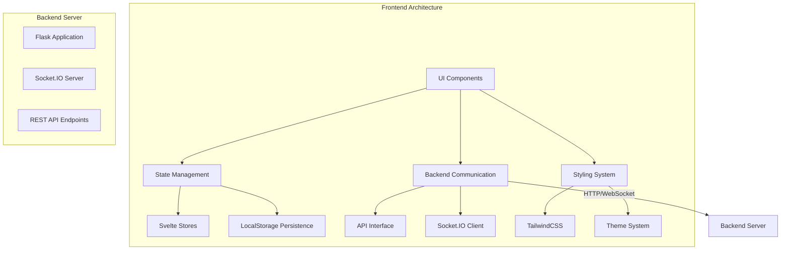
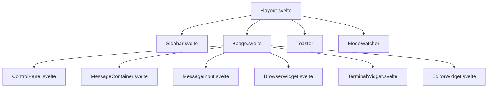
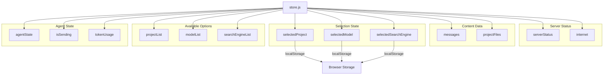
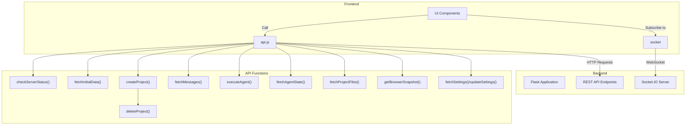
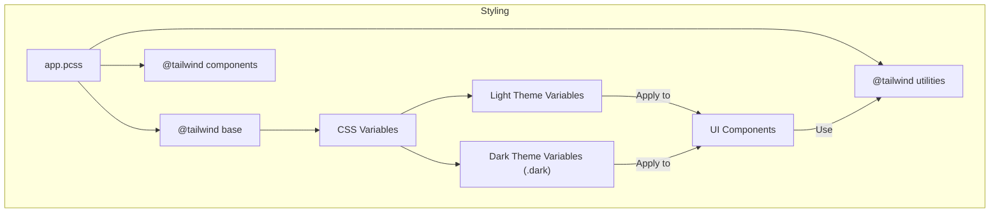
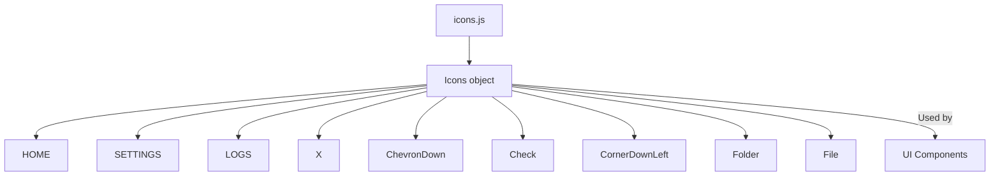
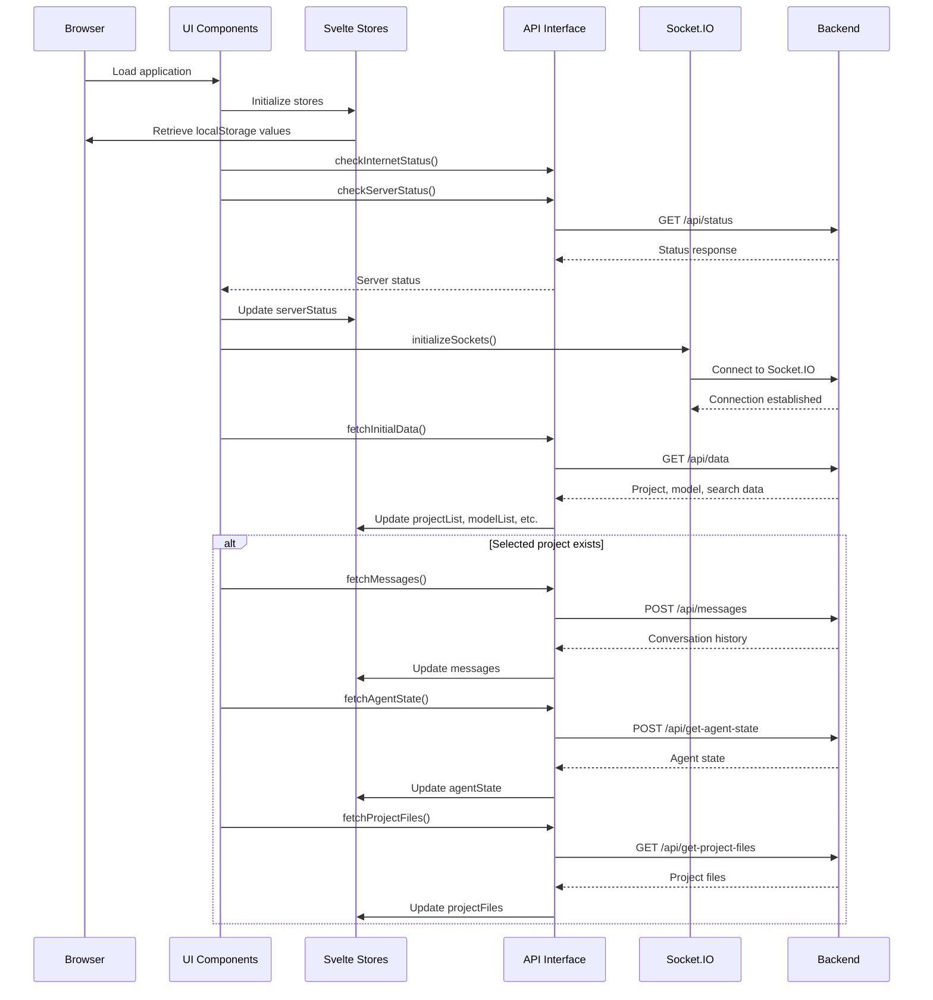

<!-- source: DeepWiki mcp.deepwiki.com · repo stitionai/devika · page 2.3 Frontend Architecture · fetched 2026-10-26 -->

# Frontend Architecture

<details>
<summary>Relevant source files</summary>

The following files were used as context for generating this wiki page:

- [ui/src/app.pcss](ui/src/app.pcss)
- [ui/src/lib/api.js](ui/src/lib/api.js)
- [ui/src/lib/icons.js](ui/src/lib/icons.js)
- [ui/src/lib/store.js](ui/src/lib/store.js)
- [ui/src/routes/+layout.svelte](ui/src/routes/+layout.svelte)
- [ui/src/routes/+page.svelte](ui/src/routes/+page.svelte)

</details>


This document provides a technical overview of the frontend architecture of Devika's user interface system. It covers the component structure, state management approach, communication mechanisms with the backend, and styling methodology. For information about the broader system architecture, see [System Architecture](#2), and for backend component details, see [Agent System Architecture](#2.2).

## Overview

Devika's frontend is built with Svelte and uses TailwindCSS for styling. The interface provides a comprehensive environment for users to interact with Devika's AI capabilities through multiple specialized widgets including code editors, terminal emulators, and browser windows.



Sources:
- [ui/src/lib/store.js]()
- [ui/src/lib/api.js]()
- [ui/src/routes/+page.svelte]()

## Component Structure

The UI is organized as a hierarchical component tree with a main layout that encapsulates the page components.



Sources:
- [ui/src/routes/+layout.svelte:1-15]()
- [ui/src/routes/+page.svelte:1-56]()

### Main Layout

The application's main layout (`+layout.svelte`) provides the structure for all pages and includes:

- A sidebar for navigation
- A toaster notification system for alerts
- A theme mode watcher
- A slot for page content

```javascript
<main>
  <div class="h-dvh w-full flex">
      <Toaster richColors/>
      <ModeWatcher />
      <Sidebar />
      <slot />
  </div>
</main>
```

Sources:
- [ui/src/routes/+layout.svelte:1-15]()

### Main Page

The main page component (`+page.svelte`) integrates the primary UI widgets:

1. **ControlPanel** - Provides project, model, and search engine selection
2. **MessageContainer** - Displays conversation history
3. **MessageInput** - Allows sending messages to Devika
4. **BrowserWidget** - Shows web browser interactions
5. **TerminalWidget** - Displays terminal command outputs
6. **EditorWidget** - Code editor for viewing and modifying project files

The page layout uses TailwindCSS flex containers to organize these components:

```javascript
<div class="flex h-full flex-col flex-1 gap-4 p-4 overflow-hidden">
  <ControlPanel />
  <div class="flex h-full overflow-x-scroll">
    <div class="flex flex-1 min-w-[calc(100vw-120px)] h-full gap-2">
      <div class="flex flex-col gap-2 w-full h-full pr-4">
        <MessageContainer />
        <MessageInput />
      </div>
      <div class="flex flex-col gap-4 h-full w-full p-2">
        <BrowserWidget />
        <TerminalWidget />
      </div>
    </div>
    <div class="flex flex-col gap-2 min-w-[calc(100vw-120px)] h-full pr-4 p-2">
      <EditorWidget />
    </div>
  </div>
</div>
```

Sources:
- [ui/src/routes/+page.svelte:1-56]()

## State Management

Devika's frontend uses Svelte's reactive store system combined with browser localStorage for state persistence across sessions.



Sources:
- [ui/src/lib/store.js:1-49]()

### Svelte Stores

The `store.js` file defines several writable Svelte stores:

| Store Category | Store Variables | Purpose |
|----------------|-----------------|---------|
| Server Status | `serverStatus`, `internet` | Track backend connectivity |
| Content Data | `messages`, `projectFiles` | Store conversation and file contents |
| Selection State | `selectedProject`, `selectedModel`, `selectedSearchEngine` | Track user selections |
| Available Options | `projectList`, `modelList`, `searchEngineList` | Available choices for selections |
| Agent State | `agentState`, `isSending`, `tokenUsage` | Track agent execution state |

Sources:
- [ui/src/lib/store.js:21-48]()

### LocalStorage Persistence

Selected values are persisted in localStorage using helper functions:

```javascript
// Helper function to get item from localStorage
function getItemFromLocalStorage(key, defaultValue) {
    const storedValue = localStorage.getItem(key);
    if (storedValue) {
        return storedValue;
    }
    localStorage.setItem(key, defaultValue);
    return defaultValue;
}

// Helper function to handle subscription and local storage setting
function subscribeAndStore(store, key, defaultValue) {
    store.set(getItemFromLocalStorage(key, defaultValue));
    store.subscribe(value => {
        localStorage.setItem(key, value);
    });
}
```

The following values are persisted:
- `selectedProject`
- `selectedModel`
- `selectedSearchEngine`

Sources:
- [ui/src/lib/store.js:3-19]()
- [ui/src/lib/store.js:34-36]()

## Backend Communication

Devika's frontend communicates with the backend server through two primary channels:

1. **REST API** - For standard request/response interactions
2. **Socket.IO** - For real-time updates and streaming responses



Sources:
- [ui/src/lib/api.js:1-165]()

### API Interface

The frontend's `api.js` module provides functions for communicating with the backend:

#### Server Configuration
- `checkServerStatus()` - Verifies backend availability
- `fetchInitialData()` - Retrieves projects, models, and search engines
- `fetchSettings()` / `updateSettings()` - Manages system settings

#### Project Management
- `createProject(projectName)` - Creates a new project
- `deleteProject(projectName)` - Deletes an existing project
- `fetchProjectFiles()` - Retrieves files from the current project

#### Agent Interaction
- `executeAgent(prompt)` - Sends user prompt to the agent
- `fetchAgentState()` - Gets agent's current state
- `fetchMessages()` - Retrieves conversation history

#### Auxiliary Functions
- `getBrowserSnapshot(snapshotPath)` - Gets browser snapshots
- `checkInternetStatus()` - Checks internet connectivity
- `fetchLogs()` - Retrieves system logs

Sources:
- [ui/src/lib/api.js:29-165]()

### Socket.IO Integration

Real-time communication is handled through Socket.IO:

```javascript
export const API_BASE_URL = import.meta.env.VITE_API_BASE_URL || getApiBaseUrl();
export const socket = io(API_BASE_URL, { autoConnect: false });
```

The connection is initialized during the main page component's mount:

```javascript
onMount(() => {
  const load = async () => {
    await checkInternetStatus();
    if(!(await checkServerStatus())) {
      toast.error("Failed to connect to server");
      return;
    }
    serverStatus.set(true);
    await initializeSockets();
  };
  load();
});
```

Sources:
- [ui/src/lib/api.js:26-27]()
- [ui/src/routes/+page.svelte:21-36]()

## Styling System

Devika's frontend uses TailwindCSS for consistent, utility-based styling with theme support.



Sources:
- [ui/src/app.pcss:1-137]()

### TailwindCSS Configuration

The application uses TailwindCSS utilities for layout and styling:

```css
@tailwind base;
@tailwind components;
@tailwind utilities;
```

Sources:
- [ui/src/app.pcss:1-3]()

### Theme Variables

CSS variables define the color schemes for both light and dark themes:

```css
:root {
  --primary: #2F3337;
  --background: #ffffff;
  --secondary: #f1f2f5;
  /* Additional variables */
}

.dark {
  --primary: #ECECEC;
  --background: #1D1F21;
  --secondary: #2F3337;
  /* Additional variables */
}
```

These variables control interface elements including:
- Text colors and backgrounds
- Window borders and outlines
- Terminal and browser window appearances
- UI component states

Sources:
- [ui/src/app.pcss:5-79]()

## Icon System

The UI uses a centralized icon system defined in `icons.js`:



Sources:
- [ui/src/lib/icons.js:1-11]()

The icon system exports an object with SVG icon definitions that can be used throughout the application:

```javascript
export const Icons = {
    HOME: '<svg width="23" height="23" viewBox="0 0 23 23" fill="none" xmlns="http://www.w3.org/2000/svg">...</svg>',
    SETTINGS: '<svg width="23" height="23" viewBox="0 0 23 23" fill="none" xmlns="http://www.w3.org/2000/svg">...</svg>',
    // Additional icons
};
```

Sources:
- [ui/src/lib/icons.js:1-11]()

## Initialization Flow

When the frontend application loads, it follows this sequence:



Sources:
- [ui/src/routes/+page.svelte:21-36]()
- [ui/src/lib/api.js:29-135]()

This initialization sequence ensures the frontend has all necessary data and connections before enabling user interaction.

---

