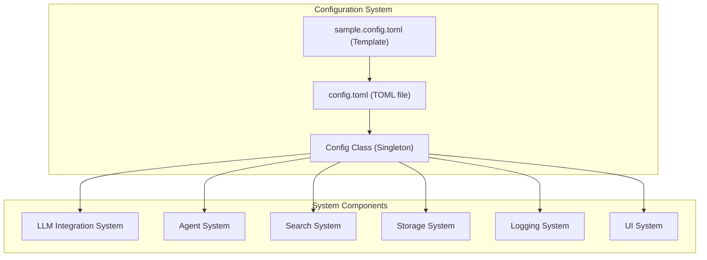
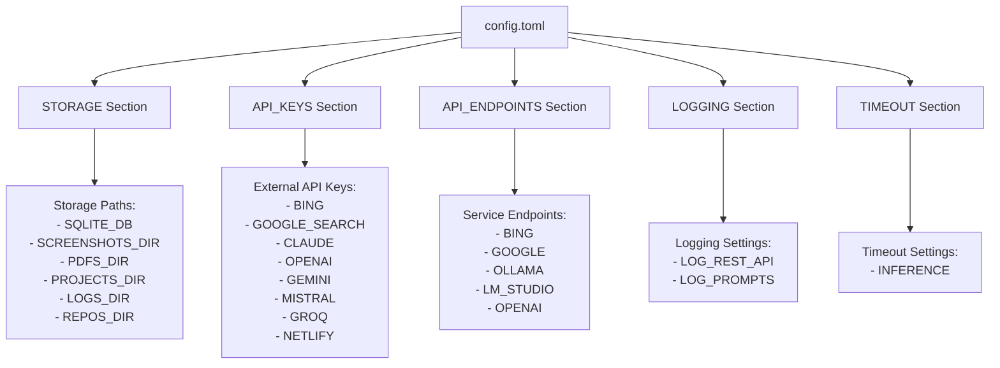
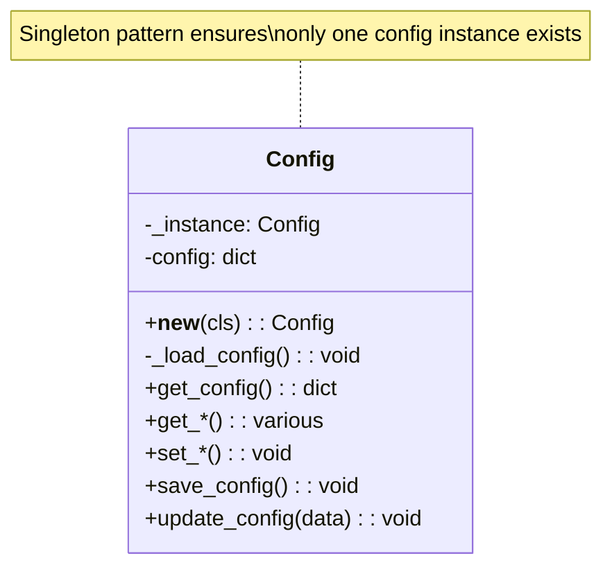
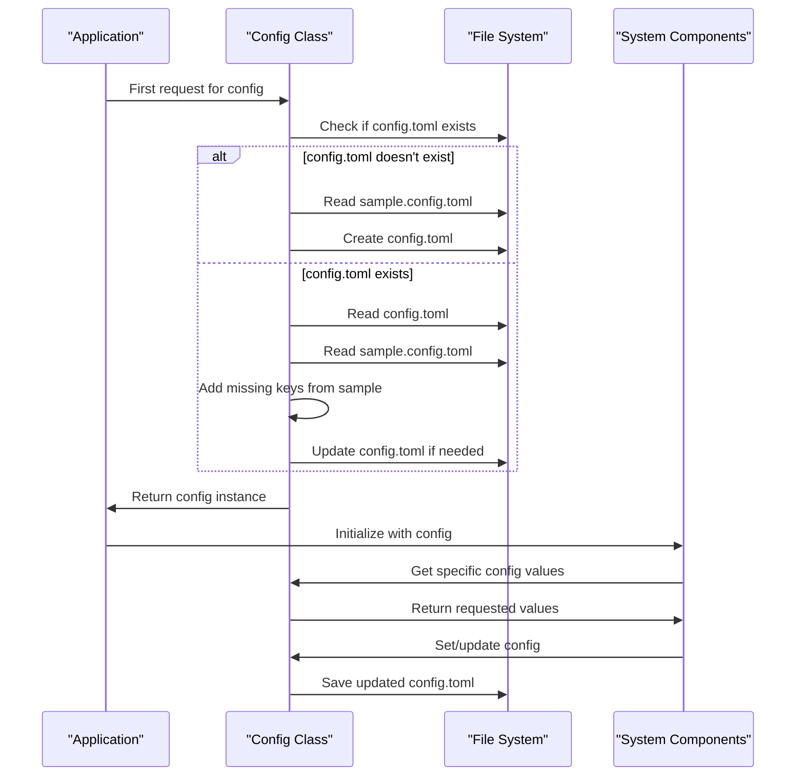
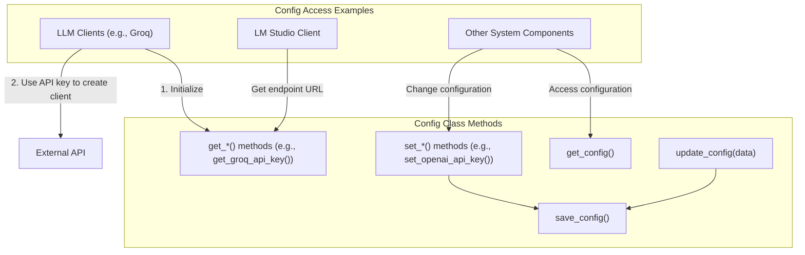

<!-- source: DeepWiki mcp.deepwiki.com · repo stitionai/devika · page 4 Configuration · fetched 2026-10-26 -->

# Configuration

<details>
<summary>Relevant source files</summary>

The following files were used as context for generating this wiki page:

- [sample.config.toml](sample.config.toml)
- [src/config.py](src/config.py)
- [src/llm/groq_client.py](src/llm/groq_client.py)
- [src/llm/lm_studio_client.py](src/llm/lm_studio_client.py)

</details>


The Configuration system in Devika provides a centralized mechanism for managing settings across all components of the application. This document details how to configure Devika through its configuration file, explains the architecture of the configuration system, and provides guidance on available options and their impacts.

For information about accessing configuration through the UI, see [Settings and Configuration](#6.4).

## Configuration Architecture

Devika uses a singleton configuration pattern that ensures consistent access to configuration data throughout the application. The configuration is stored in a TOML file (`config.toml`) and accessed through a centralized `Config` class.



Sources: [src/config.py:1-196](), [sample.config.toml:1-34]()

## Configuration File

The configuration is stored in `config.toml` in TOML format. If this file doesn't exist when Devika starts, it will be automatically created from `sample.config.toml`. The configuration file has several main sections:

| Section | Purpose | Example Keys |
|---------|---------|-------------|
| STORAGE | Defines paths for data storage | SQLITE_DB, PROJECTS_DIR |
| API_KEYS | Contains API keys for external services | OPENAI, CLAUDE, BING |
| API_ENDPOINTS | Defines URLs for various APIs | OLLAMA, OPENAI, BING |
| LOGGING | Controls logging behavior | LOG_REST_API, LOG_PROMPTS |
| TIMEOUT | Sets timeout limits | INFERENCE |

Here's a representation of the configuration structure:



Sources: [sample.config.toml:1-34]()

## Configuration Implementation

The configuration is managed by the `Config` class in `src/config.py`, which implements the Singleton pattern to ensure that configuration is consistent throughout the application.



Key features of the Config class:

1. **Singleton Pattern**: Ensures only one instance of the configuration exists.
2. **Automatic Creation**: Creates `config.toml` from the sample if it doesn't exist.
3. **Missing Key Detection**: Compares with sample config to add any missing keys.
4. **Accessor Methods**: Provides methods to get and set specific config values.
5. **Persistence**: Changes to configuration are saved back to the TOML file.

Sources: [src/config.py:5-196]()

## Configuration Sections

### Storage Configuration

The STORAGE section defines file paths for different storage needs:

```toml
[STORAGE]
SQLITE_DB = "data/db/devika.db"
SCREENSHOTS_DIR = "data/screenshots"
PDFS_DIR = "data/pdfs"
PROJECTS_DIR = "data/projects"
LOGS_DIR = "data/logs"
REPOS_DIR = "data/repos"
```

These paths are used throughout the application to store different types of data:
- `SQLITE_DB`: Path to the SQLite database used for state management
- `SCREENSHOTS_DIR`: Directory for storing screenshots
- `PDFS_DIR`: Directory for storing PDFs (documentation, etc.)
- `PROJECTS_DIR`: Directory for storing user projects
- `LOGS_DIR`: Directory for storing log files
- `REPOS_DIR`: Directory for storing git repositories

Sources: [sample.config.toml:1-7](), [src/config.py:87-103]()

### API Keys Configuration

The API_KEYS section contains keys for external services:

```toml
[API_KEYS]
BING = "<YOUR_BING_API_KEY>"
GOOGLE_SEARCH = "<YOUR_GOOGLE_SEARCH_API_KEY>"
GOOGLE_SEARCH_ENGINE_ID = "<YOUR_GOOGLE_SEARCH_ENGINE_ID>"
CLAUDE = "<YOUR_CLAUDE_API_KEY>"
OPENAI = "<YOUR_OPENAI_API_KEY>"
GEMINI = "<YOUR_GEMINI_API_KEY>"
MISTRAL = "<YOUR_MISTRAL_API_KEY>"
GROQ = "<YOUR_GROQ_API_KEY>"
NETLIFY = "<YOUR_NETLIFY_API_KEY>"
```

These keys are required for various integrations:
- Search services (Bing, Google)
- LLM providers (OpenAI, Claude, Gemini, Mistral, Groq)
- Deployment services (Netlify)

Sources: [sample.config.toml:9-18](), [src/config.py:48-85]()

### API Endpoints Configuration

The API_ENDPOINTS section defines URLs for various APIs:

```toml
[API_ENDPOINTS]
BING = "https://api.bing.microsoft.com/v7.0/search"
GOOGLE = "https://www.googleapis.com/customsearch/v1"
OLLAMA = "http://127.0.0.1:11434"
LM_STUDIO = "http://localhost:1234/v1"
OPENAI = "https://api.openai.com/v1"
```

These endpoints allow Devika to communicate with:
- Search services (Bing, Google)
- Local LLM servers (Ollama, LM Studio)
- Cloud LLM providers (OpenAI)

Sources: [sample.config.toml:20-26](), [src/config.py:45-74]()

### Logging Configuration

The LOGGING section controls logging behavior:

```toml
[LOGGING]
LOG_REST_API = "true"
LOG_PROMPTS = "false"
```

These settings determine:
- `LOG_REST_API`: Whether to log REST API calls
- `LOG_PROMPTS`: Whether to log LLM prompts (can be verbose)

Sources: [sample.config.toml:29-31](), [src/config.py:105-109]()

### Timeout Configuration

The TIMEOUT section sets timeout limits:

```toml
[TIMEOUT]
INFERENCE = 60
```

This setting defines:
- `INFERENCE`: Maximum time (in seconds) to wait for LLM inference responses

Sources: [sample.config.toml:33-34](), [src/config.py:111-112]()

## Configuration Usage Flow

When Devika starts, the configuration is loaded and made available to all components. Here's how the configuration flow works:



Sources: [src/config.py:8-40](), [src/config.py:182-196]()

## Accessing Configuration in Code

Components access configuration through the singleton `Config` class. Here's how different parts of the system use it:



Example from the Groq client:
```python
def __init__(self):
    config = Config()
    api_key = config.get_groq_api_key()
    self.client = _Groq(api_key=api_key)
```

Example from the LM Studio client:
```python
def __init__(self):
    try:
        self.api_endpoint = Config().get_lmstudio_api_endpoint()
        self.client = OpenAI(base_url=self.api_endpoint, api_key="not-needed")
        log.info("LM Studio available")
    except:
        self.api_endpoint = None
        self.client = None
        log.warning("LM Studio not available")
        log.warning("Make sure to set the LM Studio API endpoint in the config")
```

Sources: [src/llm/groq_client.py:6-24](), [src/llm/lm_studio_client.py:8-30]()

## Modifying Configuration

The configuration can be modified in several ways:

1. **Directly editing the config.toml file**
2. **Using the Config class API in code:**
   ```python
   config = Config()
   config.set_openai_api_key("your-key-here")
   ```
3. **Using the bulk update method for multiple changes:**
   ```python
   config = Config()
   config.update_config({
       "API_KEYS": {
           "OPENAI": "new-key-here",
           "CLAUDE": "another-key-here"
       }
   })
   ```
4. **Through the UI settings interface** (see [Settings and Configuration](#6.4))

Sources: [src/config.py:114-180](), [src/config.py:186-196]()

## Best Practices

1. **API Keys Security**: Never commit your real API keys to version control. The sample config uses placeholder values for a reason.

2. **Local Development**: For local development, create your own `config.toml` file with your personal API keys.

3. **Production Deployment**: In production environments, consider using environment variables or secret management systems and updating the config programmatically.

4. **Extending Configuration**: When adding new configurable options:
   - Add them to `sample.config.toml` first
   - Add appropriate getter/setter methods to the `Config` class
   - Document the new options

5. **Configuration Validation**: While the current implementation doesn't extensively validate configuration values, consider adding validation if working with critical settings.

---

