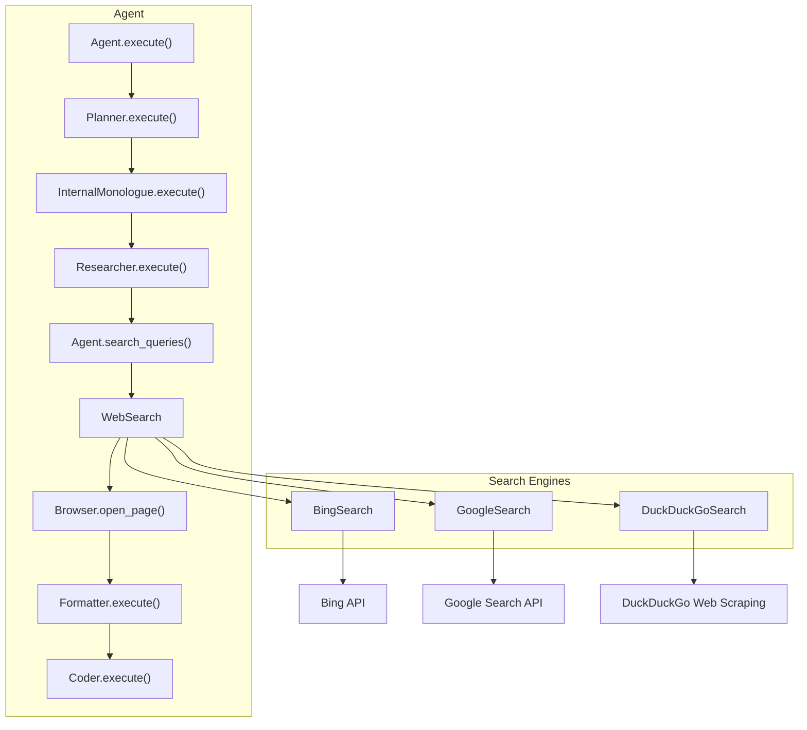
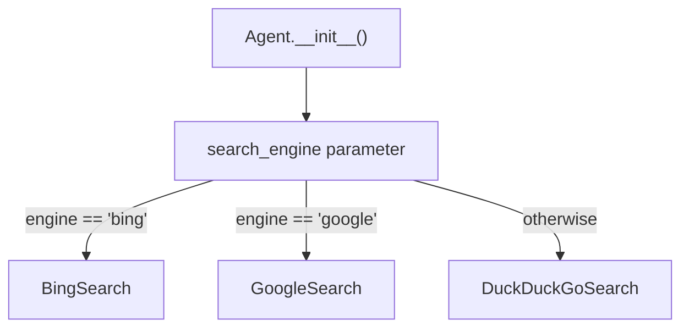
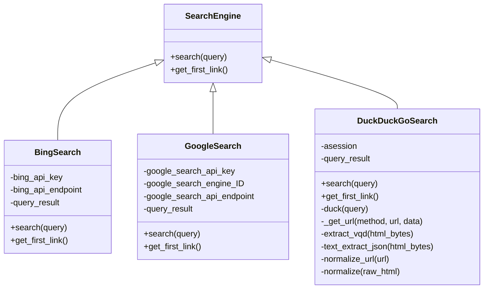
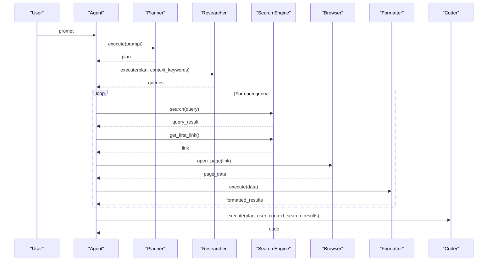
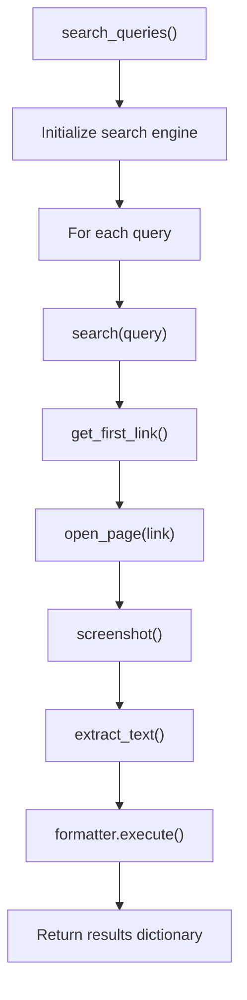
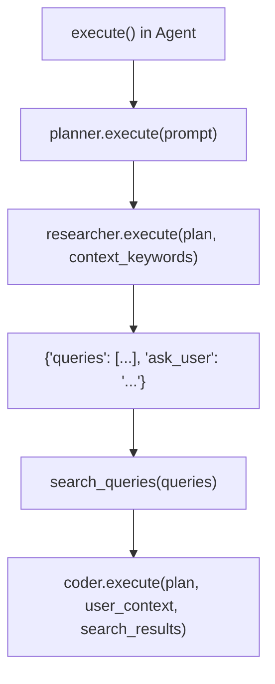
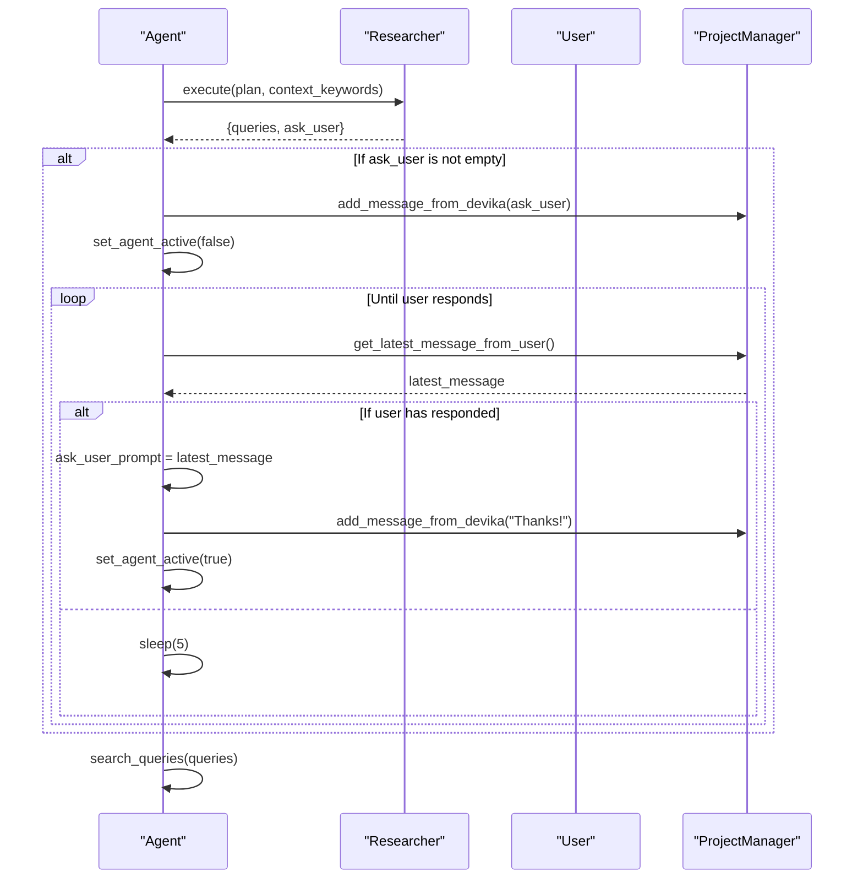
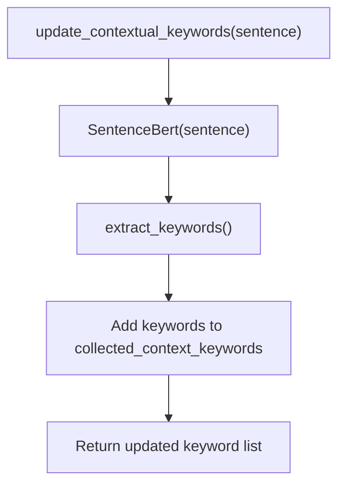

<!-- source: DeepWiki mcp.deepwiki.com · repo stitionai/devika · page 5.4 Search and Research · fetched 2026-10-26 -->

# Search and Research

Relevant source files

The following files were used as context for generating this wiki page:

- [src/agents/agent.py](src/agents/agent.py)
- [src/browser/search.py](src/browser/search.py)

## Purpose and Scope

This document explains how Devika performs web searches and conducts research to gather information needed for code generation and problem-solving. The search and research capabilities enable Devika to access up-to-date information from the web, enhancing its ability to generate accurate and relevant code solutions.

This page focuses specifically on the web search functionality and how it integrates with the researcher agent. For information about the overall agent system architecture, see [Agent System Architecture](#2.2). For details about how the gathered information is used in code generation, see [Code Generation](#5.2).

## Architecture Overview

The search and research system in Devika consists of multiple components that work together to retrieve relevant information from the web based on the requirements derived from user prompts.

Sources: [src/agents/agent.py:67-116](), [src/agents/agent.py:270-355]()

## Search Engine Integration

Devika supports three different search engines that can be configured according to preference or availability:

1. **Bing Search** - Uses the Bing Search API
2. **Google Search** - Uses the Google Custom Search API
3. **DuckDuckGo Search** - Uses web scraping techniques

Each search engine implementation follows a common interface pattern with `search()` and `get_first_link()` methods, allowing them to be used interchangeably in the system.

### Search Engine Selection

The search engine to use is specified during Agent initialization and stored in the `self.engine` property:

Sources: [src/agents/agent.py:37-68](), [src/agents/agent.py:79-89]()

### Search Engine Implementations

Each search engine provides slightly different implementations but follows the same basic functionality:

Sources: [src/browser/search.py:10-167]()

## Research Workflow

The research workflow in Devika follows these steps:

1. The Planner agent analyzes the user's prompt and creates a plan
2. The Researcher agent identifies specific queries needed for research
3. The Agent executes these queries using the configured search engine
4. The browser opens the first link from each search result
5. The page content is extracted and formatted
6. The formatted results are provided to the Coder agent

Sources: [src/agents/agent.py:270-356]()

## Search Query Execution

The `search_queries` method is the core function that handles the execution of search queries. It takes a list of queries and returns a dictionary of search results.

Key steps in the method include:
1. Initializing the appropriate search engine based on configuration
2. Executing each query in sequence
3. Retrieving the first link from each search result
4. Opening the web page using a browser instance
5. Extracting and formatting the content from the page
6. Collecting all results in a dictionary keyed by the original query

Sources: [src/agents/agent.py:79-116]()

## Search Engine Configuration

Each search engine requires specific API keys or configuration, which are retrieved from the central Config system:

| Search Engine | Required Configuration |
|--------------|------------------------|
| Bing         | `bing_api_key`, `bing_api_endpoint` |
| Google       | `google_search_api_key`, `google_search_engine_ID`, `google_search_api_endpoint` |
| DuckDuckGo   | No API key required, uses web scraping |

Sources: [src/browser/search.py:11-39]()

## Researcher Agent Integration

The Researcher agent is responsible for determining what information needs to be gathered from the web. It analyzes the plan created by the Planner agent and generates:

1. A list of specific search queries to execute
2. Optional follow-up questions to ask the user

The Researcher's output contains two key components:
- `queries`: A list of specific search terms to look up on the web
- `ask_user`: Optional follow-up questions if user input is needed for clarification

Sources: [src/agents/agent.py:302-319]()

## User Interaction During Research

If the Researcher agent determines that additional information is needed from the user, Devika will:

1. Pause the agent's execution
2. Display the question to the user
3. Wait for a response
4. Resume execution with the user's input

This creates an interactive research process where Devika can clarify requirements before proceeding with code generation.

Sources: [src/agents/agent.py:321-341]()

## Context Keyword Collection

Devika maintains context awareness throughout the research process by collecting and updating contextual keywords from various inputs:

1. The `collected_context_keywords` list accumulates important terms over time
2. The SentenceBert model extracts keywords from prompts and inputs
3. These keywords help focus and refine the research queries

Sources: [src/agents/agent.py:118-126]()

## Browser Interaction

After identifying a relevant link, Devika opens the page in a browser to extract useful information:

1. The `open_page` method starts a browser instance
2. It navigates to the URL, takes a screenshot, and extracts text
3. The screenshot is sent to the UI for display to the user
4. The text content is formatted and prepared for use in code generation

This process allows Devika to gather visual context and textual information from web pages.

Sources: [src/agents/agent.py:69-77](), [src/agents/agent.py:110-112]()

## Integration with Code Generation

The search results collected through this system are ultimately passed to the Coder agent. The Coder uses this information alongside the original plan and user context to generate appropriate code solutions.

The search results are provided as a dictionary where:
- Keys are the original search queries
- Values are the formatted text extracted from the relevant web pages

This structured format makes it easy for the Coder agent to reference specific information during code generation.

Sources: [src/agents/agent.py:349-355]()

---

