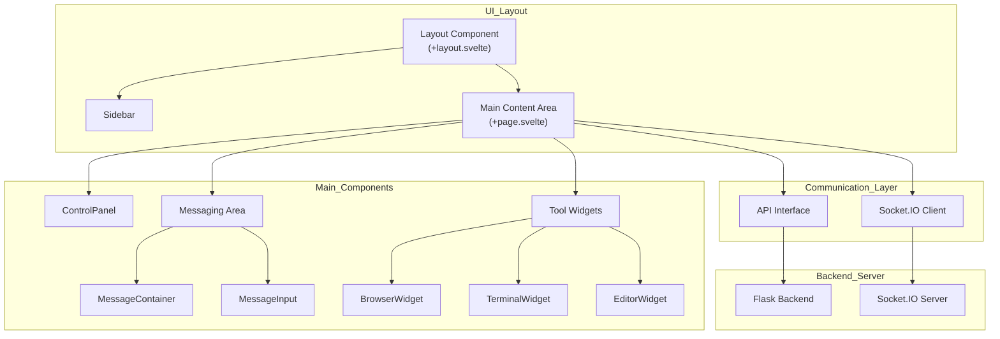
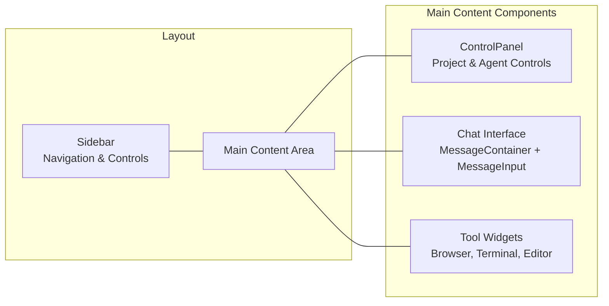
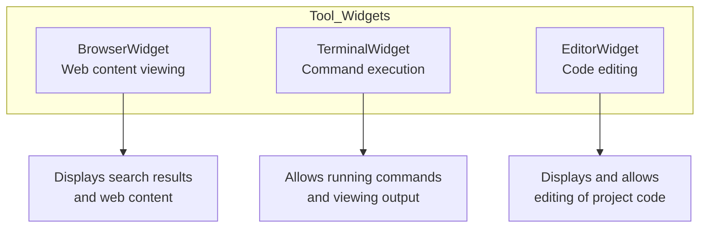
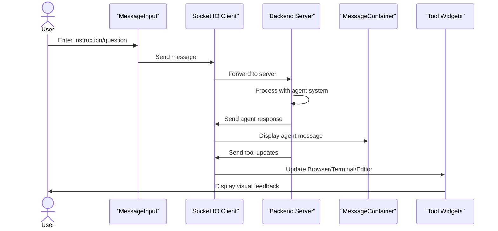

<!-- source: DeepWiki mcp.deepwiki.com · repo stitionai/devika · page 6 User Interface · fetched 2026-10-26 -->

# User Interface

<details>
<summary>Relevant source files</summary>

The following files were used as context for generating this wiki page:

- [ui/package.json](ui/package.json)
- [ui/src/app.pcss](ui/src/app.pcss)
- [ui/src/lib/icons.js](ui/src/lib/icons.js)
- [ui/src/routes/+layout.svelte](ui/src/routes/+layout.svelte)
- [ui/src/routes/+page.svelte](ui/src/routes/+page.svelte)

</details>


This document provides an overview of Devika's user interface system, explaining its structure, main components, and how they interact to enable effective communication with the AI agent. The UI is designed as an integrated environment for instructing the AI, viewing its responses, and interacting with generated code.

For specific details about project operations in the UI, see [Project Management](#6.1). For details on the messaging system, see [Chat Interface](#6.2). For specifics on code and terminal interactions, see [Editor and Terminal](#6.3). For configuring the system through the UI, see [Settings and Configuration](#6.4).

## UI Architecture Overview

Devika's user interface is built using a modern web technology stack centered around Svelte/SvelteKit with a component-based architecture. The UI communicates with the backend server via RESTful API calls and real-time Socket.IO connections.

**UI Component Architecture Diagram**


Sources: [ui/src/routes/+page.svelte:1-57](), [ui/src/routes/+layout.svelte:1-16]()

## Technology Stack

The UI is built with the following core technologies:

| Component | Technology | Purpose |
|-----------|------------|---------|
| Framework | Svelte/SvelteKit | Component-based UI framework |
| Styling | Tailwind CSS | Utility-first CSS framework |
| Code Editor | Monaco Editor | Advanced code editing capabilities |
| Terminal | Xterm.js | Terminal emulation |
| Real-time Communication | Socket.IO | Bidirectional communication with backend |
| UI Components | Bits-UI, paneforge | UI component libraries |
| Notifications | svelte-sonner | Toast notifications |

Sources: [ui/package.json:1-41]()

## Main Components

### Layout and Navigation

The UI follows a standard IDE-like layout with a sidebar for navigation and main content area containing the interaction elements.

**UI Layout Structure Diagram**


Sources: [ui/src/routes/+layout.svelte:1-16](), [ui/src/routes/+page.svelte:39-57]()

### Control Panel

The Control Panel provides access to project-related controls and agent interaction options. It serves as the primary interface for managing projects and initiating agent tasks.

Sources: [ui/src/routes/+page.svelte:5-5](), [ui/src/routes/+page.svelte:40-40]()

### Chat Interface

The Chat Interface consists of two primary components:

1. **MessageContainer**: Displays the conversation history between the user and Devika, including user requests and agent responses.
2. **MessageInput**: Provides an input field for users to communicate with Devika by typing instructions, questions, or commands.

These components enable the primary interaction method with the agent system.

Sources: [ui/src/routes/+page.svelte:6-7](), [ui/src/routes/+page.svelte:45-46]()

### Tool Widgets

Devika's UI includes three specialized tool widgets that enable interaction with code and web resources:

**Tool Widgets Diagram**


- **BrowserWidget**: Allows Devika to display web search results, documentation, and other online resources during the research phase.
- **TerminalWidget**: Provides terminal functionality for command execution, allowing Devika to run installation commands, tests, and other CLI operations.
- **EditorWidget**: Displays and allows editing of code files. This is where Devika presents generated code and where users can make modifications.

Sources: [ui/src/routes/+page.svelte:8-10](), [ui/src/routes/+page.svelte:49-51](), [ui/src/routes/+page.svelte:54-54]()

## UI Interaction Flow

The following diagram illustrates how users interact with Devika through the UI and how information flows between the different components:

**UI Interaction Flow Diagram**


Sources: [ui/src/routes/+page.svelte:13-36]()

## Theme Support

The UI supports both light and dark themes through CSS variables defined in the application stylesheet. The theme system controls colors for all major UI elements including backgrounds, text, borders, and specialized components like the terminal and browser widgets.

**Theme Variables Sample**
```
Light theme colors:
- Background: #ffffff
- Foreground: #303438
- Secondary: #f1f2f5
- Border: #E4E3E8

Dark theme colors:
- Background: #1D1F21
- Foreground: #dcdcdc
- Secondary: #2F3337
- Border: #2B2F34
```

Sources: [ui/src/app.pcss:5-79]()

## Component Communication

The UI components communicate with the backend server through two primary mechanisms:

1. **API Calls**: For non-real-time operations like checking server status, loading project data, and basic configuration.
2. **Socket.IO**: For real-time updates like agent messages, terminal output, browser content changes, and code updates.

The Socket.IO connection is initialized when the main page loads and is used throughout the session for bidirectional communication.

Sources: [ui/src/routes/+page.svelte:13-36]()

## UI Icons and Visual Elements

The UI uses a set of custom SVG icons defined in the icons.js file to represent various functions and navigation elements throughout the interface. This includes icons for home navigation, settings, logs, folders, files, and various UI controls.

Sources: [ui/src/lib/icons.js:1-11]()

---

