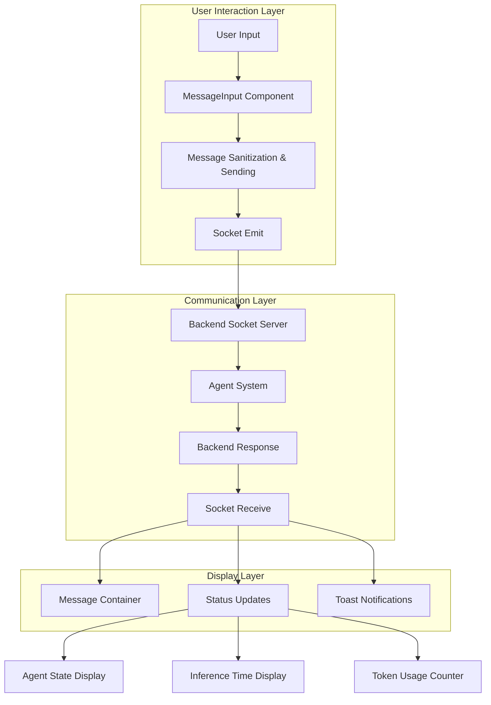
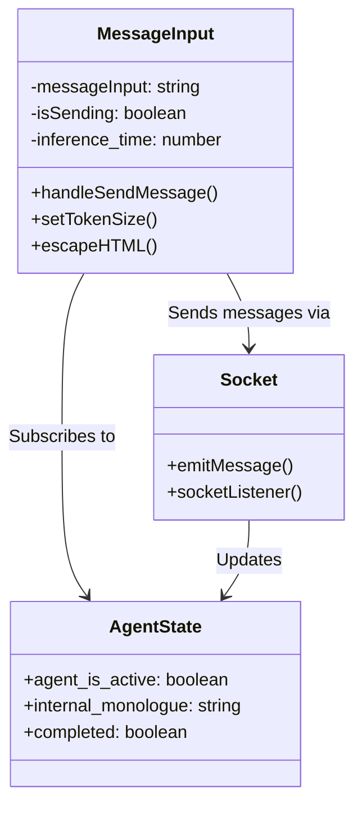
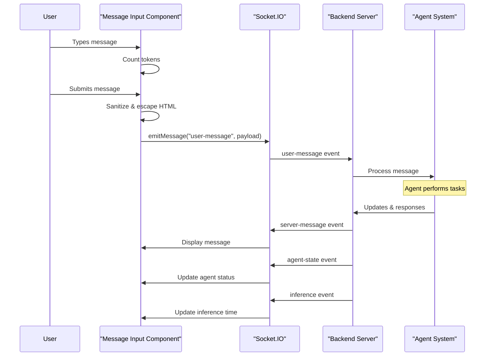
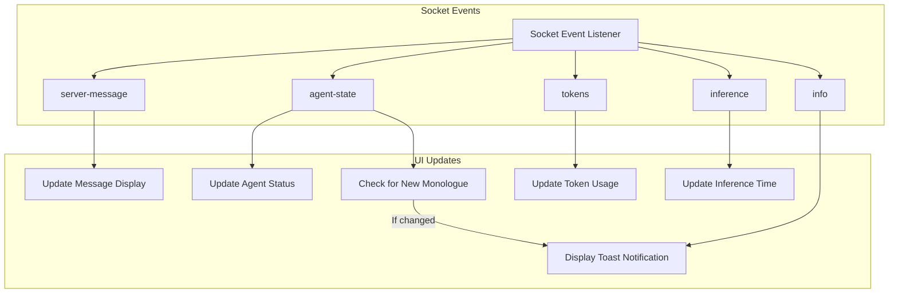
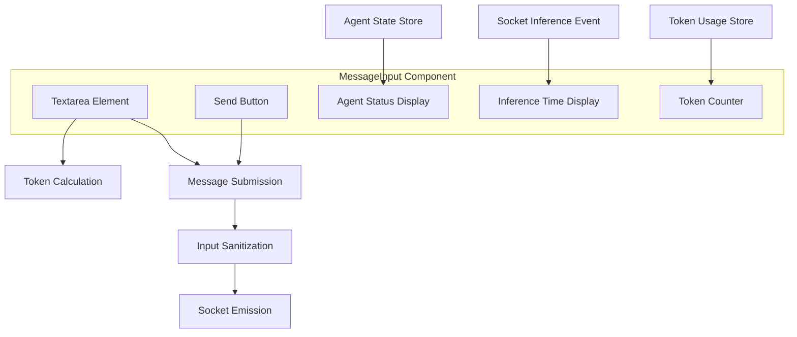
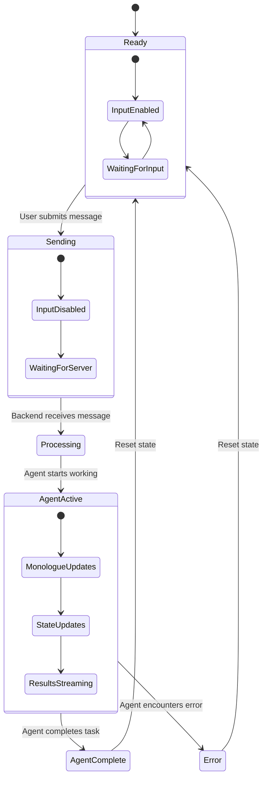
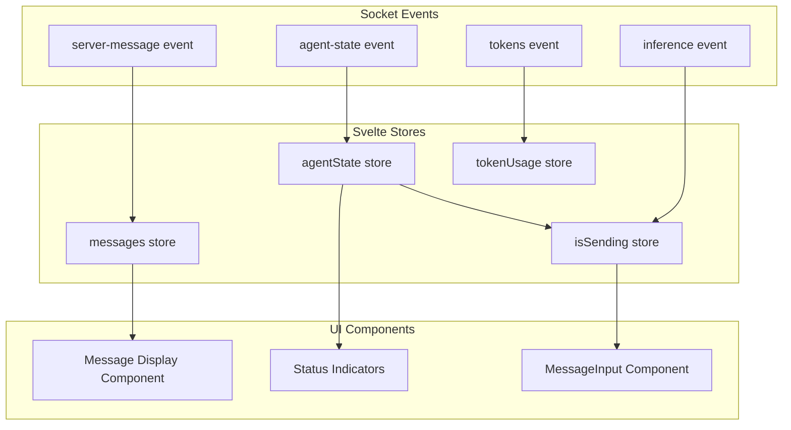

<!-- source: DeepWiki mcp.deepwiki.com · repo stitionai/devika · page 6.2 Chat Interface · fetched 2026-10-26 -->

# Chat Interface

Relevant source files

The following files were used as context for generating this wiki page:

- [ui/src/lib/components/MessageInput.svelte](ui/src/lib/components/MessageInput.svelte)
- [ui/src/lib/components/ui/sonner/sonner.svelte](ui/src/lib/components/ui/sonner/sonner.svelte)
- [ui/src/lib/sockets.js](ui/src/lib/sockets.js)

The Chat Interface is the primary means of communication between users and Devika's agent system. This document explains how users interact with Devika through the chat interface, how messages are processed, and how the interface provides feedback during agent execution.

For information about the editor and terminal interfaces, see [Editor and Terminal](#6.3). For details on the overall UI architecture, see [Frontend Architecture](#2.3).

## Overview

The chat interface provides a conversational experience allowing users to:
- Send instructions to Devika as natural language messages
- View agent responses and generated code
- Monitor agent status and internal thought processes
- Track token usage and model inference time

Sources: [ui/src/lib/components/MessageInput.svelte:1-139](), [ui/src/lib/sockets.js:1-93]()

## Components of the Chat Interface

### Message Input

The message input component allows users to type and send instructions to Devika. It includes:

1. A textarea for entering messages
2. A token counter showing the estimated token usage
3. A send button for submitting messages
4. Status indicators for agent state and model inference time

The component handles several important functions:
- Sanitizing user input to prevent XSS attacks
- Tracking token count for user awareness
- Disabling input while the agent is processing
- Providing visual feedback on agent status

Sources: [ui/src/lib/components/MessageInput.svelte:1-139]()

### Message Flow

When a user sends a message through the chat interface, it follows this process:

1. User types a message and presses Enter or clicks the send button
2. Input is sanitized using DOMPurify and HTML escaping
3. Message is sent via Socket.IO to the backend with project and model information
4. Backend processes the message through the agent system
5. Agent responses and status updates are sent back via Socket.IO
6. Frontend updates the UI with new messages and status information

Sources: [ui/src/lib/components/MessageInput.svelte:36-64](), [ui/src/lib/sockets.js:8-73]()

## Feedback and Notifications

The chat interface provides several types of feedback to keep the user informed:

### Status Indicators

1. **Agent Status**: Shows whether the agent is active or inactive
2. **Inference Time**: Displays how long model inference takes in seconds
3. **Token Counter**: Shows the estimated token count of the current message

### Toast Notifications

The system uses toast notifications to display:
- Error messages (e.g., model connection failures)
- Warning messages (e.g., potential issues with execution)
- Informational messages
- Agent's internal monologue (thoughts)

These notifications appear in the bottom-left corner of the screen and provide real-time insights into the agent's processing.

Sources: [ui/src/lib/sockets.js:20-72](), [ui/src/lib/components/ui/sonner/sonner.svelte:1-22]()

## Message Input Implementation

The message input component is implemented as a Svelte component that combines several key features:

1. **Input Handling**:
   - Textarea for message entry
   - Character to token calculation
   - Enter key handling for submission

2. **Status Display**:
   - Agent status indicator (Active/Inactive)
   - Model inference time

3. **Socket Communication**:
   - Sends user messages with project and model context
   - Receives and processes agent responses

Sources: [ui/src/lib/components/MessageInput.svelte:1-139]()

## Socket Communication

The chat interface relies heavily on Socket.IO for real-time communication with the backend. The socket functions enable:

1. **Message Transmission**:
   - Sending user messages to the backend
   - Receiving agent responses

2. **State Synchronization**:
   - Updating agent state in real-time
   - Tracking token usage
   - Monitoring model inference time

3. **Error Handling**:
   - Displaying toast notifications for errors and warnings
   - Communicating system status to the user

The `sockets.js` module provides the following key functions:

| Function | Purpose |
|----------|---------|
| `initializeSockets()` | Sets up socket connection and event listeners |
| `destroySockets()` | Cleans up socket connections and listeners |
| `emitMessage(channel, message)` | Sends a message to the server on the specified channel |
| `socketListener(channel, callback)` | Sets up a custom event listener for the specified channel |

Sources: [ui/src/lib/sockets.js:1-93]()

## User Experience Flow

Sources: [ui/src/lib/components/MessageInput.svelte:36-64](), [ui/src/lib/sockets.js:8-73]()

## Integration with Stores and State Management

The chat interface integrates with several Svelte stores to maintain state:

1. **messages**: Stores the conversation history
2. **agentState**: Tracks the current state of the agent
3. **isSending**: Boolean flag that indicates if a message is being processed
4. **tokenUsage**: Tracks token consumption by the models

These stores allow the UI to reactively update as the agent processes user requests and generates responses.

Sources: [ui/src/lib/sockets.js:2-4](), [ui/src/lib/components/MessageInput.svelte:4-18]()

## Security Considerations

The chat interface implements several security measures:

1. **Input Sanitization**: Uses DOMPurify to sanitize user input and prevent XSS attacks
2. **HTML Escaping**: Escapes special HTML characters to prevent injection attacks
3. **Input Validation**: Ensures input is not empty before sending

These measures help protect the system from potentially malicious inputs.

Sources: [ui/src/lib/components/MessageInput.svelte:22-50]()

## Summary

The Chat Interface is a crucial component of Devika that enables natural language interaction with the agent system. It processes user messages, displays agent responses, and provides real-time feedback on agent status and performance. The interface leverages Socket.IO for real-time communication and implements reactive UI updates using Svelte stores and components.

---

