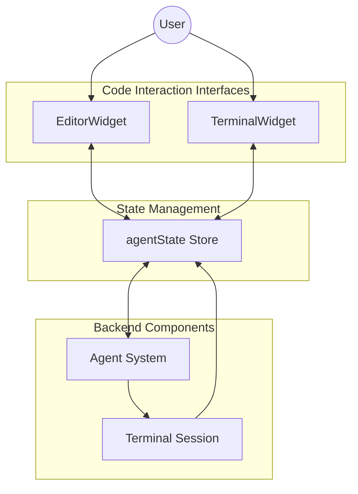
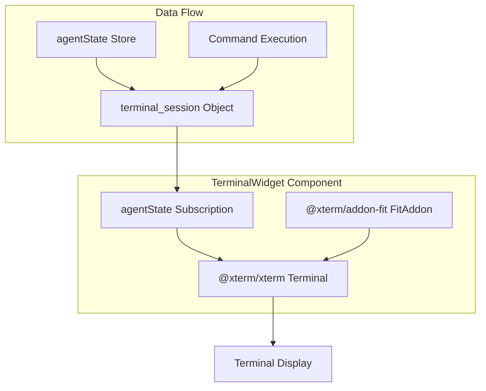
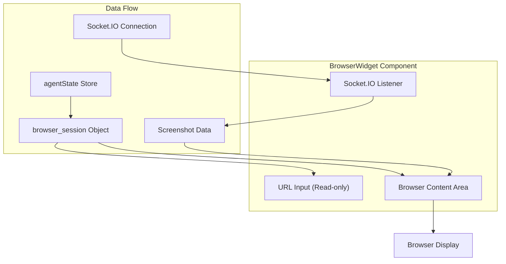
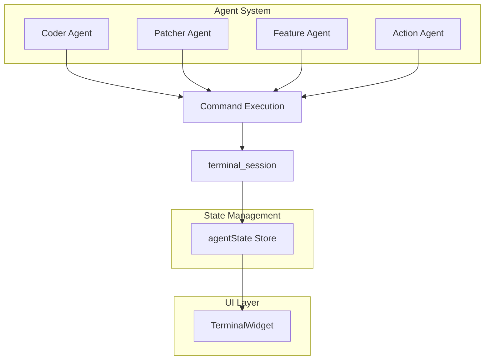

<!-- source: DeepWiki mcp.deepwiki.com · repo stitionai/devika · page 6.3 Editor and Terminal · fetched 2026-10-26 -->

# Editor and Terminal

Relevant source files

The following files were used as context for generating this wiki page:

- [ui/src/lib/components/BrowserWidget.svelte](ui/src/lib/components/BrowserWidget.svelte)
- [ui/src/lib/components/TerminalWidget.svelte](ui/src/lib/components/TerminalWidget.svelte)
- [ui/src/routes/+layout.js](ui/src/routes/+layout.js)

This document provides a detailed explanation of the Editor and Terminal interfaces in Devika, which enable users to view and interact with code. These interfaces are critical components of the user experience, allowing users to inspect code generated by Devika's agents and view the output of commands executed in the terminal.

For information about the main chat interface, see [Chat Interface](#6.2).

## Overview of Code Interaction Interfaces

Devika provides two primary interfaces for interacting with code:

1. **Editor Interface** - For viewing and potentially editing code files
2. **Terminal Interface** - For viewing command execution and output

These components work together with the rest of the UI to provide a comprehensive development environment within Devika.

Sources: [ui/src/lib/components/TerminalWidget.svelte:1-103]()

## Terminal Interface

The Terminal interface provides a way to view commands executed by Devika and their output. It's implemented as a simulated terminal that displays command history and results in a familiar terminal-like interface.

### Terminal Features

- Displays commands executed by the agent
- Shows command output in a scrollable terminal window
- Updates automatically as new commands are executed
- Visual styling that mimics a native terminal application
- Read-only interface (user input is disabled)

### Technical Implementation

The Terminal is implemented using the XTerm.js library, which provides a terminal emulator for the web. The component subscribes to the `agentState` store to receive updates about terminal sessions.

Sources: [ui/src/lib/components/TerminalWidget.svelte:1-103]()

### Terminal Widget Structure

The TerminalWidget is structured with the following components:

| Component | Purpose |
|-----------|---------|
| Terminal title bar | Displays the terminal title with decorative window dots |
| Terminal content | XTerm.js terminal emulator showing commands and output |
| FitAddon | Ensures the terminal properly fits its container |

The terminal receives its data through the `agentState` store, specifically from the `terminal_session` object which contains:
- `command`: The current/last command being executed
- `output`: The output of the command
- `title`: The title to display in the terminal window

### Code Implementation

The TerminalWidget is implemented in Svelte and initializes an XTerm.js terminal that subscribes to the `agentState` store. When new terminal session data is received, it updates the display with the command and output.

Key implementation details:
- Terminal instantiation occurs in the `onMount` lifecycle function
- Terminal theme is derived from CSS variables for consistent styling
- The widget subscribes to the `agentState` store and updates when changes occur
- Only displays changes (compares with previous state)
- Uses `FitAddon` to ensure proper terminal sizing

Sources: [ui/src/lib/components/TerminalWidget.svelte:1-103]()

## Browser Widget

While not directly part of the Editor and Terminal interfaces, the Browser Widget complements these interfaces by providing a way to view web content. This is particularly useful for research tasks or viewing documentation.

### Browser Widget Features

- Displays screenshots of web pages
- Shows the current URL in a read-only address bar
- Receives screenshots via Socket.IO
- Visual styling that mimics a web browser

Sources: [ui/src/lib/components/BrowserWidget.svelte:1-50]()

## Integration with Agent System

The Editor and Terminal interfaces are tightly integrated with Devika's agent system, particularly with the Coder, Patcher, and Feature agents that generate and modify code.

### Terminal-Agent Integration

Sources: [ui/src/lib/components/TerminalWidget.svelte:1-103]()

## User Interface Elements

The Terminal and Browser widgets share a similar visual design that mimics native desktop applications:

1. **Window chrome** - Both widgets feature a title bar with:
   - Three decorative dots mimicking window control buttons 
   - A title area displaying either "Terminal" or the current URL
   
2. **Content area** - The main display area showing:
   - Terminal: Command output with simulated prompt
   - Browser: Screenshot of web content

3. **Styling** - Customizable through CSS variables:
   - Terminal colors for background, foreground, cursor
   - Window chrome and border styling

This consistent design provides a familiar interface for users while maintaining a cohesive look and feel.

Sources: 
- [ui/src/lib/components/TerminalWidget.svelte:70-85]()
- [ui/src/lib/components/BrowserWidget.svelte:13-39]()

## Technical Specifics

### Terminal Widget Implementation

The TerminalWidget uses XTerm.js with the following configuration:

| Setting | Value | Purpose |
|---------|-------|---------|
| disableStdin | true | Makes terminal read-only |
| cursorBlink | true | Visual indicator of terminal activity |
| convertEol | true | Proper line ending conversion |
| theme | Customized | Matches application theme via CSS variables |

The terminal subscribes to the `agentState` store and updates when:
- A new command is executed
- New output is generated
- The terminal title changes

The component handles resizing via the FitAddon to ensure the terminal properly fits its container regardless of window size.

Sources: [ui/src/lib/components/TerminalWidget.svelte:16-29]()

### Browser Widget Implementation

The BrowserWidget:
- Displays screenshots from browser sessions
- Updates the URL display based on the current browser session
- Receives screenshot updates via Socket.IO events
- Provides a placeholder tip when no screenshot is available

Sources: [ui/src/lib/components/BrowserWidget.svelte:1-50]()

## Single-Page Application Architecture

It's worth noting that Devika uses a client-side rendering approach, as evidenced by the `+layout.js` file setting `ssr = false`. This means all UI components, including the Editor and Terminal interfaces, are rendered on the client side after the application loads.

Sources: [ui/src/routes/+layout.js:1-2]()

## Conclusion

The Editor and Terminal interfaces in Devika provide essential tools for viewing and interacting with code. The Terminal widget offers a familiar command-line experience for viewing command execution and output, while the Browser widget complements these interfaces by providing access to web content.

These interfaces are tightly integrated with Devika's agent system, ensuring that users can observe and interact with the work being done by the AI agents. The consistent design and real-time updates create a seamless experience for users working with Devika.

---

