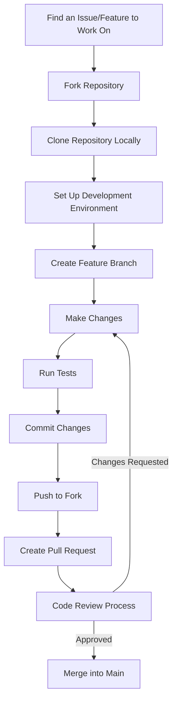
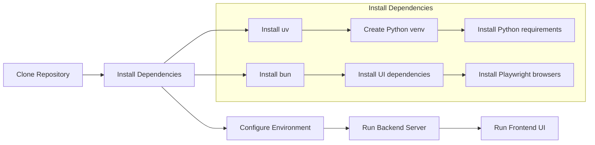
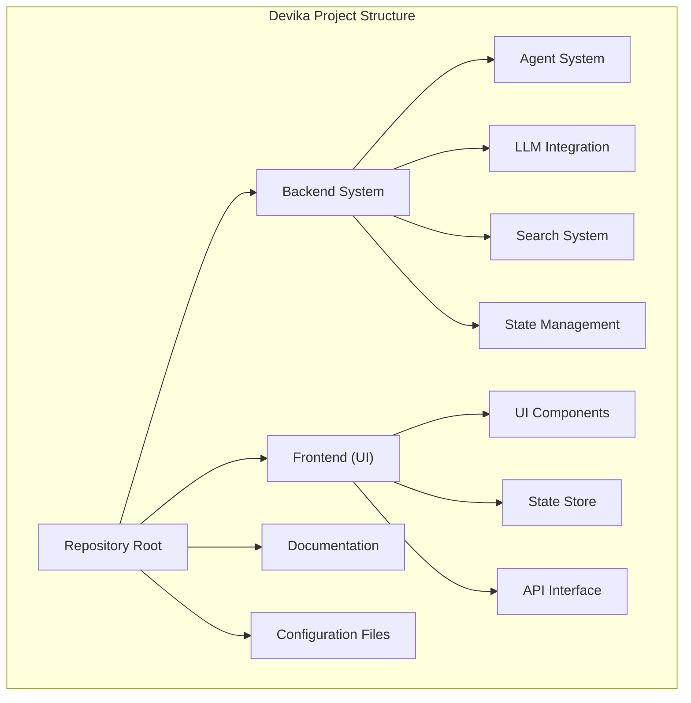
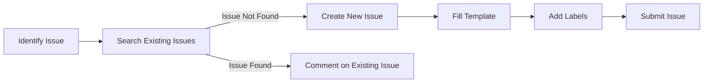
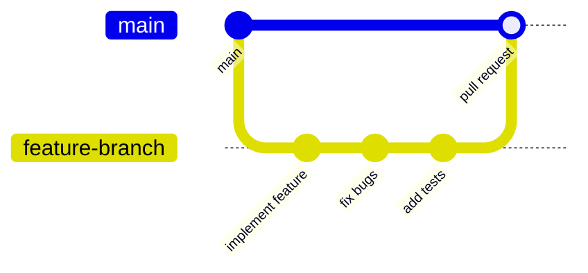
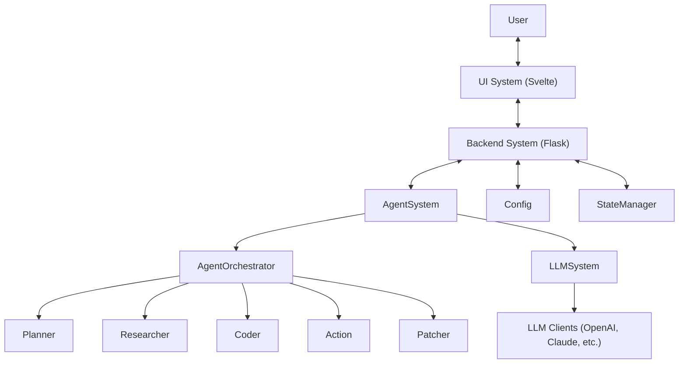
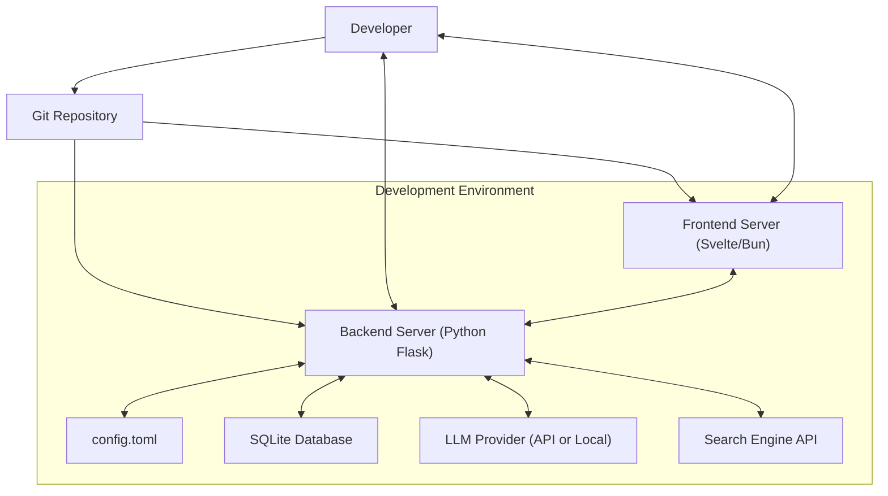

<!-- source: DeepWiki mcp.deepwiki.com · repo stitionai/devika · page 9 Contributing · fetched 2026-10-26 -->

# Contributing

<details>
<summary>Relevant source files</summary>

The following files were used as context for generating this wiki page:

- [.github/ISSUE_TEMPLATE/feature_request.md](.github/ISSUE_TEMPLATE/feature_request.md)
- [.github/ISSUE_TEMPLATE/issue.md](.github/ISSUE_TEMPLATE/issue.md)
- [.gitignore](.gitignore)
- [README.md](README.md)

</details>


This document provides guidelines for contributing to the Devika project, an agentic AI software engineer. It outlines the process for reporting issues, suggesting features, setting up a development environment, and submitting code contributions.

## Overview of the Contribution Process

The Devika project welcomes contributions from developers of all skill levels. Whether you're fixing a bug, adding a feature, or improving documentation, your help is appreciated!



Sources: [README.md:155-157]()

## Setting Up Development Environment

To contribute to Devika, you'll need to set up a local development environment. The project requires specific versions of Python, Node.js, and other tools.

### Prerequisites

- Python >= 3.10 and < 3.12
- Node.js >= 18
- bun (JavaScript runtime)
- uv (Python package manager)
- Optional: Ollama (for local LLM testing)

### Setup Steps



Follow these steps to set up your development environment:

1. **Fork and clone the repository**:
   ```bash
   git clone https://github.com/YOUR_USERNAME/devika.git
   cd devika
   ```

2. **Set up the Python environment**:
   ```bash
   uv venv
   source .venv/bin/activate  # On Windows: .venv\Scripts\activate
   uv pip install -r requirements.txt
   ```

3. **Install Playwright for browser capabilities**:
   ```bash
   playwright install --with-deps
   ```

4. **Set up the frontend environment**:
   ```bash
   cd ui/
   bun install
   ```

5. **Configure the application**:
   - Copy `sample.config.toml` to `config.toml` and add your API keys as needed
   - For full functionality, set up API keys for LLM providers and search engines

Sources: [README.md:58-152]()

## Project Structure

Understanding the codebase structure will help you make effective contributions.



Key components for contributors to understand:

- **Agent System**: The core of Devika that orchestrates different specialized agents
- **LLM Integration**: Abstractions for working with various language models
- **Frontend**: Svelte-based UI system with components for interaction
- **Search System**: Components for performing web searches and research
- **Configuration**: System for managing API keys and settings

Sources: [README.md:51-53]()

## Reporting Issues

When reporting issues, please use the issue template provided in the repository.

1. Check if a similar issue already exists
2. Use the issue template to provide:
   - A clear description of the issue
   - Steps to reproduce
   - Expected behavior
   - Screenshots and logs
   - Configuration details



Sources: [.github/ISSUE_TEMPLATE/issue.md:1-38]()

## Suggesting Features

For feature suggestions, use the feature request template.

1. Describe the problem the feature would solve
2. Explain your proposed solution
3. Mention any alternatives you've considered
4. Provide additional context if needed

Sources: [.github/ISSUE_TEMPLATE/feature_request.md:1-21]()

## Code Contribution Guidelines

### Branching Strategy



1. Create a branch from `main` with a descriptive name
2. Make your changes in small, focused commits
3. Keep your branch updated with the main branch
4. Submit a pull request when ready

### Coding Standards

The project follows these general coding standards:

- Follow PEP 8 style guide for Python code
- Use type hints in Python code
- Write descriptive commit messages
- Include comments and docstrings where appropriate
- Write tests for new features and bug fixes

### Pull Request Process

1. Ensure your code passes all tests
2. Update documentation as needed
3. Submit your pull request with a clear description of the changes
4. Be responsive to feedback and code review comments
5. Make requested changes and update your pull request

## Architecture Overview for Contributors

To effectively contribute, it's important to understand how the different components of Devika relate to each other.



Sources: [README.md:51-53]()

## Testing

Before submitting a pull request, ensure:

1. All tests pass
2. New features have appropriate test coverage
3. Existing functionality is not broken
4. The application can start and run correctly

## Documentation

Contributions to documentation are highly valuable:

1. Ensure README and other documentation is kept up to date
2. Document new features, APIs, or changes to behavior
3. Add or update comments and docstrings in code
4. Consider updating the wiki when adding significant features

## Community and Communication

Join the community to discuss development and get help:

- GitHub Discussions: [https://github.com/stitionai/devika/discussions](https://github.com/stitionai/devika/discussions)
- Discord Server: Use the invite link from the README to join the community Discord

Sources: [README.md:160-163]()

## Development Environment Structure

This diagram shows how the development environment components relate to each other:



Sources: [README.md:72-114](), [.gitignore:1-163]()

## License

The Devika project is released under the MIT License. By contributing to the project, you agree to license your contributions under the same license.

Sources: [README.md:165-167]()