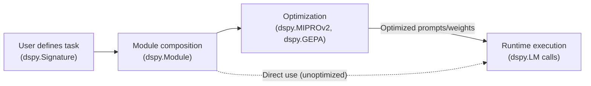
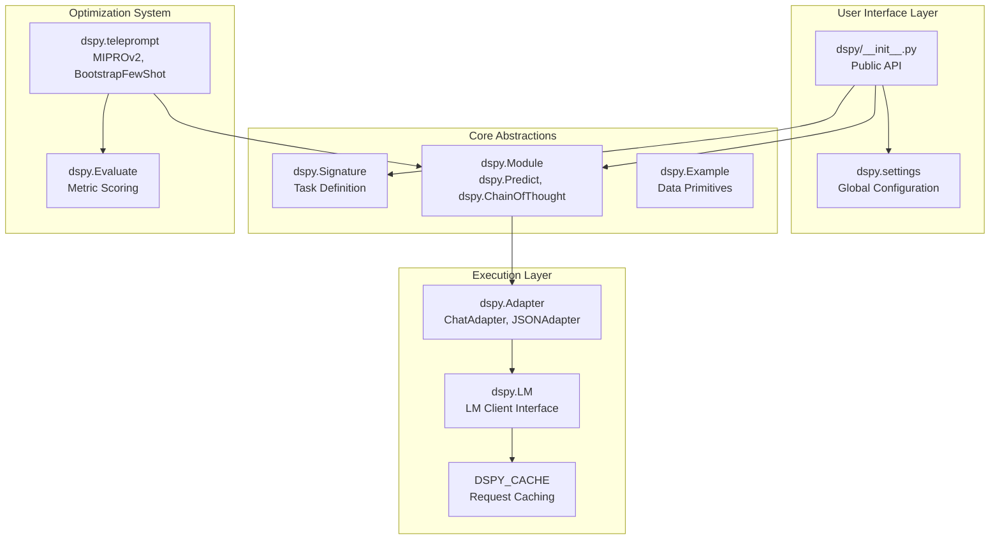
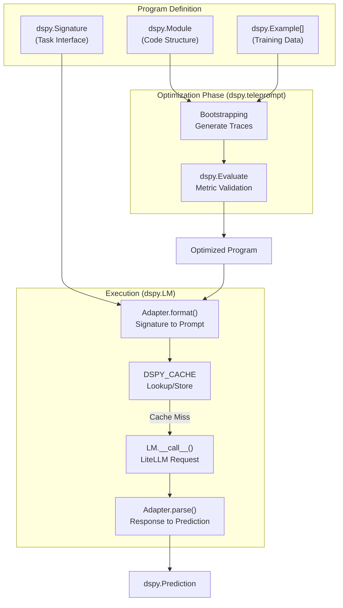

<!-- source: DeepWiki mcp.deepwiki.com · repo stanfordnlp/dspy · page 1 Overview · fetched 2026-10-26 -->

# Overview

Relevant source files

The following files were used as context for generating this wiki page:

- [README.md](README.md)
- [docs/docs/index.md](docs/docs/index.md)
- [docs/docs/static/img/logos/microsoft-ai.svg](docs/docs/static/img/logos/microsoft-ai.svg)
- [docs/docs/stylesheets/extra.css](docs/docs/stylesheets/extra.css)
- [dspy/__init__.py](dspy/__init__.py)
- [dspy/adapters/__init__.py](dspy/adapters/__init__.py)
- [dspy/adapters/types/__init__.py](dspy/adapters/types/__init__.py)

## Purpose and Scope

This page provides a high-level introduction to DSPy, a framework for programming—rather than prompting—language models. It covers the core philosophy, architectural layers, and high-level capabilities of the system. For detailed information on specific topics, see:

- Core concepts and programming model: [Introduction & Core Concepts](#1.1)
- Practical examples and patterns: [Use Cases & Applications](#1.2)
- Getting started guide: [Installation & Quick Start](#1.3)
- Deep dive into architecture: [Core Architecture](#2)
- Building programs: [Building DSPy Programs](#3)
- Optimization details: [Program Optimization](#4)

**Sources:** [README.md:1-89](), [dspy/__init__.py:1-65]()

---

## What is DSPy?

DSPy (Declarative Self-improving Python) is a framework that enables **programming language models through compositional code** rather than manual prompt engineering [README.md:16-18](). The core philosophy distinguishes it from traditional prompting approaches:

| Traditional Prompting | DSPy Programming |
|----------------------|-----------------|
| Hand-crafted string templates | Declarative `Signature` definitions |
| Brittle, model-specific prompts | Portable, model-agnostic modules |
| Manual few-shot example curation | Automatic example synthesis via optimizers |
| Trial-and-error iteration | Metric-driven compilation |

The framework is named for its declarative nature—users specify *what* the LM should do (via signatures) rather than *how* to prompt it [README.md:18](). The "self-improving" aspect refers to DSPy's **optimizers** (formerly called "teleprompters"), which automatically tune prompts and weights to maximize user-defined metrics [README.md:16-18]().

Title: DSPy Compile-Then-Run Philosophy

**Sources:** [README.md:7-18](), [dspy/__init__.py:1-5]()

---

## System Architecture

DSPy is organized into layers responsible for distinct concerns, from high-level user APIs to low-level LM interaction.

Title: Architectural Layers of DSPy

### Layer Descriptions

| Layer | Primary Components | Responsibility |
|-------|-------------------|----------------|
| **User Interface** | `dspy/__init__.py`, `dspy.settings` | Public API aggregation and global configuration management [dspy/__init__.py:1-53](), [dspy/__init__.py:58-60](). |
| **Core Abstractions** | `Signature`, `Module`, `Example` | Programming model: task definitions and modular composition [dspy/__init__.py:2-4](). |
| **Execution** | `Adapter`, `LM`, `DSPY_CACHE` | LM interaction, prompt formatting via adapters, and automatic request caching [dspy/adapters/__init__.py:1-24](), [dspy/__init__.py:52-64](). |
| **Optimization** | `Evaluate`, `teleprompt` | Automatic prompt and weight tuning based on metrics [dspy/__init__.py:5-7](). |

**Sources:** [dspy/__init__.py:1-65](), [dspy/adapters/__init__.py:1-24]()

---

## Core Programming Model

DSPy programs are built from three fundamental abstractions:

### Signatures: Task Specification
A `Signature` defines the input/output schema for a task. It decouples the *intent* of the task from the *implementation* of the prompt [dspy/__init__.py:4]().

### Modules: Composable Components
`dspy.Module` is the base class for all DSPy programs [dspy/__init__.py:2](). The framework provides built-in modules for different reasoning strategies:
- `dspy.Predict`: Basic signature-to-output mapping [dspy/__init__.py:1]().
- `dspy.Reasoning`: A type used to support both native and prompt-based reasoning steps [dspy/adapters/types/reasoning.py:7-10]().
- `dspy.Tool`: Wraps Python functions for agentic interaction [dspy/adapters/types/tool.py:8-9]().

### Optimizers: Automatic Improvement
Optimizers (aliased from `teleprompt`) tune the parameters of a DSPy program (prompts or weights) to maximize a metric [dspy/__init__.py:5]().
- **Prompt Optimizers**: `MIPROv2`, `GEPA`, `BootstrapFewShotWithRandomSearch` (aliased as `BootstrapRS`) [dspy/__init__.py:62]().
- **Evaluation**: The `Evaluate` class provides the infrastructure for metric scoring [dspy/__init__.py:8]().

**Sources:** [dspy/__init__.py:1-65](), [dspy/adapters/types/reasoning.py:7-10](), [dspy/adapters/types/tool.py:8-9]()

---

## Data Flow Through the System

The following diagram illustrates how data flows from user code through the compilation (optimization) phase to runtime execution, specifically highlighting how `dspy.Adapter` bridges the signature to the LM.

Title: Data Flow from Definition to Execution

**Sources:** [dspy/__init__.py:1-10](), [dspy/adapters/base.py:1-6](), [dspy/adapters/types/tool.py:8-9]()

---

## High-Level Capabilities

| Capability | Description |
|------------|-------------|
| **Multi-Model Support** | Unified interface for various providers via `dspy.clients` and LiteLLM integration [dspy/__init__.py:9](). |
| **Reasoning Strategies** | Native support for `Reasoning` types that adapt to model-specific features [dspy/adapters/types/reasoning.py:7-10](). |
| **Tool Integration** | Automatic inference of tool schemas from Python functions using `dspy.Tool` [dspy/adapters/types/tool.py:8-9](). |
| **Typed Interaction** | Support for complex types including `Image`, `Audio`, `File`, `Code`, and `ToolCalls` [dspy/adapters/__init__.py:5-6](). |
| **Async & Streaming** | Native utilities like `asyncify`, `syncify`, and `streamify` for high-performance execution [dspy/__init__.py:45-48](). |

**Sources:** [dspy/__init__.py:1-65](), [dspy/adapters/types/reasoning.py:7-10](), [dspy/adapters/types/tool.py:8-9]()

---

## Getting Started

To begin using DSPy, proceed to:

1. **[Installation & Quick Start](#1.3)** — Set up the library via `pip install dspy` and configure your first LM [README.md:27-32]().
2. **[Introduction & Core Concepts](#1.1)** — Learn about Signatures, Modules, and the declarative programming model.
3. **[Use Cases & Applications](#1.2)** — Explore patterns for RAG, Agents, and classification.
4. **[Program Optimization](#4)** — Understand how to use `MIPROv2`, `GEPA`, and other optimizers to improve your programs.

**Sources:** [README.md:27-38](), [dspy/__init__.py:1-65]()

---

