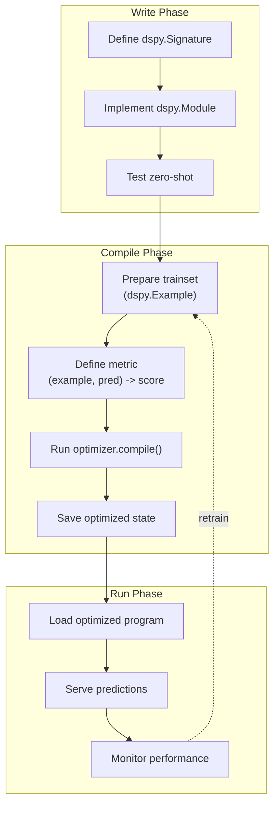
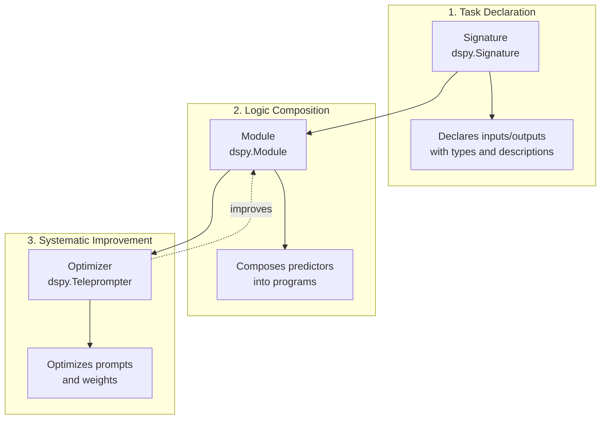
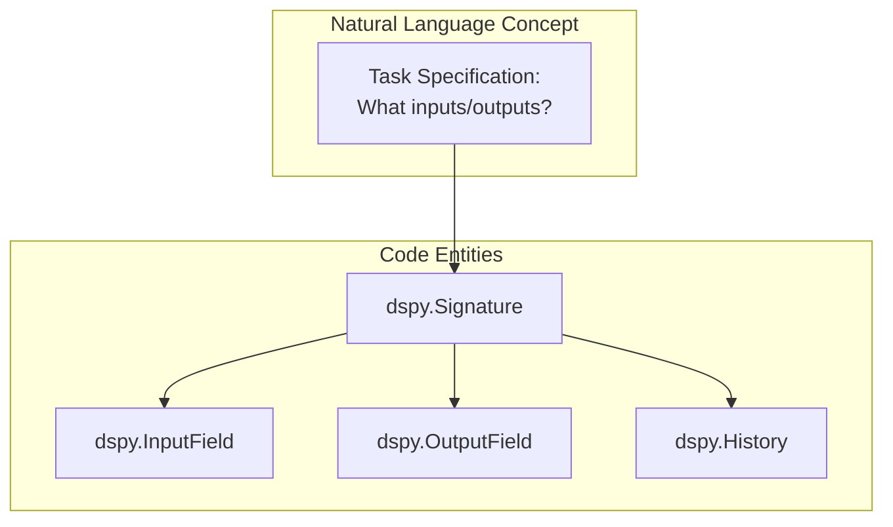
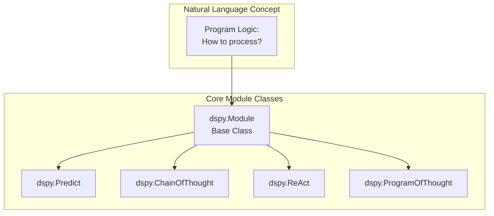
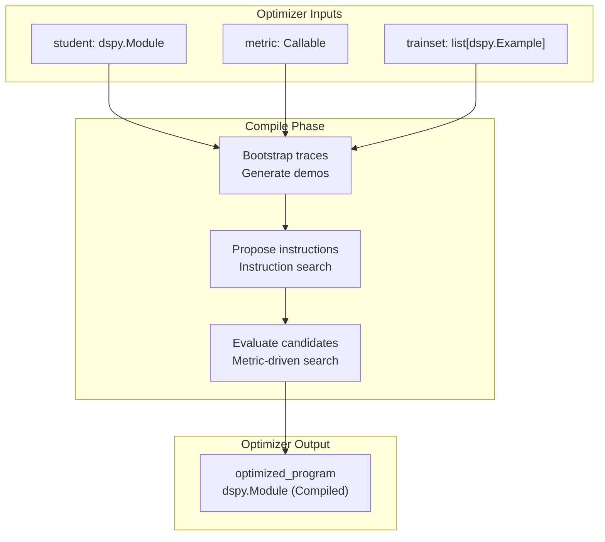

<!-- source: DeepWiki mcp.deepwiki.com · repo stanfordnlp/dspy · page 1.1 Introduction & Core Concepts · fetched 2026-10-26 -->

# Introduction & Core Concepts

<details>
<summary>Relevant source files</summary>

The following files were used as context for generating this wiki page:

- [README.md](README.md)
- [docs/docs/learn/index.md](docs/docs/learn/index.md)
- [docs/docs/learn/programming/modules.md](docs/docs/learn/programming/modules.md)
- [docs/docs/learn/programming/overview.md](docs/docs/learn/programming/overview.md)
- [docs/docs/tutorials/build_ai_program/index.md](docs/docs/tutorials/build_ai_program/index.md)
- [docs/docs/tutorials/conversation_history/index.md](docs/docs/tutorials/conversation_history/index.md)
- [docs/docs/tutorials/core_development/index.md](docs/docs/tutorials/core_development/index.md)
- [docs/docs/tutorials/index.md](docs/docs/tutorials/index.md)
- [docs/docs/tutorials/optimize_ai_program/index.md](docs/docs/tutorials/optimize_ai_program/index.md)
- [docs/docs/tutorials/program_of_thought/index.ipynb](docs/docs/tutorials/program_of_thought/index.ipynb)
- [docs/docs/tutorials/rl_ai_program/index.md](docs/docs/tutorials/rl_ai_program/index.md)
- [docs/mkdocs.yml](docs/mkdocs.yml)
- [docs/overrides/partials/tabs.html](docs/overrides/partials/tabs.html)

</details>


This page introduces DSPy's core philosophy and fundamental abstractions. It explains the framework's declarative programming paradigm for language models and presents the three key concepts—Signatures, Modules, and Optimizers—that enable systematic development of AI systems.

---

## Core Philosophy: Programming, Not Prompting

DSPy reframes language model interaction from **brittle prompt engineering** to **systematic program development**. Instead of manually crafting and tweaking prompts, developers write compositional Python code that declares what the system should accomplish. DSPy then automatically generates and optimizes the prompts and model weights needed to achieve high-quality outputs [README.md:16-18]().

### The Compile-Then-Run Model

DSPy introduces a **compilation paradigm** for LM programs, analogous to traditional programming languages:

1.  **Write declarative code:** Define program structure using `dspy.Signature` [docs/docs/learn/programming/modules.md:18-18]() and `dspy.Module` [docs/docs/learn/programming/modules.md:7-13]().
2.  **Compile with optimizer:** Use algorithms to improve the program by tuning prompts or fine-tuning weights based on a metric [docs/docs/learn/index.md:13-14]().
3.  **Deploy optimized artifact:** Run the compiled program in production. The DSPy compiler handles the mapping of your declarative logic to the specific LM's optimal prompt format [docs/docs/learn/programming/overview.md:16-19]().

This separates the **declarative logic** (what to do) from the **optimized implementation** (how to prompt the specific LM) [docs/docs/learn/programming/overview.md:16-19]().

**Compile-Then-Run Workflow Diagram**



**Sources:** [docs/docs/learn/index.md:7-15](), [docs/docs/learn/programming/overview.md:16-19](), [README.md:16-18]()

---

## The Three Core Abstractions

DSPy's architecture centers on three complementary abstractions that separate concerns and enable systematic development.



**Sources:** [README.md:16-18](), [docs/docs/learn/programming/overview.md:16-19](), [docs/docs/learn/programming/modules.md:7-13]()

---

## Abstraction 1: Signatures

A **Signature** is a declarative specification of a task's input and output structure. It defines what fields the LM receives and what it should produce, along with optional descriptions and constraints [docs/docs/learn/programming/modules.md:18-18]().

### Defining Signatures

Signatures can be created in two ways:

**String notation** for simple cases [docs/docs/learn/programming/modules.md:23-26]():
```python
# Format: "input1, input2 -> output1, output2"
classify = dspy.Predict("sentence -> sentiment: bool")
```

**Class notation** for structured definitions with metadata [docs/docs/learn/programming/modules.md:142-148]():
```python
class Classify(dspy.Signature):
    """Classify sentiment of a given sentence.""" # Task description
    
    sentence: str = dspy.InputField()
    sentiment: Literal['positive', 'negative', 'neutral'] = dspy.OutputField()
```

### Key Components

| Component | Purpose | File Reference |
| :--- | :--- | :--- |
| `dspy.InputField` | Declares input parameters and descriptions | [docs/docs/learn/programming/modules.md:145-145]() |
| `dspy.OutputField` | Declares expected outputs and constraints | [docs/docs/learn/programming/modules.md:146-147]() |
| `dspy.History` | Manages conversation turns as an input field | [docs/docs/tutorials/conversation_history/index.md:17-20]() |
| Type Hints | Enforce output structure (e.g., `float`, `list[str]`) | [docs/docs/learn/programming/modules.md:103-103]() |

**Signature System Architecture**



**Sources:** [docs/docs/learn/programming/modules.md:18-160](), [docs/docs/tutorials/conversation_history/index.md:3-23]()

---

## Abstraction 2: Modules

A **Module** is a building block for programs that use LMs. Each built-in module abstracts a specific prompting technique (like Chain of Thought) and is generalized to handle any signature [docs/docs/learn/programming/modules.md:7-13]().

### Core Module Types [docs/docs/learn/programming/modules.md:80-95]()

| Module Type | Purpose |
| :--- | :--- |
| `dspy.Predict` | Basic predictor; handles instructions and demonstrations. |
| `dspy.ChainOfThought` | Teaches the LM to think step-by-step (adds `reasoning` field). |
| `dspy.ProgramOfThought` | Teaches the LM to output code for execution via a sandbox. |
| `dspy.ReAct` | An agent loop that can use tools to implement a signature. |
| `dspy.RLM` | Recursive Language Model for exploring large contexts. |

**Module Hierarchy**



**Sources:** [docs/docs/learn/programming/modules.md:7-95](), [docs/docs/tutorials/program_of_thought/index.ipynb:9-31]()

---

## Abstraction 3: Optimizers

An **Optimizer** tunes the parameters of a DSPy program—specifically the prompts (instructions/demonstrations) and/or the LM weights—to maximize a given metric [docs/docs/learn/index.md:13-14]().

### Optimization Strategies

*   **Few-Shot Bootstrapping:** Algorithms like `BootstrapFewShot` generate self-consistent demonstrations by running the program and filtering successful traces [README.md:50-51]().
*   **Instruction Optimization:** Algorithms like `MIPROv2` search the space of natural language instructions using Bayesian optimization [README.md:50-50]().
*   **Reflective Prompt Evolution:** `GEPA` uses reflection-based evolution to iteratively improve prompts [README.md:49-49]().

**Optimizer Compilation Process**



**Sources:** [docs/docs/learn/index.md:7-15](), [README.md:49-57](), [docs/docs/learn/programming/overview.md:16-19]()

---

