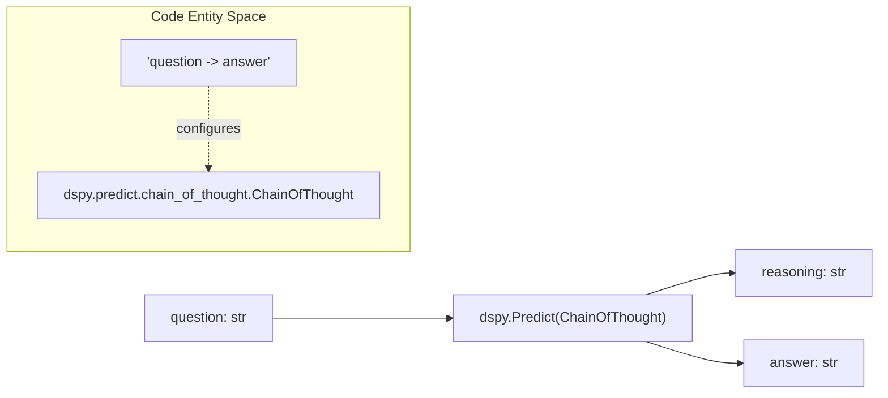
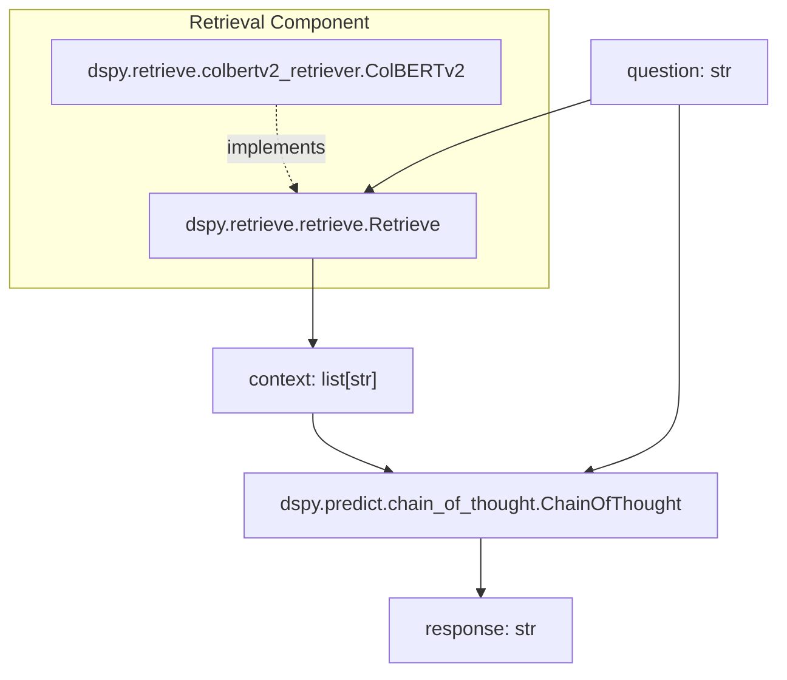
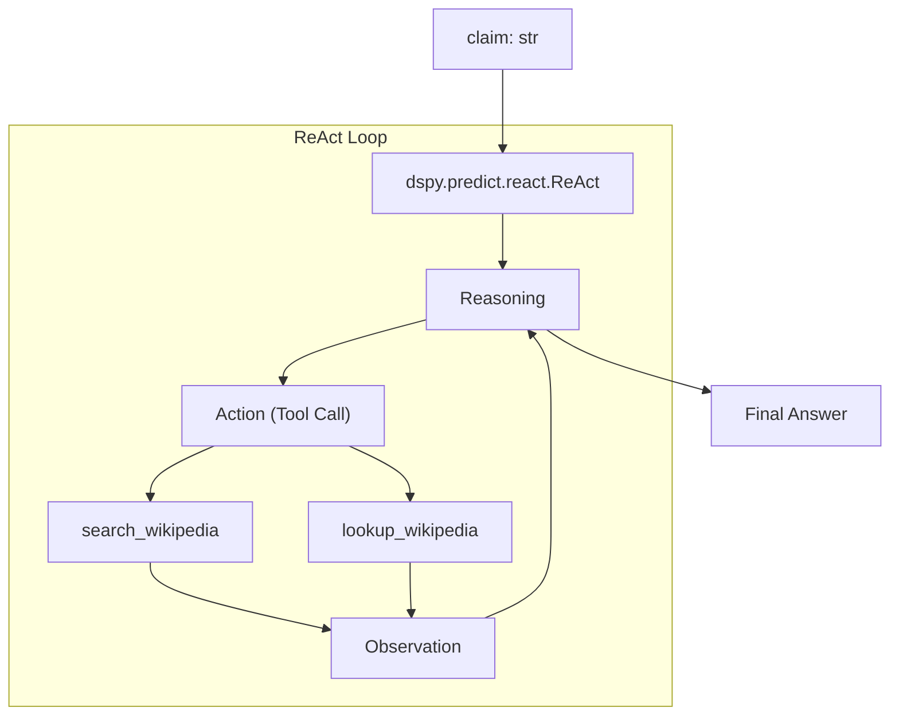
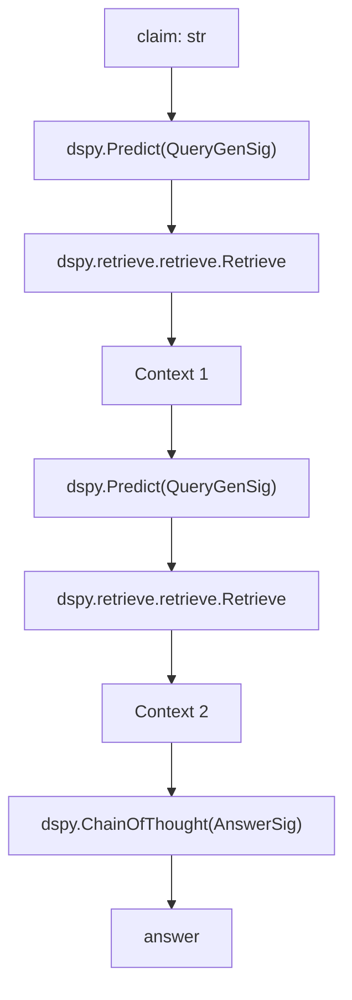

<!-- source: DeepWiki mcp.deepwiki.com · repo stanfordnlp/dspy · page 1.2 Use Cases & Applications · fetched 2026-10-26 -->

# Use Cases & Applications

<details>
<summary>Relevant source files</summary>

The following files were used as context for generating this wiki page:

- [docs/docs/community/built-with-dspy.md](docs/docs/community/built-with-dspy.md)
- [docs/docs/community/community-resources.md](docs/docs/community/community-resources.md)
- [docs/docs/community/use-cases.md](docs/docs/community/use-cases.md)
- [docs/docs/production/index.md](docs/docs/production/index.md)
- [docs/docs/static/img/logos/aws.svg](docs/docs/static/img/logos/aws.svg)
- [docs/docs/static/img/logos/databricks-wordmark.svg](docs/docs/static/img/logos/databricks-wordmark.svg)
- [docs/docs/static/img/logos/databricks.svg](docs/docs/static/img/logos/databricks.svg)
- [docs/docs/static/img/logos/dropbox-wordmark.svg](docs/docs/static/img/logos/dropbox-wordmark.svg)
- [docs/docs/static/img/logos/dropbox.svg](docs/docs/static/img/logos/dropbox.svg)
- [docs/docs/tutorials/agents/index.ipynb](docs/docs/tutorials/agents/index.ipynb)
- [docs/docs/tutorials/classification_finetuning/index.ipynb](docs/docs/tutorials/classification_finetuning/index.ipynb)
- [docs/docs/tutorials/custom_module/index.ipynb](docs/docs/tutorials/custom_module/index.ipynb)
- [docs/docs/tutorials/custom_module/mlflow-tracing-custom-module.png](docs/docs/tutorials/custom_module/mlflow-tracing-custom-module.png)
- [docs/docs/tutorials/customer_service_agent/index.ipynb](docs/docs/tutorials/customer_service_agent/index.ipynb)
- [docs/docs/tutorials/customer_service_agent/mlflow-tracing-customer-service-agent.png](docs/docs/tutorials/customer_service_agent/mlflow-tracing-customer-service-agent.png)
- [docs/docs/tutorials/deployment/index.md](docs/docs/tutorials/deployment/index.md)
- [docs/docs/tutorials/email_extraction/index.md](docs/docs/tutorials/email_extraction/index.md)
- [docs/docs/tutorials/email_extraction/mlflow-tracing-email-extraction.png](docs/docs/tutorials/email_extraction/mlflow-tracing-email-extraction.png)
- [docs/docs/tutorials/entity_extraction/index.ipynb](docs/docs/tutorials/entity_extraction/index.ipynb)
- [docs/docs/tutorials/games/index.ipynb](docs/docs/tutorials/games/index.ipynb)
- [docs/docs/tutorials/gepa_aime/mlflow-tracing-gepa-aime.png](docs/docs/tutorials/gepa_aime/mlflow-tracing-gepa-aime.png)
- [docs/docs/tutorials/gepa_aime/mlflow-tracking-gepa-aime-optimization.png](docs/docs/tutorials/gepa_aime/mlflow-tracking-gepa-aime-optimization.png)
- [docs/docs/tutorials/gepa_facilitysupportanalyzer/mlflow-tracing-gepa-support.png](docs/docs/tutorials/gepa_facilitysupportanalyzer/mlflow-tracing-gepa-support.png)
- [docs/docs/tutorials/math/index.ipynb](docs/docs/tutorials/math/index.ipynb)
- [docs/docs/tutorials/multihop_search/index.ipynb](docs/docs/tutorials/multihop_search/index.ipynb)
- [docs/docs/tutorials/rag/index.ipynb](docs/docs/tutorials/rag/index.ipynb)
- [docs/docs/tutorials/tool_use/index.ipynb](docs/docs/tutorials/tool_use/index.ipynb)

</details>


This page showcases common use cases and application patterns in DSPy, demonstrating how the framework's core abstractions (Signatures, Modules, and Optimizers) apply to real-world AI tasks. Each use case includes architectural patterns, relevant modules, and code references from the documentation.

---

## Overview of DSPy Applications

DSPy supports a wide range of AI applications through its modular, composable architecture. The framework is in production at companies like **Shopify, Databricks, Dropbox, and AWS** [docs/docs/community/use-cases.md:1-14](). It excels at tasks that benefit from systematic prompt optimization and structured workflows, particularly:

- **Multi-step reasoning** (e.g., Multi-hop search) [docs/docs/tutorials/multihop_search/index.ipynb:7-11]().
- **Tool-augmented workflows** (e.g., ReAct agents) [docs/docs/tutorials/agents/index.ipynb:7-11]().
- **Structured metadata extraction** (e.g., Shopify's 550x cost reduction via GEPA) [docs/docs/community/use-cases.md:20-25]().
- **Domain-specific reasoning** (e.g., Math, Law, Medical reports) [docs/docs/community/use-cases.md:56-57]().

**Sources:** [docs/docs/community/use-cases.md:1-71](), [docs/docs/tutorials/rag/index.ipynb:7-11]()

---

## Mathematical Reasoning

### Overview
Mathematical reasoning involves solving quantitative problems through step-by-step logic. DSPy's `dspy.ChainOfThought` module is the standard for these tasks, as it forces the LM to produce a `reasoning` trace before the final `answer` [docs/docs/tutorials/math/index.ipynb:159-161]().

### Architecture Pattern

**Diagram: Mathematical Reasoning Flow**

### Example Implementation
The documentation demonstrates solving algebra questions from the MATH benchmark [docs/docs/tutorials/math/index.ipynb:101-131](). For high precision, `dspy.ChainOfThought` is initialized with a signature string or class to define the task structure [docs/docs/tutorials/math/index.ipynb:159-160]().

```python
module = dspy.ChainOfThought("question -> answer")
response = module(question="If x + y = 10 and x - y = 2, what is x?")
```

**Sources:** [docs/docs/tutorials/math/index.ipynb:1-162](), [docs/docs/tutorials/deployment/index.md:11-12]()

---

## Retrieval-Augmented Generation (RAG)

### Overview
RAG systems enhance LM responses by retrieving relevant context from external knowledge bases. DSPy provides native integration for retrievers like `dspy.ColBERTv2` and `dspy.retrievers.Embeddings` [docs/docs/tutorials/rag/index.ipynb:11-12](), [docs/docs/tutorials/multihop_search/index.ipynb:153-162]().

### Architecture Pattern

**Diagram: RAG System Architecture**

### Implementation
A basic RAG module typically includes a retrieval step followed by a generation step using a signature like `context, question -> response` [docs/docs/tutorials/rag/index.ipynb:205-220]().

```python
import dspy
lm = dspy.LM('openai/gpt-4o-mini')
dspy.configure(lm=lm)
retriever = dspy.ColBERTv2(url='http://20.102.90.50:2017/wiki17_abstracts')
```

**Sources:** [docs/docs/tutorials/rag/index.ipynb:1-220](), [docs/docs/tutorials/multihop_search/index.ipynb:153-162]()

---

## Agent Systems & Fine-tuning

### Overview
Agents use tools and reasoning loops to solve complex tasks. DSPy's `dspy.ReAct` module implements this by consuming a signature and a list of tool functions [docs/docs/tutorials/agents/index.ipynb:192-205](), [docs/docs/tutorials/customer_service_agent/index.ipynb:13-21]().

### Architecture Pattern

**Diagram: ReAct Agent Architecture**

### Fine-tuning Agents
DSPy allows optimizing the *language model weights* (fine-tuning) within a module. For example, an agent can be taught to play games by fine-tuning a small model like `gpt-4o-mini` using trajectories from a larger teacher model like `gpt-4o` [docs/docs/tutorials/games/index.ipynb:9-13](), [docs/docs/tutorials/games/index.ipynb:73-74](). This is often implemented via `dspy.BootstrapFinetune`.

**Sources:** [docs/docs/tutorials/agents/index.ipynb:1-205](), [docs/docs/tutorials/games/index.ipynb:7-200](), [docs/docs/tutorials/customer_service_agent/index.ipynb:9-21]()

---

## Information & Entity Extraction

### Overview
Extraction tasks involve structuring unstructured text into specific fields. DSPy signatures can define multiple output fields or specific types to enforce structure, including `pydantic.BaseModel` for complex schemas [docs/docs/tutorials/entity_extraction/index.ipynb:143-146](), [docs/docs/tutorials/email_extraction/index.md:91-95]().

### Implementation Example
In email extraction, signatures are used to classify intent and extract entities like financial amounts or dates [docs/docs/tutorials/email_extraction/index.md:102-123]().

```python
class ClassifyEmail(dspy.Signature):
    """Classify the type and urgency of an email."""
    email_subject: str = dspy.InputField()
    email_body: str = dspy.InputField()
    email_type: EmailType = dspy.OutputField()
    urgency: UrgencyLevel = dspy.OutputField()
```

**Sources:** [docs/docs/tutorials/entity_extraction/index.ipynb:1-156](), [docs/docs/tutorials/email_extraction/index.md:64-145]()

---

## Multi-Hop Reasoning

### Overview
Multi-hop reasoning requires sequential steps where the output of one step informs the next, such as generating new search queries based on previously retrieved context [docs/docs/tutorials/multihop_search/index.ipynb:7-11]().

### Architecture Pattern

**Diagram: Multi-Hop Retrieval Flow**

**Sources:** [docs/docs/tutorials/multihop_search/index.ipynb:1-230](), [docs/docs/tutorials/agents/index.ipynb:84-107]()

---

## Production Deployment

### Lightweight & Production-Grade Options
DSPy programs can be deployed as REST APIs using **FastAPI** or managed through **MLflow** for versioning and tracking [docs/docs/tutorials/deployment/index.md:1-5]().

- **FastAPI:** Uses `dspy.asyncify` to convert programs for high-throughput async execution [docs/docs/tutorials/deployment/index.md:41-45](). `dspy.streamify` is used for streaming intermediate outputs [docs/docs/tutorials/deployment/index.md:70-76]().
- **MLflow:** Provides native integration for visualizing traces, logging models via `mlflow.dspy.log_model()`, and autologging [docs/docs/tutorials/deployment/index.md:149-151](), [docs/docs/tutorials/rag/index.ipynb:58-63]().

### Serialization
Programs can be saved as state-only (JSON/Pickle) or as whole programs using `dspy.Module.save` and `dspy.Module.load` mechanisms [docs/docs/tutorials/deployment/index.md:134-158]().

**Sources:** [docs/docs/tutorials/deployment/index.md:1-186](), [docs/docs/tutorials/rag/index.ipynb:28-65]()

---

