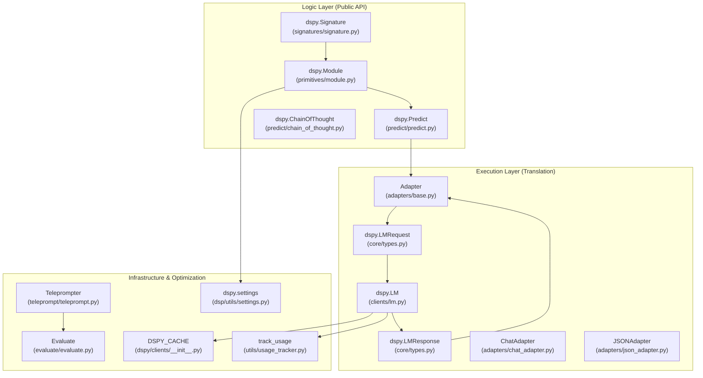
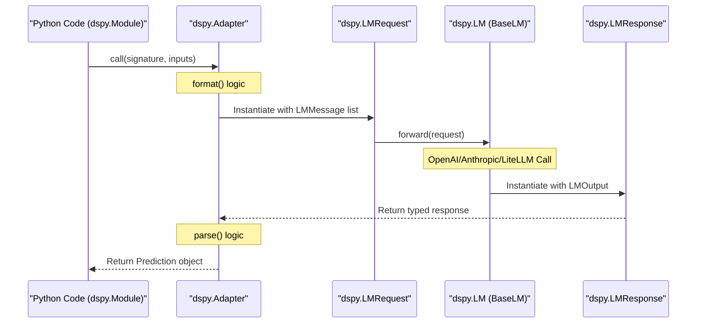

<!-- source: DeepWiki mcp.deepwiki.com · repo stanfordnlp/dspy · page 2 Core Architecture · fetched 2026-10-26 -->

# Core Architecture

Relevant source files

The following files were used as context for generating this wiki page:

- [docs/docs/community/normalized-lm-api-migration.md](docs/docs/community/normalized-lm-api-migration.md)
- [docs/overrides/main.html](docs/overrides/main.html)
- [dspy/__init__.py](dspy/__init__.py)
- [dspy/adapters/__init__.py](dspy/adapters/__init__.py)
- [dspy/adapters/types/__init__.py](dspy/adapters/types/__init__.py)
- [dspy/clients/openai_format.py](dspy/clients/openai_format.py)
- [dspy/core/__init__.py](dspy/core/__init__.py)
- [dspy/core/types.py](dspy/core/types.py)
- [tests/clients/test_lm_direct_live.py](tests/clients/test_lm_direct_live.py)
- [tests/core/test_types.py](tests/core/test_types.py)

This document provides a technical overview of DSPy's architecture, explaining how the framework's major subsystems—Signatures, Modules, Language Model Clients, Adapters, and Optimizers—fit together to enable declarative programming over foundation models.

**Scope**: This page covers the architectural patterns and component interactions that form DSPy's core. For implementation details of specific subsystems, see:
- Package organization and API surface: [Package Structure & Public API](#2.1)
- Language model integration mechanics: [Language Model Integration](#2.2)
- Signature system internals: [Signatures & Task Definition](#2.3)
- Adapter implementation details: [Adapter System](#2.4)
- Module system and base classes: [Module System & Base Classes](#2.5)
- Data primitives and example handling: [Example & Data Primitives](#2.6)

## Three-Layer Architecture

DSPy is organized into three distinct layers that separate concerns between task definition, execution, and infrastructure/optimization:

**Sources**: [dspy/__init__.py:1-40](), [dspy/core/types.py:17-47](), [dspy/adapters/__init__.py:1-23](), [dspy/utils/usage_tracker.py:49-49]()

### User-Facing Layer
The top layer exposes declarative abstractions for defining tasks. Users interact with `Signature` objects to define the "what" and `Module` objects to define the "how" [dspy/primitives/module.py:40-67]().

### Execution Layer
The middle layer handles the transition from Python objects to model-specific formats. This is powered by the **Typed LM API**, which uses standardized `LMRequest` and `LMResponse` objects to ensure provider-neutral communication [dspy/core/types.py:33-43](). Adapters like `ChatAdapter` and `JSONAdapter` bridge the gap between `Signatures` and these typed requests [dspy/adapters/__init__.py:1-7]().

### Infrastructure & Optimization
The bottom layer provides global services. `dspy.settings` manages the active LM and adapter [dspy/dsp/utils/settings.py:51-51](), while `DSPY_CACHE` provides persistence for model outputs [dspy/__init__.py:53]().

## Request Lifecycle: Code to Model Space

The following diagram traces a prediction request through the architecture, showing how Python entities map to the internal typed communication system.

**Key Code Entities**:
- `LMRequest`: The canonical container for `messages`, `tools`, and `config` sent to an LM [dspy/core/types.py:33-33]().
- `LMResponse`: The canonical container for model `outputs`, `usage`, and `provider_data` [dspy/core/types.py:34-34]().
- `LMMessage`: Represents a single turn (System, User, Assistant, or Tool) in the request [dspy/core/types.py:247-247]().

**Sources**: [dspy/core/types.py:17-47](), [dspy/clients/openai_format.py:77-85](), [docs/docs/community/normalized-lm-api-migration.md:59-62]()

## Core Subsystems

### Signature & Task Definition
Signatures define the interface of a module. They specify `InputField` and `OutputField` requirements, which the `Adapter` uses to construct prompts or JSON schemas.
*For details, see [Signatures & Task Definition](#2.3).*

### Adapter System
Adapters are the translation layer. They take a `Signature` and input data and produce an `LMRequest`. DSPy supports multiple formats, including `JSONAdapter` for structured data and `ChatAdapter` for conversational flows [dspy/adapters/__init__.py:1-7]().
*For details, see [Adapter System](#2.4).*

### Language Model Integration
DSPy uses a three-tier LM selection hierarchy (context-local, module-local, or global). The `BaseLM` class defines the `forward(request: LMRequest) -> LMResponse` contract that all new model clients must implement [docs/docs/community/normalized-lm-api-migration.md:171-179]().
*For details, see [Language Model Integration](#2.2).*

### Module System
`dspy.Module` is the base class for all programs. It manages state, including the `history` of interactions and the `named_predictors` used for optimization.
*For details, see [Module System & Base Classes](#2.5).*

### Data & Primitives
The `Example` class is the primary data structure for inputs and training data, while `Prediction` (often aliased as `Prediction`) handles the structured output from modules.
*For details, see [Example & Data Primitives](#2.6).*

## Summary of Infrastructure

- **Caching**: Controlled via `dspy.settings.cache` and the `DSPY_CACHE` singleton [dspy/__init__.py:53-65]().
- **Usage Tracking**: The `track_usage` utility monitors token consumption across nested module calls [dspy/__init__.py:49]().
- **Logging**: Managed by `configure_dspy_loggers` to provide visibility into the internal execution flow [dspy/__init__.py:56]().

**Sources**: [dspy/__init__.py:44-66](), [dspy/utils/usage_tracker.py:49-49]()

---

