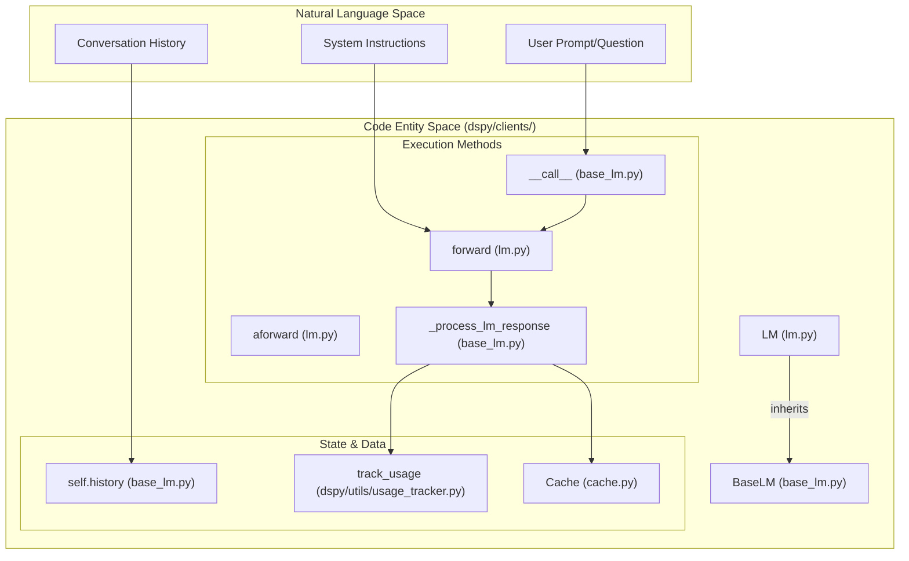
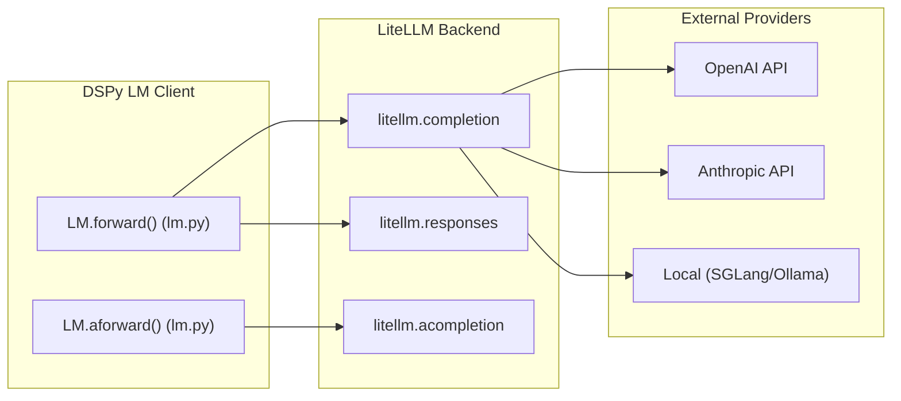

<!-- source: DeepWiki mcp.deepwiki.com · repo stanfordnlp/dspy · page 2.2 Language Model Integration · fetched 2026-10-26 -->

# Language Model Integration

Relevant source files

The following files were used as context for generating this wiki page:

- [docs/docs/api/utils/Errors.md](docs/docs/api/utils/Errors.md)
- [docs/docs/faqs.md](docs/docs/faqs.md)
- [docs/docs/learn/programming/language_models.md](docs/docs/learn/programming/language_models.md)
- [dspy/clients/__init__.py](dspy/clients/__init__.py)
- [dspy/clients/base_lm.py](dspy/clients/base_lm.py)
- [dspy/clients/cache.py](dspy/clients/cache.py)
- [dspy/clients/databricks.py](dspy/clients/databricks.py)
- [dspy/clients/embedding.py](dspy/clients/embedding.py)
- [dspy/clients/lm.py](dspy/clients/lm.py)
- [dspy/clients/lm_local.py](dspy/clients/lm_local.py)
- [dspy/clients/openai.py](dspy/clients/openai.py)
- [dspy/clients/provider.py](dspy/clients/provider.py)
- [dspy/clients/utils_finetune.py](dspy/clients/utils_finetune.py)
- [dspy/utils/dummies.py](dspy/utils/dummies.py)
- [tests/clients/test_cache.py](tests/clients/test_cache.py)
- [tests/clients/test_embedding.py](tests/clients/test_embedding.py)
- [tests/clients/test_lm.py](tests/clients/test_lm.py)
- [tests/clients/test_lm_local.py](tests/clients/test_lm_local.py)

This document describes DSPy's language model (LM) integration layer, which provides a unified interface for interacting with 40+ LM providers through LiteLLM. This layer handles prompt formatting, response parsing, caching, retry logic, and history tracking.

**Scope**: This page covers the `dspy.LM` client, `BaseLM` interface, LiteLLM backend integration, caching system, and provider abstraction.

## LM Client Architecture

The language model integration is built around two primary classes: `BaseLM` and `LM`.

### BaseLM Interface

`BaseLM` is the base class that defines the interface for all language model interactions. It implements the core lifecycle of a request:

- **History tracking**: Maintains a local `self.history` list of interactions [dspy/clients/base_lm.py:130-130]().
- **Callback support**: Uses the `@with_callbacks` decorator on `__call__` and `acall` to allow observability hooks [dspy/clients/base_lm.py:191-191](), [dspy/clients/base_lm.py:203-203]().
- **Response processing**: Implements `_process_lm_response` to extract text, reasoning, and usage data from standardized provider responses and updates the usage tracker [dspy/clients/base_lm.py:156-189]().
- **Abstract Forwarding**: Defines `forward` and `aforward` which subclasses must implement to perform the actual network request [dspy/clients/base_lm.py:223-223](), [dspy/clients/base_lm.py:230-230]().
- **Typed API Migration**: DSPy is migrating to a typed contract where `forward` accepts `dspy.LMRequest` and returns `dspy.LMResponse`. Subclasses declare their support via `forward_contract` [dspy/clients/base_lm.py:65-92]().

**Sources**: [dspy/clients/base_lm.py:57-231]()

### LM Class (The LiteLLM Implementation)

`LM` is the primary class users interact with. It extends `BaseLM` and leverages LiteLLM for multi-provider support. Key responsibilities include:

- **Provider Specialization**: Handles specific logic for OpenAI reasoning models (o1, o3, gpt-5) which require `temperature=1.0` and `max_completion_tokens` instead of `max_tokens` [dspy/clients/lm.py:124-132]().
- **Retry Logic**: Configures `num_retries` for transient failures using exponential backoff [dspy/clients/lm.py:70-71](), [dspy/clients/lm.py:109-110]().
- **Caching Integration**: Wraps the completion function with `request_cache` to prevent redundant API calls [dspy/clients/lm.py:172-182]().
- **Feature Detection**: Exposes properties to check for model capabilities like `supports_function_calling`, `supports_reasoning`, and `supports_response_schema` via LiteLLM [dspy/clients/lm.py:148-157]().

**Sources**: [dspy/clients/lm.py:55-182]()

### LM Client Entity Mapping

The following diagram bridges the high-level concepts to the specific classes and methods in the codebase.

**Diagram: LM Integration Entity Bridge**  
**Sources**: [dspy/clients/base_lm.py:57-191](), [dspy/clients/lm.py:55-245]()

## Provider Support via LiteLLM

DSPy delegates provider-specific API formatting to **LiteLLM**. This allows a single `dspy.LM` instance to support OpenAI, Anthropic, Gemini, Vertex AI, Databricks, and local models (Ollama/SGLang).

### Model Selection Hierarchy

When a request is made, DSPy follows a hierarchy to determine how to execute the call:

1.  **Model Type Dispatch**: The `model_type` attribute determines if the call uses `chat`, `text`, or the "responses" API [dspy/clients/lm.py:65-67](), [dspy/clients/lm.py:184-192]().
2.  **Provider Inference**: If not explicitly provided, the system extracts the provider from the model string (e.g., "openai" from "openai/gpt-4o") [dspy/clients/lm.py:114-115](), [dspy/clients/lm.py:141-145]().
3.  **Parameter Mapping**: DSPy maps standard parameters like `temperature` and `max_tokens` to provider-specific keys, notably handling OpenAI's reasoning model constraints [dspy/clients/lm.py:124-138]().

### LiteLLM Execution Flow

**Diagram: Provider Execution Flow**  
**Sources**: [dspy/clients/lm.py:183-245](), [dspy/clients/_litellm.py:1-20]()

## Caching System

DSPy implements a two-tier caching system to reduce latency and costs.

### Cache Tiers
1.  **In-Memory Cache**: Implemented with `cachetools.LRUCache` for fast access [dspy/clients/cache.py:44-44](), [dspy/clients/cache.py:78-78]().
2.  **On-Disk Cache**: Implemented with `diskcache.FanoutCache` for persistent storage, defaulting to `~/.dspy_cache` [dspy/clients/cache.py:45-45](), [dspy/clients/cache.py:81-94](), [dspy/clients/__init__.py:15-15]().

### Cache Key Logic
The cache key is a SHA-256 hash of the request dictionary. Arguments like `api_key`, `api_base`, and `base_url` are ignored to ensure that changing credentials doesn't invalidate the cache [dspy/clients/cache.py:104-113](), [dspy/clients/lm.py:173-174]().

### Security and Serialization
DSPy provides a `restrict_pickle` mode to limit deserialization to known-safe types like LiteLLM/OpenAI response models and NumPy helpers [dspy/clients/cache.py:88-93](), [dspy/clients/__init__.py:25-26]().

**Sources**: [dspy/clients/cache.py:40-155](), [dspy/clients/__init__.py:19-55](), [dspy/clients/lm.py:172-182]()

## Three-Tier LM Selection Hierarchy

DSPy resolves the LM to use in the following order of priority:

| Tier | Mechanism | Scope |
| :--- | :--- | :--- |
| **1. Local Context** | `with dspy.context(lm=my_lm):` | Block-level override for specific modules or operations. |
| **2. Module-Specific** | `module.set_lm(my_lm)` | Overrides the LM for a specific module instance. |
| **3. Global Default** | `dspy.configure(lm=my_lm)` | The fallback LM used by all modules if no specific LM is set [dspy/dsp/utils/settings.py:19-19](). |

**Sources**: [dspy/dsp/utils/settings.py:8-25](), [dspy/clients/base_lm.py:158-160]()

## Embedding Integration

The `Embedder` class provides a unified interface for computing text embeddings via LiteLLM or custom callables [dspy/clients/embedding.py:16-84]().

- **Hosted Models**: Uses `litellm.embedding` with optional caching [dspy/clients/embedding.py:158-161]().
- **Custom Functions**: Accepts any callable that takes a list of strings and returns a 2D array [dspy/clients/embedding.py:162-163]().
- **Caching**: Leverages `request_cache` to store embedding results [dspy/clients/embedding.py:168-170]().

**Sources**: [dspy/clients/embedding.py:16-170]()

---

