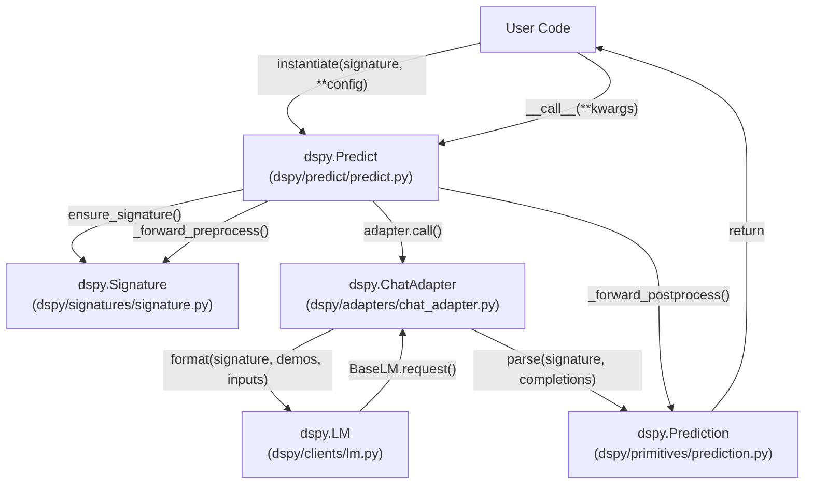
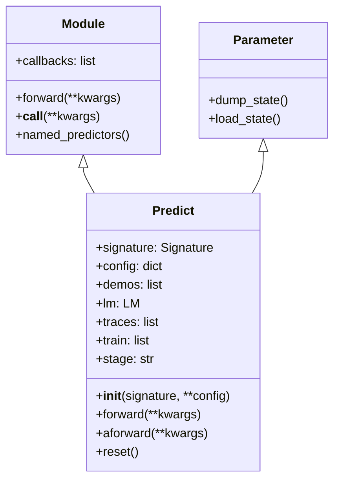

<!-- source: DeepWiki mcp.deepwiki.com · repo stanfordnlp/dspy · page 3.1 Predict Module · fetched 2026-10-26 -->

# Predict Module

<details>
<summary>Relevant source files</summary>

The following files were used as context for generating this wiki page:

- [docs/docs/api/evaluation/CompleteAndGrounded.md](docs/docs/api/evaluation/CompleteAndGrounded.md)
- [docs/docs/api/evaluation/SemanticF1.md](docs/docs/api/evaluation/SemanticF1.md)
- [docs/docs/api/modules/BestOfN.md](docs/docs/api/modules/BestOfN.md)
- [docs/docs/api/modules/ChainOfThought.md](docs/docs/api/modules/ChainOfThought.md)
- [docs/docs/api/modules/Module.md](docs/docs/api/modules/Module.md)
- [docs/docs/api/modules/MultiChainComparison.md](docs/docs/api/modules/MultiChainComparison.md)
- [docs/docs/api/modules/Predict.md](docs/docs/api/modules/Predict.md)
- [docs/docs/api/modules/Refine.md](docs/docs/api/modules/Refine.md)
- [dspy/predict/predict.py](dspy/predict/predict.py)
- [dspy/primitives/base_module.py](dspy/primitives/base_module.py)
- [tests/predict/test_predict.py](tests/predict/test_predict.py)

</details>


## Purpose and Scope

This document covers the `dspy.Predict` module, the foundational building block for making language model calls in DSPy. It explains how to initialize `Predict` instances, configure their behavior, execute forward passes, and manage state (demonstrations, traces, and serialization).

For information about:
- The base `Module` class that `Predict` inherits from, see [Module System & Base Classes](2.5)
- Signature definitions that `Predict` uses, see [Signatures & Task Definition](2.3)
- Advanced reasoning modules built on top of `Predict` (ChainOfThought, ReAct), see [Reasoning Strategies](3.2)
- The adapter system that formats prompts, see [Adapter System](2.4)

---

## Overview

`dspy.Predict` is the core module for mapping inputs to outputs using a language model. It takes a `Signature` (defining input/output fields) and produces structured `Prediction` objects by calling an LM through an adapter.

**Key characteristics:**
- Inherits from both `dspy.Module` and `dspy.Parameter` (making it optimizable) [[dspy/predict/predict.py:43]()]
- Manages demonstrations (few-shot examples) for in-context learning [[dspy/predict/predict.py:69]()]
- Supports both synchronous (`forward`) and asynchronous (`aforward`) execution [[dspy/predict/predict.py:189-214]()]
- Handles configuration at multiple levels (initialization, call-time, global settings) [[dspy/predict/predict.py:58-62]()]
- Maintains execution traces for debugging and optimization [[dspy/predict/predict.py:67]()]

### System Flow: Natural Language to Code Entities

The following diagram bridges the conceptual task (Natural Language Space) to the specific code entities in the `dspy` package.

**Data Flow from Signature to Prediction**


**Sources:** [dspy/predict/predict.py:43-214](), [dspy/signatures/signature.py:1-20](), [dspy/primitives/prediction.py:1-15]()

---

## Class Structure and Inheritance

The `Predict` class has a dual inheritance structure that serves distinct purposes:

**Predict Inheritance and Core Methods**


| Inherited From | Purpose |
|----------------|---------|
| `dspy.Module` | Provides execution interface (`forward`, `__call__`, `acall`) and module composition capabilities [[dspy/primitives/module.py:19-21]()] |
| `dspy.Parameter` | Marks this as an optimizable component; enables state serialization for saving/loading trained programs [[dspy/predict/parameter.py:1-5]()] |

**Sources:** [dspy/predict/predict.py:43](), [dspy/primitives/module.py:19-21](), [dspy/predict/parameter.py:1-5]()

---

## Initialization

### Constructor Signature

```python
def __init__(self, signature: str | type[Signature], callbacks: list[BaseCallback] | None = None, **config)
```
[[dspy/predict/predict.py:58]()]

### Parameters

| Parameter | Type | Description |
|-----------|------|-------------|
| `signature` | `str` or `type[Signature]` | Input/output specification. Can be shorthand string or a `Signature` class [[dspy/predict/predict.py:61]()] |
| `callbacks` | `list[BaseCallback]` | Optional callbacks for instrumentation and monitoring [[dspy/predict/predict.py:58]()] |
| `**config` | `dict` | Default LM configuration (e.g., `temperature`, `n`). These can be overridden per call [[dspy/predict/predict.py:62]()] |

### Initialization Process

1. **Signature normalization:** Converts string or class to `Signature` instance via `ensure_signature()` [[dspy/predict/predict.py:61]()]
2. **Stage assignment:** Generates unique 16-character hex identifier for tracking this predictor instance [[dspy/predict/predict.py:60]()]
3. **Config storage:** Stores default configuration that applies to all calls unless overridden [[dspy/predict/predict.py:62]()]
4. **State reset:** Initializes `lm`, `traces`, `train`, and `demos` to empty/None via `self.reset()` [[dspy/predict/predict.py:63-69]()]

**Sources:** [dspy/predict/predict.py:58-70]()

---

## Execution Flow

### Forward Method Entry Points

`Predict` provides three execution interfaces:

| Method | Async? | Description |
|--------|--------|-------------|
| `__call__(**kwargs)` | No | Synchronous execution via `Module.__call__` → `forward` [[dspy/predict/predict.py:130-134]()] |
| `forward(**kwargs)` | No | Core synchronous implementation [[dspy/predict/predict.py:189-201]()] |
| `acall(**kwargs)` | Yes | Asynchronous execution via `Module.acall` → `aforward` [[dspy/predict/predict.py:136-140]()] |

**Positional arguments are explicitly disallowed** to ensure clarity with signature fields [[dspy/predict/predict.py:131-132]()] [[dspy/predict/predict.py:137-138]()].

### Preprocessing Stage

The `_forward_preprocess` method performs critical setup:

1.  **Argument Extraction:** Pulls `signature`, `demos`, `config`, and `lm` from keyword arguments [[dspy/predict/predict.py:145-150]()].
2.  **LM Validation:** Ensures an LM is configured via `dspy.configure` or passed as an argument. It rejects strings or non-`BaseLM` types [[dspy/predict/predict.py:152-166]()].
3.  **Temperature Adjustment:** If `n > 1` (multiple generations) and temperature is low/unset, it defaults to `0.7` to ensure variety [[dspy/predict/predict.py:169-173]()].

**Sources:** [dspy/predict/predict.py:142-173]()

### Postprocessing Stage

The `_forward_postprocess` method handles:

1.  **Prediction creation:** Converts raw completions into a structured `Prediction` object using `Prediction.from_completions()` [[dspy/predict/predict.py:174]()].
2.  **Trace recording:** If tracing is enabled in `dspy.settings.trace`, the call (module, inputs, and prediction) is recorded for optimization or debugging [[dspy/predict/predict.py:176-178]()].

**Sources:** [dspy/predict/predict.py:172-179]()

---

## Configuration Management

Configuration follows a hierarchy where call-time settings override instance settings, which override global settings.

| Priority | Level | Method |
|----------|-------|--------|
| 1 (High) | Call-time | `predict(..., config={"temperature": 0.5})` [[dspy/predict/predict.py:147]()] |
| 2 | Instance | `predict = dspy.Predict(..., temperature=0.7)` [[dspy/predict/predict.py:62]()] |
| 3 (Low) | Global | `dspy.configure(lm=...)` [[dspy/predict/predict.py:150]()] |

**Sources:** [dspy/predict/predict.py:58-62](), [dspy/predict/predict.py:142-150]()

---

## State Management

### Serialization: dump_state and load_state

`Predict` supports full state serialization, which is essential for saving optimized programs.

-   **`dump_state(json_mode=True)`**: Returns a dictionary containing `traces`, `train`, `demos`, the `signature` state, and the `lm` configuration [[dspy/predict/predict.py:71-90]()]. It uses `serialize_object` to handle complex types like Pydantic models within demonstrations [[dspy/predict/predict.py:81]()] [[dspy/predict/predict.py:226-242]()].
-   **`load_state(state)`**: Restores the predictor from a dictionary. It handles signature reconstruction and LM instantiation [[dspy/predict/predict.py:92-120]()]. It includes a safety check `_sanitize_lm_state` to prevent loading unsafe keys like `api_base`, `base_url`, and `model_list` from untrusted files unless explicitly allowed [[dspy/predict/predict.py:25-40]()] [[dspy/predict/predict.py:110-115]()].

**Sources:** [dspy/predict/predict.py:71-120](), [dspy/predict/predict.py:25-40](), [dspy/predict/predict.py:226-242]()

### Demonstrations (Few-Shot)

The `demos` list is the primary mechanism for few-shot learning. Optimizers (teleprompters) populate this list with `dspy.Example` objects that match the module's signature [[dspy/predict/predict.py:69]()] [[dspy/predict/predict.py:75-87]()]. During serialization, `Predict` ensures these examples are properly formatted for JSON storage [[dspy/predict/predict.py:76-86]()].

---

## Advanced Features

### Asynchronous Execution

The `aforward` method enables concurrent LM calls. It uses `adapter.acall` to handle the underlying asynchronous request to the LM provider [[dspy/predict/predict.py:203-214]()].

### Streaming Support

`Predict` checks `settings.send_stream` and `settings.stream_listeners` to determine if output should be streamed [[dspy/predict/predict.py:181-187]()]. If enabled, it executes within a context that tracks the `caller_predict` instance to allow downstream listeners to associate chunks with specific predictor stages [[dspy/predict/predict.py:195]()] [[dspy/predict/predict.py:207]()].

**Sources:** [dspy/predict/predict.py:181-214]()

---

## Summary of Key Functions

| Function/Method | File:Lines | Role |
|-----------------|------------|------|
| `__init__` | [dspy/predict/predict.py:58-64]() | Initializes signature, hex stage, and config. |
| `_forward_preprocess` | [dspy/predict/predict.py:142-173]() | Merges configs, validates LM, and prepares inputs. |
| `_forward_postprocess` | [dspy/predict/predict.py:172-179]() | Wraps output in `Prediction` and records traces. |
| `dump_state` | [dspy/predict/predict.py:71-90]() | Serializes module state including demos and LM config. |
| `load_state` | [dspy/predict/predict.py:92-120]() | Restores state with safety checks for LM parameters. |
| `serialize_object` | [dspy/predict/predict.py:226-242]() | Utility to recursively serialize complex objects (Pydantic models, enums) for JSON. |

**Sources:** [dspy/predict/predict.py:1-242]()

---

