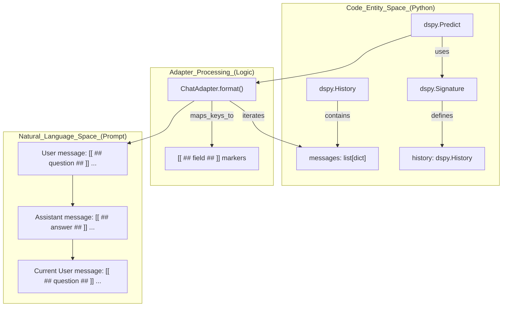
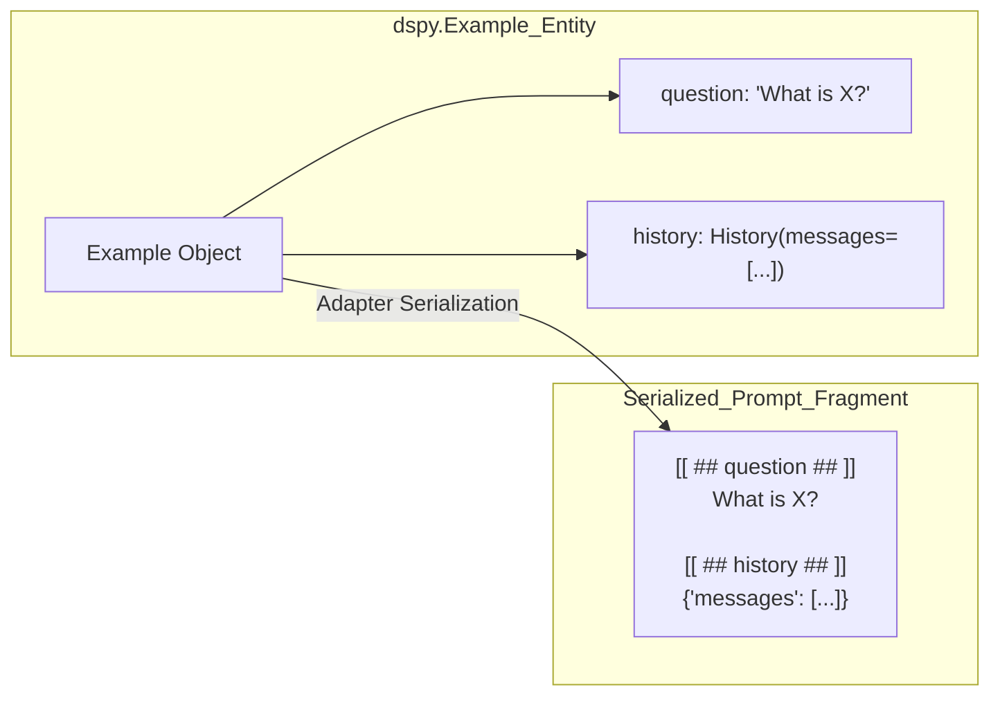
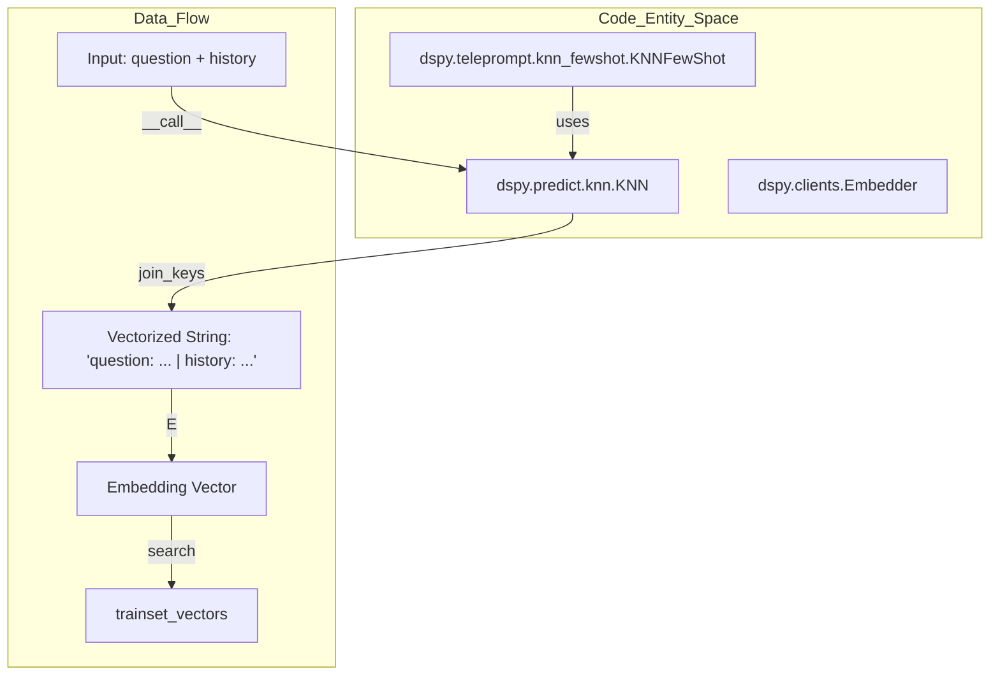

<!-- source: DeepWiki mcp.deepwiki.com · repo stanfordnlp/dspy · page 3.6 History & Conversation Management · fetched 2026-10-26 -->

# History & Conversation Management

<details>
<summary>Relevant source files</summary>

The following files were used as context for generating this wiki page:

- [docs/docs/tutorials/build_ai_program/index.md](docs/docs/tutorials/build_ai_program/index.md)
- [docs/docs/tutorials/conversation_history/index.md](docs/docs/tutorials/conversation_history/index.md)
- [docs/docs/tutorials/core_development/index.md](docs/docs/tutorials/core_development/index.md)
- [docs/docs/tutorials/index.md](docs/docs/tutorials/index.md)
- [docs/docs/tutorials/optimize_ai_program/index.md](docs/docs/tutorials/optimize_ai_program/index.md)
- [docs/docs/tutorials/program_of_thought/index.ipynb](docs/docs/tutorials/program_of_thought/index.ipynb)
- [docs/docs/tutorials/rl_ai_program/index.md](docs/docs/tutorials/rl_ai_program/index.md)
- [docs/mkdocs.yml](docs/mkdocs.yml)
- [docs/overrides/partials/tabs.html](docs/overrides/partials/tabs.html)
- [dspy/adapters/types/history.py](dspy/adapters/types/history.py)
- [dspy/predict/knn.py](dspy/predict/knn.py)
- [dspy/teleprompt/ensemble.py](dspy/teleprompt/ensemble.py)
- [dspy/teleprompt/knn_fewshot.py](dspy/teleprompt/knn_fewshot.py)
- [dspy/teleprompt/vanilla.py](dspy/teleprompt/vanilla.py)
- [tests/predict/test_knn.py](tests/predict/test_knn.py)
- [tests/teleprompt/test_knn_fewshot.py](tests/teleprompt/test_knn_fewshot.py)

</details>


This page documents DSPy's conversation history management capabilities through the `dspy.History` primitive. It covers how to maintain conversational context across multiple turns in DSPy programs, how history is formatted into multi-turn messages for language models, and how history integrates with signatures, modules, and adapters.

## Overview

DSPy does not provide automatic conversation history management within `dspy.Module`. Instead, it provides the `dspy.History` primitive as a tool that developers can use to explicitly manage conversational context. This design gives developers full control over when and how conversation history is maintained, allowing for flexible patterns in multi-turn interactions such as chatbots, iterative agents, and dialogue systems. [docs/docs/tutorials/conversation_history/index.md:1-4]()

The `dspy.History` class serves as a structured container for conversation turns and integrates with DSPy's signature system and adapter layer. When used as an input field in a signature, the adapter layer handles the transformation of this structured data into the format required by the underlying Language Model (LM). [dspy/adapters/types/history.py:6-61]()

## The History Class

### Structure and Implementation

The `dspy.History` class is defined as a Pydantic model to ensure data validation and consistent structure. It is located in the adapter type system. [dspy/adapters/types/history.py:6-6]()

| Attribute | Type | Description |
|-----------|------|-------------|
| `messages` | `list[dict[str, Any]]` | List of conversation turns, where each entry is a dictionary with keys corresponding to signature fields |

The class is configured with `frozen=True` and `extra="forbid"` to maintain strict schema adherence during the conversation lifecycle. [dspy/adapters/types/history.py:63-69]()

### History as a Signature Field

To use history in a DSPy program, it must be declared as an `InputField` within a `dspy.Signature`. The type hint `dspy.History` signals to the system how to process this field. [dspy/adapters/types/history.py:13-17](), [docs/docs/tutorials/conversation_history/index.md:17-20]()

```python
class QA(dspy.Signature):
    question: str = dspy.InputField()
    history: dspy.History = dspy.InputField()
    answer: str = dspy.OutputField()
```

Sources: [dspy/adapters/types/history.py:6-69](), [docs/docs/tutorials/conversation_history/index.md:17-20]()

## Usage Patterns

### Multi-Turn Workflow

The standard pattern for managing history involves initializing a `History` object and manually appending results after each module execution. [docs/docs/tutorials/conversation_history/index.md:22-31]()

1.  **Initialization**: Create an empty history instance: `history = dspy.History(messages=[])`. [docs/docs/tutorials/conversation_history/index.md:23-23]()
2.  **Execution**: Pass the history object to a module (e.g., `dspy.Predict`). [docs/docs/tutorials/conversation_history/index.md:29-29]()
3.  **Update**: Append the previous turn's inputs and the module's outputs to the `messages` list. [docs/docs/tutorials/conversation_history/index.md:31-31]()

Sources: [docs/docs/tutorials/conversation_history/index.md:22-31](), [dspy/adapters/types/history.py:49-58]()

### Code Entity Space to Natural Language Space

The following diagram illustrates how the code-level `dspy.History` entity is transformed by the `Adapter` system into the natural language prompt structure sent to an LM.

**History Transformation Flow**

Sources: [dspy/adapters/types/history.py:6-61](), [docs/docs/tutorials/conversation_history/index.md:55-114]()

## History in Demonstrations (Few-Shot)

### JSON Serialization in Examples

When `dspy.History` is used within `dspy.Example` objects (demonstrations), DSPy does not expand the history into multiple chat turns. Instead, it serializes the history into a JSON string within a single turn. This ensures that few-shot examples remain self-contained units compatible with standard message formats. [docs/docs/tutorials/conversation_history/index.md:115-120]()

**Demonstration Formatting**

Sources: [docs/docs/tutorials/conversation_history/index.md:115-120](), [docs/docs/tutorials/conversation_history/index.md:183-184]()

## Integration with Retrieval (KNN)

Conversation history can be used in conjunction with retrieval-based optimizers like `KNNFewShot`. While `KNNFewShot` typically operates on simple input strings, the underlying `KNN` retriever can vectorize complex inputs. [dspy/teleprompt/knn_fewshot.py:11-52]()

The `KNN` class vectorizes training examples by joining input keys using a `" | "` separator. [dspy/predict/knn.py:43-47]() If `history` is an input key, its string representation (JSON) will be included in the vector embedding calculation, allowing the system to retrieve similar past conversations based on historical context. [dspy/predict/knn.py:49-53]()

**Retrieval with History Context**

Sources: [dspy/predict/knn.py:43-53](), [dspy/teleprompt/knn_fewshot.py:11-52]()

## Debugging and Inspection

To verify how history is being managed and formatted, developers use `dspy.inspect_history()`. This function reveals the underlying multi-turn structure created by the adapter, showing exactly how the `messages` list was expanded into `User message` and `Assistant message` blocks in the prompt. [docs/docs/tutorials/conversation_history/index.md:33-34](), [docs/docs/tutorials/conversation_history/index.md:55-114]()

### Key Implementation Files

| Component | File Path | Description |
|-----------|-----------|-------------|
| `History` Class | [dspy/adapters/types/history.py:6-69]() | Definition of the Pydantic-based history container. |
| `KNN` Retriever | [dspy/predict/knn.py:7-52]() | Logic for retrieving similar examples, potentially including history. |
| `KNNFewShot` | [dspy/teleprompt/knn_fewshot.py:11-70]() | Optimizer that uses KNN to find demonstrations. |
| Tutorial | [docs/docs/tutorials/conversation_history/index.md:1-220]() | Comprehensive guide on manual history management. |

Sources: [dspy/adapters/types/history.py:1-69](), [dspy/predict/knn.py:1-53](), [dspy/teleprompt/knn_fewshot.py:1-70]()

---

