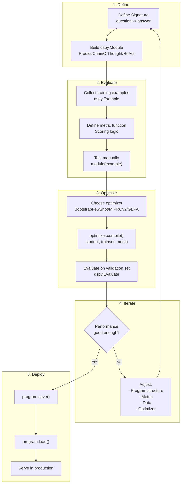
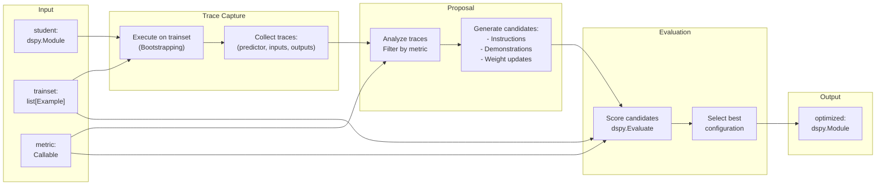
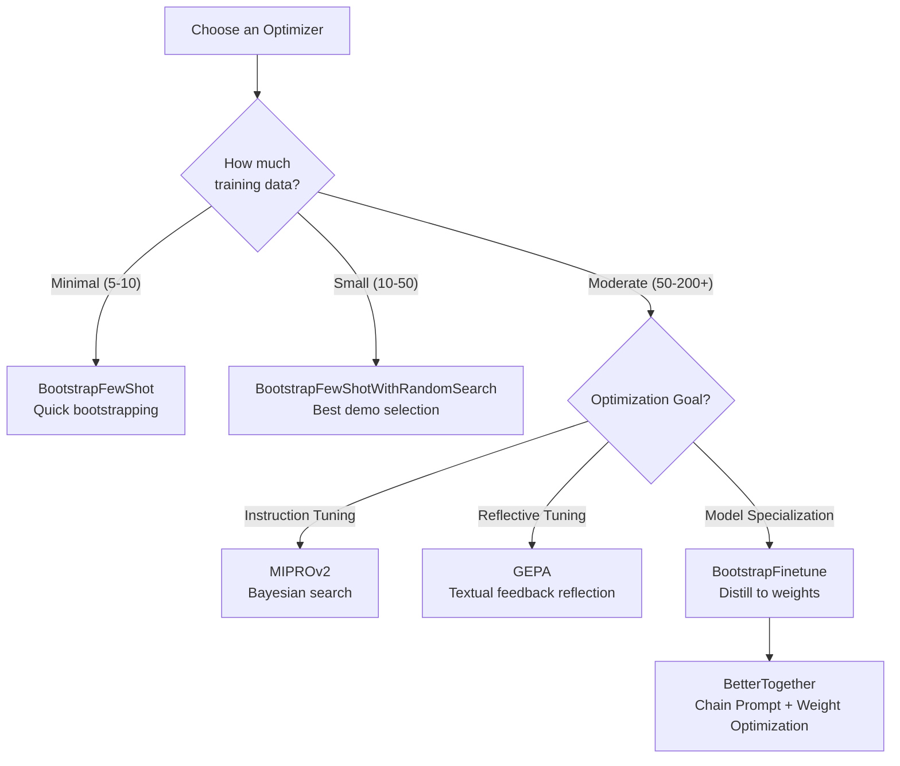

<!-- source: DeepWiki mcp.deepwiki.com · repo stanfordnlp/dspy · page 4.1 Optimization Overview · fetched 2026-10-26 -->

# Optimization Overview

Relevant source files

The following files were used as context for generating this wiki page:

- [docs/docs/api/models/BaseLM.md](docs/docs/api/models/BaseLM.md)
- [docs/docs/api/models/LM.md](docs/docs/api/models/LM.md)
- [docs/docs/api/modules/ReAct.md](docs/docs/api/modules/ReAct.md)
- [docs/docs/api/optimizers/BetterTogether.md](docs/docs/api/optimizers/BetterTogether.md)
- [docs/docs/api/optimizers/BootstrapFewShot.md](docs/docs/api/optimizers/BootstrapFewShot.md)
- [docs/docs/api/optimizers/BootstrapFewShotWithRandomSearch.md](docs/docs/api/optimizers/BootstrapFewShotWithRandomSearch.md)
- [docs/docs/api/optimizers/BootstrapFinetune.md](docs/docs/api/optimizers/BootstrapFinetune.md)
- [docs/docs/api/optimizers/BootstrapRS.md](docs/docs/api/optimizers/BootstrapRS.md)
- [docs/docs/api/optimizers/COPRO.md](docs/docs/api/optimizers/COPRO.md)
- [docs/docs/api/optimizers/Ensemble.md](docs/docs/api/optimizers/Ensemble.md)
- [docs/docs/api/optimizers/InferRules.md](docs/docs/api/optimizers/InferRules.md)
- [docs/docs/api/optimizers/KNNFewShot.md](docs/docs/api/optimizers/KNNFewShot.md)
- [docs/docs/api/optimizers/MIPROv2.md](docs/docs/api/optimizers/MIPROv2.md)
- [docs/docs/api/primitives/Tool.md](docs/docs/api/primitives/Tool.md)
- [docs/docs/learn/optimization/optimizers.md](docs/docs/learn/optimization/optimizers.md)
- [docs/docs/learn/optimization/overview.md](docs/docs/learn/optimization/overview.md)
- [tests/teleprompt/test_bettertogether.py](tests/teleprompt/test_bettertogether.py)

DSPy **optimizers** (formerly called **teleprompters**) automatically improve your programs by tuning prompts, few-shot demonstrations, or model weights. Instead of manually engineering prompts, you define a metric and provide training examples, and the optimizer searches for better configurations.

This page introduces the optimization philosophy, workflow, and provides guidance on choosing the right optimizer for your task. For implementation details, see [Evaluation Framework](page://4.2), [Few-Shot Optimizers](page://4.3), [MIPROv2](page://4.4), [GEPA](page://4.5), and [Fine-tuning & Weight Optimization](page://4.6).

## Why Optimize?

Traditional prompt engineering is brittle and doesn't scale:
- **Manual prompt tuning** requires extensive trial-and-error for each model and task.
- **Prompts break** when you change models, add pipeline stages, or modify requirements.
- **Few-shot examples** need careful curation and don't automatically adapt to your data.

DSPy optimization addresses these problems by:
1. **Separating interface from implementation**: You define what modules should do (signatures), not how to prompt them.
2. **Learning from data**: Optimizers discover effective prompts and demonstrations from your training examples [docs/docs/learn/optimization/optimizers.md:24-26]().
3. **Adapting to changes**: Re-compile when you change models or task requirements.

**Result**: Programs that are more reliable, maintainable, and portable across models.

**Sources:** [docs/docs/learn/optimization/overview.md:1-12](), [docs/docs/learn/optimization/optimizers.md:24-26]()

## The Three Inputs

Every optimizer takes three core inputs as defined in the `Teleprompter.compile` interface:

| Input | Description | Typical Size |
|-------|-------------|--------------|
| **Student Program** | The `dspy.Module` to optimize [docs/docs/learn/optimization/optimizers.md:13-13]() | Single program |
| **Training Set** | `list[dspy.Example]` with inputs marked via `.with_inputs()` [docs/docs/learn/optimization/optimizers.md:17-17]() | 10-500+ examples |
| **Metric Function** | `Callable` that scores outputs (higher = better) [docs/docs/learn/optimization/optimizers.md:15-15]() | Single function |

If you have a lot of data, DSPy can leverage it, but substantial value can often be gained from as few as 30 examples [docs/docs/learn/optimization/overview.md:8-9]().

**Sources:** [docs/docs/learn/optimization/optimizers.md:11-20](), [docs/docs/learn/optimization/overview.md:8-9]()

## The Development Workflow

Optimization is part of an iterative development cycle. The recommended workflow follows these phases:

**Title:** DSPy Development Workflow with Optimization

**Key Phases:**
1. **Define**: Create your program using signatures and modules.
2. **Evaluate**: Collect examples and define a metric. For prompt optimizers, a reverse split (20% train, 80% validation) is often recommended to avoid overfitting [docs/docs/learn/optimization/overview.md:8-9]().
3. **Optimize**: Run an optimizer to improve prompts, demos, or weights [docs/docs/learn/optimization/optimizers.md:24-26]().
4. **Iterate**: Refine your program, metric, or data based on results [docs/docs/learn/optimization/overview.md:10-12]().

**Sources:** [docs/docs/learn/optimization/overview.md:1-12](), [docs/docs/learn/optimization/optimizers.md:11-20]()

## How Optimizers Work

All optimizers follow a similar internal workflow, though they differ in how they generate improvements:

**Title:** Internal Optimization Workflow

**Implementation Phases:**
1. **Bootstrapping**: The optimizer runs the program many times across different inputs to collect traces of input/output behavior for every module [docs/docs/learn/optimization/optimizers.md:30-31]().
2. **Grounded Proposal**: For instruction optimizers like `MIPROv2`, the system previews code, data, and traces to draft potential instructions for every prompt [docs/docs/learn/optimization/optimizers.md:30-31]().
3. **Discrete Search**: Candidates are evaluated on mini-batches of the training set. Scores update a surrogate model (e.g., in Bayesian Optimization) to improve future proposals [docs/docs/learn/optimization/optimizers.md:30-31]().

**Sources:** [docs/docs/learn/optimization/optimizers.md:30-31](), [docs/docs/api/optimizers/MIPROv2.md:55-65]()

## Optimizer Categories

DSPy provides four categories of optimizers, each targeting different aspects of program optimization:

### 1. Few-Shot Learning Optimizers
These extend signatures by automatically generating and including optimized examples within the prompt [docs/docs/learn/optimization/optimizers.md:40-42]().

| Optimizer | Strategy | Best For |
|-----------|----------|----------|
| `LabeledFewShot` | Constructs demos from provided labeled data [docs/docs/learn/optimization/optimizers.md:44-44]() | Pre-labeled data available |
| `BootstrapFewShot` | Uses a teacher module to generate demonstrations validated by a metric [docs/docs/learn/optimization/optimizers.md:46-47]() | Basic optimization with small data |
| `BootstrapFewShotWithRandomSearch` | Applies `BootstrapFewShot` multiple times with random search over demo sets [docs/docs/learn/optimization/optimizers.md:48-49]() | Searching for the best subset of demos |
| `KNNFewShot` | Uses k-Nearest Neighbors to find similar training examples for a given input [docs/docs/learn/optimization/optimizers.md:50-51]() | Dynamic demo selection |

### 2. Instruction & Parameter Optimizers
These produce optimal instructions and can also optimize few-shot demonstrations [docs/docs/learn/optimization/optimizers.md:53-55]().

| Optimizer | Strategy | Best For |
|-----------|----------|----------|
| `COPRO` | Coordinate ascent (hill-climbing) to refine instructions [docs/docs/learn/optimization/optimizers.md:57-58]() | Iterative prompt improvement |
| `MIPROv2` | Bayesian Optimization over instructions and demonstrations [docs/docs/learn/optimization/optimizers.md:59-60]() | Data-aware and demo-aware instruction tuning |
| `SIMBA` | Stochastic mini-batch sampling to identify challenging examples and introspect failures [docs/docs/learn/optimization/optimizers.md:61-62]() | Self-reflective improvement rules |
| `GEPA` | Reflective analysis of trajectories to identify gaps and propose prompts [docs/docs/learn/optimization/optimizers.md:63-64]() | Rapid improvement via domain feedback |

### 3. Fine-tuning Optimizers
These tune the underlying LLM weights [docs/docs/learn/optimization/optimizers.md:65-67]().

| Optimizer | Strategy | Best For |
|-----------|----------|----------|
| `BootstrapFinetune` | Distills a prompt-based program into weight updates for each step [docs/docs/learn/optimization/optimizers.md:69-70]() | Moving from prompting to fine-tuned specialized models |

### 4. Meta-Optimizers
These allow composing or ensembling multiple optimization strategies.

| Optimizer | Strategy | Best For |
|-----------|----------|----------|
| `BetterTogether` | Combines prompt and weight optimization in configurable sequences (e.g., `p -> w`) [docs/docs/api/optimizers/BetterTogether.md:3-4]() | Compounding gains from prompts and weights |
| `Ensemble` | Combines multiple programs (e.g., top-5 candidates) into one program [docs/docs/learn/optimization/optimizers.md:32-33]() | Scaling inference-time compute |

**Sources:** [docs/docs/learn/optimization/optimizers.md:26-75](), [docs/docs/api/optimizers/BetterTogether.md:1-20]()

## Choosing an Optimizer

The right optimizer depends on your data size and optimization goals:

**Title:** Optimizer Selection Guide

### Chaining and Ensembling
DSPy provides mechanisms to combine multiple optimized results or optimize in sequence:

- **BetterTogether**: Executes optimizers in a configurable sequence using a strategy string like `"p -> w -> p"`. This is particularly powerful for combining prompt optimization (which discovers reasoning strategies) with weight optimization (which specializes the model) [docs/docs/api/optimizers/BetterTogether.md:3-4](). It manages the validation and program selection by evaluating each intermediate program and returning the best performer [docs/docs/api/optimizers/BetterTogether.md:82-105]().
- **Ensemble**: Combines multiple programs into one. You can run an optimizer, extract the top-5 candidate programs, and build an ensemble of them to scale inference-time compute [docs/docs/learn/optimization/optimizers.md:32-33]().

**Sources:** [docs/docs/api/optimizers/BetterTogether.md:22-108](), [docs/docs/learn/optimization/optimizers.md:28-33]()

---

