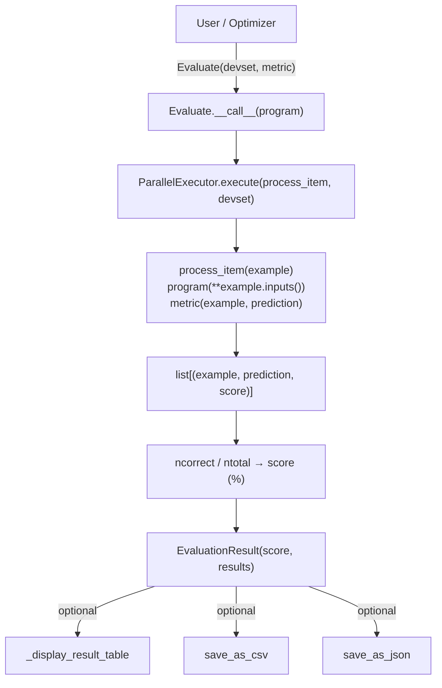
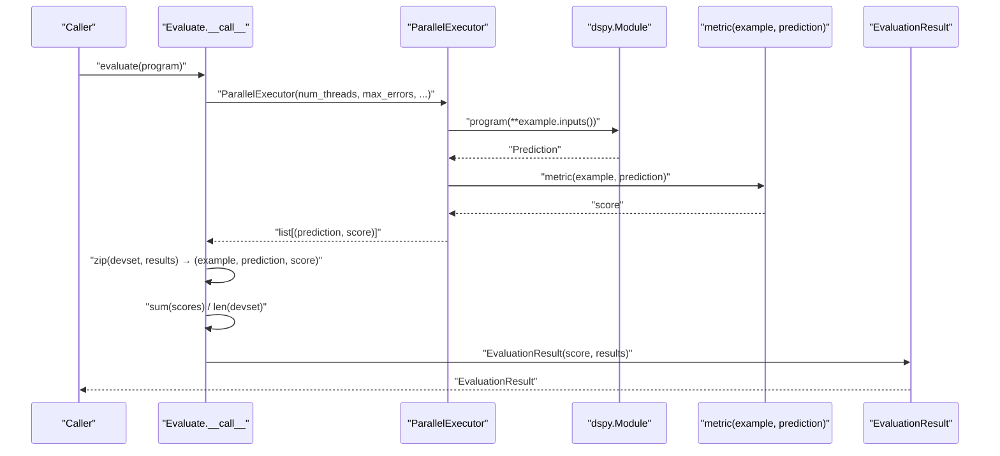
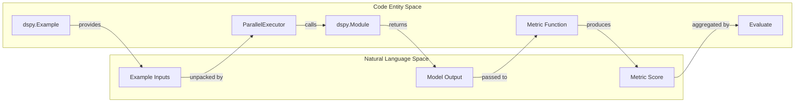
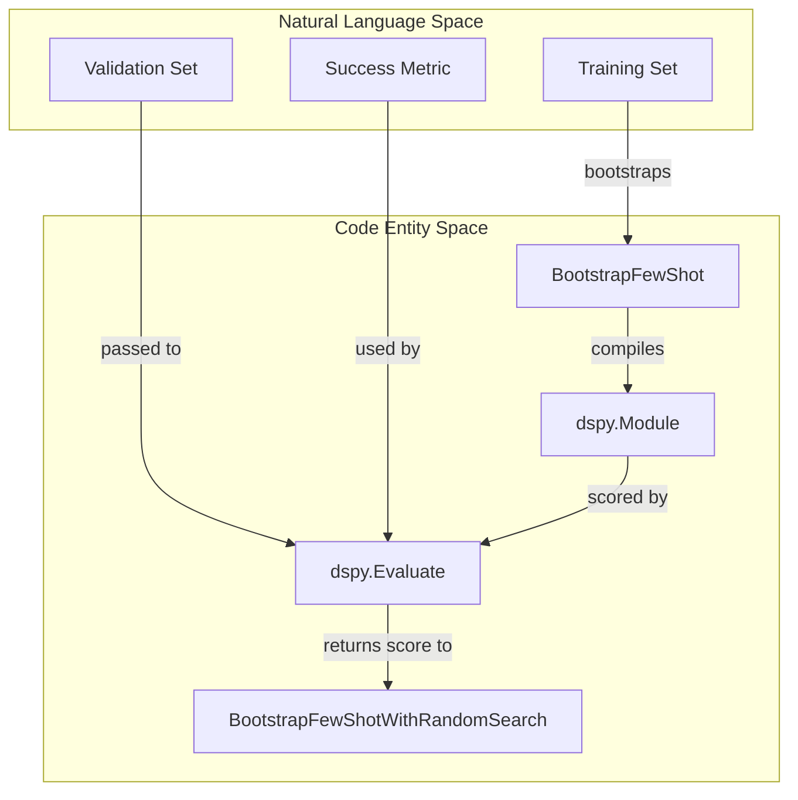

<!-- source: DeepWiki mcp.deepwiki.com · repo stanfordnlp/dspy · page 4.2 Evaluation Framework · fetched 2026-10-26 -->

# Evaluation Framework

Relevant source files

The following files were used as context for generating this wiki page:

- [docs/docs/learn/evaluation/overview.md](docs/docs/learn/evaluation/overview.md)
- [docs/docs/tutorials/optimizer_tracking/child_run.png](docs/docs/tutorials/optimizer_tracking/child_run.png)
- [docs/docs/tutorials/optimizer_tracking/experiment.png](docs/docs/tutorials/optimizer_tracking/experiment.png)
- [docs/docs/tutorials/optimizer_tracking/index.md](docs/docs/tutorials/optimizer_tracking/index.md)
- [docs/docs/tutorials/optimizer_tracking/parent_run.png](docs/docs/tutorials/optimizer_tracking/parent_run.png)
- [dspy/dsp/utils/__init__.py](dspy/dsp/utils/__init__.py)
- [dspy/evaluate/__init__.py](dspy/evaluate/__init__.py)
- [dspy/evaluate/auto_evaluation.py](dspy/evaluate/auto_evaluation.py)
- [dspy/evaluate/evaluate.py](dspy/evaluate/evaluate.py)
- [dspy/evaluate/metrics.py](dspy/evaluate/metrics.py)
- [dspy/predict/parallel.py](dspy/predict/parallel.py)
- [dspy/signatures/__init__.py](dspy/signatures/__init__.py)
- [dspy/signatures/field.py](dspy/signatures/field.py)
- [dspy/teleprompt/__init__.py](dspy/teleprompt/__init__.py)
- [dspy/teleprompt/bootstrap.py](dspy/teleprompt/bootstrap.py)
- [dspy/teleprompt/copro_optimizer.py](dspy/teleprompt/copro_optimizer.py)
- [dspy/teleprompt/random_search.py](dspy/teleprompt/random_search.py)
- [dspy/teleprompt/signature_opt.py](dspy/teleprompt/signature_opt.py)
- [dspy/teleprompt/teleprompt_optuna.py](dspy/teleprompt/teleprompt_optuna.py)
- [dspy/utils/parallelizer.py](dspy/utils/parallelizer.py)
- [tests/evaluate/test_auto_evaluation.py](tests/evaluate/test_auto_evaluation.py)
- [tests/evaluate/test_evaluate.py](tests/evaluate/test_evaluate.py)
- [tests/predict/test_parallel.py](tests/predict/test_parallel.py)
- [tests/teleprompt/test_random_search.py](tests/teleprompt/test_random_search.py)
- [tests/utils/test_parallelizer.py](tests/utils/test_parallelizer.py)

This page documents `dspy.Evaluate`, the `EvaluationResult` type, metric function conventions, parallel evaluation, and result handling. Evaluation in DSPy is used to assess program performance and to score candidate programs during optimization.

---

## Overview

The evaluation framework is implemented in [dspy/evaluate/evaluate.py](). The primary interface is the `Evaluate` class, which runs a `dspy.Module` against a dataset (`devset`) and aggregates metric scores into a summary result.

Title: Evaluation Logic Flow

Sources: [dspy/evaluate/evaluate.py:64-128](), [dspy/evaluate/evaluate.py:162-226]()

---

## Core Classes

### `EvaluationResult`

`EvaluationResult` ([dspy/evaluate/evaluate.py:48-61]()) is a subclass of `dspy.Prediction` that stores the outcome of an evaluation run.

| Attribute | Type | Description |
|-----------|------|-------------|
| `score` | `float` | Overall performance score (e.g., `67.30`) |
| `results` | `list[tuple[Example, Example, Any]]` | List of `(example, prediction, score)` triples |

Sources: [dspy/evaluate/evaluate.py:48-61]()

### `Evaluate`

The `Evaluate` class ([dspy/evaluate/evaluate.py:64-111]()) provides the configuration and execution logic for running benchmarks.

**Constructor parameters:**

| Parameter | Type | Default | Description |
|-----------|------|---------|-------------|
| `devset` | `list[dspy.Example]` | required | The evaluation dataset |
| `metric` | `Callable \| None` | `None` | The scoring function |
| `num_threads` | `int \| None` | `None` | Threads for parallel evaluation |
| `display_progress` | `bool` | `False` | Show `tqdm` progress bar |
| `display_table` | `bool \| int` | `False` | Display results in a table (int limits rows) |
| `max_errors` | `int \| None` | `None` | Max errors before stopping (falls back to `dspy.settings.max_errors`) |
| `failure_score` | `float` | `0.0` | Default score if an exception occurs |
| `save_as_csv` | `str \| None` | `None` | Filename for CSV export |
| `save_as_json` | `str \| None` | `None` | Filename for JSON export |

Sources: [dspy/evaluate/evaluate.py:71-111]()

---

## Execution Flow

When an `Evaluate` instance is called, it triggers the following sequence:

Title: Evaluation Sequence Diagram

1. **Setup**: Parameters are resolved, favoring `__call__` arguments over constructor defaults [dspy/evaluate/evaluate.py:149-155]().
2. **Parallelization**: `ParallelExecutor` ([dspy/utils/parallelizer.py]()) manages the distribution of examples across threads [dspy/evaluate/evaluate.py:162-175]().
3. **Execution**: For each example, the program is executed with `example.inputs()` [dspy/evaluate/evaluate.py:171]().
4. **Scoring**: The `metric` function compares the `example` and `prediction` [dspy/evaluate/evaluate.py:173]().
5. **Aggregation**: Scores are averaged and rounded to 2 decimal places [dspy/evaluate/evaluate.py:221-224]().

Sources: [dspy/evaluate/evaluate.py:116-226](), [dspy/utils/parallelizer.py:16-46]()

---

## Metric Functions

A metric is a callable that defines "good" vs "bad" outputs.

### Function Signature
Metrics must follow this signature:
`metric(example: dspy.Example, prediction: dspy.Prediction, trace=None) -> Any`

While `Evaluate` calls metrics with two arguments, optimizers like `BootstrapFewShot` ([dspy/teleprompt/bootstrap.py:73]()) provide a `trace` for intermediate step validation during the bootstrapping process.

### Standard Metrics
DSPy provides several built-in metrics in [dspy/evaluate/metrics.py]():
- `answer_exact_match`: Normalizes text and checks for equality [dspy/evaluate/metrics.py:87-123]().
- `answer_passage_match`: Checks if the answer is contained within retrieved passages [dspy/evaluate/metrics.py:126-150]().

### Auto-Evaluation (LLM-as-a-Judge)
The framework supports metrics that are themselves DSPy programs in [dspy/evaluate/auto_evaluation.py]():
- `SemanticF1`: Uses a `ChainOfThought` module with the `SemanticRecallPrecision` signature to compute precision/recall based on semantic meaning [dspy/evaluate/auto_evaluation.py:42-62]().
- `CompleteAndGrounded`: Scores responses based on completeness (against ground truth) and groundedness (against context) using specialized signatures like `AnswerCompleteness` and `AnswerGroundedness` [dspy/evaluate/auto_evaluation.py:102-123]().

Sources: [dspy/evaluate/metrics.py:87-150](), [dspy/evaluate/auto_evaluation.py:1-124](), [dspy/teleprompt/bootstrap.py:73-83]()

---

## Parallel Execution and Threading

The framework utilizes `ParallelExecutor` to manage concurrent execution across examples.

Title: Evaluation Code Entity Mapping

Sources: [dspy/evaluate/evaluate.py:162-175](), [dspy/utils/parallelizer.py:16-46]()

### Concurrency Details
- **Single-Threaded**: If `num_threads=1`, evaluation runs in the main thread [dspy/utils/parallelizer.py:53-54](), [tests/evaluate/test_evaluate.py:59-83]().
- **Multi-Threaded**: Spawns worker threads via `ThreadPoolExecutor` [dspy/utils/parallelizer.py:108-157]().
- **Error Handling**: The `max_errors` setting limits the number of failures before execution stops [dspy/utils/parallelizer.py:66-67]().
- **Failure Handling**: If an example fails, the `failure_score` (default `0.0`) is assigned [dspy/evaluate/evaluate.py:109]().

Sources: [dspy/evaluate/evaluate.py:162-175](), [dspy/utils/parallelizer.py:50-108](), [tests/evaluate/test_evaluate.py:117-130]()

---

## Result Display and Persistence

### Table Display
If `display_table` is enabled, `Evaluate` constructs a `pandas.DataFrame` via `_construct_result_table` [dspy/evaluate/evaluate.py:231]().
- In Jupyter environments, it renders as a stylized HTML table using `IPython.display` [dspy/evaluate/evaluate.py:19-20]().
- If `display_table` is an integer, the table is truncated to that number of rows [dspy/evaluate/evaluate.py:138-140]().

### File Export
Results can be persisted to disk:
- **CSV**: Saves the evaluation results to a CSV file [dspy/evaluate/evaluate.py:110]().
- **JSON**: Saves the evaluation results to a JSON file [dspy/evaluate/evaluate.py:111]().

Sources: [dspy/evaluate/evaluate.py:110-111](), [dspy/evaluate/evaluate.py:154-155](), [dspy/evaluate/evaluate.py:231-250]()

---

## Integration with Optimizers

The evaluation framework is a core component of program optimization. Optimizers use `Evaluate` to rank candidate programs.

Title: Optimizer to Evaluation Mapping

Sources: [dspy/teleprompt/random_search.py:113-122](), [dspy/teleprompt/bootstrap.py:73-83]()

### Optimization Workflow
1. **Looping**: Optimizers like `BootstrapFewShotWithRandomSearch` iterate through multiple seeds [dspy/teleprompt/random_search.py:75]().
2. **Validation**: The candidate program is passed to an `Evaluate` instance using the `valset` [dspy/teleprompt/random_search.py:121-130]().
3. **Ranking**: Candidates are sorted by their `score` to select the best program [dspy/teleprompt/random_search.py:150-153]().

Sources: [dspy/teleprompt/random_search.py:27-150](), [dspy/teleprompt/copro_optimizer.py:137-148]()

---

