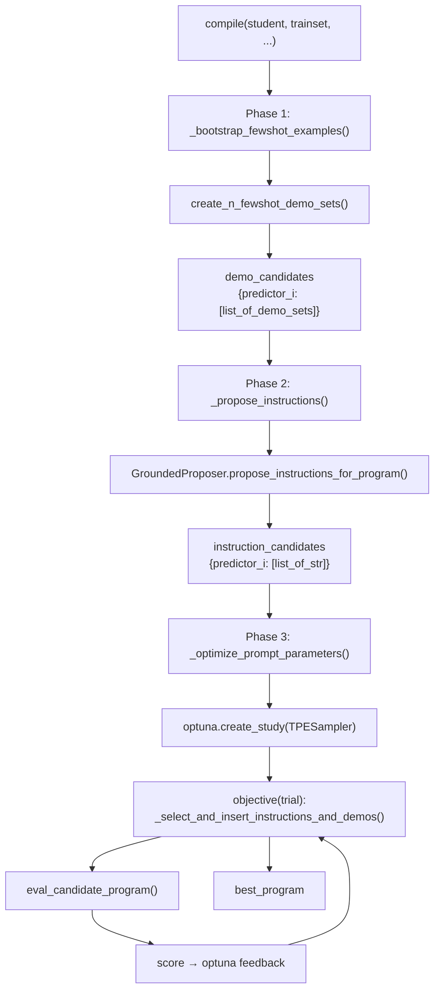
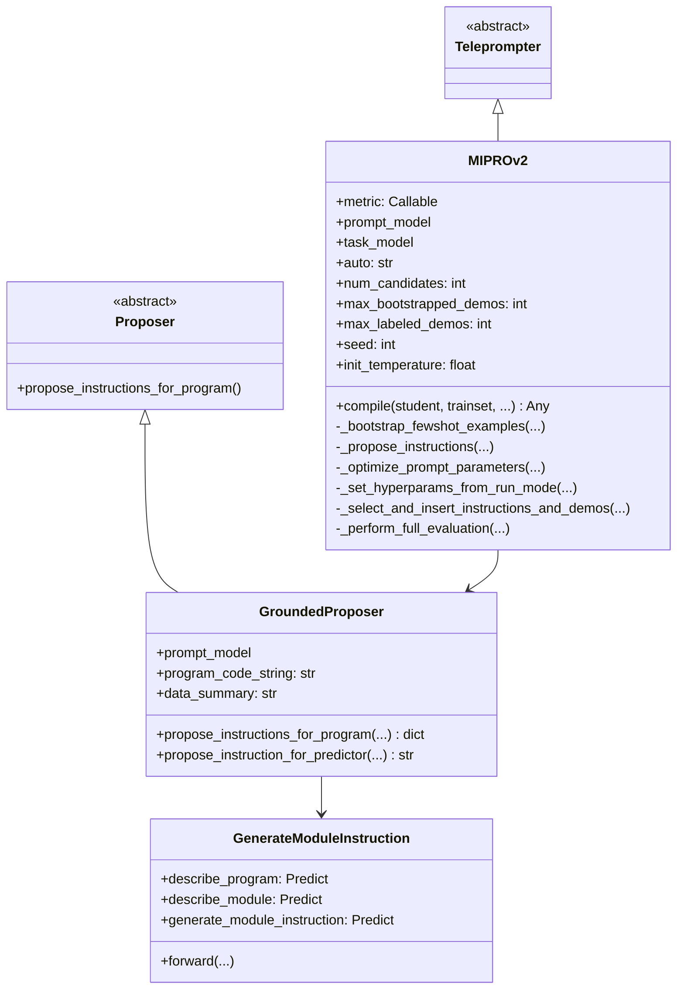
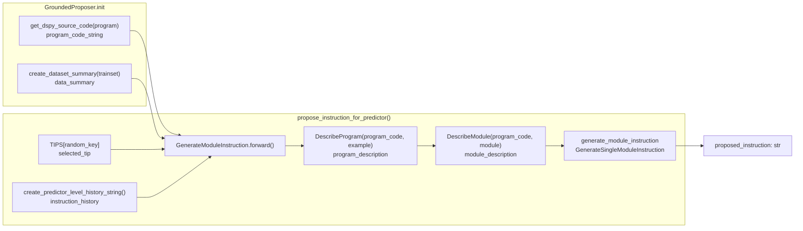
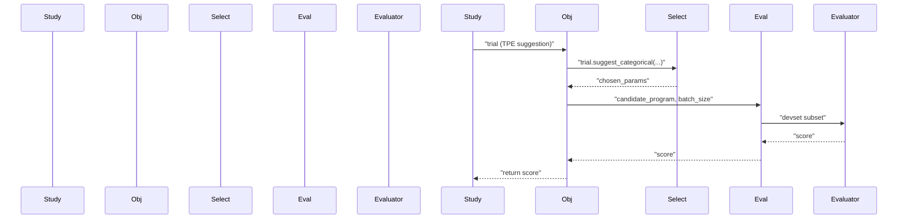

<!-- source: DeepWiki mcp.deepwiki.com · repo stanfordnlp/dspy · page 4.4 MIPROv2: Instruction & Parameter Optimization · fetched 2026-10-26 -->

# MIPROv2: Instruction & Parameter Optimization

Relevant source files

The following files were used as context for generating this wiki page:

- [docs/docs/api/models/BaseLM.md](docs/docs/api/models/BaseLM.md)
- [docs/docs/api/models/LM.md](docs/docs/api/models/LM.md)
- [docs/docs/api/modules/ReAct.md](docs/docs/api/modules/ReAct.md)
- [docs/docs/api/optimizers/InferRules.md](docs/docs/api/optimizers/InferRules.md)
- [docs/docs/api/optimizers/MIPROv2.md](docs/docs/api/optimizers/MIPROv2.md)
- [docs/docs/api/primitives/Tool.md](docs/docs/api/primitives/Tool.md)
- [dspy/propose/__init__.py](dspy/propose/__init__.py)
- [dspy/propose/dataset_summary_generator.py](dspy/propose/dataset_summary_generator.py)
- [dspy/propose/grounded_proposer.py](dspy/propose/grounded_proposer.py)
- [dspy/propose/propose_base.py](dspy/propose/propose_base.py)
- [dspy/propose/utils.py](dspy/propose/utils.py)
- [dspy/teleprompt/mipro_optimizer_v2.py](dspy/teleprompt/mipro_optimizer_v2.py)
- [dspy/teleprompt/utils.py](dspy/teleprompt/utils.py)
- [tests/propose/test_grounded_proposer.py](tests/propose/test_grounded_proposer.py)
- [tests/teleprompt/test_utils.py](tests/teleprompt/test_utils.py)

MIPROv2 (Multi-prompt Instruction PRoposal Optimizer, version 2) is DSPy's primary optimizer for jointly tuning both the instruction text and few-shot demonstration sets of every predictor in a program [docs/docs/api/optimizers/MIPROv2.md:1-3](). It treats prompt optimization as a search problem over discrete categorical parameters, using Bayesian Optimization to find the highest-performing combination [docs/docs/api/optimizers/MIPROv2.md:55-67]().

---

## How MIPROv2 Works

MIPROv2 optimizes a DSPy program by running three sequential phases:

1. **Bootstrap** — Generate multiple candidate few-shot demonstration sets from the training data [dspy/teleprompt/mipro_optimizer_v2.py:403-454]().
2. **Propose** — Use a `GroundedProposer` (itself an LM-powered module) to generate candidate instruction strings for each predictor [dspy/teleprompt/mipro_optimizer_v2.py:456-507]().
3. **Search** — Use Bayesian optimization (via Optuna's TPE sampler) to find the best combination of instructions and demo sets across all predictors [dspy/teleprompt/mipro_optimizer_v2.py:509-694]().

**Optimization Phases Diagram**

Sources: [dspy/teleprompt/mipro_optimizer_v2.py:110-276](), [dspy/teleprompt/mipro_optimizer_v2.py:403-454](), [dspy/teleprompt/mipro_optimizer_v2.py:456-507](), [dspy/teleprompt/mipro_optimizer_v2.py:509-694]()

---

## Class Overview

**MIPROv2 Class Hierarchy and Key Components**

Sources: [dspy/teleprompt/mipro_optimizer_v2.py:61-109](), [dspy/propose/grounded_proposer.py:114-246](), [dspy/propose/propose_base.py:1-13]()

---

## Constructor Parameters

`MIPROv2.__init__` accepts the following parameters:

| Parameter | Type | Default | Description |
|---|---|---|---|
| `metric` | `Callable` | required | Scoring function `(example, prediction, trace) -> float` [dspy/teleprompt/mipro_optimizer_v2.py:88]() |
| `prompt_model` | LM or `None` | `dspy.settings.lm` | LM used to generate instructions [dspy/teleprompt/mipro_optimizer_v2.py:91]() |
| `task_model` | LM or `None` | `dspy.settings.lm` | LM used to evaluate programs [dspy/teleprompt/mipro_optimizer_v2.py:90]() |
| `auto` | `"light"`, `"medium"`, `"heavy"`, or `None` | `"light"` | Auto-configure hyperparameters [dspy/teleprompt/mipro_optimizer_v2.py:84]() |
| `num_candidates` | `int` or `None` | `None` | Candidate count when `auto=None` [dspy/teleprompt/mipro_optimizer_v2.py:87]() |
| `max_bootstrapped_demos` | `int` | `4` | Max bootstrapped demos per predictor [dspy/teleprompt/mipro_optimizer_v2.py:92]() |
| `max_labeled_demos` | `int` | `4` | Max labeled demos per predictor [dspy/teleprompt/mipro_optimizer_v2.py:93]() |
| `seed` | `int` | `9` | Random seed for reproducibility [dspy/teleprompt/mipro_optimizer_v2.py:103]() |
| `init_temperature` | `float` | `1.0` | Temperature used when generating instructions [dspy/teleprompt/mipro_optimizer_v2.py:89]() |
| `metric_threshold` | `float` or `None` | `None` | Minimum metric score for bootstrap acceptance [dspy/teleprompt/mipro_optimizer_v2.py:102]() |

When `auto` is set, `num_candidates` and `num_trials` (in `compile`) must not be set—they are derived automatically [dspy/teleprompt/mipro_optimizer_v2.py:164-167]().

Sources: [dspy/teleprompt/mipro_optimizer_v2.py:62-109](), [dspy/teleprompt/mipro_optimizer_v2.py:154-169]()

---

## Auto-Run Modes

MIPROv2 provides three preset modes defined in `AUTO_RUN_SETTINGS` [dspy/teleprompt/mipro_optimizer_v2.py:46-50]():

| Mode | `n` (candidates) | `val_size` | Use case |
|---|---|---|---|
| `"light"` | 6 | 100 | Fast iteration [dspy/teleprompt/mipro_optimizer_v2.py:47]() |
| `"medium"` | 12 | 300 | Balanced cost/quality [dspy/teleprompt/mipro_optimizer_v2.py:48]() |
| `"heavy"` | 18 | 1000 | Maximum quality [dspy/teleprompt/mipro_optimizer_v2.py:49]() |

Sources: [dspy/teleprompt/mipro_optimizer_v2.py:47-51](), [dspy/teleprompt/mipro_optimizer_v2.py:291-319]()

---

## Phase 1: Bootstrapping Few-Shot Examples

`_bootstrap_fewshot_examples` delegates to `create_n_fewshot_demo_sets` in `dspy/teleprompt/utils.py` [dspy/teleprompt/mipro_optimizer_v2.py:441-452](). This function generates `num_fewshot_candidates` distinct demo sets per predictor.

Each set is produced by a different strategy based on `seed` [dspy/teleprompt/utils.py:328-418]():
- **Seed -3**: Zero-shot (empty)
- **Seed -2**: Labeled-only via `LabeledFewShot`
- **Seed -1**: Unshuffled via `BootstrapFewShot`
- **Seed ≥ 0**: Shuffled random bootstrapped sets

Sources: [dspy/teleprompt/mipro_optimizer_v2.py:403-454](), [dspy/teleprompt/utils.py:328-418]()

---

## Phase 2: Instruction Proposal via GroundedProposer

The `GroundedProposer` generates instruction candidates grounded in program code, dataset summaries, and existing demonstrations [dspy/propose/grounded_proposer.py:249-260]().

### GroundedProposer Context Signals

| Flag | Component | Source Code Reference |
|---|---|---|
| `program_aware_proposer` | `DescribeProgram` & `DescribeModule` | [dspy/propose/grounded_proposer.py:270-278]() |
| `data_aware_proposer` | `create_dataset_summary()` | [dspy/propose/grounded_proposer.py:262-268]() |
| `tip_aware_proposer` | `TIPS` dictionary selection | [dspy/propose/grounded_proposer.py:394-395]() |
| `fewshot_aware_proposer` | Bootstrapped demo context | [dspy/propose/grounded_proposer.py:171-180]() |

**GroundedProposer Data Flow**

Sources: [dspy/propose/grounded_proposer.py:249-417](), [dspy/propose/dataset_summary_generator.py:48-99](), [dspy/propose/utils.py:146-183]()

---

## Phase 3: Bayesian Optimization via Optuna

MIPROv2 uses `optuna` to search the joint space of instructions and demo sets [dspy/teleprompt/mipro_optimizer_v2.py:509-694]().

### Search Execution Flow

1. **Parameter Space**: Each predictor's instruction and demo set indices are defined as categorical parameters [dspy/teleprompt/mipro_optimizer_v2.py:754-785]().
2. **Objective Function**: The `objective(trial)` function suggests a combination, inserts it into the program, and evaluates it [dspy/teleprompt/mipro_optimizer_v2.py:754-785]().
3. **Minibatching**: Programs are evaluated on small batches (`minibatch_size`) to save costs, with full evaluations every `minibatch_full_eval_steps` [dspy/teleprompt/mipro_optimizer_v2.py:802-868]().
4. **Pruning**: Optuna can prune underperforming trials early based on intermediate scores [dspy/teleprompt/utils.py:99-105]().

**Search sequence diagram**

Sources: [dspy/teleprompt/mipro_optimizer_v2.py:509-694](), [dspy/teleprompt/utils.py:47-64](), [dspy/teleprompt/utils.py:74-113]()

---

## Implementation Details

### Instruction Set History
MIPROv2 tracks the performance of instructions over time using `create_predictor_level_history_string`, which aggregates scores for specific instruction strings across different trials to provide feedback to the proposer [dspy/propose/utils.py:78-127]().

### Dataset Summary Generation
The `create_dataset_summary` function uses `DatasetDescriptor` and `ObservationSummarizer` signatures to generate a 2-3 sentence overview of the training data [dspy/propose/dataset_summary_generator.py:7-19](), [dspy/propose/dataset_summary_generator.py:48-99]().

### Optuna Integration
The `_import_optuna` helper ensures the dependency is present before starting optimization [dspy/teleprompt/mipro_optimizer_v2.py:28-39](). The optimizer uses `optuna.samplers.TPESampler` for its search strategy [dspy/teleprompt/mipro_optimizer_v2.py:660-674]().

Sources: [dspy/propose/utils.py:78-127](), [dspy/propose/dataset_summary_generator.py:7-19](), [dspy/teleprompt/mipro_optimizer_v2.py:28-39]()

---

