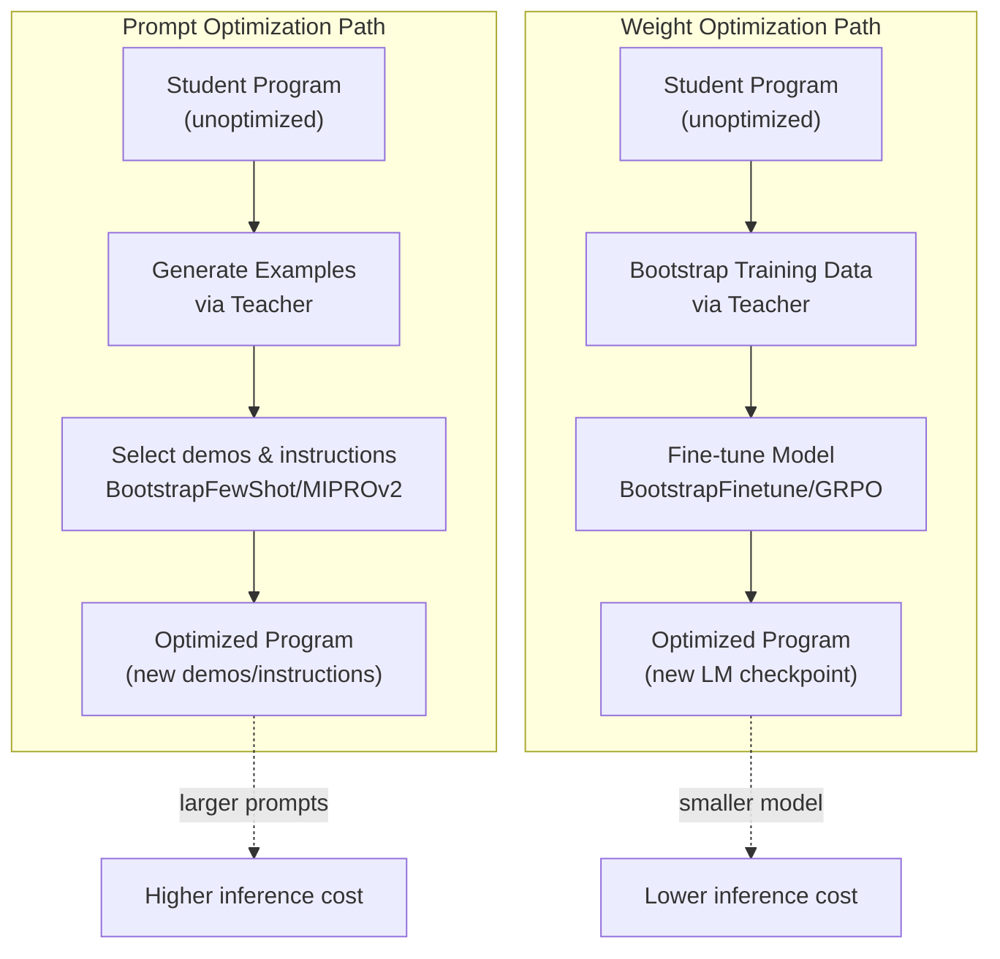
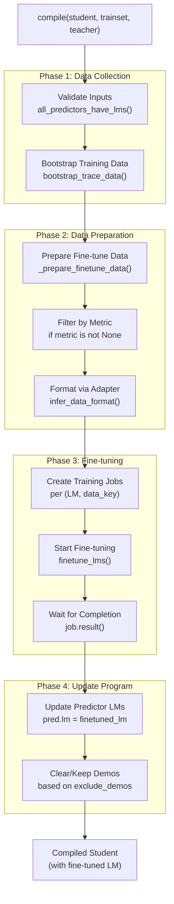
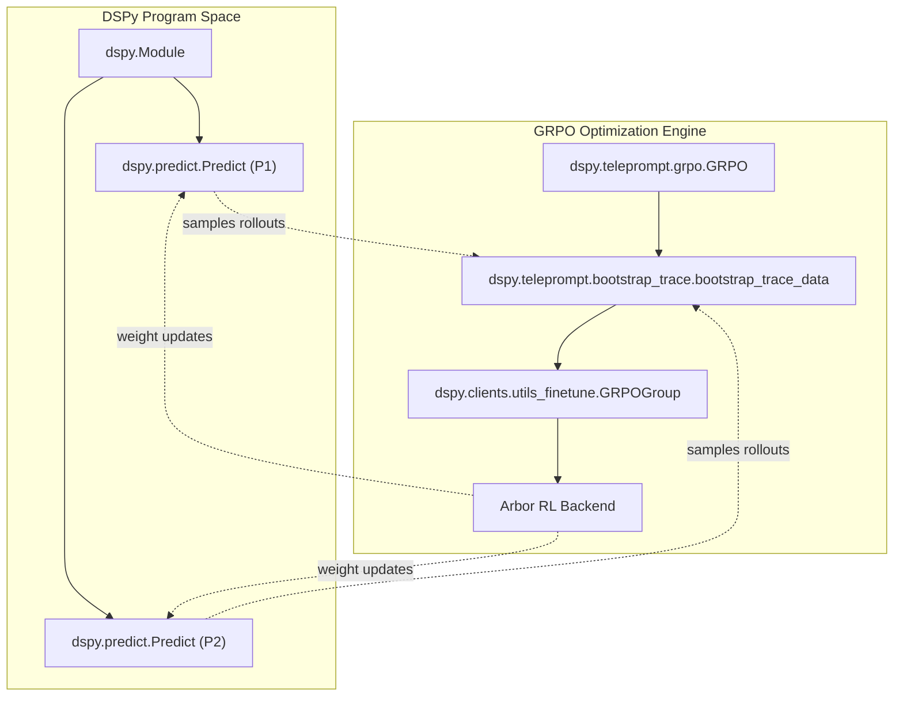
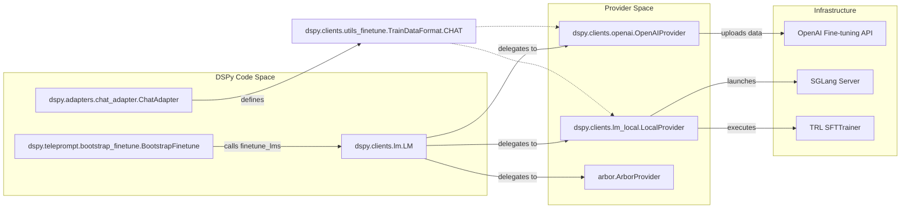

<!-- source: DeepWiki mcp.deepwiki.com · repo stanfordnlp/dspy · page 4.6 Fine-tuning & Weight Optimization · fetched 2026-10-26 -->

# Fine-tuning & Weight Optimization

<details>
<summary>Relevant source files</summary>

The following files were used as context for generating this wiki page:

- [docs/docs/api/optimizers/BetterTogether.md](docs/docs/api/optimizers/BetterTogether.md)
- [docs/docs/learn/optimization/optimizers.md](docs/docs/learn/optimization/optimizers.md)
- [docs/docs/learn/optimization/overview.md](docs/docs/learn/optimization/overview.md)
- [docs/docs/tutorials/rl_multihop/index.ipynb](docs/docs/tutorials/rl_multihop/index.ipynb)
- [docs/docs/tutorials/rl_papillon/index.ipynb](docs/docs/tutorials/rl_papillon/index.ipynb)
- [dspy/teleprompt/bettertogether.py](dspy/teleprompt/bettertogether.py)
- [dspy/teleprompt/bootstrap_finetune.py](dspy/teleprompt/bootstrap_finetune.py)
- [dspy/teleprompt/grpo.py](dspy/teleprompt/grpo.py)
- [tests/teleprompt/test_bettertogether.py](tests/teleprompt/test_bettertogether.py)
- [tests/teleprompt/test_bootstrap_finetune.py](tests/teleprompt/test_bootstrap_finetune.py)

</details>


This page documents DSPy's weight optimization capabilities, which distill program knowledge into model weights through supervised fine-tuning and reinforcement learning. Weight optimization complements prompt optimization (see [Few-Shot Optimizers](#4.3) and [MIPROv2: Instruction & Parameter Optimization](#4.4)) by creating specialized model checkpoints rather than updating in-context demonstrations or instructions.

For general optimization concepts and the `Teleprompter` base class, see [Optimization Overview](#4.1). For evaluation infrastructure used during optimization, see [Evaluation Framework](#4.2).

---

## Weight Optimization vs Prompt Optimization

DSPy provides two optimization strategies:

**Prompt Optimization** (covered in sections [Few-Shot Optimizers](#4.3), [MIPROv2: Instruction & Parameter Optimization](#4.4), [GEPA & SIMBA: Reflective and Stochastic Optimization](#4.5)):
- Modifies `Predict.demos` and `Predict.signature.instructions`.
- No model retraining required.
- Fast iteration cycles.
- Works with any LM provider.
- Results in larger prompts (token cost).

**Weight Optimization** (this page):
- Updates model parameters through fine-tuning or RL.
- Requires training infrastructure.
- Slower iteration cycles.
- Provider-dependent (must support fine-tuning interfaces).
- Results in specialized model checkpoints.
- Can distill larger models into smaller ones [docs/docs/learn/optimization/optimizers.md:65-69]().



**Diagram: Prompt vs Weight Optimization Paths**

**Sources:** [dspy/teleprompt/bootstrap_finetune.py:36-134](), [docs/docs/learn/optimization/optimizers.md:24-33]()

---

## BootstrapFinetune: Supervised Fine-Tuning

`BootstrapFinetune` is the primary teleprompter for supervised weight optimization. It generates training data by executing a teacher program, then fine-tunes the student's LM on successful traces [dspy/teleprompt/bootstrap_finetune.py:36-45]().

### Basic Usage

```python
import dspy

# Configure student with a finetunable LM
student = MyModule()
student.set_lm(dspy.LM("openai/local:Qwen/Qwen2.5-1.5B-Instruct"))

# Define metric for filtering training data
def metric(example, pred, trace=None):
    return example.answer == pred.answer

# Create optimizer
optimizer = dspy.BootstrapFinetune(
    metric=metric,
    multitask=True,  # Train all predictors with same data
    train_kwargs={
        "num_train_epochs": 3,
        "per_device_train_batch_size": 4,
    },
)

# Compile (starts fine-tuning)
compiled_student = optimizer.compile(
    student=student,
    trainset=trainset,
    teacher=teacher,  # Optional; uses student if None
)
```

**Sources:** [dspy/teleprompt/bootstrap_finetune.py:36-134]()

### Compilation Pipeline

The `compile` method orchestrates the full transition from a prompted program to a weight-optimized one [dspy/teleprompt/bootstrap_finetune.py:60-134]().



**Diagram: BootstrapFinetune Compilation Pipeline**

**Sources:** [dspy/teleprompt/bootstrap_finetune.py:60-134](), [dspy/teleprompt/bootstrap_trace.py:14-15]()

### Key Parameters

| Parameter | Type | Default | Description |
|-----------|------|---------|-------------|
| `metric` | `Callable` | `None` | Filters training data; only examples where `metric(example, pred, trace)` is truthy are used [dspy/teleprompt/bootstrap_finetune.py:39-39](). |
| `multitask` | `bool` | `True` | If `True`, all predictors train on the same data; if `False`, each predictor gets separate data [dspy/teleprompt/bootstrap_finetune.py:40-40](). |
| `train_kwargs` | `dict` | `None` | Passed to the fine-tuning backend [dspy/teleprompt/bootstrap_finetune.py:41-41](). |
| `adapter` | `Adapter` | `None` | Formats training data for the LM [dspy/teleprompt/bootstrap_finetune.py:42-42](). |
| `exclude_demos` | `bool` | `False` | If `True`, clears `Predict.demos` after fine-tuning to rely solely on weights [dspy/teleprompt/bootstrap_finetune.py:43-43](). |

**Sources:** [dspy/teleprompt/bootstrap_finetune.py:36-59]()

---

## BetterTogether: Meta-Optimization

`BetterTogether` is a meta-optimizer that combines prompt optimization and weight optimization in configurable sequences [dspy/teleprompt/bettertogether.py:32-39](). It is based on the insight that prompt optimization can discover reasoning strategies while weight optimization specializes the model to execute them [dspy/teleprompt/bettertogether.py:41-43]().

### Common Strategies
- **`"p -> w"`**: Optimize prompts first, then fine-tune [dspy/teleprompt/bettertogether.py:138-140]().
- **`"p -> w -> p"`**: Optimize prompts, fine-tune, then refine prompts on the new model weights [dspy/teleprompt/bettertogether.py:127-128]().
- **`"mipro -> gepa -> mipro"`**: Chaining different prompt optimizers before weight updates [dspy/teleprompt/bettertogether.py:109-122]().

**Sources:** [dspy/teleprompt/bettertogether.py:32-140](), [docs/docs/api/optimizers/BetterTogether.md:1-80]()

---

## GRPO: Online Reinforcement Learning

`GRPO` (Group Relative Policy Optimization) enables online reinforcement learning over DSPy programs [dspy/teleprompt/grpo.py:26-46](). It is specifically designed for multi-module programs where individual steps need to be optimized against a global reward [docs/docs/tutorials/rl_papillon/index.ipynb:11-13]().

### Arbor Integration

GRPO in DSPy utilizes the **Arbor** framework for serving and RL execution [docs/docs/tutorials/rl_papillon/index.ipynb:15-18](). This allows optimizing a student program's weights using relative rewards calculated across a group of rollouts [dspy/teleprompt/grpo.py:38-38]().

```python
import arbor
from arbor import ArborGRPO, ArborProvider

# Initialize Arbor server
arbor_server_info = arbor.init()

# Configure DSPy to use Arbor provider
local_lm = dspy.LM(
    model=f"openai/arbor:{local_lm_name}",
    provider=ArborProvider(),
    api_base=arbor_server_info["base_url"],
)
dspy.configure(lm=local_lm)
```

**Sources:** [docs/docs/tutorials/rl_papillon/index.ipynb:31-51](), [dspy/teleprompt/grpo.py:26-46]()

### RL Workflow Architecture

The `GRPO` optimizer bridges the gap between DSPy's high-level module structure and low-level RL backends like Arbor.



**Diagram: GRPO Multi-Module RL Architecture**

**Sources:** [dspy/teleprompt/grpo.py:26-111](), [docs/docs/tutorials/rl_papillon/index.ipynb:11-13](), [dspy/teleprompt/bootstrap_trace.py:14-21]()

### Key GRPO Parameters

| Parameter | Type | Description |
|-----------|------|-------------|
| `num_rollouts_per_grpo_step` | `int` | Number of samples per input to compute relative advantage [dspy/teleprompt/grpo.py:38-38](). |
| `num_train_steps` | `int` | Total RL iterations [dspy/teleprompt/grpo.py:35-35](). |
| `failure_score` | `float` | Reward assigned when a trace fails to complete [dspy/teleprompt/grpo.py:42-42](). |
| `format_failure_score` | `float` | Reward for traces that violate formatting constraints [dspy/teleprompt/grpo.py:43-43](). |

**Sources:** [dspy/teleprompt/grpo.py:26-64]()

---

## Infrastructure and Providers

Weight optimization requires integration with specific model providers that support fine-tuning or reinforcement learning interfaces.

### Provider Capabilities

Providers implement specific methods to handle the weight update process, often involving background jobs or local training loops.

- **OpenAI**: Supports supervised fine-tuning through the `TrainingJobOpenAI` abstraction [dspy/teleprompt/bootstrap_finetune.py:150-155]().
- **Local**: Uses the `LocalProvider` to trigger local fine-tuning sessions via backends like `SGLang` or `TRL` [dspy/teleprompt/bettertogether.py:133-137]().
- **Arbor**: Specialized for online RL (GRPO) workflows, providing the `ArborProvider` for communicating with the Arbor RL server [docs/docs/tutorials/rl_papillon/index.ipynb:34-41]().

### Data Flow for Fine-Tuning

The following diagram bridges the DSPy program logic with the underlying provider infrastructure, specifically focusing on how `BootstrapFinetune` interacts with model backends.



**Diagram: Fine-tuning Data Flow and Provider Mapping**

**Sources:** [dspy/teleprompt/bootstrap_finetune.py:137-150](), [dspy/clients/utils_finetune.py:58-61](), [docs/docs/tutorials/rl_papillon/index.ipynb:31-51]()

---

## Comparison of Weight-Based Optimizers

| Optimizer | Method | Primary Use Case |
|-----------|--------|------------------|
| `BootstrapFinetune` | Supervised Learning | Distilling teacher behavior into smaller model weights [dspy/teleprompt/bootstrap_finetune.py:36-45](). |
| `BetterTogether` | Hybrid | Iteratively improving both prompts and weights for maximum performance [dspy/teleprompt/bettertogether.py:32-43](). |
| `GRPO` | Reinforcement Learning | Optimizing complex multi-step reasoning against sparse rewards [dspy/teleprompt/grpo.py:26-46](). |

**Sources:** [dspy/teleprompt/bootstrap_finetune.py](), [dspy/teleprompt/bettertogether.py](), [dspy/teleprompt/grpo.py]()

---

