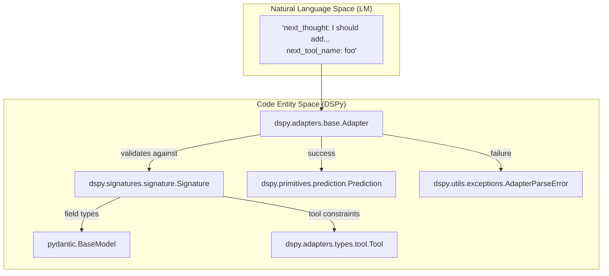
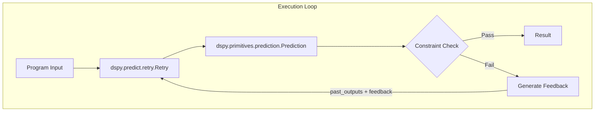
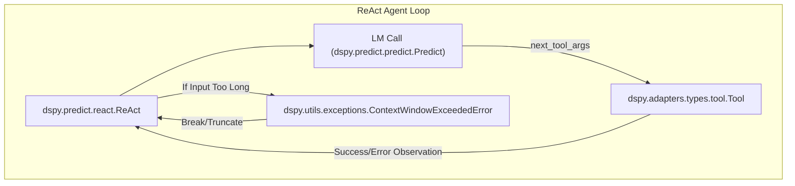

<!-- source: DeepWiki mcp.deepwiki.com · repo stanfordnlp/dspy · page 5.5 Assertions & Output Validation · fetched 2026-10-26 -->

# Assertions & Output Validation

Relevant source files

The following files were used as context for generating this wiki page:

- [dspy/predict/__init__.py](dspy/predict/__init__.py)
- [dspy/predict/react.py](dspy/predict/react.py)
- [dspy/predict/react_v2.py](dspy/predict/react_v2.py)
- [dspy/predict/retry.py](dspy/predict/retry.py)
- [dspy/utils/exceptions.py](dspy/utils/exceptions.py)
- [tests/predict/test_react.py](tests/predict/test_react.py)
- [tests/predict/test_react_v2.py](tests/predict/test_react_v2.py)
- [tests/reliability/README.md](tests/reliability/README.md)
- [tests/reliability/__init__.py](tests/reliability/__init__.py)
- [tests/reliability/conftest.py](tests/reliability/conftest.py)
- [tests/reliability/generate/__init__.py](tests/reliability/generate/__init__.py)
- [tests/reliability/generate/__main__.py](tests/reliability/generate/__main__.py)
- [tests/reliability/generate/utils.py](tests/reliability/generate/utils.py)
- [tests/reliability/reliability_conf.yaml](tests/reliability/reliability_conf.yaml)
- [tests/reliability/test_generated.py](tests/reliability/test_generated.py)
- [tests/reliability/test_pydantic_models.py](tests/reliability/test_pydantic_models.py)
- [tests/reliability/utils.py](tests/reliability/utils.py)
- [tests/utils/test_exceptions.py](tests/utils/test_exceptions.py)

This page documents DSPy's mechanisms for validating LM outputs, enforcing constraints, and recovering from errors through retry logic. DSPy provides several layers of validation, from structural type-checking to semantic judging and agentic self-correction.

---

## Architecture Overview

Validation in DSPy occurs across three primary layers: the **Signature/Adapter** layer (structural), the **Module** layer (procedural/agentic), and the **Error/Exception** layer (recovery).

| Layer | Component | Role | Implementation |
|---|---|---|---|
| **Structural** | `Adapter` & `Pydantic` | Enforces JSON/Type schemas | [dspy/signatures/signature.py:28-31]() |
| **Procedural** | `Retry` | Signature augmentation for error recovery | [dspy/predict/retry.py:8-50]() |
| **Recovery** | `Exception Handling` | Categorizes retryable vs fatal errors | [dspy/utils/exceptions.py:208-222]() |

---

## Structural Validation: Signatures & Types

DSPy uses `Signatures` to define the contract between the program and the LM. The framework leverages Python type hints and Pydantic to enforce these contracts.

### Type Enforcement
Signatures define `OutputField` types using Python type hints, `Pydantic` classes, or `Literal`. For instance, `ReAct` uses `Literal` to constrain tool selection [dspy/predict/react.py:77-77](). During signature construction, `ensure_signature` processes these definitions to ensure fields are correctly mapped to `InputField` and `OutputField` objects [dspy/signatures/signature.py:12-12]().

**Diagram: Signature-Level Validation Flow**

Sources: [dspy/signatures/signature.py:41-51](), [dspy/predict/react.py:73-79](), [dspy/utils/exceptions.py:14-14](), [dspy/adapters/types/tool.py:9-9]()

---

## Procedural Validation: The Retry Mechanism

The `dspy.Retry` module (currently implemented as a template for backtracking) is designed to handle failures by feeding "past" incorrect outputs and feedback back into the LM prompt.

### Signature Augmentation
When a module is wrapped in `Retry`, DSPy dynamically generates a `new_signature`. This signature includes:
1.  **Original Fields**: All original input fields from the base signature.
2.  **Past Outputs**: `past_{key}` fields for each output field that failed validation, providing the previous erroneous output to the LM [dspy/predict/retry.py:18-24]().
3.  **Feedback Field**: A `feedback` field containing instructions or error messages to help the LM correct its mistake [dspy/predict/retry.py:26-30]().

### Integration with Predictors
The `Retry` module overrides the `forward` pass to inject these historical fields into the keyword arguments (`kwargs`) before calling the underlying predictor [dspy/predict/retry.py:34-50]().

**Diagram: Retry Logic and Backtracking**

Sources: [dspy/predict/retry.py:8-50](), [dspy/predict/retry.py:18-32]()

---

## Error Recovery and Exception Handling

DSPy categorizes errors to distinguish between transient failures (retryable) and structural failures (fatal).

### Retryable vs. Fatal Errors
The utility function `is_retryable_lm_error` identifies exceptions that are generally safe to retry, such as rate limits or server timeouts [dspy/utils/exceptions.py:211-223]().

*   **Retryable Errors**: `LMRateLimitError`, `LMTimeoutError`, `LMServerError`, `LMTransportError` [dspy/utils/exceptions.py:208-208]().
*   **Fatal Errors**: `LMAuthError`, `LMBillingError`, `LMInvalidRequestError` [dspy/utils/exceptions.py:135-161]().

### Context Window Management
The `ContextWindowExceededError` is a specialized `LMInvalidRequestError` used to signal that the input is too long for the model [dspy/utils/exceptions.py:163-179](). Modules like `ReAct` catch this specifically to terminate loops or truncate trajectories [dspy/predict/react.py:101-103]().

---

## Validation in Agentic Loops (ReAct)

Agentic modules like `ReAct` and `ReActV2` implement internal validation loops to handle tool execution errors and malformed tool calls.

1.  **Tool Execution Validation**: If a tool call fails, the error is captured via `format_error_for_lm` and appended to the `trajectory` as an observation, allowing the model to reason about the failure in the next iteration [dspy/predict/react.py:112-115]().
2.  **Trajectory Truncation**: To prevent context window overflows during long validation loops, `ReAct` includes logic to catch `ContextWindowExceededError` and break the loop [dspy/predict/react.py:99-103]().
3.  **Final Output Submission**: `ReActV2` uses a reserved `submit` tool to validate that all required output fields from the original signature are present before terminating [dspy/predict/react_v2.py:37-58]().

**Diagram: ReAct Validation Loop**

Sources: [dspy/predict/react.py:95-121](), [dspy/predict/react_v2.py:128-149](), [dspy/utils/exceptions.py:8-9]()

---

## Summary of Validation Patterns

| Pattern | Module/Utility | Best Use Case |
|---|---|---|
| **Structural Check** | `Signature` + `Pydantic` | Ensuring field presence and basic type safety [dspy/signatures/signature.py:12-12](). |
| **Feedback Loop** | `dspy.Retry` | Dynamically updating prompts with error context [dspy/predict/retry.py:18-32](). |
| **Error Classification** | `is_retryable_lm_error` | Orchestrating network-level retries [dspy/utils/exceptions.py:211-223](). |
| **Agentic Recovery** | `ReAct` / `ReActV2` | Handling tool execution errors and iterative reasoning [dspy/predict/react.py:112-115](). |
| **Judge-Based Validation**| `assert_program_output_correct` | Using an LLM "Judge" to validate semantic correctness [tests/reliability/utils.py:15-41](). |

Sources: [dspy/signatures/signature.py:12-12](), [dspy/predict/retry.py:8-50](), [dspy/utils/exceptions.py:208-223](), [dspy/predict/react.py:16-43](), [tests/reliability/utils.py:15-41]()

---

