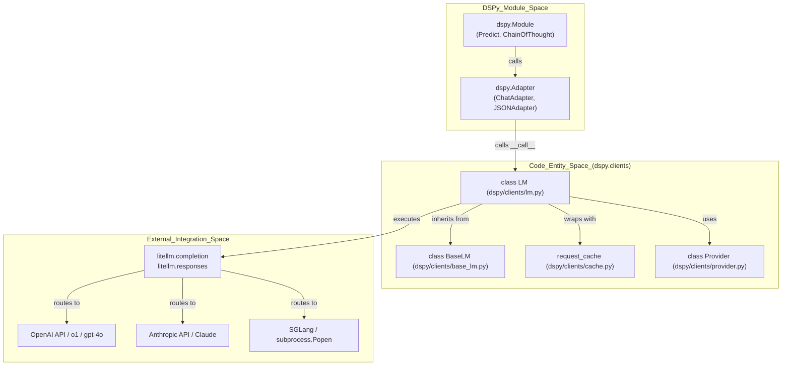

<!-- source: DeepWiki mcp.deepwiki.com · repo stanfordnlp/dspy · page 6.2 Model Providers & LiteLLM Integration · fetched 2026-10-26 -->

# Model Providers & LiteLLM Integration

<details>
<summary>Relevant source files</summary>

The following files were used as context for generating this wiki page:

- [docs/docs/api/utils/Errors.md](docs/docs/api/utils/Errors.md)
- [docs/docs/faqs.md](docs/docs/faqs.md)
- [docs/docs/learn/programming/language_models.md](docs/docs/learn/programming/language_models.md)
- [dspy/clients/_litellm.py](dspy/clients/_litellm.py)
- [dspy/clients/base_lm.py](dspy/clients/base_lm.py)
- [dspy/clients/databricks.py](dspy/clients/databricks.py)
- [dspy/clients/lm.py](dspy/clients/lm.py)
- [dspy/clients/lm_local.py](dspy/clients/lm_local.py)
- [dspy/clients/openai.py](dspy/clients/openai.py)
- [dspy/clients/provider.py](dspy/clients/provider.py)
- [dspy/clients/utils_finetune.py](dspy/clients/utils_finetune.py)
- [dspy/utils/dummies.py](dspy/utils/dummies.py)
- [dspy/utils/lazy_import.py](dspy/utils/lazy_import.py)
- [tests/clients/test_lazy_litellm_import.py](tests/clients/test_lazy_litellm_import.py)
- [tests/clients/test_lm.py](tests/clients/test_lm.py)
- [tests/clients/test_lm_local.py](tests/clients/test_lm_local.py)
- [tests/utils/test_lazy_import.py](tests/utils/test_lazy_import.py)

</details>


This document describes how DSPy integrates with language model providers through the LiteLLM abstraction layer. It covers the `dspy.LM` client, supported providers (OpenAI, Anthropic, Databricks, local models via SGLang), and provider-specific features like fine-tuning and reasoning models.

---

## Purpose and Architecture

DSPy uses [LiteLLM](https://github.com/BerriAI/litellm) as its primary abstraction layer for language model providers. This design allows DSPy to support 100+ LM providers through a single unified interface while providing consistent caching, retry logic, and history tracking across all providers.

The `dspy.LM` class [dspy/clients/lm.py:56-78]() serves as the primary interface between DSPy modules and language models, handling:
- Provider abstraction via LiteLLM [dspy/clients/lm.py:142-146]().
- Request formatting and response parsing [dspy/clients/lm.py:123-139]().
- Caching (memory and disk) [dspy/clients/lm.py:173-185]().
- Retry logic with exponential backoff [dspy/clients/lm.py:92-94]().
- History tracking [dspy/clients/base_lm.py:207-220]().
- Provider-specific features (function calling, reasoning modes, fine-tuning).

### System-to-Code Mapping: LM Execution Flow

The following diagram bridges the natural language concepts of "Request Processing" to the specific code entities in the `dspy` client layer.



**Sources:** [dspy/clients/lm.py:56-113](), [dspy/clients/base_lm.py:57-114](), [dspy/clients/provider.py:180-210](), [dspy/clients/lm_local.py:71-76]()

---

## The dspy.LM Class

### Basic Construction

The `dspy.LM` class is initialized with a model string, typically in the format `"provider/model_name"`. It automatically infers the provider if not explicitly passed [dspy/clients/lm.py:115]().

```python
import dspy

# OpenAI GPT-4o
lm = dspy.LM(model="openai/gpt-4o", temperature=0.7, max_tokens=1000)

# Local SGLang (using LocalProvider logic)
lm = dspy.LM("openai/meta-llama/Meta-Llama-3-8B-Instruct")
```

**Sources:** [dspy/clients/lm.py:63-113](), [dspy/clients/lm.py:115-119]()

### Model Types and API Formats

DSPy supports three `model_type` values corresponding to different execution paths [dspy/clients/lm.py:66]():

1.  **Chat API** (`model_type="chat"`): Default for most modern models. Uses `litellm.completion()`.
2.  **Text Completion API** (`model_type="text"`): For legacy models.
3.  **Responses API** (`model_type="responses"`): Specialized for reasoning models (o1, o3, gpt-5).

**Sources:** [dspy/clients/lm.py:66](), [dspy/clients/base_lm.py:186-187](), [dspy/clients/lm.py:85-86]()

---

## Provider Support and Specialization

### Major Provider Integration Patterns

| Provider | Model Prefix | Auth / Config |
|----------|--------------|---------------|
| **OpenAI** | `openai/` | `OPENAI_API_KEY` env var [docs/docs/learn/programming/language_models.md:10]() |
| **Databricks** | `databricks/` | `DATABRICKS_API_KEY` and `DATABRICKS_API_BASE` [docs/docs/learn/programming/language_models.md:83-84]() |
| **Local (SGLang)** | `local:` or `huggingface/` | Handled by `LocalProvider.launch` [dspy/clients/lm_local.py:47-52]() |
| **Vertex AI** | `vertex_ai/` | `GOOGLE_APPLICATION_CREDENTIALS` [docs/docs/learn/programming/language_models.md:44-67]() |

**Sources:** [dspy/clients/lm.py:142-146](), [dspy/clients/openai.py:49-55](), [dspy/clients/lm_local.py:47-52](), [dspy/clients/databricks.py:54-55]()

### OpenAI Reasoning Models (o1, o3, gpt-5)

DSPy includes specialized handling for OpenAI's reasoning family [dspy/clients/lm.py:48-53](). It uses a regex pattern to detect these models and enforces strict parameter constraints:
- `temperature` must be `1.0` or `None` [dspy/clients/lm.py:126-132]().
- `max_tokens` must be `>= 16000` or `None` [dspy/clients/lm.py:126-132]().
- It maps `max_tokens` to `max_completion_tokens` internally [dspy/clients/lm.py:133]().

**Sources:** [dspy/clients/lm.py:48-53](), [dspy/clients/lm.py:125-139](), [tests/clients/test_lm.py:205-212]()

### Local Models via SGLang
The `LocalProvider` supports launching local inference servers using `sglang` [dspy/clients/lm_local.py:31-36]().
- **Launch**: Uses `subprocess.Popen` to start `sglang.launch_server` on a free port [dspy/clients/lm_local.py:56-76]().
- **Lifecycle**: Provides `launch()` and `kill()` methods to manage the server process [dspy/clients/lm_local.py:29, 131]().
- **Logs**: Streams and buffers server logs, accessible via `lm.get_logs()` [dspy/clients/lm_local.py:117-126]().

**Sources:** [dspy/clients/lm_local.py:22-143](), [tests/clients/test_lm_local.py:7-40]()

---

## Fine-tuning and Training Jobs

DSPy provides a `Provider` abstraction for models that support fine-tuning (e.g., OpenAI, Databricks, or Local).

### Code Entity Space: Provider and Training Architecture

```mermaid
graph TD
    subgraph "Training_Infrastructure_(dspy.clients.provider)"
        Provider["class Provider"]
        TrainingJob["class TrainingJob<br/>(Future-based)"]
        ReinforceJob["class ReinforceJob"]
    end
    
    subgraph "Implementation_(dspy.clients.openai)"
        OAIProvider["class OpenAIProvider"]
        OAITrainingJob["class TrainingJobOpenAI"]
    end
    
    subgraph "Implementation_(dspy.clients.databricks)"
        DBProvider["class DatabricksProvider"]
        DBTrainingJob["class TrainingJobDatabricks"]
    end
    
    Provider <|-- OAIProvider
    Provider <|-- DBProvider
    TrainingJob <|-- OAITrainingJob
    TrainingJob <|-- DBTrainingJob
    
    OAIProvider -- "interacts with" --> OAIApi["openai.fine_tuning.jobs"]
    DBProvider -- "interacts with" --> DBApi["databricks.model_training"]
```

**Sources:** [dspy/clients/provider.py:12-180](), [dspy/clients/openai.py:11-100](), [dspy/clients/databricks.py:19-43]()

### Fine-tuning Workflow
The fine-tuning process is initiated via the `Provider.finetune` method.
1.  **Format**: Convert traces into `TrainDataFormat.CHAT` or `COMPLETION` [dspy/clients/utils_finetune.py:23-26]().
2.  **Submit**: Call the provider's `finetune` method. 
    - For OpenAI, this uploads data via `openai.files.create` and starts a job via `openai.fine_tuning.jobs.create` [dspy/clients/openai.py:167-183]().
    - For Databricks, it uses `foundation_model.create` and handles endpoint deployment via `deploy_finetuned_model` [dspy/clients/databricks.py:51-165]().

**Sources:** [dspy/clients/openai.py:63-100](), [dspy/clients/databricks.py:168-200](), [dspy/clients/utils_finetune.py:58-61]()

---

## Caching and Performance

DSPy implements a caching system via the `request_cache` decorator [dspy/clients/lm.py:175-178]().

### Cache Control: rollout_id
To bypass the cache for optimization, users can provide a `rollout_id` [dspy/clients/lm.py:98-102](). 
- If `temperature > 0`, changing the `rollout_id` generates a new cache entry even for identical prompts [tests/clients/test_lm.py:134-179]().
- If `temperature == 0`, `rollout_id` has no effect, and DSPy issues a warning [dspy/clients/lm.py:165-171]().

**Sources:** [dspy/clients/lm.py:165-178](), [tests/clients/test_lm.py:134-180]()

---

## History and Usage Tracking

The `BaseLM` class manages request history and usage data [dspy/clients/base_lm.py:207-220]().
- **Entry Structure**: Includes prompt, messages, kwargs, response, usage, and cost [dspy/clients/base_lm.py:17-18]().
- **Usage Tracking**: Token usage is captured and added to the `usage_tracker` if configured [tests/clients/test_lm.py:87-98]().
- **Cost Tracking**: Costs are calculated from the response metadata using provider-specific logic [dspy/clients/base_lm.py:11]().

**Sources:** [dspy/clients/base_lm.py:17-18](), [dspy/clients/base_lm.py:207-220](), [tests/clients/test_lm.py:87-98]()

---

