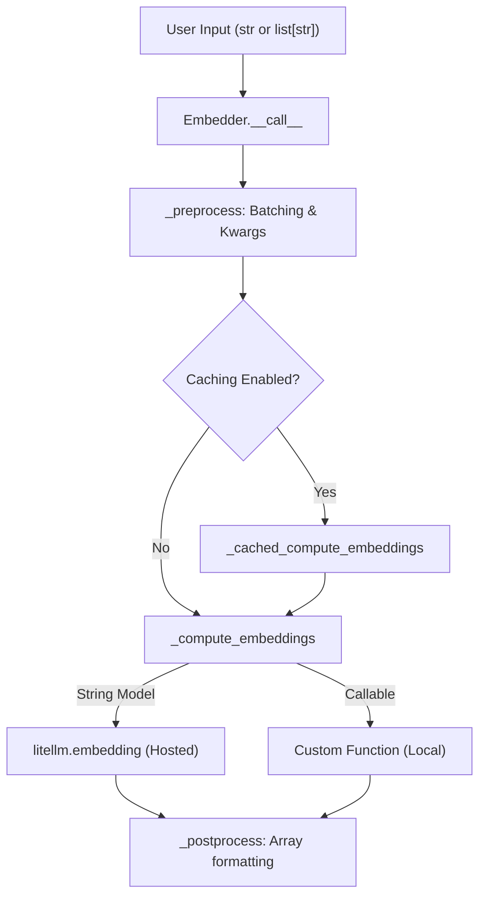
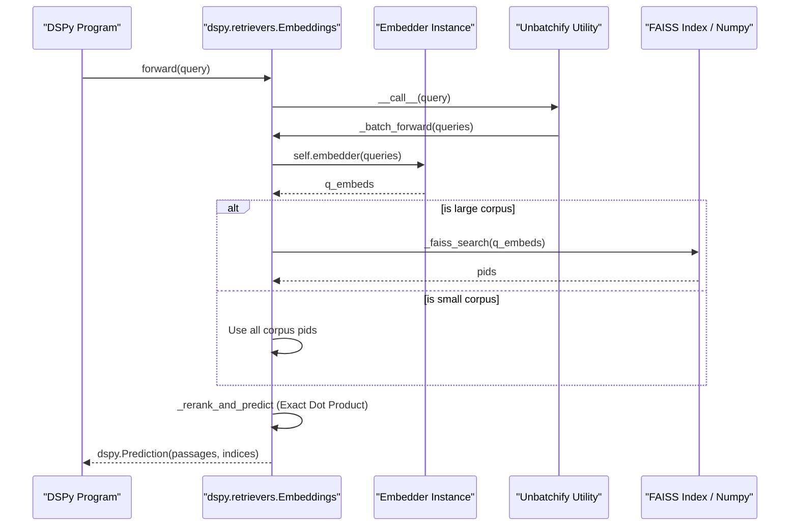

<!-- source: DeepWiki mcp.deepwiki.com · repo stanfordnlp/dspy · page 6.3 Vector Databases & Retrieval · fetched 2026-10-26 -->

# Vector Databases & Retrieval

Relevant source files

The following files were used as context for generating this wiki page:

- [docs/docs/api/evaluation/Evaluate.md](docs/docs/api/evaluation/Evaluate.md)
- [docs/docs/api/evaluation/answer_exact_match.md](docs/docs/api/evaluation/answer_exact_match.md)
- [docs/docs/api/evaluation/answer_passage_match.md](docs/docs/api/evaluation/answer_passage_match.md)
- [docs/docs/api/models/Embedder.md](docs/docs/api/models/Embedder.md)
- [docs/docs/api/optimizers/KNN.md](docs/docs/api/optimizers/KNN.md)
- [dspy/dsp/colbertv2.py](dspy/dsp/colbertv2.py)
- [dspy/dsp/utils/dpr.py](dspy/dsp/utils/dpr.py)
- [dspy/dsp/utils/utils.py](dspy/dsp/utils/utils.py)
- [dspy/retrievers/__init__.py](dspy/retrievers/__init__.py)
- [dspy/retrievers/embeddings.py](dspy/retrievers/embeddings.py)
- [dspy/utils/caching.py](dspy/utils/caching.py)
- [dspy/utils/unbatchify.py](dspy/utils/unbatchify.py)
- [tests/retrievers/test_colbertv2.py](tests/retrievers/test_colbertv2.py)
- [tests/retrievers/test_embeddings.py](tests/retrievers/test_embeddings.py)
- [tests/teleprompt/test_ensemble.py](tests/teleprompt/test_ensemble.py)
- [tests/teleprompt/test_finetune.py](tests/teleprompt/test_finetune.py)
- [tests/teleprompt/test_grpo.py](tests/teleprompt/test_grpo.py)

This page documents DSPy's retrieval architecture, focusing on the `Embedder` class, the `ColBERTv2` client, and the `dspy.retrievers` system. It covers how DSPy bridges the gap between natural language queries and vector-based search through hosted and local embedding models.

---

## Role of Retrieval in DSPy

Retrieval components in DSPy serve as data sources that programs query to fetch relevant context. The core abstraction involves taking a string query, converting it to a vector representation (via an `Embedder`), and searching a corpus (via a retriever like `Embeddings`).

DSPy does not treat retrieval as a special construct—retrievers are ordinary Python callables or `dspy.Module` subclasses that can be embedded in any `forward` method. The `Retrieve` module serves as the primary interface for these operations [dspy/retrievers/retrieve.py:1-10]().

Sources: [dspy/retrievers/embeddings.py:13-19](), [dspy/retrievers/retrieve.py:1-10]()

---

## The Embedder Class

The `Embedder` class provides a unified interface for computing text embeddings. It supports both hosted models (via `litellm`) and local functions (e.g., `sentence-transformers`).

### Key Features
- **Batching**: Automatically splits large input lists into smaller chunks based on `batch_size` (default 200).
- **Caching**: Integrates with the DSPy global cache to avoid redundant API calls.
- **Async Support**: Provides `acall` for asynchronous embedding generation.
- **Serialization Safety**: Supports `restrict_pickle` mode in the cache to safely deserialize `numpy.ndarray` and other trusted types.

### Implementation Flow

Sources: [docs/docs/api/models/Embedder.md:1-21](), [dspy/retrievers/embeddings.py:33-38]()

---

## ColBERTv2 Integrations

DSPy provides specialized support for **ColBERTv2**, a multi-vector ranking model. It supports both remote (HTTP) and local (indexed) execution.

### Remote Client (`ColBERTv2`)
The `ColBERTv2` class acts as a client for a hosted server. It supports both `GET` and `POST` requests and includes automatic caching via the `@request_cache` decorator [dspy/dsp/colbertv2.py:40-41](), [dspy/dsp/colbertv2.py:68-69](). It defaults to `http://0.0.0.0` [dspy/dsp/colbertv2.py:16]().

### Local Retriever (`ColBERTv2RetrieverLocal`)
For local use, this class manages the index lifecycle:
1. **Build**: Uses `colbert.Indexer` to create a searchable representation of a passage collection [dspy/dsp/colbertv2.py:130-144]().
2. **Search**: Uses `colbert.Searcher` to perform retrieval, supporting GPU acceleration and PID filtering via a `filter_fn` [dspy/dsp/colbertv2.py:165-186]().

### Local Reranker (`ColBERTv2RerankerLocal`)
DSPy also includes a local reranker that uses a ColBERT checkpoint to score pairs of queries and passages [dspy/dsp/colbertv2.py:189-200]().

Sources: [dspy/dsp/colbertv2.py:11-37](), [dspy/dsp/colbertv2.py:93-128](), [dspy/dsp/colbertv2.py:165-186](), [dspy/dsp/colbertv2.py:189-200]()

---

## Vector Store & Embedding Retrieval

The `dspy.retrievers.Embeddings` class implements a standard vector search workflow. It handles small corpora with brute-force search and transitions to **FAISS** for larger datasets.

### Search Strategy Selection
- **Brute Force**: Used if `len(corpus) < brute_force_threshold` (default 20,000) [dspy/retrievers/embeddings.py:28-41]().
- **FAISS Index**: For larger corpora, it builds an `IndexIVFPQ` (Inverted File with Product Quantization) to enable fast approximate search [dspy/retrievers/embeddings.py:70-91]().

### Unbatching and Efficiency
To handle high-throughput scenarios, the `Embeddings` class utilizes the `Unbatchify` utility [dspy/retrievers/embeddings.py:42](). This allows single-query calls to be transparently batched together for more efficient GPU/API utilization [dspy/retrievers/embeddings.py:61-68](). The `Unbatchify` class manages a background worker thread and an input queue to process these batches [dspy/utils/unbatchify.py:8-31]().

### Data Flow: Query to Prediction

Sources: [dspy/retrievers/embeddings.py:44-68](), [dspy/retrievers/embeddings.py:93-108](), [dspy/utils/unbatchify.py:33-49]()

---

## Persistence and Serialization

The `Embeddings` class supports saving and loading indices to avoid recomputing embeddings for static corpora.

- **`save(path)`**: Writes a `config.json` (metadata), `corpus_embeddings.npy` (raw vectors), and `faiss_index.bin` (if applicable) to the specified directory [dspy/retrievers/embeddings.py:114-149]().
- **`load(path, embedder)`**: Restores the state from disk. It requires the original `embedder` to be passed back in to handle future queries [dspy/retrievers/embeddings.py:150-194]().
- **`from_saved(path, embedder)`**: A convenience class method to instantiate and load a retriever in one call [dspy/retrievers/embeddings.py:202-206]().

### Scoring Support
The `EmbeddingsWithScores` subclass extends the base retrieval to return similarity scores alongside passages and indices [dspy/retrievers/embeddings.py:209-223]().

Sources: [dspy/retrievers/embeddings.py:114-206](), [dspy/retrievers/embeddings.py:209-223](), [tests/retrievers/test_embeddings.py:78-112]()

---

## Summary of Retrieval Components

| Code Entity | File Path | Role | Key Dependencies |
|:---|:---|:---|:---|
| `Embedder` | `dspy/clients/embedding.py` | Vectorizes text | `litellm`, `numpy` |
| `ColBERTv2` | `dspy/dsp/colbertv2.py` | Remote ColBERT client | `requests` |
| `ColBERTv2RetrieverLocal` | `dspy/dsp/colbertv2.py` | Local ColBERT search | `colbert-ai`, `torch` |
| `Embeddings` | `dspy/retrievers/embeddings.py` | Vector DB abstraction | `faiss-cpu`, `numpy` |
| `Unbatchify` | `dspy/utils/unbatchify.py` | Thread-safe batching | `queue`, `threading` |
| `Retrieve` | `dspy/retrievers/retrieve.py` | High-level RAG module | `dspy.Module` |

Sources: [dspy/dsp/colbertv2.py:11](), [dspy/dsp/colbertv2.py:93](), [dspy/retrievers/embeddings.py:13](), [dspy/retrievers/retrieve.py:1](), [dspy/utils/unbatchify.py:8]()

---

