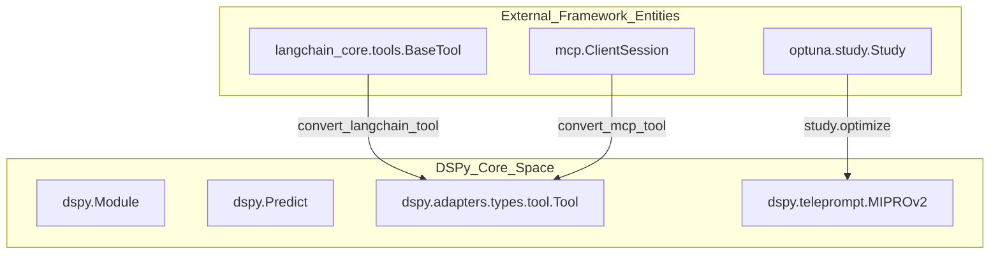
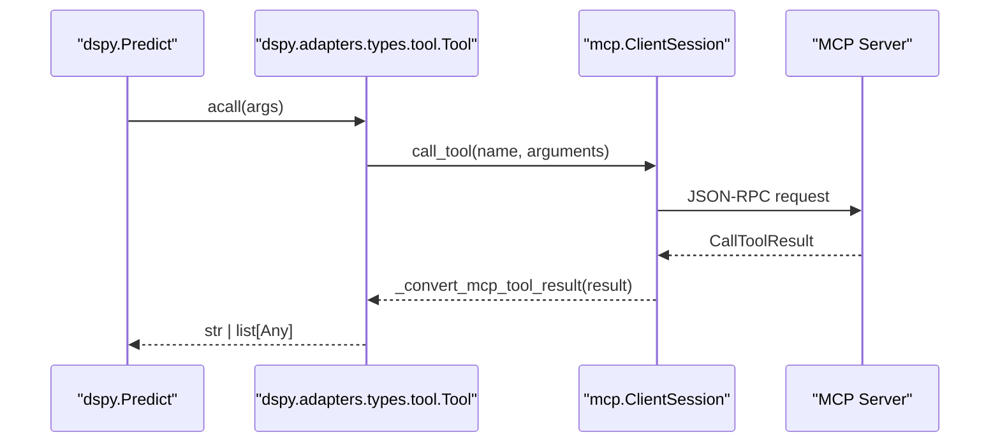

<!-- source: DeepWiki mcp.deepwiki.com · repo stanfordnlp/dspy · page 6.5 External Framework Integration · fetched 2026-10-26 -->

# External Framework Integration

Relevant source files

The following files were used as context for generating this wiki page:

- [.github/.internal_dspyai/pyproject.toml](.github/.internal_dspyai/pyproject.toml)
- [.github/.tmp/.generated-actions/run-pypi-publish-in-docker-container/action.yml](.github/.tmp/.generated-actions/run-pypi-publish-in-docker-container/action.yml)
- [.github/workflows/dependency-range.yml](.github/workflows/dependency-range.yml)
- [dspy/__metadata__.py](dspy/__metadata__.py)
- [dspy/utils/langchain_tool.py](dspy/utils/langchain_tool.py)
- [dspy/utils/mcp.py](dspy/utils/mcp.py)
- [pyproject.toml](pyproject.toml)
- [tests/utils/resources/mcp_server.py](tests/utils/resources/mcp_server.py)
- [tests/utils/test_langchain_tool.py](tests/utils/test_langchain_tool.py)
- [tests/utils/test_mcp.py](tests/utils/test_mcp.py)
- [uv.lock](uv.lock)

## Purpose and Scope

This document explains how DSPy integrates with external LLM frameworks including LangChain, Optuna, and the Model Context Protocol (MCP). DSPy is designed to **complement** these frameworks, offering specialized optimization capabilities and tool conversion utilities. This page covers the technical implementation of these integrations via optional dependencies and specific utility classes that map external schemas to internal DSPy primitives.

For information about integrating with vector databases (ColBERT, Pinecone), see [Vector Databases & Retrieval (6.3)](). For observability integrations, see [Observability & Monitoring (6.4)]().

## Integration Philosophy

DSPy treats external frameworks as providers of either **Infrastructure** (retrievers, tools) or **Optimization Engines** (Bayesian search). The integration architecture relies on "Adapters" and "Converters" that map external schemas to internal DSPy primitives like `dspy.Signature` and `dspy.adapters.types.tool.Tool` [dspy/adapters/types/tool.py:3-47]().

### Bridging External Entities to DSPy Core
The following diagram illustrates how external code entities are mapped into the DSPy `Module` and `Tool` ecosystem.

Sources: [dspy/utils/mcp.py:30-47](), [dspy/utils/langchain_tool.py:10-47](), [pyproject.toml:40-47]()

## Package Dependencies

DSPy uses optional dependencies to keep the core installation lightweight. These are defined in `pyproject.toml` [pyproject.toml:40-47]().

| Framework | Optional Dependency | Role |
| :--- | :--- | :--- |
| **LangChain** | `langchain` | Tool conversion and integration with LangChain's ecosystem [pyproject.toml:45]() |
| **Optuna** | `optuna` | Bayesian optimization for prompt and demo search [pyproject.toml:46]() |
| **MCP** | `mcp` | Standardized tool access via Model Context Protocol [pyproject.toml:43]() |
| **Anthropic** | `anthropic` | Native Anthropic client support [pyproject.toml:41]() |
| **Weaviate** | `weaviate` | Vector store integration [pyproject.toml:42]() |

Sources: [pyproject.toml:40-47](), [uv.lock:1-58]()

## LangChain Integration

DSPy integrates with LangChain primarily through tool conversion, allowing LangChain's extensive ecosystem of tools to be used directly within DSPy modules like `ReAct` or `Predict`.

### Tool Conversion Implementation
The `convert_langchain_tool` function transforms a `langchain_core.tools.BaseTool` into a `dspy.adapters.types.tool.Tool` [dspy/utils/langchain_tool.py:10-21]().

1.  **Schema Extraction**: It accesses `tool.args_schema` and calls `model_json_schema()` to extract the input requirements [dspy/utils/langchain_tool.py:31-32]().
2.  **Type Mapping**: It maps LangChain's Pydantic-based argument schemas to Python type hints using `field.annotation` [dspy/utils/langchain_tool.py:35-38]().
3.  **Async Wrapping**: It wraps the tool's `ainvoke` method into an async function that handles dictionary-based keyword arguments [dspy/utils/langchain_tool.py:22-27]().

Sources: [dspy/utils/langchain_tool.py:10-47](), [tests/utils/test_langchain_tool.py:15-52]()

## Model Context Protocol (MCP) Integration

DSPy supports the Model Context Protocol to interface with standardized MCP servers. This is handled by `convert_mcp_tool` [dspy/utils/mcp.py:30]().

### Technical Workflow
- **Session Management**: The converter requires an active `mcp.ClientSession` to communicate with the MCP server [dspy/utils/mcp.py:30-34]().
- **Dynamic Argument Parsing**: It uses `convert_input_schema_to_tool_args` [dspy/utils/mcp.py:40]() to parse the MCP `inputSchema` into DSPy-readable arguments and descriptions.
- **Result Handling**: The `_convert_mcp_tool_result` helper processes `TextContent` vs. non-text contents and raises `RuntimeError` if the MCP server returns an error flag [dspy/utils/mcp.py:9-27]().
- **Tool Creation**: It returns a `dspy.adapters.types.tool.Tool` instance wrapping the async call to `session.call_tool` [dspy/utils/mcp.py:43-47]().

### MCP Data Flow

Sources: [dspy/utils/mcp.py:9-47](), [tests/utils/test_mcp.py:14-99]()

## Optuna Integration

Optuna serves as the primary engine for Bayesian optimization in DSPy's advanced teleprompters, specifically for instruction and few-shot example selection.

### Bayesian Search Backends
- **MIPROv2**: Uses Optuna to navigate the high-dimensional search space of instruction proposals and example sets. The integration is guarded by version checks, requiring `optuna>=3.4.0` [pyproject.toml:46]().
- **Resource Management**: During optimization, DSPy uses Optuna's `Study` object to track trials and objective values (metrics) across parallel execution threads.

Sources: [pyproject.toml:46](), [pyproject.toml:69]()

## Integration Summary Table

| Feature | Code Entity | Dependency | Purpose |
| :--- | :--- | :--- | :--- |
| **LangChain Tooling** | `convert_langchain_tool` | `langchain_core` | Use LangChain tools in DSPy modules [dspy/utils/langchain_tool.py:10]() |
| **MCP Support** | `convert_mcp_tool` | `mcp` | Interface with MCP servers for standardized tools [dspy/utils/mcp.py:30]() |
| **Bayesian Search** | `MIPROv2` | `optuna` | High-dimensional search for instructions and examples [pyproject.toml:46]() |
| **Local JS/TS** | `deno` | `deno` | Secure execution of code generated by ProgramOfThought [pyproject.toml:44]() |
| **Multi-modal** | `pillow` | `pillow` | Image processing for multimodal Signatures [pyproject.toml:56]() |

Sources: [dspy/utils/mcp.py:30](), [dspy/utils/langchain_tool.py:10](), [pyproject.toml:40-72]()

---

