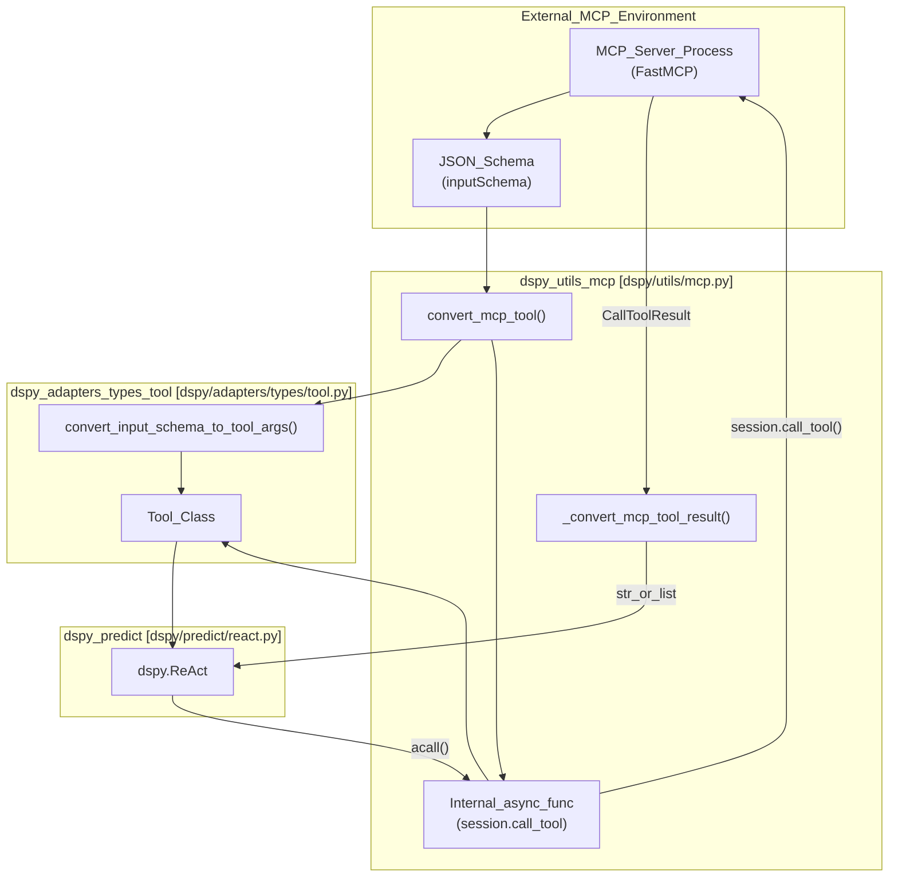
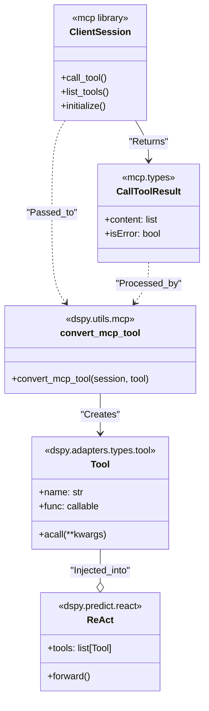

<!-- source: DeepWiki mcp.deepwiki.com · repo stanfordnlp/dspy · page 6.6 Model Context Protocol (MCP) · fetched 2026-10-26 -->

# Model Context Protocol (MCP)

<details>
<summary>Relevant source files</summary>

The following files were used as context for generating this wiki page:

- [docs/docs/tutorials/mcp/index.md](docs/docs/tutorials/mcp/index.md)
- [dspy/utils/langchain_tool.py](dspy/utils/langchain_tool.py)
- [dspy/utils/mcp.py](dspy/utils/mcp.py)
- [tests/utils/resources/mcp_server.py](tests/utils/resources/mcp_server.py)
- [tests/utils/test_langchain_tool.py](tests/utils/test_langchain_tool.py)
- [tests/utils/test_mcp.py](tests/utils/test_mcp.py)

</details>


This page documents DSPy's integration with the Model Context Protocol (MCP), covering how MCP servers are connected, how their tools are converted to DSPy-compatible `Tool` objects via `convert_mcp_tool`, and how those tools are used within DSPy modules.

## Overview

The **Model Context Protocol** (MCP) is an open protocol that standardizes how applications expose tools, resources, and prompts to language models. DSPy supports MCP by bridging this protocol with its own `Tool` primitive, allowing tools defined on any MCP server to be used inside DSPy modules as if they were locally defined Python functions [docs/docs/tutorials/mcp/index.md:3-11]().

### Key Capabilities
- **Standardized Tooling**: Connect to any MCP-compatible server (local or remote) to share tools across different technical stacks [docs/docs/tutorials/mcp/index.md:3-11]().
- **One-line Conversion**: Transform MCP tool definitions into `dspy.Tool` objects using `convert_mcp_tool` [dspy/utils/mcp.py:30-47]().
- **Async Session Handling**: Supports full asynchronous execution for tool calling via `acall`. The underlying wrapper uses the `mcp.ClientSession` to communicate with the server [dspy/utils/mcp.py:43-45]().
- **Complex Schema Support**: Handles nested Pydantic models and complex JSON schemas during conversion, extracting titles, types, and descriptions for each argument [tests/utils/test_mcp.py:57-89](), [dspy/utils/mcp.py:40]().

Sources: [docs/docs/tutorials/mcp/index.md:3-11](), [dspy/utils/mcp.py:30-47](), [tests/utils/test_mcp.py:57-89](), [dspy/utils/mcp.py:40-45]()

---

## Technical Architecture

The MCP integration sits within the utility layer of DSPy, acting as a factory for the `dspy.Tool` primitive. It relies on the official `mcp` Python SDK for session management and transport.

### Data Flow: MCP to DSPy
The conversion process involves mapping JSON Schema definitions from the MCP server to DSPy's internal argument tracking system.

**Diagram: MCP Tool Transformation & Execution**


Sources: [dspy/utils/mcp.py:9-47](), [dspy/utils/mcp.py:40](), [dspy/adapters/types/tool.py:3]()

---

## Implementation Details

### Tool Conversion (`convert_mcp_tool`)
The primary entry point for integration is `convert_mcp_tool`. It takes an active `mcp.ClientSession` and an `mcp.types.Tool` definition to produce a `dspy.Tool` [dspy/utils/mcp.py:30-39]().

1. **Schema Mapping**: It uses `convert_input_schema_to_tool_args` to parse the MCP `inputSchema` into DSPy-compatible `args`, `arg_types`, and `arg_desc` [dspy/utils/mcp.py:40]().
2. **Async Wrapper**: It creates a closure `func(*args, **kwargs)` that encapsulates the `session.call_tool` logic, mapping the `kwargs` directly to the MCP `arguments` parameter [dspy/utils/mcp.py:43-45]().
3. **Result Parsing**: The internal `_convert_mcp_tool_result` handles the `mcp.types.CallToolResult` object. It iterates through `call_tool_result.content`, prioritizing `TextContent` and raising a `RuntimeError` if `isError` is true [dspy/utils/mcp.py:9-27]().

### Integration with `dspy.Tool`
The converted MCP tool inherits all capabilities of the standard `dspy.Tool` class.

- **Metadata Extraction**: The tool's name and description are pulled directly from the MCP tool definition (`tool.name`, `tool.description`) [dspy/utils/mcp.py:47]().
- **Pydantic Support**: For tools using Pydantic models (e.g., in a `FastMCP` server), the schema is correctly unrolled into nested dictionaries for the DSPy `Tool` object [tests/utils/test_mcp.py:57-89](), [tests/utils/resources/mcp_server.py:7-15]().

Sources: [dspy/utils/mcp.py:9-47](), [tests/utils/test_mcp.py:57-89](), [tests/utils/resources/mcp_server.py:7-15]()

---

## Integration with Code Entities

The following diagram maps the relationship between MCP-specific utilities and the core DSPy module system.

**Diagram: MCP Code Entity Relationship**


Sources: [dspy/utils/mcp.py:9-47](), [tests/utils/test_mcp.py:14-47](), [dspy/adapters/types/tool.py:3]()

---

## Usage Patterns

### 1. Initialization and Conversion
To use MCP tools, you must initialize an MCP session (typically using `stdio_client`) and then convert the tools using the `convert_mcp_tool` utility.

```python
from mcp import ClientSession, StdioServerParameters
from mcp.client.stdio import stdio_client
from dspy.utils.mcp import convert_mcp_tool

async def setup_mcp_tools():
    # Define server parameters (e.g., local python script)
    server_params = StdioServerParameters(
        command="python",
        args=["tests/utils/resources/mcp_server.py"]
    )
    
    async with stdio_client(server_params) as (read, write):
        async with ClientSession(read, write) as session:
            await session.initialize()
            response = await session.list_tools()
            
            # Convert first MCP tool to a DSPy tool
            dspy_tool = convert_mcp_tool(session, response.tools[0])
            return dspy_tool
```
Sources: [tests/utils/test_mcp.py:17-28](), [dspy/utils/mcp.py:30-47]()

### 2. Error Handling
The integration includes built-in error checking. If an MCP tool returns an error (`isError=True`), DSPy raises a `RuntimeError` containing the tool's output content [dspy/utils/mcp.py:24-25](). This is verified in tests where tools designed to fail are correctly caught [tests/utils/test_mcp.py:48-55]().

### 3. Comparison with Other Tool Integrations
DSPy provides similar conversion utilities for other ecosystems, ensuring a consistent interface across different tool sources.

| Feature | MCP (`convert_mcp_tool`) | LangChain (`convert_langchain_tool`) |
|---------|-------------------------|--------------------------------------|
| **Source Entity** | `mcp.ClientSession` [dspy/utils/mcp.py:30]() | `langchain.tools.BaseTool` [dspy/utils/langchain_tool.py:10]() |
| **Schema Source** | `tool.inputSchema` [dspy/utils/mcp.py:40]() | `tool.args_schema` [dspy/utils/langchain_tool.py:31]() |
| **Execution Logic** | `session.call_tool` [dspy/utils/mcp.py:44]() | `tool.ainvoke` [dspy/utils/langchain_tool.py:24]() |
| **Module Path** | `dspy/utils/mcp.py` | `dspy/utils/langchain_tool.py` |

Sources: [dspy/utils/mcp.py:30-47](), [dspy/utils/langchain_tool.py:10-47]()

---

