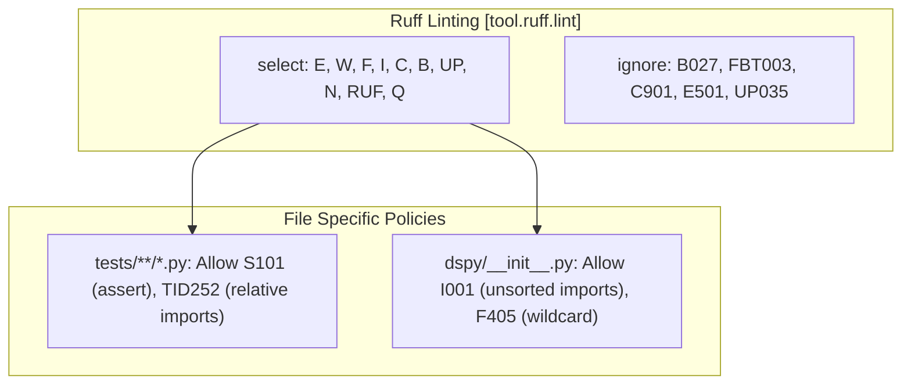
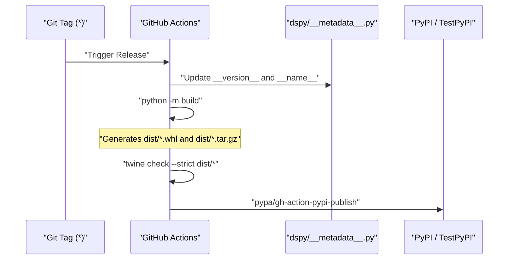

<!-- source: DeepWiki mcp.deepwiki.com · repo stanfordnlp/dspy · page 7.1 Build System & CI/CD · fetched 2026-10-26 -->

# Build System & CI/CD

<details>
<summary>Relevant source files</summary>

The following files were used as context for generating this wiki page:

- [.github/.internal_dspyai/pyproject.toml](.github/.internal_dspyai/pyproject.toml)
- [.github/.tmp/.generated-actions/run-pypi-publish-in-docker-container/action.yml](.github/.tmp/.generated-actions/run-pypi-publish-in-docker-container/action.yml)
- [.github/workflows/build_and_release.yml](.github/workflows/build_and_release.yml)
- [.github/workflows/dependency-range.yml](.github/workflows/dependency-range.yml)
- [.github/workflows/docs-push.yml](.github/workflows/docs-push.yml)
- [.github/workflows/precommits_check.yml](.github/workflows/precommits_check.yml)
- [.github/workflows/run_tests.yml](.github/workflows/run_tests.yml)
- [.pre-commit-config.yaml](.pre-commit-config.yaml)
- [CONTRIBUTING.md](CONTRIBUTING.md)
- [dspy/__metadata__.py](dspy/__metadata__.py)
- [pyproject.toml](pyproject.toml)
- [uv.lock](uv.lock)

</details>


This page documents the DSPy build system configuration, dependency management via `uv`, and the GitHub Actions CI/CD pipelines. It explains how the package is assembled, validated, and published.

---

## Build System

DSPy uses `setuptools` as its build backend, as defined in the `[build-system]` table of `pyproject.toml`.

[pyproject.toml:1-3]()

```toml
[build-system]
requires = ["setuptools>=77.0.1"]
build-backend = "setuptools.build_meta"
```

### Package Discovery & Assets
The build system is configured to include the core `dspy` package while excluding test suites from the final distribution. It also explicitly bundles JavaScript primitives required for the `PythonInterpreter`.

[pyproject.toml:74-80]()

| Configuration | Value |
| :--- | :--- |
| **Packages** | `dspy`, `dspy.*` |
| **Exclusions** | `tests`, `tests.*` |
| **Data Assets** | `dspy/primitives/*.js` |

---

## Dependency Management

DSPy utilizes a tiered dependency structure to balance core functionality with optional integrations.

### Core Dependencies
These are required for the fundamental operation of DSPy modules and optimizers.

[pyproject.toml:23-38]()

| Dependency | Version | Role |
| :--- | :--- | :--- |
| `litellm` | `>=1.65.8` | Primary LM provider abstraction |
| `openai` | `>=1.66.2` | Native OpenAI client support |
| `pydantic` | `>=2.0` | Data validation and Signature schemas |
| `diskcache` | `>=5.6.0` | Persistent LM response caching |
| `gepa[dspy]` | `==0.1.1` | Reflective optimization support |
| `json-repair` | `>=0.54.2` | Handling malformed LM outputs |

### Optional Extras
Optional features are grouped into "extras" to minimize the install footprint.

[pyproject.toml:40-72]()

*   **Integrations**: `anthropic`, `weaviate`, `langchain`, `optuna`, `numpy`.
*   **Protocol Support**: `mcp` (Model Context Protocol).
*   **Runtimes**: `deno` (required for sandboxed code execution).
*   **Development**: `dev` (includes `pytest`, `ruff`, `pre-commit`, `build`).
*   **Testing**: `test_extras` (includes `datasets`, `pandas`, `numpy`).

---

## Development Tooling

### uv & Virtual Environments
The project recommends [uv](https://github.com/astral-sh/uv) for environment management. The `uv.lock` file ensures reproducible builds across development and CI environments.

[uv.lock:1-14](), [CONTRIBUTING.md:105-122]()

### Linting & Formatting
DSPy uses `ruff` for both linting and code formatting. The configuration enforces a line length of 120 characters and target Python 3.10 compatibility.

[pyproject.toml:124-135]()

**Diagram: Linting Rules & Constraints**

Sources: [pyproject.toml:136-192]()

---

## CI/CD Pipeline

The primary CI workflow is defined in `.github/workflows/run_tests.yml`. It triggers on pushes to `main` and all pull requests.

[.github/workflows/run_tests.yml:3-8]()

### Automated Test Suites
The CI environment executes three distinct test categories to ensure framework reliability.

| Job Name | Focus | Key Commands |
| :--- | :--- | :--- |
| `test` | Core logic across Python 3.10-3.14 | `uv run pytest -m 'not extra and not deno'` |
| `extra_test` | Optional deps and Deno runtime | `uv sync --extra deno --extra test_extras` |
| `llm_call_test` | Real LM integration via Ollama | `docker run -d --name ollama ...` |

Sources: [.github/workflows/run_tests.yml:70-135]()

### Dependency Range Validation
A dedicated workflow `dependency-range.yml` runs weekly to test compatibility with both the minimum declared versions and the latest available versions of dependencies.

[.github/workflows/dependency-range.yml:4-34]()

---

## Release Process

The `build_and_release.yml` workflow automates the publication to PyPI and TestPyPI. It uses "Trusted Publishing" (OIDC) for secure uploads.

[.github/workflows/build_and_release.yml:30, 93]()

**Diagram: Build & Release Data Flow**

Sources: [.github/workflows/build_and_release.yml:1-138](), [dspy/__metadata__.py:1-8]()

### Compatibility Alias
The release process also builds and publishes `dspy-ai`, which acts as a compatibility alias that depends on the main `dspy` package.

[.github/.internal_dspyai/pyproject.toml:1-15](), [.github/workflows/build_and_release.yml:141-156]()

---

