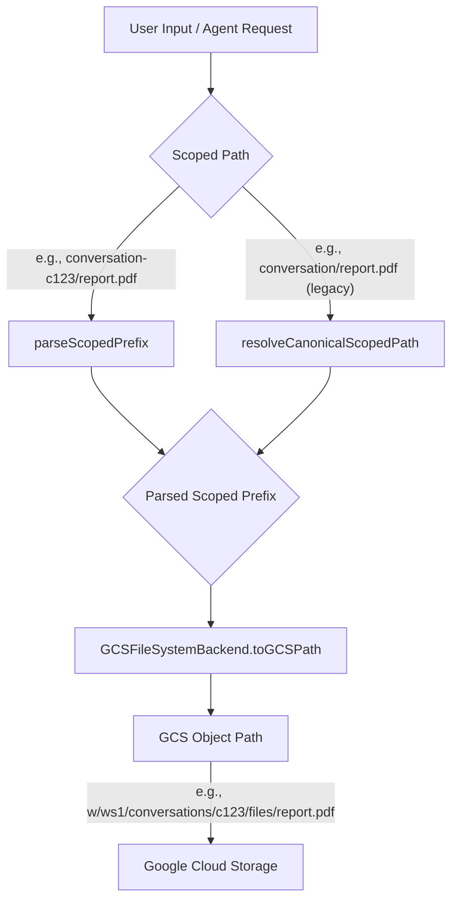

<!-- source: DeepWiki mcp.deepwiki.com · repo dust-tt/dust · page 10 File System and Storage · fetched 2026-10-26 -->

# File System and Storage

<details>
<summary>Relevant source files</summary>

The following files were used as context for generating this wiki page:

- [front-api/middlewares/public_api_auth.ts](front-api/middlewares/public_api_auth.ts)
- [front-api/routes/v1/viz/content.test.ts](front-api/routes/v1/viz/content.test.ts)
- [front-api/routes/v1/viz/content.ts](front-api/routes/v1/viz/content.ts)
- [front-api/routes/v1/viz/files/[...segments].ts](front-api/routes/v1/viz/files/[...segments].ts)
- [front-api/routes/v1/viz/files/[fileId].ts](front-api/routes/v1/viz/files/[fileId].ts)
- [front-api/routes/v1/w/[wId]/assistant/conversations/[cId]/content_fragments.ts](front-api/routes/v1/w/[wId]/assistant/conversations/[cId]/content_fragments.ts)
- [front-api/routes/v1/w/[wId]/assistant/conversations/index.ts](front-api/routes/v1/w/[wId]/assistant/conversations/index.ts)
- [front-api/routes/v1/w/[wId]/spaces/[spaceId]/conversation_ids.test.ts](front-api/routes/v1/w/[wId]/spaces/[spaceId]/conversation_ids.test.ts)
- [front-api/routes/v1/w/[wId]/spaces/[spaceId]/conversation_ids.ts](front-api/routes/v1/w/[wId]/spaces/[spaceId]/conversation_ids.ts)
- [front-api/routes/v1/w/[wId]/spaces/[spaceId]/project_files/index.test.ts](front-api/routes/v1/w/[wId]/spaces/[spaceId]/project_files/index.test.ts)
- [front-api/routes/v1/w/[wId]/spaces/[spaceId]/project_files/index.ts](front-api/routes/v1/w/[wId]/spaces/[spaceId]/project_files/index.ts)
- [front-api/routes/v1/w/[wId]/spaces/[spaceId]/project_metadata.ts](front-api/routes/v1/w/[wId]/spaces/[spaceId]/project_metadata.ts)
- [front-api/routes/w/[wId]/files/[fileId]/export/pdf.test.ts](front-api/routes/w/[wId]/files/[fileId]/export/pdf.test.ts)
- [front-api/routes/w/[wId]/files/[fileId]/share/grants.test.ts](front-api/routes/w/[wId]/files/[fileId]/share/grants.test.ts)
- [front-api/routes/w/[wId]/files/[fileId]/share/grants.ts](front-api/routes/w/[wId]/files/[fileId]/share/grants.ts)
- [front-api/routes/w/[wId]/files/[fileId]/share/index.test.ts](front-api/routes/w/[wId]/files/[fileId]/share/index.test.ts)
- [front-api/routes/w/[wId]/files/[fileId]/share/index.ts](front-api/routes/w/[wId]/files/[fileId]/share/index.ts)
- [front-api/routes/w/[wId]/spaces/[spaceId]/files/index.test.ts](front-api/routes/w/[wId]/spaces/[spaceId]/files/index.test.ts)
- [front-api/routes/w/[wId]/spaces/[spaceId]/files/index.ts](front-api/routes/w/[wId]/spaces/[spaceId]/files/index.ts)
- [front/admin/audit_log_schemas/frame.email_grant_added.json](front/admin/audit_log_schemas/frame.email_grant_added.json)
- [front/admin/audit_log_schemas/frame.email_grant_revoked.json](front/admin/audit_log_schemas/frame.email_grant_revoked.json)
- [front/admin/audit_log_schemas/frame.share_scope_updated.json](front/admin/audit_log_schemas/frame.share_scope_updated.json)
- [front/lib/actions/action_file_helpers.ts](front/lib/actions/action_file_helpers.ts)
- [front/lib/api/assistant/conversation/content_fragment.ts](front/lib/api/assistant/conversation/content_fragment.ts)
- [front/lib/api/file_system/backends/file_system_backend.ts](front/lib/api/file_system/backends/file_system_backend.ts)
- [front/lib/api/file_system/backends/gcs_file_system_backend.test.ts](front/lib/api/file_system/backends/gcs_file_system_backend.test.ts)
- [front/lib/api/file_system/backends/gcs_file_system_backend.ts](front/lib/api/file_system/backends/gcs_file_system_backend.ts)
- [front/lib/api/file_system/dust_file_system.test.ts](front/lib/api/file_system/dust_file_system.test.ts)
- [front/lib/api/file_system/dust_file_system.ts](front/lib/api/file_system/dust_file_system.ts)
- [front/lib/api/files/gcs_mount/files.test.ts](front/lib/api/files/gcs_mount/files.test.ts)
- [front/lib/api/files/gcs_mount/files.ts](front/lib/api/files/gcs_mount/files.ts)
- [front/lib/api/files/mount_path.test.ts](front/lib/api/files/mount_path.test.ts)
- [front/lib/api/files/upload.ts](front/lib/api/files/upload.ts)
- [front/lib/api/files/upsert.test.ts](front/lib/api/files/upsert.test.ts)
- [front/lib/api/files/upsert.ts](front/lib/api/files/upsert.ts)
- [front/lib/api/mcp_server/tools/files/list.ts](front/lib/api/mcp_server/tools/files/list.ts)
- [front/lib/api/mcp_server/tools/files/list_output.ts](front/lib/api/mcp_server/tools/files/list_output.ts)
- [front/lib/api/mcp_server/tools/pods/get.ts](front/lib/api/mcp_server/tools/pods/get.ts)
- [front/lib/api/projects/context.ts](front/lib/api/projects/context.ts)
- [front/lib/api/v1/backward_compatibility.ts](front/lib/api/v1/backward_compatibility.ts)
- [front/lib/api/viz/authorized_file_access.test.ts](front/lib/api/viz/authorized_file_access.test.ts)
- [front/lib/api/viz/authorized_file_access.ts](front/lib/api/viz/authorized_file_access.ts)
- [front/lib/api/viz/authorized_file_access_policy.ts](front/lib/api/viz/authorized_file_access_policy.ts)
- [front/lib/api/viz/share_frame_viewer_files.ts](front/lib/api/viz/share_frame_viewer_files.ts)
- [front/lib/resources/file_resource.test.ts](front/lib/resources/file_resource.test.ts)
- [front/lib/resources/file_resource.ts](front/lib/resources/file_resource.ts)
- [front/lib/resources/frame_file_resource.test.ts](front/lib/resources/frame_file_resource.test.ts)
- [front/types/files.test.ts](front/types/files.test.ts)
- [front/types/files.ts](front/types/files.ts)

</details>


This page provides a high-level overview of the file management system within the Dust platform. It covers the `FileResource` abstraction for managing files, the underlying Google Cloud Storage (GCS) backend, the `DustFileSystem` abstraction for unified file access, and the various file processing pipelines. It also touches upon how files are integrated into different parts of the platform, such as conversations, project contexts, and sandbox environments.

## File Resource and Upload Pipeline

The `FileResource` class [front/lib/resources/file_resource.ts:140-141]() is the primary abstraction for managing files within the Dust platform. It handles file metadata, status, and access control. Files can be associated with various use cases, including:

*   **Conversation Attachments**: Files uploaded directly within a conversation [front/types/files.ts:16]().
*   **Skill Attachments**: Files attached to skill configurations, which are then synced to the sandbox environment [front/types/files.ts:35-36]().
*   **Project Context**: Files uploaded to a project's shared context, accessible to all conversations within that project [front/types/files.ts:30-32]().
*   **Tool Output**: Files generated as output by tools during agent execution [front/types/files.ts:19]().

The file upload pipeline involves several steps:
1.  **Creation**: A new `FileResource` is created with initial metadata [front/lib/resources/file_resource.ts:156-167]().
2.  **Signed URL Generation**: For direct uploads to GCS, signed URLs are generated to allow clients to upload files securely without exposing GCS credentials [front/lib/file_storage/signed_url_cache.ts:1-12]().
3.  **Upload**: The client uploads the file content to GCS using the signed URL.
4.  **Processing**: After upload, files may undergo processing such as content type detection, resizing, or transcription, depending on their type and use case [front/lib/api/files/processing.ts:1-12]().
5.  **Status Update**: The `FileResource` status is updated to `ready` once processing is complete [front/lib/resources/file_resource.ts:290-300]().

The system also includes a mechanism for authorized file access, particularly for interactive content (Frames) [front/lib/api/viz/authorized_file_access_policy.ts:22-23](). This ensures that only authorized users or agents can access specific files, even if they are publicly shared.

For details, see [File Resource and Upload Pipeline](#10.1).

Sources:
- [front/lib/resources/file_resource.ts:140-141]()
- [front/lib/resources/file_resource.ts:156-167]()
- [front/lib/resources/file_resource.ts:290-300]()
- [front/lib/file_storage/signed_url_cache.ts:1-12]()
- [front/lib/api/files/processing.ts:1-12]()
- [front/lib/api/viz/authorized_file_access_policy.ts:22-23]()
- [front/types/files.ts:16]()
- [front/types/files.ts:19]()
- [front/types/files.ts:30-32]()
- [front/types/files.ts:35-36]()

## DustFileSystem and GCS Mount

The `DustFileSystem` [front/lib/api/file_system/dust_file_system.ts:1-17]() is a unified abstraction layer for all file system operations within Dust. It provides a consistent interface for interacting with files, regardless of their underlying storage mechanism. Currently, the primary backend for `DustFileSystem` is Google Cloud Storage (GCS) [front/lib/api/file_system/backends/gcs_file_system_backend.ts:89-94]().

`DustFileSystem` supports various mount points, allowing files to be organized and accessed based on their context:

*   **Conversation Mounts**: Files associated with specific conversations [front/lib/api/file_system/dust_file_system.ts:114-130]().
*   **Pod Mounts**: Files associated with project spaces (referred to as "pods" in some contexts) [front/lib/api/file_system/dust_file_system.ts:132-149]().
*   **User Mounts**: Personal files for authenticated users [front/lib/api/file_system/dust_file_system.ts:151-163]().

### DustFileSystem Architecture

```mermaid
graph TD
    A[DustFileSystem] --> B{File System Operations};
    B -- "read, write, list, delete" --> C[FileSystemBackend Interface];
    C -- "Implements" --> D[GCSFileSystemBackend];
    D -- "Interacts with" --> E[Google Cloud Storage (GCS)];

    subgraph Mount Points
        F[Conversation Mount] --> A;
        G[Pod Mount] --> A;
        H[User Mount] --> A;
    end

    subgraph Sandbox Integration
        I[Sandbox Environment] --> J[GCSSandboxMountAdapter];
        J --> D;
    end

    style A fill:#ace,stroke:#333,stroke-width:2px
    style D fill:#ace,stroke:#333,stroke-width:2px
    style E fill:#ace,stroke:#333,stroke-width:2px
```
Title: DustFileSystem Architecture

Sources:
- [front/lib/api/file_system/dust_file_system.ts:1-17]()
- [front/lib/api/file_system/dust_file_system.ts:114-130]()
- [front/lib/api/file_system/dust_file_system.ts:132-149]()
- [front/lib/api/file_system/dust_file_system.ts:151-163]()
- [front/lib/api/file_system/backends/gcs_file_system_backend.ts:89-94]()

### GCS Mount Adapter for Sandbox

The `GCSSandboxMountAdapter` [front/lib/api/file_system/backends/gcs_file_system_backend.ts:1-3]() facilitates mounting GCS-backed file systems into the sandbox execution environment. This allows agents running in the sandbox to access files stored in GCS as if they were local files. The adapter handles the translation between `DustFileSystem`'s scoped paths and the actual GCS object paths.

### File Explorer UI

The File Explorer UI component provides a user-friendly interface for browsing and managing files within the `DustFileSystem`. It allows users to view files associated with conversations, projects, and their personal storage, and perform operations like uploading, downloading, renaming, and deleting files.

For details, see [DustFileSystem and GCS Mount](#10.2).

Sources:
- [front/lib/api/file_system/backends/gcs_file_system_backend.ts:1-3]()

### File Path Resolution

The system uses a structured approach to resolve file paths, distinguishing between canonical and legacy scoped paths. Canonical paths use prefixes like `conversation-{cId}/` or `pod-{pId}/` [front/lib/api/file_system/dust_file_system.ts:48-53](), while legacy paths use simpler prefixes like `conversation/` or `project/` [front/lib/api/file_system/dust_file_system.ts:48-53](). Helper functions like `resolveCanonicalScopedPath` [front/lib/api/files/mount_path.test.ts:127-158]() and `parseScopedPrefix` [front/lib/api/file_system/dust_file_system.ts:86-112]() are used to correctly interpret and translate these paths to their corresponding GCS locations.


Title: Scoped Path Resolution Flow

Sources:
- [front/lib/api/file_system/dust_file_system.ts:48-53]()
- [front/lib/api/file_system/dust_file_system.ts:86-112]()
- [front/lib/api/files/mount_path.test.ts:127-158]()

---

