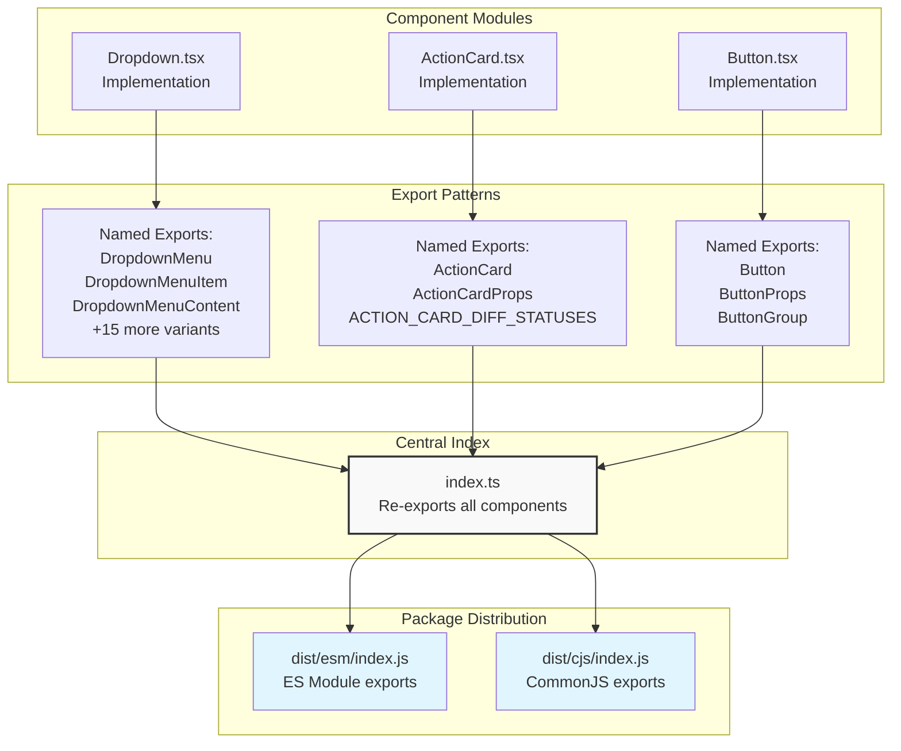
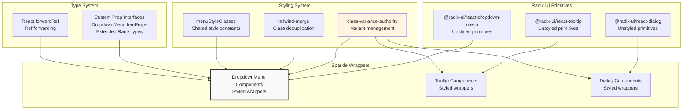
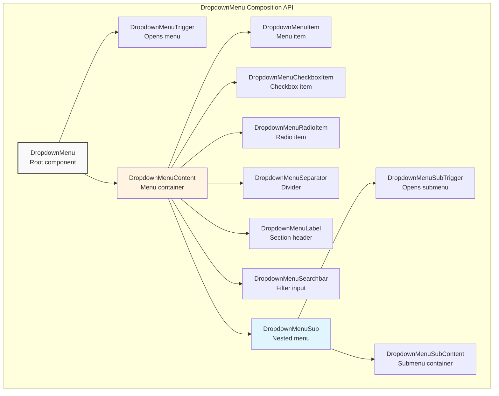
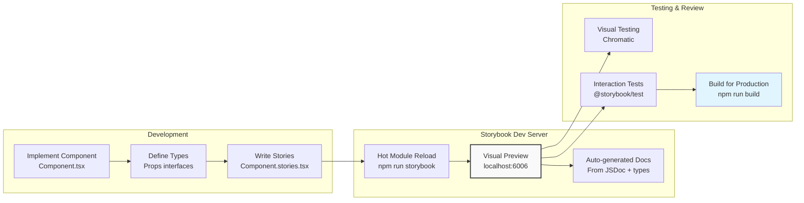
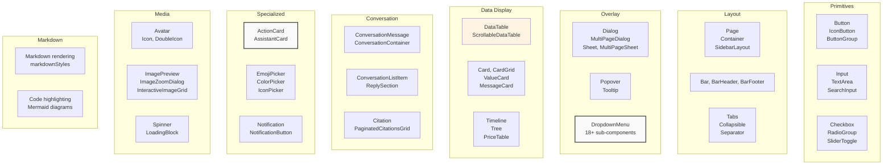

<!-- source: DeepWiki mcp.deepwiki.com · repo dust-tt/dust · page 12.1 Component Library and Architecture · fetched 2026-10-26 -->

# Component Library and Architecture

<details>
<summary>Relevant source files</summary>

The following files were used as context for generating this wiki page:

- [front/components/FairUsageModal.tsx](front/components/FairUsageModal.tsx)
- [front/components/agent_builder/AgentTemplateGrid.tsx](front/components/agent_builder/AgentTemplateGrid.tsx)
- [front/components/app/FairUseCreditsUsage.tsx](front/components/app/FairUseCreditsUsage.tsx)
- [front/components/assistant/WelcomeTourGuide.tsx](front/components/assistant/WelcomeTourGuide.tsx)
- [front/components/assistant/conversation/AgentHandle.tsx](front/components/assistant/conversation/AgentHandle.tsx)
- [front/components/assistant/conversation/ConversationLayout.tsx](front/components/assistant/conversation/ConversationLayout.tsx)
- [front/components/assistant/conversation/ConversationMenu.tsx](front/components/assistant/conversation/ConversationMenu.tsx)
- [front/components/assistant/conversation/ConversationTitle.tsx](front/components/assistant/conversation/ConversationTitle.tsx)
- [front/components/assistant/conversation/SidebarMenu.tsx](front/components/assistant/conversation/SidebarMenu.tsx)
- [front/components/assistant/conversation/UserHandle.tsx](front/components/assistant/conversation/UserHandle.tsx)
- [front/components/assistant/conversation/agent_browser/AgentBrowser.tsx](front/components/assistant/conversation/agent_browser/AgentBrowser.tsx)
- [front/components/assistant/conversation/agent_browser/MobileOrExtensionAgentBrowser.tsx](front/components/assistant/conversation/agent_browser/MobileOrExtensionAgentBrowser.tsx)
- [front/components/assistant/conversation/agent_browser/WebAgentBrowser.tsx](front/components/assistant/conversation/agent_browser/WebAgentBrowser.tsx)
- [front/components/assistant/conversation/agent_browser/shared.tsx](front/components/assistant/conversation/agent_browser/shared.tsx)
- [front/components/assistant/conversation/input_bar/InputBarAttachmentsPicker.tsx](front/components/assistant/conversation/input_bar/InputBarAttachmentsPicker.tsx)
- [front/components/assistant/conversation/utils.ts](front/components/assistant/conversation/utils.ts)
- [front/components/navigation/NavigationSidebar.tsx](front/components/navigation/NavigationSidebar.tsx)
- [front/components/pod/tasks/SuggestedTaskItem.tsx](front/components/pod/tasks/SuggestedTaskItem.tsx)
- [front/components/spaces/SpaceSideBarMenu.tsx](front/components/spaces/SpaceSideBarMenu.tsx)
- [front/hooks/conversations/useBranchConversation.ts](front/hooks/conversations/useBranchConversation.ts)
- [front/lib/spaces.ts](front/lib/spaces.ts)
- [front/lib/spaces_utils.ts](front/lib/spaces_utils.ts)
- [front/lib/swr/permissions.ts](front/lib/swr/permissions.ts)
- [sparkle/src/components/AssistantCard.tsx](sparkle/src/components/AssistantCard.tsx)
- [sparkle/src/components/Button.tsx](sparkle/src/components/Button.tsx)
- [sparkle/src/components/ButtonsSwitch.tsx](sparkle/src/components/ButtonsSwitch.tsx)
- [sparkle/src/components/Card.tsx](sparkle/src/components/Card.tsx)
- [sparkle/src/components/Citation.tsx](sparkle/src/components/Citation.tsx)
- [sparkle/src/components/CollapseButton.tsx](sparkle/src/components/CollapseButton.tsx)
- [sparkle/src/components/DataTable.tsx](sparkle/src/components/DataTable.tsx)
- [sparkle/src/components/Dialog.tsx](sparkle/src/components/Dialog.tsx)
- [sparkle/src/components/Dropdown.tsx](sparkle/src/components/Dropdown.tsx)
- [sparkle/src/components/DropzoneOverlay.tsx](sparkle/src/components/DropzoneOverlay.tsx)
- [sparkle/src/components/FaviconIcon.tsx](sparkle/src/components/FaviconIcon.tsx)
- [sparkle/src/components/FilterChips.tsx](sparkle/src/components/FilterChips.tsx)
- [sparkle/src/components/Hover3D.tsx](sparkle/src/components/Hover3D.tsx)
- [sparkle/src/components/ImageZoomDialog.tsx](sparkle/src/components/ImageZoomDialog.tsx)
- [sparkle/src/components/MessageCard.tsx](sparkle/src/components/MessageCard.tsx)
- [sparkle/src/components/NavigationList.tsx](sparkle/src/components/NavigationList.tsx)
- [sparkle/src/components/Pagination.tsx](sparkle/src/components/Pagination.tsx)
- [sparkle/src/components/Popover.tsx](sparkle/src/components/Popover.tsx)
- [sparkle/src/components/SearchInput.tsx](sparkle/src/components/SearchInput.tsx)
- [sparkle/src/components/Sheet.tsx](sparkle/src/components/Sheet.tsx)
- [sparkle/src/components/Spinner.tsx](sparkle/src/components/Spinner.tsx)
- [sparkle/src/components/Tabs.tsx](sparkle/src/components/Tabs.tsx)
- [sparkle/src/components/TruncatedText.tsx](sparkle/src/components/TruncatedText.tsx)
- [sparkle/src/components/TypingAnimation.tsx](sparkle/src/components/TypingAnimation.tsx)
- [sparkle/src/components/index.ts](sparkle/src/components/index.ts)
- [sparkle/src/components/markdown/ContentBlockWrapper.tsx](sparkle/src/components/markdown/ContentBlockWrapper.tsx)
- [sparkle/src/stories/AssistantCard.stories.tsx](sparkle/src/stories/AssistantCard.stories.tsx)
- [sparkle/src/stories/Chip.stories.tsx](sparkle/src/stories/Chip.stories.tsx)
- [sparkle/src/stories/Dialog.stories.tsx](sparkle/src/stories/Dialog.stories.tsx)
- [sparkle/src/stories/Dropdown.stories.tsx](sparkle/src/stories/Dropdown.stories.tsx)
- [sparkle/src/stories/SidebarLayout.stories.tsx](sparkle/src/stories/SidebarLayout.stories.tsx)
- [sparkle/src/stories/Tree.stories.tsx](sparkle/src/stories/Tree.stories.tsx)

</details>


## Purpose and Scope

This page documents the Sparkle component library architecture, including component organization, composition patterns, primitive wrapping strategies, and Storybook integration. Sparkle serves as Dust's design system, providing reusable UI components built on Radix UI primitives with Tailwind CSS styling.

For information about the build system and package distribution, see [Sandbox Functions (Pod Functions)](#6.2). For usage of Sparkle components in the main Dust application UI, see [Conversation UI Components](#5.4) and [Agent Builder Interface](#3.2).

**Sources:** [sparkle/package.json:1-147](), [sparkle/src/components/index.ts:1-248]()

---

## Component Organization

### Export Structure

The Sparkle library exports 100+ components through a centralized index file that re-exports from individual component modules. Components are organized into several categories:

| Category | Examples | Purpose |
|----------|----------|---------|
| Primitives | `Button`, `Input`, `Checkbox`, `Label` | Basic interactive elements |
| Dropdown System | `DropdownMenu`, `DropdownMenuItem`, `DropdownMenuContent` | Menu and selection interfaces |
| Dialogs & Sheets | `Dialog`, `Sheet`, `MultiPageDialog` | Modal and sliding panel interfaces |
| Data Display | `DataTable`, `Card`, `Timeline`, `PaginatedCitationsGrid` | Structured data presentation |
| Layout | `Page`, `Container`, `SidebarLayout`, `Resizable` | Page structure components |
| Conversation | `ConversationMessage`, `ConversationListItem` | Chat-specific UI |
| Specialized | `ActionCard`, `AssistantCard`, `EmojiPicker` | Domain-specific components |

**Sources:** [sparkle/src/components/index.ts:1-248]()

### Component Export Pattern



**Diagram:** Component export flow from individual modules through the central index to package distribution formats.

The library uses a flat export structure where all components are available as named exports from the package root. This enables tree-shaking and clear import statements: `import { Button, DropdownMenu } from "@dust-tt/sparkle"`.

**Sources:** [sparkle/src/components/index.ts:1-248](), [sparkle/package.json:27-43]()

---

## Component Architecture Patterns

### Primitive Wrapping with Radix UI

Sparkle components wrap unstyled Radix UI primitives to provide consistent styling and behavior. The pattern involves:

1.  **Import Radix primitives** with namespace prefixes
2.  **Wrap with styled components** using `forwardRef` for ref forwarding
3.  **Apply style classes** via `class-variance-authority` and `tailwind-merge`
4.  **Export typed components** with custom prop interfaces



**Diagram:** Architecture showing how Sparkle wraps Radix UI primitives with styling and type systems.

**Example: Dropdown Component Wrapper**

The `DropdownMenuItem` demonstrates this pattern [sparkle/src/components/Dropdown.tsx:356-417]():

-   Imports `DropdownMenuPrimitive.Item` from Radix [sparkle/src/components/Dropdown.tsx:1]()
-   Wraps with `forwardRef` for ref support [sparkle/src/components/Dropdown.tsx:356-358]()
-   Defines custom props via `DropdownMenuItemProps` interface [sparkle/src/components/Dropdown.tsx:344-354]()
-   Applies variant styles via `menuStyleClasses.item({ variant })` [sparkle/src/components/Dropdown.tsx:393-396]()
-   Renders with `LinkWrapper` for navigation support [sparkle/src/components/Dropdown.tsx:383-390]()

**Sources:** [sparkle/src/components/Dropdown.tsx:1-899](), [sparkle/package.json:109-122]()

### Variant System with CVA

Components use `class-variance-authority` to define style variants. This pattern enables type-safe variant selection with automatic class composition.

**Example: ActionCard Diff Variants** [sparkle/src/components/ActionCard.tsx:17-30]()

```typescript
const actionCardDiffVariants = cva("s-p-3", {
  variants: {
    diffStatus: {
      added: cn("s-bg-success-50 s-border-success-200", ...),
      removed: cn("s-bg-warning-50 s-border-warning-200", ...)
    }
  }
});
```

The `cva` function creates a variant function that combines base classes with variant-specific classes. The `cn` utility (from `tailwind-merge`) deduplicates conflicting Tailwind classes.

**Sources:** [sparkle/src/components/ActionCard.tsx:17-30](), [sparkle/src/components/Dropdown.tsx:40-73]()

### Composition with Sub-components

Complex components expose sub-components for flexible composition:



**Diagram:** DropdownMenu component composition tree showing parent-child relationships.

This pattern enables declarative usage:

```tsx
<DropdownMenu>
  <DropdownMenuTrigger>Open</DropdownMenuTrigger>
  <DropdownMenuContent>
    <DropdownMenuLabel label="Section" />
    <DropdownMenuItem label="Option 1" />
    <DropdownMenuSeparator />
    <DropdownMenuSub>
      <DropdownMenuSubTrigger label="More" />
      <DropdownMenuSubContent>
        <DropdownMenuItem label="Nested option" />
      </DropdownMenuSubContent>
    </DropdownMenuSub>
  </DropdownMenuContent>
</DropdownMenu>
```

**Sources:** [sparkle/src/components/Dropdown.tsx:96-101](), [sparkle/src/stories/Dropdown.stories.tsx:126-192]()

---

## Core Component Systems

### Dropdown Menu System

The Dropdown component provides a comprehensive menu system with 18+ sub-components for different interaction patterns.

#### Component Hierarchy

| Component | Purpose | Key Props |
|-----------|---------|-----------|
| `DropdownMenu` | Root container | `open`, `onOpenChange`, `modal` |
| `DropdownMenuTrigger` | Trigger element | `asChild` |
| `DropdownMenuContent` | Menu container | `dropdownHeaders`, `mountPortal`, `sideOffset` |
| `DropdownMenuItem` | Clickable item | `label`, `icon`, `description`, `href`, `variant` |
| `DropdownMenuCheckboxItem` | Checkbox item | `checked`, `onCheckedChange` |
| `DropdownMenuRadioItem` | Radio item | `value` (within `RadioGroup`) |
| `DropdownMenuSearchbar` | Search input | `value`, `onChange`, `autoFocus` |
| `DropdownMenuFilters` | Filter chips | `filters`, `selectedValues`, `onSelectFilter` |

**Sources:** [sparkle/src/components/Dropdown.tsx:96-101](), [sparkle/src/components/Dropdown.tsx:344-417]()

#### Icon Rendering Pattern

The Dropdown system supports flexible icon rendering via the `renderIcon` helper [sparkle/src/components/Dropdown.tsx:127-143]():

```typescript
const renderIcon = (icon, size = "xs") => {
  if (React.isValidElement(icon)) return icon;  // Pre-rendered
  if (typeof icon === "function" || typeof icon === "object") {
    return <Icon size={size} visual={icon as React.ComponentType} />;
  }
  return null;  // Primitive values
};
```

This pattern allows passing icons as:
-   Component types: `icon={UserIcon}`
-   Rendered elements: `icon={<Avatar size="xs" />}`
-   Render functions: `icon={() => <CustomIcon />}`

**Sources:** [sparkle/src/components/Dropdown.tsx:127-143](), [sparkle/src/components/Dropdown.tsx:156-192]()

#### Searchbar with Keyboard Navigation

`DropdownMenuSearchbar` implements keyboard navigation [sparkle/src/components/Dropdown.tsx:633-708]():

-   **Enter**: Clicks first menu item
-   **Tab/ArrowDown**: Focuses first menu item
-   **Auto-focus**: Optional via `autoFocus` prop with `setTimeout` for Radix portal timing

The component uses `useRef` and `useImperativeHandle` to manage focus imperatively [sparkle/src/components/Dropdown.tsx:651-663]().

**Sources:** [sparkle/src/components/Dropdown.tsx:633-708](), [sparkle/src/stories/Dropdown.stories.tsx:400-717]()

#### Portal Management

Dropdown supports configurable portal mounting via `mountPortal` and `mountPortalContainer` props [sparkle/src/components/Dropdown.tsx:268-270]():

```typescript
const container = useSheetContainer(mountPortalContainer);
return mountPortal ? (
  <DropdownMenuPrimitive.Portal container={container}>
    {content}
  </DropdownMenuPrimitive.Portal>
) : content;
```

The `useSheetContainer` hook determines the correct container when rendering inside Sheet components, preventing z-index and positioning issues.

**Sources:** [sparkle/src/components/Dropdown.tsx:275-340](), [sparkle/src/hooks/useSheetContainer:19]()

#### Tooltip Integration

`DropdownTooltipTrigger` provides hover tooltips for dropdown items [sparkle/src/components/Dropdown.tsx:786-838]():

-   Wraps Radix Tooltip primitives
-   Supports media preview (images, diagrams)
-   Uses 300ms delay duration
-   Follows same portal management pattern

**Sources:** [sparkle/src/components/Dropdown.tsx:754-840]()

### ActionCard Component

`ActionCard` provides a specialized card for displaying selectable actions with diff status visualization [sparkle/src/components/ActionCard.tsx:40-173]().

#### Variant Modes

The component supports two mutually exclusive modes via discriminated union types:

```typescript
interface ActionCardSelectableProps extends ActionCardBaseProps {
  isSelected: boolean;
  diffStatus?: never;
}

interface ActionCardDiffProps extends ActionCardBaseProps {
  diffStatus: ActionCardDiffStatus;  // "added" | "removed"
  isSelected?: never;
}

type ActionCardProps = ActionCardSelectableProps | ActionCardDiffProps;
```

**Sources:** [sparkle/src/components/ActionCard.tsx:57-67]()

#### Visual States

| State | Visual Treatment | Use Case |
|-------|-----------------|----------|
| `isSelected=true` | Green "ADDED" chip | User has selected action |
| `canAdd=true` | "Add" button visible | Action available to add |
| `canAdd=false` with `cantAddReason` | Reason text visible | Action unavailable with explanation |
| `diffStatus="added"` | Green background, plus icon chip | Preview of addition in diff |
| `diffStatus="removed"` | Warning background, dash icon chip | Preview of removal in diff |

**Sources:** [sparkle/src/components/ActionCard.tsx:91-145]()

#### Composition Elements

ActionCard composes several child components [sparkle/src/components/ActionCard.tsx:102-169]():

1.  **Avatar**: Icon display with customizable background color [sparkle/src/components/ActionCard.tsx:106-111]()
2.  **Chip**: Status indicators with fade transitions [sparkle/src/components/ActionCard.tsx:113-130]()
3.  **Button**: Add action button [sparkle/src/components/ActionCard.tsx:131-139]()
4.  **TruncatedText**: Description with configurable line clamping and tooltip [sparkle/src/components/ActionCard.tsx:147-154]()
5.  **Footer**: Optional link with hover effects [sparkle/src/components/ActionCard.tsx:156-168]()

**Sources:** [sparkle/src/components/ActionCard.tsx:1-175]()

### DataTable Component

The `DataTable` component is a highly configurable table built on `@tanstack/react-table` [sparkle/src/components/DataTable.tsx:148-172](). It supports client-side or server-side sorting, pagination, filtering, and row selection.

#### Data Flow and State Management

```mermaid
graph TD
    A[DataTableProps<br/>data, columns, filter, pagination, sorting, rowSelection] --> B{useReactTable Hook}
    B --> C[Table Instance<br/>getCoreRowModel, getSortedRowModel, getFilteredRowModel, getPaginationRowModel]
    C --> D[Table Headers<br/>flexRender(header.column.columnDef.header)]
    C --> E[Table Rows<br/>flexRender(cell.column.columnDef.cell)]
    
    subgraph "User Interactions"
        F[User Clicks Sort Header] --> G{setSorting Callback}
        H[User Changes Page] --> I{setPagination Callback}
        J[User Selects Row] --> K{setRowSelection Callback}
    end
    
    G --> B
    I --> B
    K --> B
    
    subgraph "Conditional Rendering"
        L[Window Size Hook<br/>useWindowSize] --> M{shouldRenderColumn Function}
        M --> D
    end
    
    style B fill:#f9f9f9,stroke:#333,stroke-width:2px
    style C fill:#e1f5ff
```

**Diagram:** Data flow and state management within the `DataTable` component.

Key aspects of its implementation:

-   **`useReactTable`**: The core hook for managing table state, including sorting, filtering, and pagination [sparkle/src/components/DataTable.tsx:208-220]().
-   **Controlled Props**: `pagination`, `sorting`, and `rowSelection` can be controlled externally via `setPagination`, `setSorting`, and `setRowSelection` callbacks [sparkle/src/components/DataTable.tsx:105-128]().
-   **Server-Side Operations**: Supports server-side sorting and pagination by checking `isServerSideSorting` and `totalRowCount` [sparkle/src/components/DataTable.tsx:114-115](), [sparkle/src/components/DataTable.tsx:177]().
-   **Column Visibility**: Columns can be conditionally rendered based on window breakpoints using `columnsBreakpoints` and the `shouldRenderColumn` helper [sparkle/src/components/DataTable.tsx:109](), [sparkle/src/components/DataTable.tsx:80-86]().

**Sources:** [sparkle/src/components/DataTable.tsx:1-500]()

### NavigationList Component

The `NavigationList` component provides a vertical, scrollable list for sidebar navigation [sparkle/src/components/NavigationList.tsx:41-57](). It is composed of several sub-components:

-   `NavigationListItem`: A single navigation entry [sparkle/src/components/NavigationList.tsx:99-201]().
-   `NavigationListLabel`: A non-interactive label for sections [sparkle/src/components/NavigationList.tsx:203-220]().
-   `NavigationListCompactLabel`: A compact version of the label [sparkle/src/components/NavigationList.tsx:222-239]().
-   `NavigationListCollapsibleSection`: A collapsible section for grouping items [sparkle/src/components/NavigationList.tsx:241-309]().
-   `NavigationListItemAction`: An action button for list items, typically used with `DropdownMenu` [sparkle/src/components/NavigationList.tsx:311-330]().

#### `NavigationListItem` Features

-   **Status Dots**: Displays a colored dot (`unread`, `blocked`, `error`) at the end of the row [sparkle/src/components/NavigationList.tsx:65-66](), [sparkle/src/components/NavigationList.tsx:128-138]().
-   **Count Badge**: Shows a numerical badge for counts greater than zero [sparkle/src/components/NavigationList.tsx:87](), [sparkle/src/components/NavigationList.tsx:142]().
-   **Label Animation**: Supports `typing` and `streaming` animations for the label text [sparkle/src/components/NavigationList.tsx:74](), [sparkle/src/components/NavigationList.tsx:195-200]().
-   **More Menu**: An optional slot for a `DropdownMenu` triggered on hover/focus, often used for contextual actions [sparkle/src/components/NavigationList.tsx:80-81]().
-   **Link Integration**: Uses `LinkWrapper` to handle internal and external navigation [sparkle/src/components/NavigationList.tsx:153-159]().

**Sources:** [sparkle/src/components/NavigationList.tsx:1-330](), [front/components/assistant/conversation/SidebarMenu.tsx:96-101](), [front/components/navigation/NavigationSidebar.tsx:153-175]()

---

## Type Safety and Props Patterns

### Discriminated Unions

Sparkle uses discriminated unions to enforce mutually exclusive props:

```typescript
// Dropdown item: either children OR label+icon
type EitherChildrenOrProps<BaseProps, ExtraProps> =
  | (BaseProps & ExtraProps & { children?: never })
  | (BaseProps & { [K in keyof ExtraProps]?: never });

type MutuallyExclusiveProps<BaseProps, ExtraProps> = 
  Simplify<EitherChildrenOrProps<BaseProps, ExtraProps>>;
```

This pattern appears in:
-   `DropdownMenuItem`: `label`/`icon` XOR `children` [sparkle/src/components/Dropdown.tsx:344-354]()
-   `DropdownMenuSubTrigger`: Same pattern [sparkle/src/components/Dropdown.tsx:194-220]()
-   `ActionCard`: `isSelected` XOR `diffStatus` [sparkle/src/components/ActionCard.tsx:57-67]()

**Sources:** [sparkle/src/components/Dropdown.tsx:108-116](), [sparkle/src/components/ActionCard.tsx:40-67]()

### Link Wrapper Integration

Components supporting navigation extend `LinkWrapperProps` [sparkle/src/components/Dropdown.tsx:344-354]():

```typescript
export type DropdownMenuItemProps = MutuallyExclusiveProps<
  React.ComponentPropsWithoutRef<typeof DropdownMenuPrimitive.Item> & {
    // ... component-specific props
  } & Omit<LinkWrapperProps, "children" | "className">,
  LabelAndIconProps & { /* ... */ }
>;
```

The `LinkWrapper` component handles both internal routing (Next.js `Link`) and external navigation seamlessly [sparkle/src/components/Dropdown.tsx:383-414]().

**Sources:** [sparkle/src/components/Dropdown.tsx:344-417](), [sparkle/src/components/LinkWrapper:147-148]()

### Forward Ref Pattern

All interactive components use `React.forwardRef` for ref forwarding [sparkle/src/components/Dropdown.tsx:356-358]():

```typescript
const DropdownMenuItem = React.forwardRef<
  React.ElementRef<typeof DropdownMenuPrimitive.Item>,
  DropdownMenuItemProps
>(({ /* props */ }, ref) => {
  // Implementation
});
DropdownMenuItem.displayName = DropdownMenuPrimitive.Item.displayName;
```

This enables:
-   Parent components to access DOM nodes
-   Form libraries to register inputs
-   Scroll and focus management

**Sources:** [sparkle/src/components/Dropdown.tsx:356-417](), [sparkle/src/components/ActionCard.tsx:69-173]()

---

## Storybook Integration

### Story Organization

Components include comprehensive Storybook stories for development and documentation. Stories are organized by complexity [sparkle/src/stories/Dropdown.stories.tsx:73-80]():

```typescript
const meta = {
  title: "Primitives/Dropdown",  // Navigation path
  component: DropdownMenu,
  tags: ["autodocs"],            // Enable auto-generated docs
} satisfies Meta<typeof DropdownMenu>;
```

**Sources:** [sparkle/src/stories/Dropdown.stories.tsx:73-80](), [sparkle/package.json:13-14]()

### Story Patterns

| Story Type | Purpose | Example |
|------------|---------|---------|
| Simple | Basic usage | `SimpleDropdown` [sparkle/src/stories/Dropdown.stories.tsx:82-124]() |
| Complex | All features | `ComplexDropdown` [sparkle/src/stories/Dropdown.stories.tsx:126-192]() |
| With State | Interactive demos | `WithCheckboxes` [sparkle/src/stories/Dropdown.stories.tsx:233-272]() |
| Use Case | Real-world scenarios | `ModelSelector` [sparkle/src/stories/Dropdown.stories.tsx:295-342]() |
| Variants | All visual states | `DiffStatus` [sparkle/src/stories/ActionCard.stories.tsx:73-96]() |

**Sources:** [sparkle/src/stories/Dropdown.stories.tsx:1-947](), [sparkle/src/stories/ActionCard.stories.tsx:1-97]()

### Interactive State Management

Stories use React hooks for interactive demos [sparkle/src/stories/Dropdown.stories.tsx:234-238]():

```typescript
export const WithCheckboxes: Story = {
  render: () => {
    const [showStatusBar, setShowStatusBar] = React.useState<Checked>(true);
    const [showActivityBar, setShowActivityBar] = React.useState<Checked>(false);
    // ... render with state
  }
};
```

This pattern enables testing components with realistic state transitions and user interactions.

**Sources:** [sparkle/src/stories/Dropdown.stories.tsx:233-272](), [sparkle/src/stories/Dropdown.stories.tsx:400-717]()

### Component Development Workflow



**Diagram:** Component development workflow from implementation through Storybook to production build.

The development server runs on port 6006 with hot reload [sparkle/package.json:13](). Stories serve as both documentation and visual regression tests via Chromatic integration [sparkle/package.json:52]().

**Sources:** [sparkle/package.json:13-14](), [sparkle/package.json:47-88]()

---

## Specialized Component Patterns

### SearchDropdownMenu Wrapper

`SearchDropdownMenu` wraps `DropdownMenu` to provide search-triggered menu opening [sparkle/src/components/SearchDropdownMenu.tsx:1-104]():

```typescript
export function SearchDropdownMenu({
  searchInputValue,
  setSearchInputValue,
  minLengthToOpen = 1,
  children,
}: SearchDropdownMenuProps) {
  const [isOpen, setIsOpen] = useState(false);
  
  return (
    <DropdownMenu
      open={isOpen && searchInputValue.length >= minLengthToOpen}
      modal={false}
      onOpenChange={(open) => { if (!open) setIsOpen(open); }}
    >
      <DropdownMenuTrigger asChild>
        <SearchInput
          value={searchInputValue}
          onChange={(value) => {
            setSearchInputValue(value);
            setIsOpen(value.length >= minLengthToOpen);
          }}
          // ... keyboard handlers
        />
      </DropdownMenuTrigger>
      <DropdownMenuContent>{children}</DropdownMenuContent>
    </DropdownMenu>
  );
}
```

**Key features:**
-   Controlled open state based on search input length
-   Non-modal to prevent focus loss
-   Keyboard navigation (Enter, Tab, ArrowDown) [sparkle/src/components/SearchDropdownMenu.tsx:58-77]()
-   Focus management to prevent premature closing [sparkle/src/components/SearchDropdownMenu.tsx:87-98]()

**Sources:** [sparkle/src/components/SearchDropdownMenu.tsx:1-104](), [sparkle/src/stories/Dropdown.stories.tsx:764-791]()

### Shared Style Constants

Components define shared style constants for consistency [sparkle/src/components/Dropdown.tsx:30-94]():

```typescript
export const menuStyleClasses = {
  inset: "s-pl-8",
  container: cn("s-rounded-xl s-border-hovering ...", ...),
  item: cva("s-relative s-flex s-gap-2 ...", { variants: {...} }),
  label: cn("s-px-2 s-py-2 s-heading-xs", ...),
  separator: cn("-s-mx-1 s-my-1 s-h-px", ...),
  // ...
};
```

This pattern:
-   Centralizes style definitions
-   Ensures consistent spacing and colors
-   Enables theme-aware styling (light/dark mode)
-   Simplifies style composition

All Tailwind classes use the `s-` prefix to prevent conflicts with consuming applications.

**Sources:** [sparkle/src/components/Dropdown.tsx:30-94]()

---

## Component Categories Reference

### Complete Component List by Category



**Diagram:** Complete component taxonomy showing all major component categories exported by Sparkle.

**Sources:** [sparkle/src/components/index.ts:1-248]()

---

## Dependency Architecture

### Core Dependencies

| Package | Version | Purpose |
|---------|---------|---------|
| `@radix-ui/*` | 1.x-2.x | Unstyled primitive components |
| `tailwindcss` | ^3.4 | Utility-first CSS framework |
| `class-variance-authority` | ^0.7 | Type-safe variant management |
| `tailwind-merge` | ^2.5 | Tailwind class deduplication |
| `framer-motion` | ^11.18 | Animation library |
| `react-markdown` | ^8.0 | Markdown rendering |
| `@tanstack/react-table` | ^8.13 | Table data management |

**Sources:** [sparkle/package.json:105-147]()

### Peer Dependencies

Sparkle requires React 18.3.1+ as a peer dependency [sparkle/package.json:90-93]():

```json
"peerDependencies": {
  "react": "^18.3.1",
  "react-dom": "^18.3.1"
}
```

This prevents React version conflicts in consuming applications while keeping the bundle size minimal.

**Sources:** [sparkle/package.json:90-93]()

---

