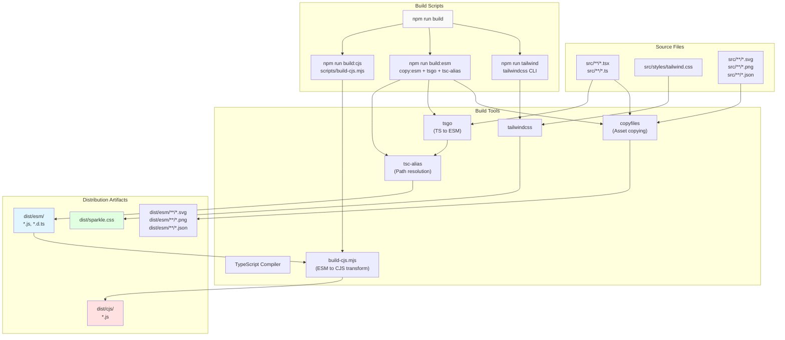
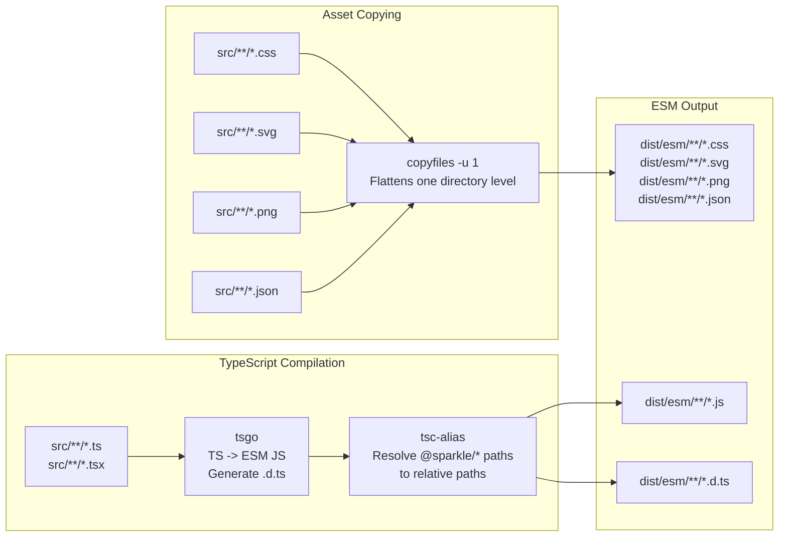
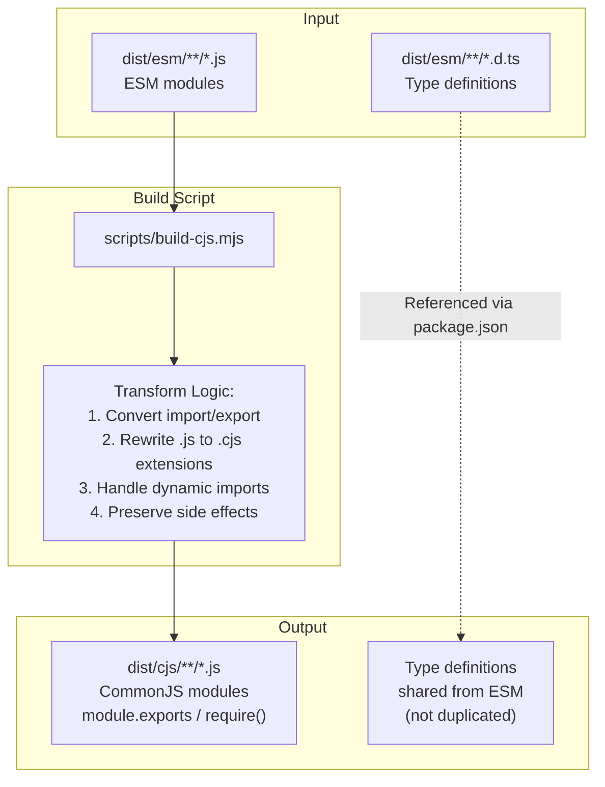
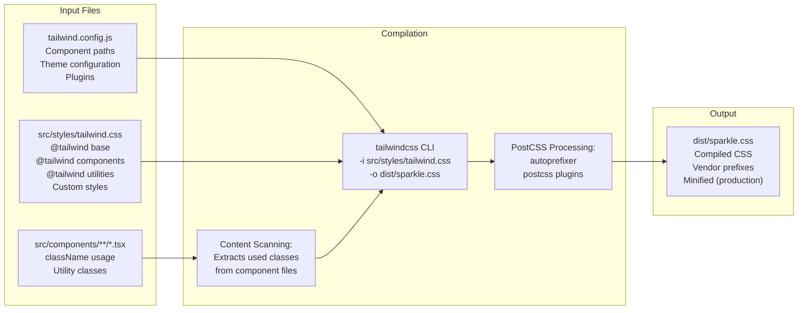
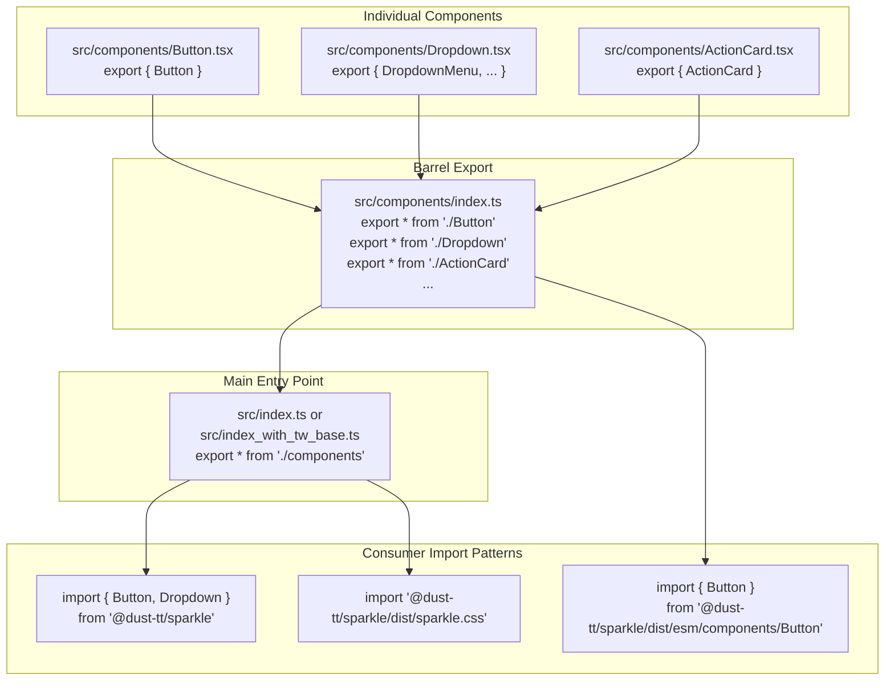

<!-- source: DeepWiki mcp.deepwiki.com · repo dust-tt/dust · page 12.2 Build System and Distribution · fetched 2026-10-26 -->

# Build System and Distribution

<details>
<summary>Relevant source files</summary>

The following files were used as context for generating this wiki page:

- [connectors/package.json](connectors/package.json)
- [extension/css.d.ts](extension/css.d.ts)
- [extension/package.json](extension/package.json)
- [extension/platforms/chrome/manifests/manifest.base.json](extension/platforms/chrome/manifests/manifest.base.json)
- [extension/platforms/firefox/manifests/manifest.base.json](extension/platforms/firefox/manifests/manifest.base.json)
- [extension/tsconfig.json](extension/tsconfig.json)
- [extension/ui/hooks/useFileUploaderService.ts](extension/ui/hooks/useFileUploaderService.ts)
- [extension/ui/hooks/useSavePageToPod.ts](extension/ui/hooks/useSavePageToPod.ts)
- [front-spa/package.json](front-spa/package.json)
- [front-spa/vite.config.ts](front-spa/vite.config.ts)
- [front/components/agent_builder/AgentTemplateGrid.tsx](front/components/agent_builder/AgentTemplateGrid.tsx)
- [front/components/assistant/WelcomeTourGuide.tsx](front/components/assistant/WelcomeTourGuide.tsx)
- [front/components/assistant/conversation/AgentHandle.tsx](front/components/assistant/conversation/AgentHandle.tsx)
- [front/components/assistant/conversation/UserHandle.tsx](front/components/assistant/conversation/UserHandle.tsx)
- [front/components/assistant/conversation/agent_browser/AgentBrowser.tsx](front/components/assistant/conversation/agent_browser/AgentBrowser.tsx)
- [front/components/assistant/conversation/agent_browser/MobileOrExtensionAgentBrowser.tsx](front/components/assistant/conversation/agent_browser/MobileOrExtensionAgentBrowser.tsx)
- [front/components/assistant/conversation/agent_browser/WebAgentBrowser.tsx](front/components/assistant/conversation/agent_browser/WebAgentBrowser.tsx)
- [front/components/assistant/conversation/agent_browser/shared.tsx](front/components/assistant/conversation/agent_browser/shared.tsx)
- [front/components/assistant/conversation/input_bar/InputBarAttachmentsPicker.tsx](front/components/assistant/conversation/input_bar/InputBarAttachmentsPicker.tsx)
- [front/css.d.ts](front/css.d.ts)
- [front/hooks/useFileUploaderService.ts](front/hooks/useFileUploaderService.ts)
- [front/lib/swr/permissions.ts](front/lib/swr/permissions.ts)
- [front/package.json](front/package.json)
- [package-lock.json](package-lock.json)
- [package.json](package.json)
- [sdks/js/package.json](sdks/js/package.json)
- [sdks/js/tsconfig.json](sdks/js/tsconfig.json)
- [sparkle/package.json](sparkle/package.json)
- [sparkle/src/components/AssistantCard.tsx](sparkle/src/components/AssistantCard.tsx)
- [sparkle/src/components/Button.tsx](sparkle/src/components/Button.tsx)
- [sparkle/src/components/ButtonsSwitch.tsx](sparkle/src/components/ButtonsSwitch.tsx)
- [sparkle/src/components/Card.tsx](sparkle/src/components/Card.tsx)
- [sparkle/src/components/Citation.tsx](sparkle/src/components/Citation.tsx)
- [sparkle/src/components/CollapseButton.tsx](sparkle/src/components/CollapseButton.tsx)
- [sparkle/src/components/DataTable.tsx](sparkle/src/components/DataTable.tsx)
- [sparkle/src/components/Dialog.tsx](sparkle/src/components/Dialog.tsx)
- [sparkle/src/components/Dropdown.tsx](sparkle/src/components/Dropdown.tsx)
- [sparkle/src/components/DropzoneOverlay.tsx](sparkle/src/components/DropzoneOverlay.tsx)
- [sparkle/src/components/FaviconIcon.tsx](sparkle/src/components/FaviconIcon.tsx)
- [sparkle/src/components/FilterChips.tsx](sparkle/src/components/FilterChips.tsx)
- [sparkle/src/components/Hover3D.tsx](sparkle/src/components/Hover3D.tsx)
- [sparkle/src/components/ImageZoomDialog.tsx](sparkle/src/components/ImageZoomDialog.tsx)
- [sparkle/src/components/MessageCard.tsx](sparkle/src/components/MessageCard.tsx)
- [sparkle/src/components/Pagination.tsx](sparkle/src/components/Pagination.tsx)
- [sparkle/src/components/Popover.tsx](sparkle/src/components/Popover.tsx)
- [sparkle/src/components/SearchInput.tsx](sparkle/src/components/SearchInput.tsx)
- [sparkle/src/components/Sheet.tsx](sparkle/src/components/Sheet.tsx)
- [sparkle/src/components/Spinner.tsx](sparkle/src/components/Spinner.tsx)
- [sparkle/src/components/Tabs.tsx](sparkle/src/components/Tabs.tsx)
- [sparkle/src/components/TruncatedText.tsx](sparkle/src/components/TruncatedText.tsx)
- [sparkle/src/components/TypingAnimation.tsx](sparkle/src/components/TypingAnimation.tsx)
- [sparkle/src/components/index.ts](sparkle/src/components/index.ts)
- [sparkle/src/components/markdown/ContentBlockWrapper.tsx](sparkle/src/components/markdown/ContentBlockWrapper.tsx)
- [sparkle/src/stories/AssistantCard.stories.tsx](sparkle/src/stories/AssistantCard.stories.tsx)
- [sparkle/src/stories/Chip.stories.tsx](sparkle/src/stories/Chip.stories.tsx)
- [sparkle/src/stories/Dialog.stories.tsx](sparkle/src/stories/Dialog.stories.tsx)
- [sparkle/src/stories/Dropdown.stories.tsx](sparkle/src/stories/Dropdown.stories.tsx)
- [sparkle/src/stories/SidebarLayout.stories.tsx](sparkle/src/stories/SidebarLayout.stories.tsx)
- [sparkle/src/stories/Tree.stories.tsx](sparkle/src/stories/Tree.stories.tsx)
- [sparkle/tsconfig.json](sparkle/tsconfig.json)
- [viz/package.json](viz/package.json)

</details>


This document describes the build system, compilation pipeline, and distribution strategy for the Sparkle design system library. It covers the dual ESM/CJS build process, Tailwind CSS compilation, asset handling, and package export configuration. For information about the component library architecture and individual components, see [Sandbox Infrastructure](#6.1).

## Purpose and Scope

The Sparkle package (`@dust-tt/sparkle`) is distributed as a dual-format library supporting both ECMAScript Modules (ESM) and CommonJS (CJS). The build system compiles TypeScript source code, processes Tailwind CSS stylesheets, and packages static assets (SVG, PNG, JSON) into a consumable npm package. This document explains how the build pipeline transforms source code in `src/` into the distributable artifacts in `dist/`, and how consuming applications import and use the library.

## Build Pipeline Overview



**Build Pipeline Flow**: The main `build` script orchestrates three parallel processes: (1) Tailwind CSS compilation from source to `dist/sparkle.css`, (2) ESM build that copies assets, compiles TypeScript, and resolves path aliases, and (3) CJS build that transforms ESM output into CommonJS format. The pipeline ensures both module formats and all static assets are available in the distribution directory.

Sources: [sparkle/package.json:8-12]()

## Build Script Configuration

The build system is defined in the `scripts` section of `package.json`:

| Script | Command | Purpose |
|--------|---------|---------|
| `build` | `rm -rf dist && npm run tailwind && npm run build:esm && npm run build:cjs` | Main build entry point; cleans dist/ and runs all sub-builds |
| `tailwind` | `npx @tailwindcss/cli -i ./src/styles/tailwind.css -o dist/sparkle.css` | Compiles Tailwind CSS with custom styles |
| `build:esm` | `npm run copy:esm && tsgo && tsc-alias` | Builds ESM output: copy assets, compile TS, resolve aliases |
| `copy:esm` | `copyfiles -u 1 src/**/*.css src/**/*.svg src/**/*.png src/**/*.json dist/esm` | Copies non-TS assets to dist/esm with flattened structure |
| `build:cjs` | `node scripts/build-cjs.mjs` | Transforms ESM output to CommonJS format |
| `watch` | `npm-watch` | Development mode: watches src/ for changes and rebuilds |

The watch configuration monitors TypeScript and CSS files, automatically triggering rebuilds during development:

```json
{
  "watch": {
    "build": {
      "patterns": ["src"],
      "extensions": "ts,tsx,css",
      "ignore": ""
    }
  }
}
```

Sources: [sparkle/package.json:8-23]()

## ESM Build Process



**ESM Build Pipeline**: The ESM build first copies static assets using `copyfiles` with the `-u 1` flag to strip one directory level (moving from `src/components/Icon.svg` to `dist/esm/components/Icon.svg`). TypeScript source files are compiled by `tsgo` which generates both JavaScript modules and TypeScript declaration files. Finally, `tsc-alias` resolves path aliases (like `@sparkle/components`) to relative paths for proper module resolution in consuming applications.

The ESM output preserves the original source directory structure, making imports intuitive:

```typescript
// Source: src/components/Button.tsx
// Output: dist/esm/components/Button.js
//         dist/esm/components/Button.d.ts
```

Sources: [sparkle/package.json:10-11]()

## CJS Build Process

The CommonJS build transforms the ESM output into CJS format using a custom build script:



**CJS Transformation**: The `build-cjs.mjs` script reads ESM JavaScript files and transforms them into CommonJS format. Import statements become `require()` calls, and export statements become `module.exports` assignments. File extensions are rewritten from `.js` to `.cjs` in internal references. Type definitions are not duplicated; instead, the `package.json` exports configuration points CJS consumers to the ESM `.d.ts` files.

The script handles several edge cases:
- **Dynamic imports**: Preserved as-is since they're valid in both formats
- **Side effects**: Maintained through proper execution order
- **Default exports**: Transformed to `module.exports.default`
- **Named exports**: Each becomes a property on `module.exports`

Sources: [sparkle/package.json:12]()

## Tailwind CSS Compilation



**Tailwind Compilation Process**: The Tailwind CLI scans component source files for utility class usage, generates only the CSS rules needed, applies PostCSS plugins (including `autoprefixer` for vendor prefixes), and outputs a single `dist/sparkle.css` file. The configuration includes custom plugins like `@tailwindcss/forms`, `@tailwindcss/postcss`, and `tailwind-scrollbar-hide`.

Key configuration elements:

| Configuration | Purpose |
|---------------|---------|
| Content paths | Tells Tailwind which files to scan for class usage |
| Theme extensions | Custom colors, spacing, animations defined for Sparkle |
| Plugins | Additional utility generators for forms, animations, etc. |
| Dark mode | Class-based dark mode strategy (`dark:` prefix) |

The compiled CSS is self-contained and can be imported separately from JavaScript components.

Sources: [sparkle/package.json:9](), [sparkle/package.json:65-66](), [sparkle/package.json:83-84]()

## Package Exports Configuration

```mermaid
graph TB
    subgraph "Package Entry Points"
        MainExport["exports['.']<br/>Main package entry"]
        ESMExport["exports['./dist/esm/*']<br/>Direct ESM imports"]
        CJSExport["exports['./dist/cjs/*']<br/>Direct CJS imports"]
        CSSExport["exports['./dist/sparkle.css']<br/>Stylesheet import"]
    end
    
    subgraph "Main Entry Resolution"
        TypesField["types: ./dist/esm/index.d.ts"]
        ImportField["import: ./dist/esm/index.js"]
        RequireField["require: ./dist/cjs/index.js"]
        DefaultField["default: ./dist/esm/index.js"]
        
        MainExport --> TypesField
        MainExport --> ImportField
        MainExport --> RequireField
        MainExport --> DefaultField
    end
    
    subgraph "Direct Path Resolution"
        ESMTypes["types: ./dist/esm/*.d.ts"]
        ESMImport["import: ./dist/esm/*.js"]
        CJSTypes["types: ./dist/esm/*.d.ts<br/>(shared with ESM)"]
        CJSRequire["require: ./dist/cjs/*.js"]
        
        ESMExport --> ESMTypes
        ESMExport --> ESMImport
        CJSExport --> CJSTypes
        CJSExport --> CJSRequire
    end
    
    subgraph "CSS Resolution"
        CSSPath["Direct path to compiled CSS"]
        CSSExport --> CSSPath
    end
```



**Package Exports Strategy**: The `exports` field defines how consumers can import from the package. The main entry (`'.'`) provides automatic format selection based on the consumer's module system. Direct path exports allow importing specific files while maintaining type safety. Both ESM and CJS consumers share the same TypeScript definitions from `dist/esm/*.d.ts`.

The `package.json` configuration:

```json
{
  "main": "dist/cjs/index.js",
  "types": "dist/esm/index.d.ts",
  "module": "dist/esm/index.js",
  "exports": {
    ".": {
      "types": "./dist/esm/index.d.ts",
      "import": "./dist/esm/index.js",
      "require": "./dist/cjs/index.js",
      "default": "./dist/esm/index.js"
    },
    "./dist/esm/*": {
      "types": "./dist/esm/*.d.ts",
      "import": "./dist/esm/*.js",
      "default": "./dist/esm/*.js"
    },
    "./dist/cjs/*": {
      "types": "./dist/esm/*.d.ts",
      "require": "./dist/cjs/*.js"
    },
    "./dist/sparkle.css": "./dist/sparkle.css",
    "./styles/tailwind.css": "./src/styles/tailwind.css",
    "./styles/theme.css": "./src/styles/theme.css"
  }
}
```

**Field Priority**:
1. **types**: TypeScript looks here first for `.d.ts` files
2. **import**: Used by ESM-aware bundlers/runtimes
3. **require**: Used by CommonJS environments
4. **default**: Fallback for tools that don't recognize import/require

The `files` field limits package contents to essential directories:

```json
{
  "files": ["dist/", "src/", "!src/stories/"]
}
```

This includes the compiled `dist/` directory and source `src/` directory (excluding Storybook stories) for source map resolution and debugging.

Sources: [sparkle/package.json:28-50](), [sparkle/package.json:51]()

## Distribution Structure

The `dist/` directory contains all build artifacts:

```
dist/
├── sparkle.css              # Compiled Tailwind CSS
├── esm/                     # ESM build output
│   ├── index.js             # Main entry point
│   ├── index.d.ts           # Type definitions
│   ├── components/          # Component modules
│   │   ├── Button.js
│   │   ├── Button.d.ts
│   │   ├── Dropdown.js
│   │   ├── Dropdown.d.ts
│   │   ├── Icon.svg         # Copied assets
│   │   └── index.js         # Component barrel export
│   ├── icons/               # Icon modules
│   ├── lib/                 # Utility modules
│   └── styles/              # CSS modules (copied)
└── cjs/                     # CJS build output
    ├── index.js             # Main entry point (CJS)
    ├── components/          # Component modules (CJS)
    │   ├── Button.js
    │   ├── Dropdown.js
    │   └── index.js
    ├── icons/
    └── lib/
```

**Key Observations**:
- ESM directory contains both `.js` and `.d.ts` files
- CJS directory contains only `.js` files (types reference ESM)
- Static assets (SVG, PNG, JSON, CSS) exist only in ESM directory
- Directory structure mirrors source layout

The main barrel export in `src/components/index.ts` re-exports all components:

Sources: [sparkle/src/components/index.ts:1-248]()

## Component Export Pattern



**Export Strategy**: Individual component files export their components and types. The `components/index.ts` barrel file re-exports everything, making them available from a single import. Consumers can import from the main entry point (tree-shakeable) or directly from specific component files (explicit dependencies).

Example component exports:

```typescript
// From src/components/Dropdown.tsx
export {
  DropdownMenu,
  DropdownMenuCheckboxItem,
  DropdownMenuContent,
  DropdownMenuFilters,
  // ... 20+ exports
}
```

The barrel export pattern enables clean imports while maintaining tree-shaking capabilities:

```typescript
// Consumer can import everything needed in one line
import { Button, DropdownMenu, Avatar } from '@dust-tt/sparkle';
```

Sources: [sparkle/src/components/index.ts:1-248](), [sparkle/src/components/Dropdown.tsx:106-147](), [sparkle/src/components/ActionCard.tsx:1-5]()

## Consumption Patterns

### Basic Usage

Consuming applications typically import components and styles:

```typescript
// Import components
import { Button, DropdownMenu, ActionCard } from '@dust-tt/sparkle';

// Import types
import type { ButtonProps, DropdownMenuItemProps } from '@dust-tt/sparkle';

// Import CSS (once in main app file)
import '@dust-tt/sparkle/dist/sparkle.css';
```

### Direct Imports

For fine-grained control or to avoid barrel import overhead:

```typescript
// Import specific component file
import { Button } from '@dust-tt/sparkle/dist/esm/components/Button';

// Import sub-module
import { cn } from '@dust-tt/sparkle/dist/esm/lib/utils';
```

### Asset References

Components may reference static assets bundled with the package:

```typescript
// Assets are co-located with components in dist/esm/
// Bundlers resolve these automatically
<Icon visual={require('@dust-tt/sparkle/dist/esm/icons/app/PlusIcon.svg')} />
```

### Side Effects Configuration

The `sideEffects` field informs bundlers about files with global side effects:

```json
{
  "sideEffects": ["src/index_with_tw_base.ts", "*.css"]
}
```

This tells webpack and other bundlers:
- `index_with_tw_base.ts` imports Tailwind base styles (side effect)
- All CSS files have global side effects
- Other files are pure and can be tree-shaken

Sources: [sparkle/package.json:52]()

## Peer Dependencies

Sparkle declares React as a peer dependency to avoid bundling it:

```json
{
  "peerDependencies": {
    "react": "^18.3.1",
    "react-dom": "^18.3.1"
  }
}
```

This ensures:
- Consuming applications provide their own React version
- Only one React instance exists in the dependency tree
- React's rules of hooks and context work correctly

The library includes React and react-dom as dev dependencies for development and Storybook, but excludes them from the published package.

Sources: [sparkle/package.json:91-94](), [sparkle/package.json:79-80]()

## Development Tools

### Storybook Integration

The package includes Storybook for component development and documentation:

| Script | Purpose |
|--------|---------|
| `storybook` | Start dev server on port 6006 with webpack debugging |
| `build-storybook` | Build static Storybook site for deployment |

Storybook stories are excluded from the published package via the `files` field.

Sources: [sparkle/package.json:13-14](), [sparkle/package.json:51]()

### Watch Mode

The `watch` script uses `npm-watch` to automatically rebuild on file changes:

```json
{
  "watch": {
    "build": {
      "patterns": ["src"],
      "extensions": "ts,tsx,css",
      "ignore": ""
    }
  }
}
```

This monitors the `src/` directory for TypeScript, TSX, and CSS file changes, triggering the full build pipeline.

Sources: [sparkle/package.json:15](), [sparkle/package.json:17-23]()

## Build Tool Dependencies

Key build tools and their versions:

| Tool | Version | Purpose |
|------|---------|---------|
| `@tailwindcss/cli` | ^4.3.0 | Tailwind CSS CLI compiler |
| `typescript` | (via tsgo) | TypeScript compilation |
| `tsc-alias` | ^1.8.10 | Path alias resolution in compiled output |
| `copyfiles` | ^2.4.1 | Asset copying with directory flattening |
| `esbuild` | ^0.27.3 | Fast JavaScript bundler (if used by build-cjs.mjs) |
| `postcss` | ^8.5.6 | PostCSS processing (used by Tailwind) |

Additional Tailwind plugins:

| Plugin | Purpose |
|--------|---------|
| `@tailwindcss/forms` | Form control styling utilities |
| `@tailwindcss/postcss` | PostCSS integration for Tailwind |
| `tailwind-scrollbar-hide` | Scrollbar hiding utilities |

Sources: [sparkle/package.json:65-84]()

## Node.js Version Requirement

The package requires Node.js >= 24.16.0:

```json
{
  "engines": {
    "node": ">=24.16.0"
  }
}
```

This ensures compatibility with modern JavaScript features and build tool requirements.

Sources: [sparkle/package.json:4-6]()

---

