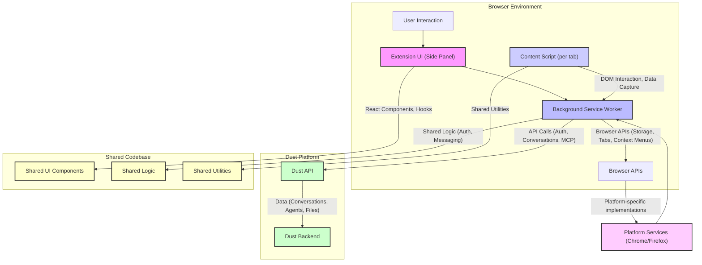
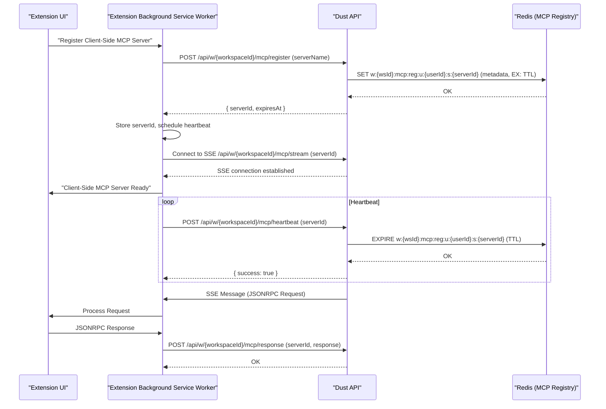

<!-- source: DeepWiki mcp.deepwiki.com · repo dust-tt/dust · page 13 Browser Extension · fetched 2026-10-26 -->

# Browser Extension

Relevant source files

The following files were used as context for generating this wiki page:

- [.github/configs/europe-west1/.env.edge](.github/configs/europe-west1/.env.edge)
- [.github/configs/europe-west1/.env.prod](.github/configs/europe-west1/.env.prod)
- [.github/configs/us-central1/.env.edge](.github/configs/us-central1/.env.edge)
- [.github/configs/us-central1/.env.prod](.github/configs/us-central1/.env.prod)
- [extension/domino.d.ts](extension/domino.d.ts)
- [extension/global.d.ts](extension/global.d.ts)
- [extension/platforms/chrome/ChromeApp.tsx](extension/platforms/chrome/ChromeApp.tsx)
- [extension/platforms/chrome/ChromeExtensionWrapper.tsx](extension/platforms/chrome/ChromeExtensionWrapper.tsx)
- [extension/platforms/chrome/background.ts](extension/platforms/chrome/background.ts)
- [extension/platforms/chrome/content-script.ts](extension/platforms/chrome/content-script.ts)
- [extension/platforms/chrome/main.tsx](extension/platforms/chrome/main.tsx)
- [extension/platforms/chrome/manifests/manifest.development.json](extension/platforms/chrome/manifests/manifest.development.json)
- [extension/platforms/chrome/manifests/manifest.production.json](extension/platforms/chrome/manifests/manifest.production.json)
- [extension/platforms/chrome/manifests/manifest.release.json](extension/platforms/chrome/manifests/manifest.release.json)
- [extension/platforms/chrome/services/platform.ts](extension/platforms/chrome/services/platform.ts)
- [extension/platforms/chrome/webpack.config.ts](extension/platforms/chrome/webpack.config.ts)
- [extension/platforms/firefox/FirefoxApp.tsx](extension/platforms/firefox/FirefoxApp.tsx)
- [extension/platforms/firefox/background.ts](extension/platforms/firefox/background.ts)
- [extension/platforms/firefox/main.tsx](extension/platforms/firefox/main.tsx)
- [extension/platforms/firefox/manifests/manifest.development.json](extension/platforms/firefox/manifests/manifest.development.json)
- [extension/platforms/firefox/manifests/manifest.production.json](extension/platforms/firefox/manifests/manifest.production.json)
- [extension/platforms/firefox/manifests/manifest.release.json](extension/platforms/firefox/manifests/manifest.release.json)
- [extension/platforms/firefox/services/platform.ts](extension/platforms/firefox/services/platform.ts)
- [extension/platforms/firefox/webpack.config.ts](extension/platforms/firefox/webpack.config.ts)
- [extension/platforms/front/FrontApp.tsx](extension/platforms/front/FrontApp.tsx)
- [extension/platforms/front/context/FrontPlatformProvider.tsx](extension/platforms/front/context/FrontPlatformProvider.tsx)
- [extension/platforms/front/main.tsx](extension/platforms/front/main.tsx)
- [extension/platforms/front/services/auth.ts](extension/platforms/front/services/auth.ts)
- [extension/platforms/front/services/platform.ts](extension/platforms/front/services/platform.ts)
- [extension/platforms/front/webpack.config.ts](extension/platforms/front/webpack.config.ts)
- [extension/shared/AuthenticatedImage.tsx](extension/shared/AuthenticatedImage.tsx)
- [extension/shared/background.ts](extension/shared/background.ts)
- [extension/shared/hooks/useCaptureActions.ts](extension/shared/hooks/useCaptureActions.ts)
- [extension/shared/lib/ExtensionFetcherProvider.tsx](extension/shared/lib/ExtensionFetcherProvider.tsx)
- [extension/shared/lib/extraction.ts](extension/shared/lib/extraction.ts)
- [extension/shared/lib/fetcher.ts](extension/shared/lib/fetcher.ts)
- [extension/shared/lib/html_to_markdown.ts](extension/shared/lib/html_to_markdown.ts)
- [extension/shared/lib/utils.ts](extension/shared/lib/utils.ts)
- [extension/shared/messages.ts](extension/shared/messages.ts)
- [extension/shared/platform.tsx](extension/shared/platform.tsx)
- [extension/shared/services/auth.ts](extension/shared/services/auth.ts)
- [extension/shared/services/browser_messaging.ts](extension/shared/services/browser_messaging.ts)
- [extension/shared/services/platform.ts](extension/shared/services/platform.ts)
- [extension/ui/components/ErrorFallback.tsx](extension/ui/components/ErrorFallback.tsx)
- [extension/ui/components/auth/ProtectedRoute.tsx](extension/ui/components/auth/ProtectedRoute.tsx)
- [extension/ui/components/auth/useAuth.ts](extension/ui/components/auth/useAuth.ts)
- [extension/ui/components/conversation/ConversationContainer.tsx](extension/ui/components/conversation/ConversationContainer.tsx)
- [extension/ui/components/conversation/ConversationLayout.tsx](extension/ui/components/conversation/ConversationLayout.tsx)
- [extension/ui/components/conversation/ExtensionInputBarProvider.tsx](extension/ui/components/conversation/ExtensionInputBarProvider.tsx)
- [extension/ui/components/navigation/UserDropdownMenu.tsx](extension/ui/components/navigation/UserDropdownMenu.tsx)
- [extension/ui/components/quick_actions/ExtensionQuickActionsProvider.tsx](extension/ui/components/quick_actions/ExtensionQuickActionsProvider.tsx)
- [extension/ui/components/quick_actions/SavePageToPodDialog.tsx](extension/ui/components/quick_actions/SavePageToPodDialog.tsx)
- [extension/ui/css/custom.css](extension/ui/css/custom.css)
- [extension/ui/css/fonts.css](extension/ui/css/fonts.css)
- [extension/ui/css/global.css](extension/ui/css/global.css)
- [extension/ui/fonts/GeistMonoVariable.woff2](extension/ui/fonts/GeistMonoVariable.woff2)
- [extension/ui/fonts/GeistVariable-Italic.woff2](extension/ui/fonts/GeistVariable-Italic.woff2)
- [extension/ui/fonts/GeistVariable.woff2](extension/ui/fonts/GeistVariable.woff2)
- [extension/ui/pages/LoginPage.tsx](extension/ui/pages/LoginPage.tsx)
- [extension/ui/pages/MainPage.tsx](extension/ui/pages/MainPage.tsx)
- [extension/ui/pages/SubscribePage.tsx](extension/ui/pages/SubscribePage.tsx)
- [extension/ui/pages/routes.tsx](extension/ui/pages/routes.tsx)
- [extension/ui/pcm-processor.js](extension/ui/pcm-processor.js)
- [front-api/routes/v1/w/[wId]/mcp/deregister.ts](front-api/routes/v1/w/[wId]/mcp/deregister.ts)
- [front-api/routes/v1/w/[wId]/mcp/heartbeat.ts](front-api/routes/v1/w/[wId]/mcp/heartbeat.ts)
- [front-api/routes/v1/w/[wId]/mcp/index.ts](front-api/routes/v1/w/[wId]/mcp/index.ts)
- [front-api/routes/v1/w/[wId]/mcp/register.ts](front-api/routes/v1/w/[wId]/mcp/register.ts)
- [front-api/routes/w/[wId]/mcp/deregister.ts](front-api/routes/w/[wId]/mcp/deregister.ts)
- [front-api/routes/w/[wId]/mcp/heartbeat.ts](front-api/routes/w/[wId]/mcp/heartbeat.ts)
- [front-api/routes/w/[wId]/mcp/register.test.ts](front-api/routes/w/[wId]/mcp/register.test.ts)
- [front-api/routes/w/[wId]/mcp/register.ts](front-api/routes/w/[wId]/mcp/register.ts)
- [front-spa/src/email/EmailApp.tsx](front-spa/src/email/EmailApp.tsx)
- [front/components/markdown/Image.tsx](front/components/markdown/Image.tsx)
- [front/components/pages/email/ValidationPage.test.tsx](front/components/pages/email/ValidationPage.test.tsx)
- [front/components/pages/onboarding/InviteChoosePage.tsx](front/components/pages/onboarding/InviteChoosePage.tsx)
- [front/global.d.ts](front/global.d.ts)
- [front/hooks/useDebounce.ts](front/hooks/useDebounce.ts)
- [front/hooks/useEventSource.ts](front/hooks/useEventSource.ts)
- [front/lib/api/actions/mcp/client_side_registry.test.ts](front/lib/api/actions/mcp/client_side_registry.test.ts)
- [front/lib/api/actions/mcp/client_side_registry.ts](front/lib/api/actions/mcp/client_side_registry.ts)
- [front/lib/api/actions/mcp_client_side.ts](front/lib/api/actions/mcp_client_side.ts)
- [front/lib/auth/RegionContext.tsx](front/lib/auth/RegionContext.tsx)
- [front/lib/client/BrowserMCPTransport.ts](front/lib/client/BrowserMCPTransport.ts)
- [front/lib/egress/client.ts](front/lib/egress/client.ts)
- [front/lib/swr/search.ts](front/lib/swr/search.ts)
- [front/lib/swr/useIsMobile.ts](front/lib/swr/useIsMobile.ts)
- [front/vite.globalSetup.ts](front/vite.globalSetup.ts)
- [sdks/js/src/mcp_transport.ts](sdks/js/src/mcp_transport.ts)
- [sparkle/src/components/ImageGenerationPlaceholder.tsx](sparkle/src/components/ImageGenerationPlaceholder.tsx)
- [sparkle/src/components/ImagePreview.tsx](sparkle/src/components/ImagePreview.tsx)
- [sparkle/src/components/ImageWrapper.tsx](sparkle/src/components/ImageWrapper.tsx)
- [sparkle/src/components/InteractiveImageGrid.tsx](sparkle/src/components/InteractiveImageGrid.tsx)
- [sparkle/src/stories/ImageGenerationPlaceholder.stories.tsx](sparkle/src/stories/ImageGenerationPlaceholder.stories.tsx)

The Dust browser extension provides a cross-platform (Chrome/Firefox) interface to interact with the Dust platform directly from the user's browser. It enables features such as capturing web page content, managing conversations, and authenticating users, integrating seamlessly with the main Dust application.

The extension is built to be lightweight and responsive, leveraging a background service worker for persistent tasks and content scripts for interacting with web pages. Its UI is designed to offer a familiar experience to users of the main Dust application, including conversation management and agent interactions.

For details on the extension's internal structure and build process, see [Extension Architecture and Build](#13.1). For an in-depth look at its user interface and specific features, refer to [Extension UI and Features](#13.2).

## Architecture Overview

The browser extension is designed with a clear separation of concerns, utilizing browser-specific APIs while maintaining a shared codebase for core logic and UI components. This allows for cross-platform compatibility (Chrome and Firefox) with minimal duplication.

The architecture comprises:
*   **Platform Abstraction**: A layer that abstracts browser-specific APIs, allowing shared code to interact with Chrome and Firefox consistently.
*   **Background Service Worker**: A persistent script that handles events, manages state, and orchestrates communication between different parts of the extension and the Dust backend.
*   **Content Scripts**: Scripts injected into web pages to interact with the DOM, capture content, and communicate with the background service worker.
*   **Extension UI**: The user interface, typically rendered in a side panel, providing access to Dust conversations, agents, and other features.

### Extension Component Diagram

Sources: [extension/platforms/chrome/background.ts:1-208](), [extension/shared/background.ts:1-209](), [extension/platforms/chrome/content-script.ts:1-100](), [extension/shared/services/platform.ts:1-87]()

## Authentication Flow

The extension integrates with the Dust platform's authentication system. Users log in via the extension UI, which then stores authentication tokens securely using browser storage APIs. These tokens are used for all subsequent API calls to the Dust backend. The `useAuth` hook [extension/ui/components/auth/useAuth.ts:18-22]() manages the authentication state, including token refreshing and user/workspace data fetching.

The authentication process involves:
1.  **Login**: User initiates login from the extension UI.
2.  **Token Storage**: Access and refresh tokens are stored securely using the platform's storage service [extension/shared/services/auth.ts:9-10]().
3.  **Token Refresh**: The `useAuthHook` [extension/ui/components/auth/useAuth.ts:18-212]() proactively refreshes tokens before they expire to maintain a continuous session.
4.  **API Integration**: All API requests from the extension include the access token for authorization.

For a detailed explanation of the authentication mechanism, refer to [Extension UI and Features](#13.2).

Sources: [extension/ui/components/auth/useAuth.ts:18-212](), [extension/shared/services/auth.ts:9-10]()

## File Capture and Page Saving

A key feature of the extension is its ability to capture content from web pages and save it to the user's Dust Pod. This is facilitated by content scripts that extract relevant information from the current tab and send it to the background service worker. The background worker then processes this data and interacts with the Dust API to save it.

The extension provides context menu options for:
*   Adding tab content to a conversation [extension/platforms/chrome/background.ts:44-47]().
*   Adding a tab screenshot to a conversation [extension/platforms/chrome/background.ts:48-51]().
*   Adding selected text to a conversation [extension/platforms/chrome/background.ts:55-59]().
*   Saving the entire page to a user's Pod [extension/platforms/chrome/background.ts:60-63]().

The `useSavePageToPod` hook (detailed in [Extension UI and Features](#13.2)) encapsulates the logic for interacting with the Dust API to store captured page content.

Sources: [extension/platforms/chrome/background.ts:44-63]()

## Client-Side MCP Transport

The browser extension utilizes a client-side Model Context Protocol (MCP) transport to enable real-time communication and interaction with Dust agents. This transport mechanism allows the extension to register itself as an MCP server, receive requests from Dust, and send back results.

The `BrowserMCPTransport` class [front/lib/client/BrowserMCPTransport.ts:16-210]() handles the client-side implementation, using Server-Sent Events (SSE) for receiving requests and HTTP POST for sending responses. It also manages server registration, heartbeats to keep the connection alive, and deregistration.

### Client-Side MCP Registration Flow

Sources: [front/lib/client/BrowserMCPTransport.ts:16-210](), [front-api/routes/v1/w/[wId]/mcp/register.ts:1-100](), [front-api/routes/w/[wId]/mcp/register.ts:1-100](), [front-api/routes/v1/w/[wId]/mcp/heartbeat.ts:1-100](), [front/lib/api/actions/mcp/client_side_registry.ts:86-135]()

## Webpack Build Process

The extension uses Webpack for bundling its assets and code. Separate Webpack configurations exist for Chrome and Firefox, as well as for the "front" (SPA) version of the extension, which is used for local development and testing.

The build process handles:
*   **Transpilation**: TypeScript and JSX are transpiled to JavaScript.
*   **Asset Management**: CSS, fonts, and other assets are processed.
*   **Manifest Generation**: Browser-specific manifest files (`manifest.json`) are generated or merged based on environment.
*   **Environment Variables**: Environment-specific variables are injected using `webpack.EnvironmentPlugin` and `Dotenv`.
*   **Optimization**: Code splitting, minification, and tree-shaking are applied for production builds.

The `getConfig` function [extension/platforms/chrome/webpack.config.ts:38-250]() defines the Webpack configuration for Chrome, including entry points for the main UI, background script, and content script. Similar configurations exist for Firefox [extension/platforms/firefox/webpack.config.ts:1-100]() and the front-end SPA [extension/platforms/front/webpack.config.ts:22-197]().

For a deeper dive into the build system and platform abstraction, see [Extension Architecture and Build](#13.1).

Sources: [extension/platforms/chrome/webpack.config.ts:38-250](), [extension/platforms/firefox/webpack.config.ts:1-100](), [extension/platforms/front/webpack.config.ts:22-197]()

---

