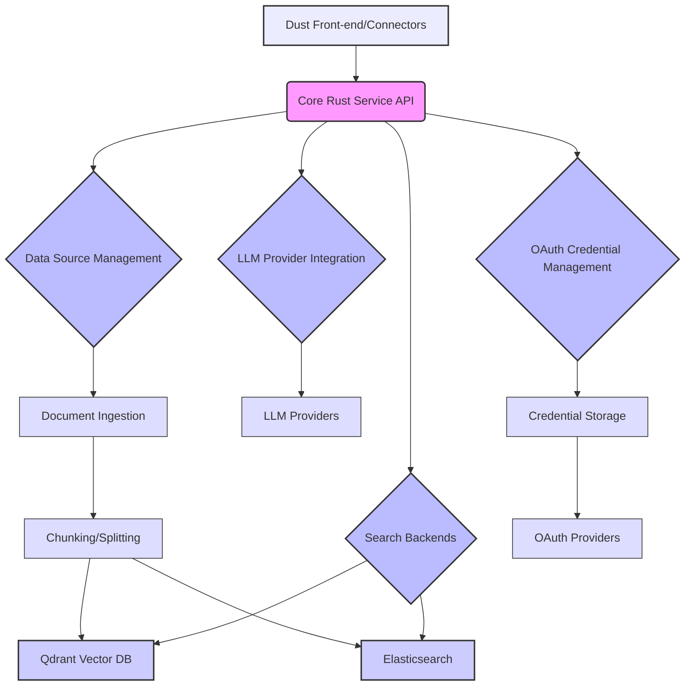
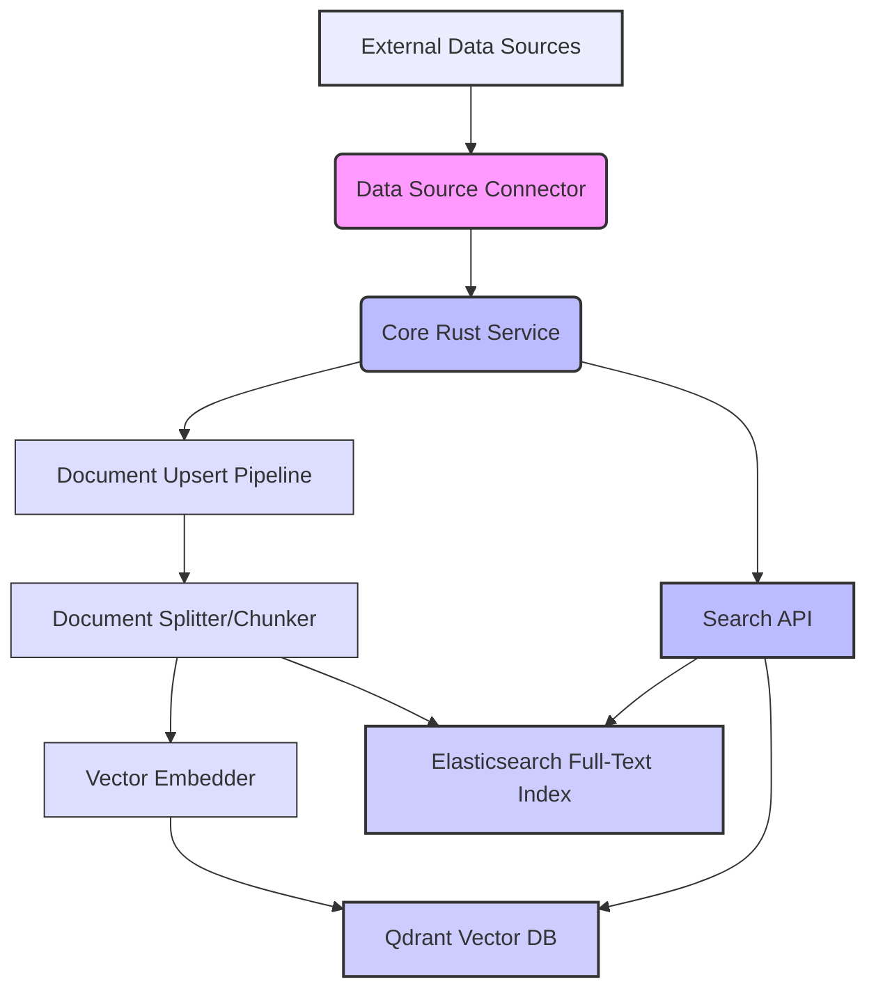

<!-- source: DeepWiki mcp.deepwiki.com · repo dust-tt/dust · page 14 Core Rust Service · fetched 2026-10-26 -->

# Core Rust Service

Relevant source files

The following files were used as context for generating this wiki page:

- [.github/actions/build-image/action.yml](.github/actions/build-image/action.yml)
- [.nvmrc](.nvmrc)
- [connectors/.nvmrc](connectors/.nvmrc)
- [connectors/esbuild.config.ts](connectors/esbuild.config.ts)
- [dockerfiles/connectors.Dockerfile](dockerfiles/connectors.Dockerfile)
- [dockerfiles/front.Dockerfile](dockerfiles/front.Dockerfile)
- [dockerfiles/marketing.Dockerfile](dockerfiles/marketing.Dockerfile)
- [dockerfiles/prodbox.Dockerfile](dockerfiles/prodbox.Dockerfile)
- [dockerfiles/sandbox-bedrock.Dockerfile](dockerfiles/sandbox-bedrock.Dockerfile)
- [dockerfiles/sparkle-storybook.Dockerfile](dockerfiles/sparkle-storybook.Dockerfile)
- [dockerfiles/sparkle/sparkle-storybook-nginx.conf](dockerfiles/sparkle/sparkle-storybook-nginx.conf)
- [dockerfiles/viz.Dockerfile](dockerfiles/viz.Dockerfile)
- [firebase-functions/webhook-router/Dockerfile](firebase-functions/webhook-router/Dockerfile)
- [front-spa/.nvmrc](front-spa/.nvmrc)
- [front/.nvmrc](front/.nvmrc)
- [front/esbuild.worker.ts](front/esbuild.worker.ts)
- [front/lib/api/config.ts](front/lib/api/config.ts)
- [front/lib/api/credits/purchase.ts](front/lib/api/credits/purchase.ts)
- [front/lib/api/poke/plugins/workspaces/buy_programmatic_usage_credits.ts](front/lib/api/poke/plugins/workspaces/buy_programmatic_usage_credits.ts)
- [front/lib/api/sandbox/image/index.ts](front/lib/api/sandbox/image/index.ts)
- [front/lib/api/sandbox/image/sandbox_image.test.ts](front/lib/api/sandbox/image/sandbox_image.test.ts)
- [front/lib/api/sandbox/image/sandbox_image.ts](front/lib/api/sandbox/image/sandbox_image.ts)
- [front/lib/api/sandbox/image/tool_manifest.test.ts](front/lib/api/sandbox/image/tool_manifest.test.ts)
- [front/lib/api/sandbox/image/tool_manifest.ts](front/lib/api/sandbox/image/tool_manifest.ts)
- [front/lib/api/sandbox/image/types.ts](front/lib/api/sandbox/image/types.ts)
- [front/lib/api/sandbox/providers/e2b_template.test.ts](front/lib/api/sandbox/providers/e2b_template.test.ts)
- [front/lib/api/sandbox/providers/e2b_template.ts](front/lib/api/sandbox/providers/e2b_template.ts)
- [front/lib/credits/committed.test.ts](front/lib/credits/committed.test.ts)
- [front/lib/credits/committed.ts](front/lib/credits/committed.ts)
- [front/lib/credits/limits.test.ts](front/lib/credits/limits.test.ts)
- [front/lib/credits/limits.ts](front/lib/credits/limits.ts)
- [front/scripts/backfill_metronome_credits.ts](front/scripts/backfill_metronome_credits.ts)
- [front/scripts/metronome_initial_contract_setup.ts](front/scripts/metronome_initial_contract_setup.ts)
- [front/workers-build/scripts/esbuild.worker.ts](front/workers-build/scripts/esbuild.worker.ts)
- [scripts/db/run-migrate.cjs](scripts/db/run-migrate.cjs)
- [sdks/js/esbuild.config.ts](sdks/js/esbuild.config.ts)
- [viz/.nvmrc](viz/.nvmrc)

The Core Rust Service is a critical component of the Dust platform, responsible for managing data sources, indexing documents, integrating with Large Language Model (LLM) providers, handling OAuth credentials, and powering search functionalities through Qdrant and Elasticsearch. This service provides the backbone for many of Dust's core features, ensuring efficient data handling, secure access to external services, and robust search capabilities.

This page provides a high-level overview of the Core Rust Service's architecture and its main responsibilities. Detailed information on specific modules and functionalities can be found in the linked child pages.

## Architecture Overview

The Core Rust Service is designed for performance and reliability, leveraging Rust's strengths in concurrency and memory safety. It exposes an API (primarily defined in `app.rs`) that other Dust services interact with. Key areas of functionality include:

- **Data Source Management**: Ingesting, processing, and indexing data from various external sources.
- **LLM Provider Integrations**: Connecting to and managing interactions with different LLM providers.
- **OAuth Credential Management**: Securely storing and managing OAuth tokens for external service access.
- **Search Backends**: Utilizing Qdrant for vector search and Elasticsearch for full-text search to enable powerful information retrieval.

The service interacts with various databases and external systems to perform its tasks.

Sources: [front/lib/api/config.ts:5-20](), [dockerfiles/front.Dockerfile:1-171](), [dockerfiles/connectors.Dockerfile:1-60]()

## Data Sources and Search

The Core Rust Service is central to how Dust manages and searches data. It handles the entire lifecycle of data from external sources, including ingestion, processing, and indexing. This involves:

- **Document Upsert Pipeline**: A robust pipeline for adding and updating documents, often involving a Temporal workflow for orchestration.
- **Chunking and Splitting**: Breaking down large documents into smaller, manageable chunks suitable for vector embedding and search.
- **Vector Search with Qdrant**: Utilizing Qdrant for efficient similarity search on document embeddings.
- **Full-Text Search with Elasticsearch**: Providing comprehensive keyword-based search capabilities.

For a detailed exploration of data source management, the upsert pipeline, and search backends, refer to [Data Sources and Search](#14.1).

Sources: [front/lib/api/sandbox/image/types.ts:1-189](), [front/lib/api/sandbox/image/index.ts:1-134](), [front/lib/api/sandbox/image/sandbox_image.ts:1-257]()

## OAuth and Provider Management

The Core Rust Service includes a dedicated `oauth` module responsible for securely handling OAuth credentials and managing integrations with various external providers. This module ensures that Dust can connect to services like GitHub, Google, Slack, Notion, HubSpot, and Gong on behalf of users, while maintaining security and compliance.

Key aspects include:

- **Connection and Credential Management**: Storing and retrieving encrypted OAuth tokens.
- **Provider Integrations**: Supporting a wide range of OAuth providers.
- **Token Refresh and Lifecycle**: Managing the refresh and expiration of access tokens.

For an in-depth look at the OAuth system, credential encryption, and supported providers, see [OAuth and Provider Management](#14.2).
Sources: [front/lib/credits/committed.ts:1-36](), [front/scripts/backfill_metronome_credits.ts:1-37](), [front/lib/api/poke/plugins/workspaces/buy_programmatic_usage_credits.ts:1-64]()

---

