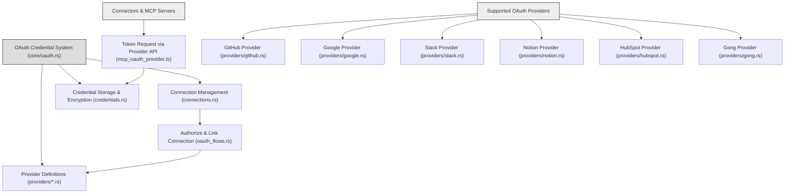
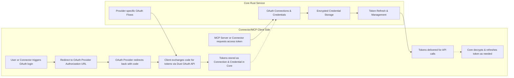

<!-- source: DeepWiki mcp.deepwiki.com · repo dust-tt/dust · page 14.2 OAuth and Provider Management · fetched 2026-10-26 -->

# 14.2 OAuth and Provider Management

Relevant source files

The following files were used as context for generating this wiki page:

- [dockerfiles/sandbox-bedrock.Dockerfile](dockerfiles/sandbox-bedrock.Dockerfile)
- [front/lib/actions/action_output_limits.ts](front/lib/actions/action_output_limits.ts)
- [front/lib/actions/mcp.ts](front/lib/actions/mcp.ts)
- [front/lib/actions/mcp_actions.test.ts](front/lib/actions/mcp_actions.test.ts)
- [front/lib/actions/mcp_actions.ts](front/lib/actions/mcp_actions.ts)
- [front/lib/actions/mcp_authentication.test.ts](front/lib/actions/mcp_authentication.test.ts)
- [front/lib/actions/mcp_authentication.ts](front/lib/actions/mcp_authentication.ts)
- [front/lib/actions/mcp_execution.test.ts](front/lib/actions/mcp_execution.test.ts)
- [front/lib/actions/mcp_execution.ts](front/lib/actions/mcp_execution.ts)
- [front/lib/actions/mcp_internal_actions/exit_events.test.ts](front/lib/actions/mcp_internal_actions/exit_events.test.ts)
- [front/lib/actions/mcp_internal_actions/exit_events.ts](front/lib/actions/mcp_internal_actions/exit_events.ts)
- [front/lib/actions/mcp_internal_actions/output_schemas.ts](front/lib/actions/mcp_internal_actions/output_schemas.ts)
- [front/lib/actions/mcp_metadata.ts](front/lib/actions/mcp_metadata.ts)
- [front/lib/actions/mcp_oauth_provider.ts](front/lib/actions/mcp_oauth_provider.ts)
- [front/lib/actions/mcp_utils.ts](front/lib/actions/mcp_utils.ts)
- [front/lib/actions/types/index.ts](front/lib/actions/types/index.ts)
- [front/lib/api/config.ts](front/lib/api/config.ts)
- [front/lib/api/credits/purchase.ts](front/lib/api/credits/purchase.ts)
- [front/lib/api/files/action_output_fs/index.ts](front/lib/api/files/action_output_fs/index.ts)
- [front/lib/api/files/action_output_fs/naming.ts](front/lib/api/files/action_output_fs/naming.ts)
- [front/lib/api/files/action_output_fs/registry.ts](front/lib/api/files/action_output_fs/registry.ts)
- [front/lib/api/mcp/error.ts](front/lib/api/mcp/error.ts)
- [front/lib/api/mcp/run_tool.ts](front/lib/api/mcp/run_tool.ts)
- [front/lib/api/poke/plugins/workspaces/buy_programmatic_usage_credits.ts](front/lib/api/poke/plugins/workspaces/buy_programmatic_usage_credits.ts)
- [front/lib/api/sandbox/image/index.ts](front/lib/api/sandbox/image/index.ts)
- [front/lib/api/sandbox/image/sandbox_image.test.ts](front/lib/api/sandbox/image/sandbox_image.test.ts)
- [front/lib/api/sandbox/image/sandbox_image.ts](front/lib/api/sandbox/image/sandbox_image.ts)
- [front/lib/api/sandbox/image/tool_manifest.test.ts](front/lib/api/sandbox/image/tool_manifest.test.ts)
- [front/lib/api/sandbox/image/tool_manifest.ts](front/lib/api/sandbox/image/tool_manifest.ts)
- [front/lib/api/sandbox/image/types.ts](front/lib/api/sandbox/image/types.ts)
- [front/lib/api/sandbox/providers/e2b_template.test.ts](front/lib/api/sandbox/providers/e2b_template.test.ts)
- [front/lib/api/sandbox/providers/e2b_template.ts](front/lib/api/sandbox/providers/e2b_template.ts)
- [front/lib/credits/committed.test.ts](front/lib/credits/committed.test.ts)
- [front/lib/credits/committed.ts](front/lib/credits/committed.ts)
- [front/lib/credits/limits.test.ts](front/lib/credits/limits.test.ts)
- [front/lib/credits/limits.ts](front/lib/credits/limits.ts)
- [front/scripts/backfill_metronome_credits.ts](front/scripts/backfill_metronome_credits.ts)
- [front/scripts/metronome_initial_contract_setup.ts](front/scripts/metronome_initial_contract_setup.ts)
- [front/temporal/agent_loop/activities/run_tool.ts](front/temporal/agent_loop/activities/run_tool.ts)
- [front/types/assistant/agent.ts](front/types/assistant/agent.ts)
- [front/types/assistant/agent_run.ts](front/types/assistant/agent_run.ts)

This page documents the OAuth credential system within Dust's core Rust service, covering its architecture, data flow, and implementation details. It explains how connectors and MCP (Model Context Protocol) servers use OAuth tokens obtained via this system. It also details the supported OAuth providers such as GitHub, Google, Slack, Notion, HubSpot, Gong, and others.

## Purpose and Scope

OAuth and provider management is critical for Dust's integration with external services. The OAuth system spans credential storage, connection management, encryption, and provider-specific logic, enabling secure authentication and authorization flows. This page provides a comprehensive technical overview of:

- Core OAuth-related structures and classes in core.
- How tokens are obtained and managed for connectors and MCP servers.
- The supported OAuth providers and their integration approach.

This documentation assumes familiarity with Dust's monorepo structure and core service design fundamentals.

---

## 1. Core OAuth Credential System Architecture

The OAuth system is implemented primarily in the `core` Rust service, managing the lifecycle and secure storage of OAuth credentials used by connectors and MCP servers.

### Key Concepts and Components

- **Connection**: Represents an OAuth connection to an external service, binding a workspace or user identity to OAuth tokens.
- **Credential**: OAuth token data (e.g., access tokens, refresh tokens) stored securely and associated with connections.
- **Encryption**: OAuth tokens are encrypted at rest using Dust's core encryption services to prevent unauthorized access.
- **Providers**: OAuth provider definitions and handlers that encapsulate OAuth flows and API interactions for supported services.

The system ensures proper granting, refreshing, and revoking of tokens, handling provider nuances.

### Data Flow Overview

1. **Provider Registration**: Providers are registered within the core with configuration including client IDs, secrets, and scopes.
2. **Connection Creation**: When a user or workspace attempts to connect a provider, a connection record is created, associating it with the OAuth credential.
3. **Authorization Flow**: OAuth authorization codes are exchanged for tokens via providers.
4. **Token Storage**: Tokens are encrypted and stored as credentials tied to connections.
5. **Token Use**: When connectors or MCP servers need to access external APIs, they retrieve and decrypt tokens to perform authorized calls.
6. **Token Refresh**: Long-lived tokens are refreshed automatically as needed, ensuring uninterrupted access.

---

## 2. How Connectors and MCP Servers Obtain OAuth Tokens

Dust supports two primary types of MCP servers in relation to OAuth:

- **Server-side MCP Servers**: These run in core or server environments and obtain tokens securely by retrieving stored credentials associated with workspace or user connections.
- **Client-side MCP Servers**: These run in browsers or extensions and obtain tokens through client-initiated OAuth flows, typically via WorkOS or custom OAuth providers.

### Token Retrieval Process

- **Server-side**: When an MCP server needs tokens, it queries Dust core resources tied to the MCP server's workspace. The core service decrypts stored credentials and provides the valid OAuth tokens.
- **Client-side**: The client performs an OAuth authorization code flow with redirects to Dust's OAuth redirect URLs. After authorization, the client obtains tokens and securely transmits connection information back to Dust.

### Security and Permissions

- Connections are permissioned to workspaces or users, restricting token access.
- Sensitive fields in credentials (refresh tokens, secrets) are stored encrypted.
- Token caches and expiration handling ensure minimal latency and avoid stale tokens.

---

## 3. Supported OAuth Providers

Dust integrates with several enterprise and productivity services via OAuth to enable connector synchronization and MCP server tool actions. The key supported OAuth providers include:

| Provider  | Description                                | Identifier (Code)      |
|-----------|--------------------------------------------|-----------------------|
| GitHub    | Source code hosting and collaboration      | `github`              |
| Google    | Google Workspace services (Drive, Gmail, etc.) | `google`              |
| Slack     | Team messaging and collaboration platform | `slack`               |
| Notion    | All-in-one workspace for note-taking       | `notion`              |
| HubSpot   | CRM, marketing, and sales platform          | `hubspot`             |
| Gong      | Conversation analytics and AI platform      | `gong`                |

Each provider has an implementation that:

- Defines OAuth scopes and URLs.
- Handles provider-specific OAuth quirks.
- Integrates with Dust's credential and connection storage.
- Provides token renewal logic if needed.

---

## 4. Key Code Entities and Their Roles

To bridge the natural language concepts above to Dust's codebase, the following diagram maps major OAuth and provider management entities to code:

- `core/oauth.rs`, `connections.rs`, `credentials.rs`: Core Rust files for OAuth connection and credential management.
- `providers/*.rs`: Modules for OAuth provider implementations.
- `front/lib/actions/mcp_oauth_provider.ts`: Frontend TypeScript logic for MCP OAuth tokens retrieval and management.
- MCP servers and connectors call into these systems to securely acquire OAuth tokens.

Sources:  
- `core/oauth.rs` (not directly listed but implied core location)  
- `front/lib/actions/mcp_oauth_provider.ts:32-74,108-145`  
- `front/lib/actions/mcp_metadata.ts:32-60`  
- `front/lib/actions/mcp_actions.ts:20-63`  

---

## 5. OAuth Connections and Credential Management in Core

### Connections

Connections abstract the linking of a Dust workspace or user identity to an external OAuth session. They maintain:

- OAuth provider identifier (e.g., `google`, `github`).
- Token-related data (encrypted access and refresh tokens).
- Metadata such as connection status, last refresh time, and scopes granted.

### Credentials and Encryption

- Credentials are stored encrypted in the database.
- Core uses envelope encryption techniques for sensitive token data.
- Access tokens have expiration; refresh tokens allow renewal.
- Core ensures tokens are valid before returning them for use.

This ensures robust security compliance.

---

## 6. OAuth Provider Implementations

Each provider module encapsulates:

- OAuth 2.0 endpoints: authorization URL, token exchange URL.
- Required OAuth scopes for Dust features.
- Parsing and validation of token responses.
- Refresh token support and renewal logic.

For example:

- **GitHub**: Offers OAuth scopes for repo access, user profile.
- **Google**: Wide scope support for Drive, Gmail, Contacts.
- **Slack**: Scopes for reading and posting in Slack workspaces.
- **Notion**: Database reading/writing scopes.
- **HubSpot** and **Gong**: CRM and conversation analytics scopes respectively.

Providers integrate with MCP tool actions and connectors that leverage these APIs once authorized.

---

## 7. MCP OAuth Token Acquisition Flow

MCP servers utilize OAuth tokens by following:

1. MCP server identified by `mcpServerId` requests connection info via core API.
2. Core resolves stored encrypted OAuth credential.
3. Core decrypts and refreshes tokens if needed.
4. Core provides valid access token transparently to MCP server requests.
5. MCP actions pass token in API calls to external services.

In frontend contexts, MCP OAuth flows include:

- Redirects using URLs from the base config (`getAuthRedirectBaseUrl` function in `front/lib/api/config.ts`).
- Client-side token caching and refresh logic.
- Error handling for token expiration, re-authentication prompts.

This is integrated with MCP execution logic in TypeScript, such as `runToolWithStreaming` in `front/lib/api/mcp/run_tool.ts`.

---

## 8. Diagram: OAuth System from Connector and MCP Perspectives

This lifecycle illustrates the interplay between user/client initiated OAuth flows, the core secure storage and token management, and token usage by MCP servers and connectors.

Sources:  
- `front/lib/api/config.ts:116-123`  
- `front/lib/actions/mcp_oauth_provider.ts`  
- `front/lib/actions/mcp_metadata.ts`  
- `front/lib/api/mcp/run_tool.ts:30-170`  

---

## 9. OAuth Provider List in MCP Server View

Dust maintains a list of supported OAuth providers for MCP servers. MCP server tooling and connectors recognize these identifiers:

| Provider key | Common Use Case                                   |
|--------------|-------------------------------------------------|
| `github`     | Code collaboration, repos access                |
| `google`     | Drive, Gmail, Workspace services                 |
| `slack`      | Messaging and collaboration                       |
| `notion`     | Workspace documents and databases                 |
| `hubspot`    | Customer relationship management                  |
| `gong`       | Conversation analysis and AI insights             |

Provider IDs are used in MCP server connection metadata, OAuth scope checks, and UI display.

---

## 10. Summary

Dust’s OAuth and Provider Management system is a secure, modular system embedded in core with frontend integrations, enabling:

- Secure credential storage with encryption.
- Provider abstraction for OAuth flow implementation.
- Token lifecycle management with refresh and expiration handling.
- Support for MCP servers and connectors to use external APIs seamlessly.
- Integration with multiple enterprise SaaS platforms through OAuth.

This system is foundational for Dust’s capability to extend through connectors and MCP servers authenticated against various external services.

---

Generated with primary source files:  
- `front/lib/actions/mcp_oauth_provider.ts:1-150`  
- `front/lib/actions/mcp_metadata.ts:1-180`  
- `front/lib/api/config.ts:110-123`  
- `front/lib/api/mcp/run_tool.ts:1-170`  
- `front/lib/actions/mcp_actions.ts:1-150`

---

