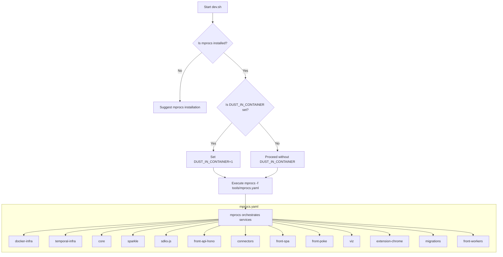
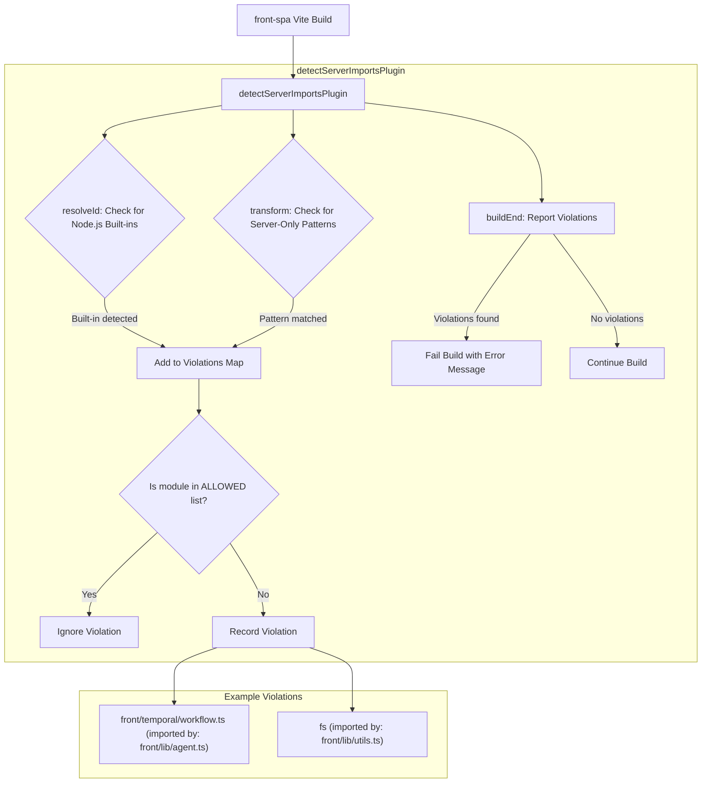

<!-- source: DeepWiki mcp.deepwiki.com · repo dust-tt/dust · page 15.2 Local Development · fetched 2026-10-26 -->

# 15.2. Local Development

Relevant source files

The following files were used as context for generating this wiki page:

- [.cursor/environment.json](.cursor/environment.json)
- [.gitignore](.gitignore)
- [connectors/package.json](connectors/package.json)
- [extension/css.d.ts](extension/css.d.ts)
- [extension/package.json](extension/package.json)
- [extension/platforms/chrome/manifests/manifest.base.json](extension/platforms/chrome/manifests/manifest.base.json)
- [extension/platforms/firefox/manifests/manifest.base.json](extension/platforms/firefox/manifests/manifest.base.json)
- [extension/tsconfig.json](extension/tsconfig.json)
- [extension/ui/hooks/useFileUploaderService.ts](extension/ui/hooks/useFileUploaderService.ts)
- [extension/ui/hooks/useSavePageToPod.ts](extension/ui/hooks/useSavePageToPod.ts)
- [front-api/forbid-next.cjs](front-api/forbid-next.cjs)
- [front-spa/package.json](front-spa/package.json)
- [front-spa/src/app/routes/adminRoutes.tsx](front-spa/src/app/routes/adminRoutes.tsx)
- [front-spa/vite.config.ts](front-spa/vite.config.ts)
- [front/components/navigation/config.test.ts](front/components/navigation/config.test.ts)
- [front/components/navigation/config.ts](front/components/navigation/config.ts)
- [front/components/pages/workspace/AnalyticsAutomationsPage.tsx](front/components/pages/workspace/AnalyticsAutomationsPage.tsx)
- [front/css.d.ts](front/css.d.ts)
- [front/hooks/useFileUploaderService.ts](front/hooks/useFileUploaderService.ts)
- [front/package.json](front/package.json)
- [front/scripts/seed/README.md](front/scripts/seed/README.md)
- [front/scripts/seed/analytics/assets/triggers.json](front/scripts/seed/analytics/assets/triggers.json)
- [front/scripts/seed/analytics/assets/webhook-sources.json](front/scripts/seed/analytics/assets/webhook-sources.json)
- [front/scripts/seed/analytics/seed.ts](front/scripts/seed/analytics/seed.ts)
- [front/scripts/seed/factories/seedConsumptionAnalytics.ts](front/scripts/seed/factories/seedConsumptionAnalytics.ts)
- [front/scripts/seed/mcp_tools/README.md](front/scripts/seed/mcp_tools/README.md)
- [front/scripts/seed/mcp_tools/seed.ts](front/scripts/seed/mcp_tools/seed.ts)
- [package-lock.json](package-lock.json)
- [package.json](package.json)
- [sdks/js/package.json](sdks/js/package.json)
- [sdks/js/tsconfig.json](sdks/js/tsconfig.json)
- [sparkle/package.json](sparkle/package.json)
- [sparkle/tsconfig.json](sparkle/tsconfig.json)
- [temporal/.env](temporal/.env)
- [temporal/docker-compose.yml](temporal/docker-compose.yml)
- [temporal/dynamicconfig/development-sql.yaml](temporal/dynamicconfig/development-sql.yaml)
- [tools/check-start-mprocs.sh](tools/check-start-mprocs.sh)
- [tools/dev.sh](tools/dev.sh)
- [tools/mprocs.yaml](tools/mprocs.yaml)
- [tools/process-compose.yaml](tools/process-compose.yaml)
- [tools/start-mprocs.sh](tools/start-mprocs.sh)
- [tools/wait-for-temporal.sh](tools/wait-for-temporal.sh)
- [viz/package.json](viz/package.json)

This page details the local development environment setup for the Dust monorepo, covering the use of `mprocs` or `process-compose`, the `dev.sh` script, Temporal local setup, database seeding, and the `front-spa` Vite configuration.

## Overview of Local Development Setup

Local development for the Dust monorepo is primarily managed through `mprocs` or `process-compose`, which orchestrate the various services and build processes. The `dev.sh` script provides a convenient entry point for starting the entire development environment. Key components include:

*   **`mprocs`/`process-compose`**: A process manager that runs multiple services concurrently, defined in `tools/mprocs.yaml` or `tools/process-compose.yaml`.
*   **`dev.sh`**: A wrapper script that sets up environment variables and starts `mprocs`.
*   **Temporal**: A distributed workflow engine, run locally via Docker Compose.
*   **Database Seeding**: Scripts and factories to populate the local PostgreSQL databases with initial data.
*   **`front-spa`**: The Single Page Application frontend, configured with Vite, including module isolation checks.

The monorepo structure, as defined in `package.json` [package.json:5-16](), includes several workspaces: `front`, `front-api`, `front-spa`, `marketing`, `sparkle`, `connectors`, `cli/dust-cli`, `extension`, `viz`, and `sdks/js`. Each of these may have its own build and run scripts orchestrated by the process manager.

Sources:
* `package.json:5-16`
* `tools/mprocs.yaml`
* `tools/process-compose.yaml`
* `tools/dev.sh`

## Process Management with `mprocs` / `process-compose`

The `tools/mprocs.yaml` [tools/mprocs.yaml:1-223]() file (or `tools/process-compose.yaml` [tools/process-compose.yaml]()) defines the various services and their commands for local development. This configuration allows developers to start and manage all necessary components from a single interface.

### Key Services and Their Roles

The `mprocs.yaml` configuration includes the following services:

*   **`_check-start-script`**: Runs a script to check prerequisites before starting other services [tools/mprocs.yaml:11-14]().
*   **`docker-infra`**: Starts core infrastructure containers like PostgreSQL (`db`), Redis, Qdrant, and Elasticsearch using `docker compose up -d` [tools/mprocs.yaml:17-25]().
*   **`temporal-infra`**: Starts the Temporal server and UI via Docker Compose, and creates necessary search attributes for `connectorId`, `conversationId`, and `workspaceId` [tools/mprocs.yaml:28-42]().
*   **`core`**: Runs the Rust-based core API service using `bacon core-api` [tools/mprocs.yaml:44-46]().
*   **`sqlite-workers`**: Runs SQLite workers, configured with `CORE_API` and `DATABASES_STORE_DATABASE_URI` environment variables [tools/mprocs.yaml:48-56]().
*   **`oauth`**: Runs the Rust-based OAuth service [tools/mprocs.yaml:58-60]().
*   **`sparkle`**: Watches for changes in the Sparkle design system and rebuilds it using `npm run watch` [tools/mprocs.yaml:62-65]().
*   **`sdks-js`**: Builds and watches the JavaScript SDK [tools/mprocs.yaml:67-70]().
*   **`migrations`**: Runs database migrations, waiting for `sdks-js` to compile first [tools/mprocs.yaml:72-76]().
*   **`front-api-hono`**: Starts the Hono-based frontend API, waiting for `sdks-js` to compile. It explicitly forbids loading `next` at runtime [tools/mprocs.yaml:78-91]().
*   **`front-workers`**: Starts the frontend workers, waiting for `front-api` to be ready [tools/mprocs.yaml:93-95]().
*   **`connectors`**: Starts the connectors service, waiting for Temporal and `sdks-js` to be ready [tools/mprocs.yaml:97-105]().
*   **`front-spa`**: Starts the main Single Page Application frontend, waiting for `sparkle` to compile [tools/mprocs.yaml:107-115]().
*   **`front-poke`**: Starts the Poke admin interface SPA, also waiting for `sparkle` [tools/mprocs.yaml:117-125]().
*   **`marketing-site`**: Starts the marketing website, waiting for `sparkle` [tools/mprocs.yaml:127-136]().
*   **`viz`**: Starts the visualization service [tools/mprocs.yaml:154-157]().
*   **`extension-chrome`/`extension-firefox`**: Starts the browser extension development servers for Chrome and Firefox respectively [tools/mprocs.yaml:159-167]().
*   **Optional Services**: `ngrok`, `firebase-webhook-router`, `apache-tika`, `kibana`, `gotenberg`, `novu`, `stripe` are also defined but typically `autostart: false` [tools/mprocs.yaml:169-223]().

### `dev.sh` Script

The `tools/dev.sh` [tools/dev.sh]() script is the primary entry point for local development. It performs the following actions:
1.  **Checks for `mprocs`**: Ensures `mprocs` is installed. If not, it suggests installation.
2.  **Sets Environment Variables**: Exports `DUST_IN_CONTAINER=1` if running inside a Docker container, which affects how `docker-infra` and `temporal-infra` behave.
3.  **Starts `mprocs`**: Executes `mprocs -f tools/mprocs.yaml`.

**Figure 1: Local Development Startup Flow**

Sources:
* `tools/mprocs.yaml:1-223`
* `tools/process-compose.yaml`
* `tools/dev.sh`

## Temporal Local Setup

Temporal is crucial for orchestrating workflows in Dust. For local development, Temporal is run via Docker Compose.

The `temporal/docker-compose.yml` [temporal/docker-compose.yml]() defines the Temporal server and UI services. The `mprocs.yaml` [tools/mprocs.yaml:28-42]() entry for `temporal-infra` handles its startup:
1.  `docker compose up -d`: Starts the Temporal services in detached mode.
2.  `until nc -z localhost 7233 2>/dev/null; do sleep 2; done`: Waits for the Temporal frontend service to be available on port 7233.
3.  `temporal operator search-attribute create ...`: Creates necessary search attributes (`connectorId`, `conversationId`, `workspaceId`) which are used for querying workflows. These attributes are defined as `Int` or `Text` types.
4.  `docker compose logs -f`: Streams logs from the Temporal services.

The `tools/wait-for-temporal.sh` [tools/wait-for-temporal.sh]() script is used by other services (like `connectors`) to ensure Temporal is running before they attempt to connect.

Sources:
* `temporal/docker-compose.yml`
* `tools/mprocs.yaml:28-42`
* `tools/wait-for-temporal.sh`

## Database Seeding

To ensure a functional local development environment, databases need to be populated with initial data. This is achieved through SQL scripts and seed factories.

### `dust_hive_seed.sql`

The `dust_hive_seed.sql` file (not provided in snippets, but implied by context) is typically used to seed the main PostgreSQL database with essential data. This might include initial workspace configurations, default agents, or other foundational data.

### Seed Factories

The `front` service includes a `scripts/seed` directory [front/scripts/seed/README.md]() containing various seed factories. These factories are TypeScript files that programmatically create data for different parts of the application.

Examples of seed factories include:
*   `front/scripts/seed/analytics/seed.ts` [front/scripts/seed/analytics/seed.ts](): Seeds analytics data, potentially using assets like `webhook-sources.json` [front/scripts/seed/analytics/assets/webhook-sources.json]() and `triggers.json` [front/scripts/seed/analytics/assets/triggers.json]().
*   `front/scripts/seed/mcp_tools/seed.ts` [front/scripts/seed/mcp_tools/seed.ts](): Seeds data related to MCP (Model Context Protocol) tools.
*   `front/scripts/seed/factories/seedConsumptionAnalytics.ts` [front/scripts/seed/factories/seedConsumptionAnalytics.ts](): Specifically seeds consumption analytics data.

These scripts are typically run as part of the `initdb` process or manually when specific data is required. For instance, `front/package.json` [front/package.json:26]() defines an `initdb` script: `./admin/init_db.sh`.

Sources:
* `front/scripts/seed/README.md`
* `front/scripts/seed/analytics/seed.ts`
* `front/scripts/seed/analytics/assets/webhook-sources.json`
* `front/scripts/seed/analytics/assets/triggers.json`
* `front/scripts/seed/mcp_tools/seed.ts`
* `front/scripts/seed/factories/seedConsumptionAnalytics.ts`
* `front/package.json:26`

## `front-spa` Vite Configuration and Module Isolation

The `front-spa` project is a Single Page Application built with Vite. Its configuration, defined in `front-spa/vite.config.ts` [front-spa/vite.config.ts:1-231](), is crucial for development and build processes, especially regarding module isolation.

### Multiple Entry Points

The `front-spa` supports multiple entry points, each serving a different purpose:
*   **`app`**: The main Dust application, accessible via `index.html`, `share.html`, `oauth.html`, and `email.html` [front-spa/vite.config.ts:11-35](). It runs on port 3011 [front-spa/vite.config.ts:35]().
*   **`poke`**: The internal admin interface, accessible via `poke.html` [front-spa/vite.config.ts:37-46](). It runs on port 3010 [front-spa/vite.config.ts:46]().

The `serveMapping` function [front-spa/vite.config.ts:23-33]() in the `serveHtmlPlugin` [front-spa/vite.config.ts:205-231]() ensures that the correct HTML file is served based on the URL path during development.

### Module Isolation with `detectServerImportsPlugin`

A critical aspect of the `front-spa` configuration is the `detectServerImportsPlugin` [front-spa/vite.config.ts:52-161](). This custom Vite plugin enforces module isolation by preventing server-side code from being accidentally bundled into the client-side SPA.

**How it works:**
1.  **`NODE_BUILTINS`**: A set of Node.js built-in modules (e.g., `fs`, `path`, `buffer`) that should not be imported in client-side code [front-spa/vite.config.ts:54-70]().
2.  **`SERVER_ONLY_PATTERNS`**: Regular expressions matching file paths that are known to contain server-only code (e.g., `front/temporal/`, `front/lib/resources/`) [front-spa/vite.config.ts:72-75]().
3.  **`ALLOWED`**: A whitelist of exceptions, with comments explaining why they are tolerated (e.g., `front/lib/resources/string_ids.ts` because its server-dependent parts are isolated, `buffer` for shimmed runtime use) [front-spa/vite.config.ts:78-89]().
4.  **`resolveId` hook**: Checks for imports of `NODE_BUILTINS` [front-spa/vite.config.ts:122-126]().
5.  **`transform` hook**: Checks if the module ID matches any `SERVER_ONLY_PATTERNS` [front-spa/vite.config.ts:128-135]().
6.  **`buildEnd` hook**: If any violations are detected (and not in the `ALLOWED` list), the build fails with an informative error message, listing the offending modules and their importers [front-spa/vite.config.ts:137-158]().

This plugin helps maintain a clean separation between frontend and backend concerns, preventing runtime errors or unnecessary bundle size increases.

**Figure 2: `detectServerImportsPlugin` Data Flow**

### Other Vite Plugins

*   **`react`**: Enables React Fast Refresh [front-spa/vite.config.ts:1]().
*   **`visualizer`**: Generates a bundle analysis report when `ANALYZE=true` [front-spa/vite.config.ts:3]().
*   **`reactScanPlugin`**: Injects a `react-scan` script in development mode for React component analysis [front-spa/vite.config.ts:164-179]().
*   **`organizeMultiEntryOutputPlugin`**: Renames output HTML files for multi-entry builds (e.g., `poke.html` to `index.html` in the `poke` build directory) [front-spa/vite.config.ts:181-202]().

Sources:
* `front-spa/vite.config.ts:1-231`
* `front-spa/vite.config.ts:11-35`
* `front-spa/vite.config.ts:37-46`
* `front-spa/vite.config.ts:23-33`
* `front-spa/vite.config.ts:205-231`
* `front-spa/vite.config.ts:52-161`
* `front-spa/vite.config.ts:54-70`
* `front-spa/vite.config.ts:72-75`
* `front-spa/vite.config.ts:78-89`
* `front-spa/vite.config.ts:122-126`
* `front-spa/vite.config.ts:128-135`
* `front-spa/vite.config.ts:137-158`
* `front-spa/vite.config.ts:1`
* `front-spa/vite.config.ts:3`
* `front-spa/vite.config.ts:164-179`
* `front-spa/vite.config.ts:181-202`

---

