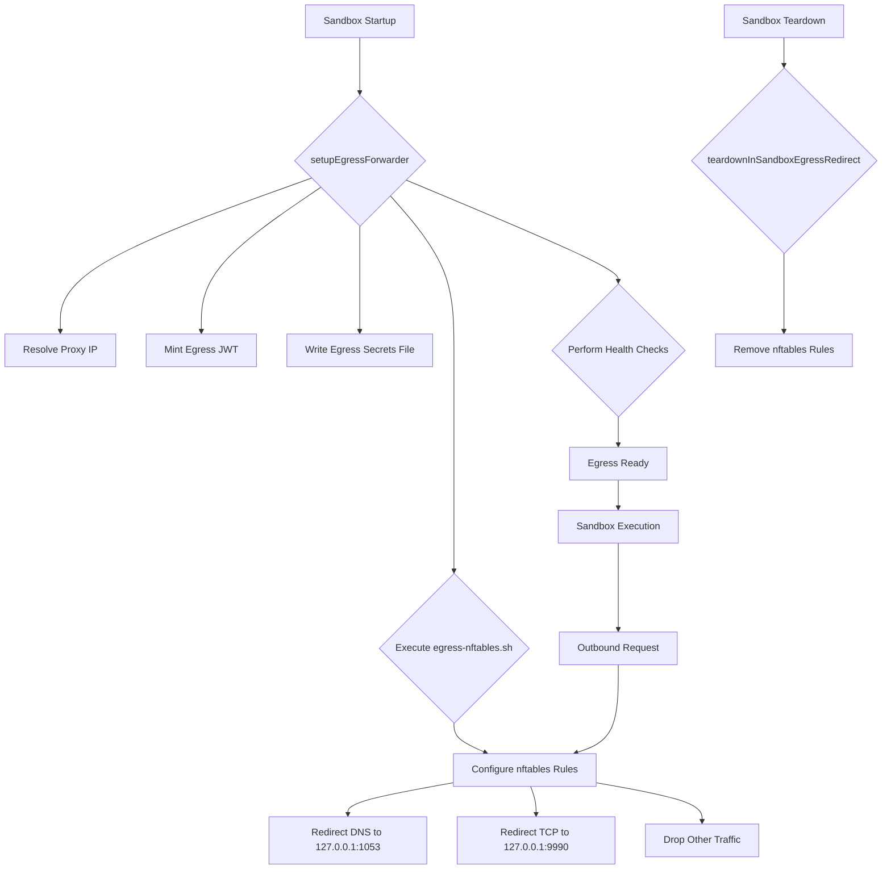

<!-- source: DeepWiki mcp.deepwiki.com · repo dust-tt/dust · page 15.3 Egress Proxy and Network Security · fetched 2026-10-26 -->

# Egress Proxy and Network Security

<details>
<summary>Relevant source files</summary>

The following files were used as context for generating this wiki page:

- [cli/dust-sandbox/Cargo.lock](cli/dust-sandbox/Cargo.lock)
- [cli/dust-sandbox/Cargo.toml](cli/dust-sandbox/Cargo.toml)
- [front-api/routes/w/[wId]/assistant/conversations/[cId]/sandbox/index.ts](front-api/routes/w/[wId]/assistant/conversations/[cId]/sandbox/index.ts)
- [front/lib/api/actions/servers/sandbox/metadata.ts](front/lib/api/actions/servers/sandbox/metadata.ts)
- [front/lib/api/actions/servers/sandbox/tools/index.test.ts](front/lib/api/actions/servers/sandbox/tools/index.test.ts)
- [front/lib/api/actions/servers/sandbox/tools/index.ts](front/lib/api/actions/servers/sandbox/tools/index.ts)
- [front/lib/api/file_system/sandbox/gcs_sandbox_mount_adapter.test.ts](front/lib/api/file_system/sandbox/gcs_sandbox_mount_adapter.test.ts)
- [front/lib/api/file_system/sandbox/gcs_sandbox_mount_adapter.ts](front/lib/api/file_system/sandbox/gcs_sandbox_mount_adapter.ts)
- [front/lib/api/sandbox/egress.test.ts](front/lib/api/sandbox/egress.test.ts)
- [front/lib/api/sandbox/egress.ts](front/lib/api/sandbox/egress.ts)
- [front/lib/api/sandbox/gcs/token.test.ts](front/lib/api/sandbox/gcs/token.test.ts)
- [front/lib/api/sandbox/gcs/token.ts](front/lib/api/sandbox/gcs/token.ts)
- [front/lib/api/sandbox/hardening.ts](front/lib/api/sandbox/hardening.ts)
- [front/lib/api/sandbox/image/egress/dust-egress-nftables.service](front/lib/api/sandbox/image/egress/dust-egress-nftables.service)
- [front/lib/api/sandbox/image/egress/dust-egress-resolver.service](front/lib/api/sandbox/image/egress/dust-egress-resolver.service)
- [front/lib/api/sandbox/image/egress/egress-nftables.sh](front/lib/api/sandbox/image/egress/egress-nftables.sh)
- [front/lib/api/sandbox/image/profile/soffice/pdf_text.py](front/lib/api/sandbox/image/profile/soffice/pdf_text.py)
- [front/lib/api/sandbox/image/profile/soffice/pptx_audit.py](front/lib/api/sandbox/image/profile/soffice/pptx_audit.py)
- [front/lib/api/sandbox/image/profile/soffice/pptx_contrast.py](front/lib/api/sandbox/image/profile/soffice/pptx_contrast.py)
- [front/lib/api/sandbox/image/profile/soffice/pptx_fontmetrics.py](front/lib/api/sandbox/image/profile/soffice/pptx_fontmetrics.py)
- [front/lib/api/sandbox/image/profile/soffice/pptx_geometry.py](front/lib/api/sandbox/image/profile/soffice/pptx_geometry.py)
- [front/lib/api/sandbox/image/profile/soffice/pptx_inspect.py](front/lib/api/sandbox/image/profile/soffice/pptx_inspect.py)
- [front/lib/api/sandbox/image/profile/soffice/pptx_render_boxes.py](front/lib/api/sandbox/image/profile/soffice/pptx_render_boxes.py)
- [front/lib/api/sandbox/image/profile/soffice/pptx_slides.py](front/lib/api/sandbox/image/profile/soffice/pptx_slides.py)
- [front/lib/api/sandbox/image/profile/soffice/pptx_typography.py](front/lib/api/sandbox/image/profile/soffice/pptx_typography.py)
- [front/lib/api/sandbox/image/profile/soffice/render.py](front/lib/api/sandbox/image/profile/soffice/render.py)
- [front/lib/api/sandbox/image/profile/soffice/render_publish.py](front/lib/api/sandbox/image/profile/soffice/render_publish.py)
- [front/lib/api/sandbox/image/profile/soffice/tests/test_audit.py](front/lib/api/sandbox/image/profile/soffice/tests/test_audit.py)
- [front/lib/api/sandbox/image/profile/soffice/tests/test_contrast.py](front/lib/api/sandbox/image/profile/soffice/tests/test_contrast.py)
- [front/lib/api/sandbox/image/profile/soffice/tests/test_geometry.py](front/lib/api/sandbox/image/profile/soffice/tests/test_geometry.py)
- [front/lib/api/sandbox/image/profile/soffice/tests/test_render.py](front/lib/api/sandbox/image/profile/soffice/tests/test_render.py)
- [front/lib/api/sandbox/image/profile/soffice/tests/test_slides.py](front/lib/api/sandbox/image/profile/soffice/tests/test_slides.py)
- [front/lib/api/sandbox/image/registry.test.ts](front/lib/api/sandbox/image/registry.test.ts)
- [front/lib/api/sandbox/image/registry.ts](front/lib/api/sandbox/image/registry.ts)
- [front/lib/api/sandbox/image/token/dust-gcs-token-firewall.sh](front/lib/api/sandbox/image/token/dust-gcs-token-firewall.sh)
- [front/lib/api/sandbox/instrumentation.ts](front/lib/api/sandbox/instrumentation.ts)
- [front/lib/api/sandbox/lifecycle.test.ts](front/lib/api/sandbox/lifecycle.test.ts)
- [front/lib/api/sandbox/lifecycle.ts](front/lib/api/sandbox/lifecycle.ts)
- [front/lib/api/sandbox/provider.ts](front/lib/api/sandbox/provider.ts)
- [front/lib/api/sandbox/providers/e2b.test.ts](front/lib/api/sandbox/providers/e2b.test.ts)
- [front/lib/api/sandbox/providers/e2b.ts](front/lib/api/sandbox/providers/e2b.ts)
- [front/lib/api/sandbox/sandbox_child_block.test.ts](front/lib/api/sandbox/sandbox_child_block.test.ts)
- [front/lib/api/sandbox/sandbox_child_block.ts](front/lib/api/sandbox/sandbox_child_block.ts)
- [front/lib/resources/conversation_sandbox_adapter.ts](front/lib/resources/conversation_sandbox_adapter.ts)
- [front/lib/resources/pod_sandbox_adapter.ts](front/lib/resources/pod_sandbox_adapter.ts)
- [front/lib/resources/sandbox_resource.test.ts](front/lib/resources/sandbox_resource.test.ts)
- [front/lib/resources/sandbox_resource.ts](front/lib/resources/sandbox_resource.ts)
- [front/lib/resources/skill/code_defined/global/pptx.ts](front/lib/resources/skill/code_defined/global/pptx.ts)
- [front/lib/resources/storage/models/sandbox.ts](front/lib/resources/storage/models/sandbox.ts)
- [front/migrations/pre-deploy/20260724155601_add_sandbox_reaper_indexes.sql](front/migrations/pre-deploy/20260724155601_add_sandbox_reaper_indexes.sql)
- [front/migrations/pre-deploy/20260730131801_add_sandbox_reaper_kill_requested_sleeping_index.sql](front/migrations/pre-deploy/20260730131801_add_sandbox_reaper_kill_requested_sleeping_index.sql)
- [front/migrations/pre-deploy/20260826122416_prepare_frames_v2_schema.sql](front/migrations/pre-deploy/20260826122416_prepare_frames_v2_schema.sql)
- [front/scripts/sandbox_security_check.test.ts](front/scripts/sandbox_security_check.test.ts)
- [front/scripts/sandbox_security_check.ts](front/scripts/sandbox_security_check.ts)
- [front/temporal/sandbox_reaper/activities.test.ts](front/temporal/sandbox_reaper/activities.test.ts)
- [front/temporal/sandbox_reaper/activities.ts](front/temporal/sandbox_reaper/activities.ts)
- [front/temporal/sandbox_reaper/config.ts](front/temporal/sandbox_reaper/config.ts)
- [front/temporal/sandbox_reaper/kill_requester/activities.test.ts](front/temporal/sandbox_reaper/kill_requester/activities.test.ts)
- [front/temporal/sandbox_reaper/kill_requester/activities.ts](front/temporal/sandbox_reaper/kill_requester/activities.ts)
- [front/temporal/sandbox_reaper/kill_requester/client.test.ts](front/temporal/sandbox_reaper/kill_requester/client.test.ts)
- [front/temporal/sandbox_reaper/kill_requester/client.ts](front/temporal/sandbox_reaper/kill_requester/client.ts)
- [front/temporal/sandbox_reaper/kill_requester/helpers.ts](front/temporal/sandbox_reaper/kill_requester/helpers.ts)
- [front/temporal/sandbox_reaper/kill_requester/workflows.ts](front/temporal/sandbox_reaper/kill_requester/workflows.ts)
- [front/temporal/sandbox_reaper/worker.ts](front/temporal/sandbox_reaper/worker.ts)
- [front/temporal/sandbox_reaper/workflows.test.ts](front/temporal/sandbox_reaper/workflows.test.ts)
- [front/temporal/sandbox_reaper/workflows.ts](front/temporal/sandbox_reaper/workflows.ts)
- [front/tests/utils/SandboxFactory.ts](front/tests/utils/SandboxFactory.ts)

</details>


This page details the Rust-based egress proxy, its role in enforcing network security policies for sandboxed environments, and how it integrates with the Dust platform. We will cover the proxy's architecture, JWT-based policy enforcement, domain allowlisting, `nftables` integration, and the mechanisms by which sandboxes control outbound network access.

## Egress Proxy Architecture

The egress proxy is a critical component for securing outbound network access from sandboxed environments. It is implemented in Rust and runs as a dedicated service. All outbound network traffic from sandboxes is routed through this proxy, which then applies security policies before forwarding requests.

The proxy's core responsibilities include:
*   **Policy Enforcement**: Using JWTs to authenticate and authorize sandbox requests against defined egress policies.
*   **Domain Allowlisting**: Restricting outbound connections to a predefined set of allowed domains.
*   **Traffic Interception**: Acting as a transparent proxy for HTTP/HTTPS traffic and a DNS resolver for all DNS queries.
*   **Logging**: Recording denied connection attempts for auditing and debugging.

### Components

The egress proxy system involves several key components:

*   **Rust Egress Proxy (`egress-proxy/src`)**: The main proxy application written in Rust. It handles incoming requests, validates JWTs, enforces domain allowlists, and forwards allowed traffic.
*   **`nftables`**: The Linux kernel's packet filtering framework. It is used to redirect all outbound traffic from sandboxed processes to the egress proxy.
*   **JWTs (JSON Web Tokens)**: Used for authenticating requests from sandboxes to the egress proxy and carrying policy information.
*   **Egress Policy Files**: JSON files stored on the proxy that define allowed domains for specific workspaces, owners (e.g., conversations), and pods.

### Data Flow

The following diagram illustrates the high-level data flow for an outbound network request from a sandbox:

```mermaid
graph TD
    SandboxProcess["Sandbox Process (e.g., Python script)"] --> |Outbound Network Request (HTTP/HTTPS/DNS)| Nftables[("nftables (Linux Kernel)")]
    Nftables --> |Redirected Traffic| EgressProxy["Rust Egress Proxy"]
    EgressProxy --> |Validate JWT, Enforce Policy| PolicyStore["Egress Policy Files (JSON)"]
    EgressProxy --> |Allowed Request| Internet["Internet"]
    EgressProxy --x |Denied Request| DenyLog["Deny Log File"]
    DenyLog --> SandboxTools["Sandbox Tools (readNewDenyLogEntries)"]
    SandboxTools --> Agent["Agent (for user feedback)"]
```

Sources:
- [front/lib/api/sandbox/egress.ts:35-36]()
- [front/lib/api/actions/servers/sandbox/tools/index.ts:111-112]()

## JWT-based Policy Enforcement

Every outbound network request from a sandbox to the egress proxy is accompanied by a JSON Web Token (JWT). This JWT serves as an authentication and authorization mechanism, allowing the proxy to identify the origin of the request and apply the appropriate egress policies.

### JWT Minting

The `mintEgressJwt` function [front/lib/api/sandbox/egress.ts:118-144]() is responsible for generating these JWTs. It includes claims that identify the sandbox, workspace, and owner:

*   `iss`: Issuer, always `"dust-front"`.
*   `aud`: Audience, always `"dust-egress-proxy"`.
*   `sbId`: The provider-specific ID of the sandbox.
*   `wId`: The ID of the workspace the sandbox belongs to.
*   `ownerId`: The ID of the sandbox's owner (e.g., a conversation ID).
*   `podId`: (Optional) The ID of the pod (space) if the sandbox is running within one. This allows for inherited policies.

The JWT is signed using a shared secret (`config.getEgressProxyJwtSecret()`) and has a time-to-live (TTL) of 24 hours [front/lib/api/sandbox/egress.ts:141]().

```mermaid
graph TD
    A[Sandbox Request] --> B{mintEgressJwt}
    B --> C{JWT Payload Construction}
    C --> D{Sign JWT with EgressProxyJwtSecret}
    D --> E[Signed JWT]
    E --> F[Egress Proxy]

    subgraph JWT Payload
        C1[iss: "dust-front"]
        C2[aud: "dust-egress-proxy"]
        C3[sbId: providerId]
        C4[wId: workspaceId]
        C5[ownerId: ownerId]
        C6[podId: podId (optional)]
    end
```

Sources:
- [front/lib/api/sandbox/egress.ts:118-144]()
- [front/lib/api/sandbox/egress.ts:141]()

### Policy Invalidation

When egress policies are updated (e.g., a new domain is allowlisted), the proxy's cache needs to be invalidated. The `mintEgressInvalidationJwt` function [front/lib/api/sandbox/egress.ts:153-173]() generates a special JWT for this purpose. This JWT includes:

*   `action: "invalidate-policy"`
*   `wId`: The workspace ID for which policies should be invalidated.
*   `ownerId`: (Optional) The owner ID for which policies should be invalidated.

The proxy uses these claims to evict the relevant policy entries from its cache.

Sources:
- [front/lib/api/sandbox/egress.ts:153-173]()

## Domain Allowlisting

The egress proxy enforces domain allowlisting, meaning sandboxes can only connect to domains explicitly permitted by their associated policies.

### Policy Hierarchy

Egress policies can be defined at multiple levels, forming a hierarchy:

1.  **Workspace Policy**: Applies to all sandboxes within a workspace.
2.  **Owner Policy**: Applies to a specific sandbox owner (e.g., a conversation). This policy can augment or override the workspace policy.
3.  **Pod Policy**: Applies to sandboxes running within a specific pod (space). This policy can further augment or override the owner and workspace policies.

The proxy allows a domain if it is permitted by *any* of the applicable policies.

### Managing Policies

The `addOwnerPolicyDomain` [front/lib/api/actions/servers/sandbox/tools/index.ts:34]() and `requestOwnerPolicyDomain` [front/lib/api/actions/servers/sandbox/tools/index.ts:35]() functions are used to manage egress policies.
The `add_egress_domain` tool [front/lib/api/actions/servers/sandbox/tools/index.ts:73]() allows agents to request new domains to be added to the allowlist, which might require admin approval.

### Deny Logging

When a request is denied by the egress proxy due to a domain not being allowlisted, an entry is written to a deny log file (`/tmp/dust-egress-denied.log`) [front/lib/api/sandbox/egress.ts:35](). This log entry includes the reason for denial, the domain, and the port.

The `readNewDenyLogEntries` function [front/lib/api/sandbox/egress.ts:30]() reads these log entries. The `partitionDenyLogEntries` function [front/lib/api/actions/servers/sandbox/tools/index.ts:140-173]() then processes these entries, distinguishing between `proxy_denied` reasons (actionable by the agent) and other harness-related denials. Only `proxy_denied` entries are surfaced to the agent.

Sources:
- [front/lib/api/sandbox/egress.ts:35]()
- [front/lib/api/actions/servers/sandbox/tools/index.ts:30-37]()
- [front/lib/api/actions/servers/sandbox/tools/index.ts:73]()
- [front/lib/api/actions/servers/sandbox/tools/index.ts:140-173]()

## `nftables` Integration

`nftables` is crucial for transparently redirecting all outbound network traffic from sandboxed processes to the egress proxy. This ensures that no traffic bypasses the proxy's policy enforcement.

### Sandbox Egress `nftables` Scripts

The `egress-nftables.sh` script [front/lib/api/sandbox/image/egress/egress-nftables.sh]() is responsible for configuring the `nftables` rules within the sandbox. These rules perform the following actions:

1.  **Redirect DNS Queries**: All DNS queries (UDP port 53) are redirected to the egress proxy's DNS resolver (`127.0.0.1:1053`) [front/lib/api/sandbox/egress.ts:32]().
2.  **Redirect Outbound TCP Traffic**: All outbound TCP traffic (except to the proxy itself) is redirected to the egress proxy's forwarder (`127.0.0.1:9990`) [front/lib/api/sandbox/egress.ts:31]().
3.  **Drop Uncontrolled Traffic**: Traffic that is not explicitly allowed or redirected (e.g., direct connections to external IPs, non-TCP/UDP protocols) is dropped.
4.  **User-Specific Rules**: The rules are applied specifically to processes running under certain user IDs (`SANDBOX_EGRESS_CONTROLLED_UIDS`) [front/lib/api/sandbox/image/types.ts:18](), ensuring that only sandboxed processes are affected.

### Setup and Teardown

The `setupEgressForwarder` function [front/lib/api/sandbox/egress.ts:210-211]() orchestrates the setup of the egress proxy within the sandbox. This involves:

1.  **Resolving Proxy Address**: Resolving the IP address of the external egress proxy host [front/lib/api/sandbox/egress.ts:83-87]().
2.  **Minting JWT**: Generating an egress JWT for the sandbox [front/lib/api/sandbox/egress.ts:118-144]().
3.  **Writing Secrets**: Writing the JWT and other secrets to a file within the sandbox (`/etc/dust/egress-token`) [front/lib/api/sandbox/egress.ts:34]().
4.  **Configuring `nftables`**: Executing the `egress-nftables.sh` script to set up the packet filtering rules.
5.  **Health Checks**: Performing health checks to ensure the proxy and `nftables` rules are correctly configured and operational [front/lib/api/sandbox/egress.ts:175-202]().

The `teardownInSandboxEgressRedirect` function [front/lib/api/sandbox/egress.ts:300-301]() removes the `nftables` rules when the sandbox is no longer active.



Sources:
- [front/lib/api/sandbox/egress.ts:31-32]()
- [front/lib/api/sandbox/egress.ts:34]()
- [front/lib/api/sandbox/egress.ts:83-87]()
- [front/lib/api/sandbox/egress.ts:118-144]()
- [front/lib/api/sandbox/egress.ts:175-202]()
- [front/lib/api/sandbox/egress.ts:210-211]()
- [front/lib/api/sandbox/egress.ts:300-301]()
- [front/lib/api/sandbox/image/egress/egress-nftables.sh]()
- [front/lib/api/sandbox/image/types.ts:18]()

## Sandbox Outbound Network Access Control

The combination of the Rust egress proxy and `nftables` provides robust control over outbound network access from sandboxes.

### Hardening and Security

Several measures are in place to harden the sandbox environment and prevent circumvention of egress policies:

*   **User Isolation**: Sandboxed processes run under specific user IDs (`SANDBOX_AGENT_PROXIED_UID`) [front/lib/api/sandbox/image/types.ts:19]() that are subject to the `nftables` rules.
*   **Root Command Execution**: Sensitive operations like `nftables` configuration are performed via `execRoot` [front/lib/resources/sandbox_resource.ts:13]() which ensures commands are run with root privileges and their output is captured.
*   **Immutable Environment**: The sandbox environment is designed to be largely immutable, preventing unauthorized changes to network configurations.
*   **No `sudo`**: `sudo` is explicitly removed from sandbox images to prevent privilege escalation [front/lib/api/sandbox/image/registry.test.ts:198]().
*   **Restricted Paths**: Service-owned runtime paths are locked down after package installs to prevent tampering [front/lib/api/sandbox/image/registry.test.ts:142-171]().

### Sandbox Lifecycle and Egress

The egress setup is tightly integrated with the sandbox lifecycle:

*   **`ensureSandboxEgressOnExec`**: This function [front/lib/api/sandbox/egress.ts:260-261]() is called before any execution within the sandbox to ensure that egress is properly configured. It handles cases where the sandbox is freshly created or woken from sleep.
*   **`SandboxResource.execRoot`**: This method [front/lib/resources/sandbox_resource.ts:13]() allows the execution of commands with root privileges within the sandbox, essential for `nftables` configuration.

This comprehensive approach ensures that all outbound network activity from sandboxed code is subject to strict policy enforcement, enhancing the security and integrity of the Dust platform.

Sources:
- [front/lib/api/sandbox/egress.ts:260-261]()
- [front/lib/api/sandbox/image/registry.test.ts:142-171]()
- [front/lib/api/sandbox/image/registry.test.ts:198]()
- [front/lib/api/sandbox/image/types.ts:19]()
- [front/lib/resources/sandbox_resource.ts:13]()

---

