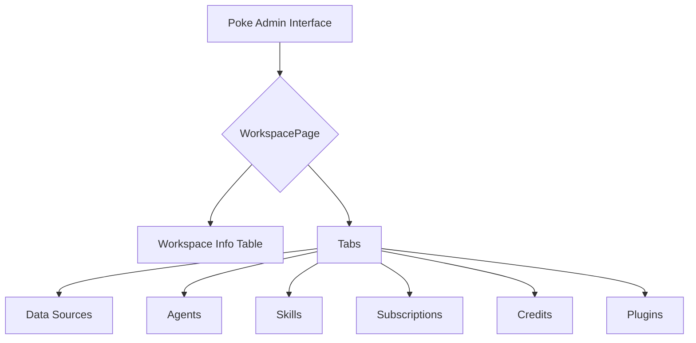

<!-- source: DeepWiki mcp.deepwiki.com · repo dust-tt/dust · page 16 Poke Admin Interface · fetched 2026-10-26 -->

# Poke Admin Interface

<details>
<summary>Relevant source files</summary>

The following files were used as context for generating this wiki page:

- [front-api/routes/poke/workspaces/[wId]/credits/api-keys-usage.ts](front-api/routes/poke/workspaces/[wId]/credits/api-keys-usage.ts)
- [front-api/routes/poke/workspaces/[wId]/credits/consumption-export.ts](front-api/routes/poke/workspaces/[wId]/credits/consumption-export.ts)
- [front-api/routes/poke/workspaces/[wId]/credits/index.ts](front-api/routes/poke/workspaces/[wId]/credits/index.ts)
- [front-api/routes/poke/workspaces/[wId]/credits/members-usage.ts](front-api/routes/poke/workspaces/[wId]/credits/members-usage.ts)
- [front-spa/index.html](front-spa/index.html)
- [front-spa/src/app/App.tsx](front-spa/src/app/App.tsx)
- [front-spa/src/app/components/AuthErrorPage.tsx](front-spa/src/app/components/AuthErrorPage.tsx)
- [front-spa/src/app/layouts/WorkspacePage.tsx](front-spa/src/app/layouts/WorkspacePage.tsx)
- [front-spa/src/app/main.tsx](front-spa/src/app/main.tsx)
- [front-spa/src/app/pages/IndexPage.tsx](front-spa/src/app/pages/IndexPage.tsx)
- [front-spa/src/index.css](front-spa/src/index.css)
- [front-spa/src/lib/initDatadog.ts](front-spa/src/lib/initDatadog.ts)
- [front-spa/src/lib/platform.tsx](front-spa/src/lib/platform.tsx)
- [front-spa/src/poke/PokeApp.tsx](front-spa/src/poke/PokeApp.tsx)
- [front-spa/src/poke/layouts/PokePage.tsx](front-spa/src/poke/layouts/PokePage.tsx)
- [front-spa/src/poke/layouts/PokeWorkspacePage.tsx](front-spa/src/poke/layouts/PokeWorkspacePage.tsx)
- [front/admin/cli.ts](front/admin/cli.ts)
- [front/components/pages/workspace/AnalyticsPage.tsx](front/components/pages/workspace/AnalyticsPage.tsx)
- [front/components/poke/credits/CreditStateLogsLink.tsx](front/components/poke/credits/CreditStateLogsLink.tsx)
- [front/components/poke/credits/MemberConsumptionExportButton.tsx](front/components/poke/credits/MemberConsumptionExportButton.tsx)
- [front/components/poke/credits/PokeApiKeysUsageTable.tsx](front/components/poke/credits/PokeApiKeysUsageTable.tsx)
- [front/components/poke/credits/PokeMembersUsageTable.tsx](front/components/poke/credits/PokeMembersUsageTable.tsx)
- [front/components/poke/credits/PokeUsageTab.tsx](front/components/poke/credits/PokeUsageTab.tsx)
- [front/components/poke/credits/ReconcileCreditStateButton.tsx](front/components/poke/credits/ReconcileCreditStateButton.tsx)
- [front/components/poke/pages/WorkspacePage.tsx](front/components/poke/pages/WorkspacePage.tsx)
- [front/components/poke/shadcn/ui/form/fields.tsx](front/components/poke/shadcn/ui/form/fields.tsx)
- [front/components/poke/subscriptions/EnterpriseUpgradeDialog.tsx](front/components/poke/subscriptions/EnterpriseUpgradeDialog.tsx)
- [front/components/poke/subscriptions/columns.tsx](front/components/poke/subscriptions/columns.tsx)
- [front/components/poke/subscriptions/table.tsx](front/components/poke/subscriptions/table.tsx)
- [front/components/poke/workspace/table.tsx](front/components/poke/workspace/table.tsx)
- [front/components/workspace/analytics/AnalyticsExportPanel.tsx](front/components/workspace/analytics/AnalyticsExportPanel.tsx)
- [front/lib/api/credits/api_keys_usage.ts](front/lib/api/credits/api_keys_usage.ts)
- [front/lib/api/credits/consumption_export.test.ts](front/lib/api/credits/consumption_export.test.ts)
- [front/lib/api/credits/consumption_export.ts](front/lib/api/credits/consumption_export.ts)
- [front/lib/api/poke/plugins/workspaces/index.ts](front/lib/api/poke/plugins/workspaces/index.ts)
- [front/lib/api/poke/plugins/workspaces/manage_conversation_kill_switch.ts](front/lib/api/poke/plugins/workspaces/manage_conversation_kill_switch.ts)
- [front/lib/api/poke/plugins/workspaces/manage_workspace_kill_switch.ts](front/lib/api/poke/plugins/workspaces/manage_workspace_kill_switch.ts)
- [front/lib/api/poke/workspace_info.ts](front/lib/api/poke/workspace_info.ts)
- [front/lib/metronome/per_user_usage.test.ts](front/lib/metronome/per_user_usage.test.ts)
- [front/lib/metronome/per_user_usage.ts](front/lib/metronome/per_user_usage.ts)
- [front/lib/metronome/programmatic_awu_usage.ts](front/lib/metronome/programmatic_awu_usage.ts)
- [front/lib/resources/key_resource.test.ts](front/lib/resources/key_resource.test.ts)
- [front/lib/resources/key_resource.ts](front/lib/resources/key_resource.ts)
- [front/lib/resources/labs_transcripts_resource.ts](front/lib/resources/labs_transcripts_resource.ts)
- [front/lib/resources/membership_resource.test.ts](front/lib/resources/membership_resource.test.ts)
- [front/lib/resources/storage/models/keys.ts](front/lib/resources/storage/models/keys.ts)
- [front/lib/resources/subscription_resource.test.ts](front/lib/resources/subscription_resource.test.ts)
- [front/lib/resources/user_resource.test.ts](front/lib/resources/user_resource.test.ts)
- [front/lib/swr/poke.ts](front/lib/swr/poke.ts)
- [front/lib/swr/workspaces.ts](front/lib/swr/workspaces.ts)
- [front/migrations/20250723_update_keys_scope_for_regular_groups.ts](front/migrations/20250723_update_keys_scope_for_regular_groups.ts)
- [front/migrations/pre-deploy/20260626181623_add_credit_cap_and_state_to_keys.sql](front/migrations/pre-deploy/20260626181623_add_credit_cap_and_state_to_keys.sql)
- [front/poke/swr/credits.ts](front/poke/swr/credits.ts)
- [front/public/manifest.webmanifest](front/public/manifest.webmanifest)
- [front/public/sw.js](front/public/sw.js)
- [front/scripts/debug_seat_balances.ts](front/scripts/debug_seat_balances.ts)
- [front/scripts/debug_user_awu_spend.ts](front/scripts/debug_user_awu_spend.ts)
- [front/tests/utils/UserFactory.ts](front/tests/utils/UserFactory.ts)
- [front/types/key.ts](front/types/key.ts)

</details>


The Poke Admin Interface is an internal tool designed for Dust administrators to manage various aspects of the platform, particularly focusing on workspace operations, subscription handling, credit management, and agent inspection. It provides a centralized view and control panel for critical administrative tasks.

This page provides a high-level overview of the Poke Admin Interface. For detailed information on specific functionalities, please refer to the linked child pages.

## Poke Workspace Management

The Poke Admin Interface offers extensive capabilities for managing workspaces. This includes overseeing user memberships, adjusting subscription plans, switching billing contracts, reconciling credit states, and applying kill switches for various features. It also provides tools for inspecting agents and managing governance permissions.

For details, see [Poke Workspace Management](#16.1).

Sources:
- [front/components/poke/pages/WorkspacePage.tsx:53-55]()
- [front/lib/api/poke/plugins/workspaces/index.ts:1-55]()

## Poke SPA Architecture

The Poke Admin Interface is implemented as a Single Page Application (SPA) using Vite, built on the same `front-spa` codebase as the main Dust application. It leverages a shared routing mechanism but maintains distinct routes for Poke-specific functionalities. The architecture ensures module isolation and handles region-specific contexts, while efficiently consuming shared frontend code and stubbing out server-only modules.

For details, see [Poke SPA Architecture](#16.2).

Sources:
- [front-spa/src/app/App.tsx:15-17]()
- [front-spa/src/poke/PokeApp.tsx:14-16]()

## Workspace Overview and Navigation

The primary entry point for workspace management within Poke is the `WorkspacePage` component. This page displays a comprehensive overview of a selected workspace, including its name, region, and various administrative tabs. Administrators can navigate through different sections like data sources, agents, skills, subscriptions, and credits.



Sources:
- [front/components/poke/pages/WorkspacePage.tsx:53-55]()
- [front/components/poke/pages/WorkspacePage.tsx:171-197]()

## Subscription and Credit Management

A crucial aspect of the Poke Admin Interface is the management of workspace subscriptions and credits. This involves viewing active and pending subscriptions, switching between different billing contracts, and managing credit states for both the workspace pool and individual users. The interface provides tools to reconcile credit states, grant free credits, and inspect detailed usage analytics.

### Subscription Details

The `ActiveSubscriptionTable` and `SubscriptionsDataTable` components display current and historical subscription information for a workspace. This includes the plan name, code, trial status, and relevant Stripe or Metronome contract IDs.

Sources:
- [front/components/poke/subscriptions/table.tsx:116-170]()
- [front/components/poke/subscriptions/table.tsx:174-177]()

### Credit State Machine

The `PokeUsageTab` component provides a detailed view of a workspace's credit state. It shows the status of the workspace's credit pool and programmatic usage, including alerts for low balance or spending limits. Administrators can initiate credit state reconciliation directly from this interface.

```mermaid
graph TD
    A[Workspace] --> B[PokeUsageTab];
    B --> C[PokeCreditStatesCard];
    C --> C1[Pool Credit State];
    C1 --> C1a[Chip: "active", "low_balance", "critical_balance", "overage", "depleted"];
    C1 --> C1b[AlertChip: "balance alert"];
    C1 --> C1c[CreditStateLogsLink];
    C1 --> C1d[ReconcileCreditStateButton];
    C --> C2[Programmatic Credit State];
    C2 --> C2a[Chip: "active", "low_balance", "critical_balance", "depleted"];
    C2 --> C2b[Chip: "near limit" (if applicable)];
    C2 --> C2c[SpendCountersInline: ES / RL / MT];
    C2 --> C2d[AlertChip: "cap alert", "warning (80%)", "low (-100)", "critical (-10)"];
    C2 --> C2e[CreditStateLogsLink];
    C2 --> C2f[ReconcileCreditStateButton];
```

Sources:
- [front/components/poke/credits/PokeUsageTab.tsx:103-179]()
- [front/components/poke/credits/PokeUsageTab.tsx:80-100]()

### Member Usage and API Key Usage

The `PokeMembersUsageTable` and `PokeApiKeysUsageTable` components allow administrators to inspect credit consumption by individual members and API keys, respectively. These tables provide insights into consumed AWU credits, seat types, and credit states, with options for sorting, filtering, and exporting data.

Sources:
- [front/components/poke/credits/PokeMembersUsageTable.tsx:162-225]()
- [front/components/poke/credits/PokeApiKeysUsageTable.tsx]() (not shown in full, but implied by `PokeApiKeysUsageTable` component)

## Poke Plugins

The Poke Admin Interface is extensible through a system of "plugins." These plugins represent specific administrative actions or tools that can be executed on a workspace. The `PluginList` component displays available plugins, which cover a wide range of operations from managing activation recommendations to toggling feature flags and handling user invitations.

Sources:
- [front/components/poke/plugins/PluginList.tsx]() (not shown in full, but implied by `PluginList` component)
- [front/lib/api/poke/plugins/workspaces/index.ts:1-55]()

## SPA Routing

The Poke application, `PokeApp`, uses `react-router-dom` for navigation, with its own set of routes defined in `front-spa/src/poke/routes.ts`. This allows for a dedicated administrative experience separate from the main user-facing application, while still benefiting from the shared `front-spa` architecture.

Sources:
- [front-spa/src/poke/PokeApp.tsx:10]()
- [front-spa/src/poke/PokeApp.tsx:14-16]()

---

