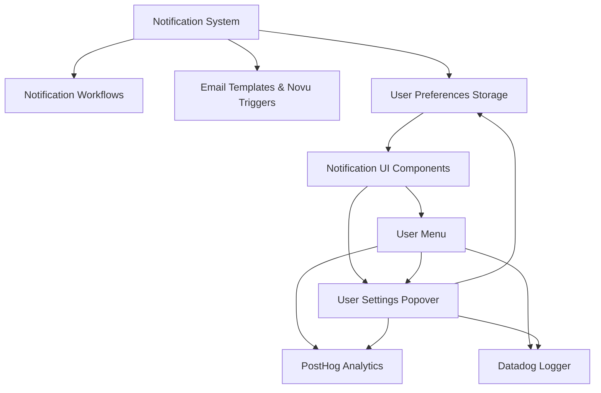
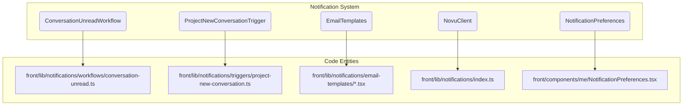
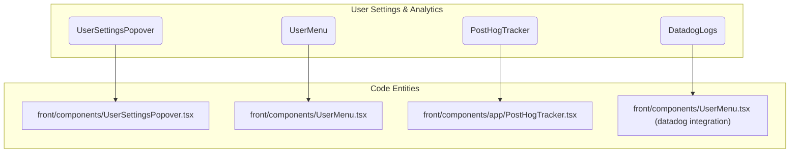

<!-- source: DeepWiki mcp.deepwiki.com · repo dust-tt/dust · page 17 Notifications and User Settings · fetched 2026-10-26 -->

# 17. Notifications and User Settings

Relevant source files

The following files were used as context for generating this wiki page:

- [front-api/routes/poke/workspaces/[wId]/analytics/consumption/index.ts](front-api/routes/poke/workspaces/[wId]/analytics/consumption/index.ts)
- [front-api/routes/poke/workspaces/[wId]/analytics/consumption/top-reasoning-efforts.ts](front-api/routes/poke/workspaces/[wId]/analytics/consumption/top-reasoning-efforts.ts)
- [front-api/routes/poke/workspaces/[wId]/analytics/consumption/top.ts](front-api/routes/poke/workspaces/[wId]/analytics/consumption/top.ts)
- [front-api/routes/w/[wId]/analytics/consumption/top-reasoning-efforts.ts](front-api/routes/w/[wId]/analytics/consumption/top-reasoning-efforts.ts)
- [front-api/routes/w/[wId]/extension/config.test.ts](front-api/routes/w/[wId]/extension/config.test.ts)
- [front-api/routes/w/[wId]/extension/config.ts](front-api/routes/w/[wId]/extension/config.ts)
- [front-api/routes/w/[wId]/me/slack-notifications.ts](front-api/routes/w/[wId]/me/slack-notifications.ts)
- [front-api/routes/w/[wId]/subscriptions/checkout-status.ts](front-api/routes/w/[wId]/subscriptions/checkout-status.ts)
- [front/components/UserMenu.tsx](front/components/UserMenu.tsx)
- [front/components/UserSettingsPopover.tsx](front/components/UserSettingsPopover.tsx)
- [front/components/agent_builder/observability/constants.ts](front/components/agent_builder/observability/constants.ts)
- [front/components/app/CreditUsage.test.tsx](front/components/app/CreditUsage.test.tsx)
- [front/components/app/CreditUsage.tsx](front/components/app/CreditUsage.tsx)
- [front/components/app/CreditUsageCard.tsx](front/components/app/CreditUsageCard.tsx)
- [front/components/app/PostHogTracker.tsx](front/components/app/PostHogTracker.tsx)
- [front/components/app/ReachedLimitPopup.tsx](front/components/app/ReachedLimitPopup.tsx)
- [front/components/app/RootLayout.tsx](front/components/app/RootLayout.tsx)
- [front/components/credits/PersonalUsageCard.tsx](front/components/credits/PersonalUsageCard.tsx)
- [front/components/me/NotificationPreferences.tsx](front/components/me/NotificationPreferences.tsx)
- [front/components/me/SoundNotificationPreferences.tsx](front/components/me/SoundNotificationPreferences.tsx)
- [front/components/navigation/SidebarUserMenu.tsx](front/components/navigation/SidebarUserMenu.tsx)
- [front/components/workspace/analytics/consumption/ConsumptionAttributionBreakdown.test.tsx](front/components/workspace/analytics/consumption/ConsumptionAttributionBreakdown.test.tsx)
- [front/hooks/conversations/useCancelMessage.ts](front/hooks/conversations/useCancelMessage.ts)
- [front/hooks/useAgentsSectionVisibility.ts](front/hooks/useAgentsSectionVisibility.ts)
- [front/hooks/useConsumptionTop.test.ts](front/hooks/useConsumptionTop.test.ts)
- [front/hooks/useServerPageView.ts](front/hooks/useServerPageView.ts)
- [front/hooks/useStripUtmParams.ts](front/hooks/useStripUtmParams.ts)
- [front/lib/analytics/events.ts](front/lib/analytics/events.ts)
- [front/lib/api/assistant/rate_limits.test.ts](front/lib/api/assistant/rate_limits.test.ts)
- [front/lib/api/assistant/rate_limits.ts](front/lib/api/assistant/rate_limits.ts)
- [front/lib/api/credits/usage_status.test.ts](front/lib/api/credits/usage_status.test.ts)
- [front/lib/api/credits/usage_status.ts](front/lib/api/credits/usage_status.ts)
- [front/lib/api/programmatic_usage/common.ts](front/lib/api/programmatic_usage/common.ts)
- [front/lib/api/signup.test.ts](front/lib/api/signup.test.ts)
- [front/lib/api/signup.ts](front/lib/api/signup.ts)
- [front/lib/client/credits.test.ts](front/lib/client/credits.test.ts)
- [front/lib/client/credits.ts](front/lib/client/credits.ts)
- [front/lib/development.ts](front/lib/development.ts)
- [front/lib/iam/workspaces.ts](front/lib/iam/workspaces.ts)
- [front/lib/invitations.ts](front/lib/invitations.ts)
- [front/lib/notifications/conversation_fetch.ts](front/lib/notifications/conversation_fetch.ts)
- [front/lib/notifications/email-templates/activation-new-conversation.tsx](front/lib/notifications/email-templates/activation-new-conversation.tsx)
- [front/lib/notifications/email-templates/conversations-unread.tsx](front/lib/notifications/email-templates/conversations-unread.tsx)
- [front/lib/notifications/helpers.test.ts](front/lib/notifications/helpers.test.ts)
- [front/lib/notifications/helpers.ts](front/lib/notifications/helpers.ts)
- [front/lib/notifications/index.ts](front/lib/notifications/index.ts)
- [front/lib/notifications/triggers/project-new-conversation.test.ts](front/lib/notifications/triggers/project-new-conversation.test.ts)
- [front/lib/notifications/triggers/project-new-conversation.ts](front/lib/notifications/triggers/project-new-conversation.ts)
- [front/lib/notifications/workflows/activation-new-conversation.test.ts](front/lib/notifications/workflows/activation-new-conversation.test.ts)
- [front/lib/notifications/workflows/activation-new-conversation.ts](front/lib/notifications/workflows/activation-new-conversation.ts)
- [front/lib/notifications/workflows/conversation-unread.test.ts](front/lib/notifications/workflows/conversation-unread.test.ts)
- [front/lib/notifications/workflows/conversation-unread.ts](front/lib/notifications/workflows/conversation-unread.ts)
- [front/lib/plans/pro_plans.test.ts](front/lib/plans/pro_plans.test.ts)
- [front/lib/resources/mention_resource.test.ts](front/lib/resources/mention_resource.test.ts)
- [front/lib/swr/notifications.ts](front/lib/swr/notifications.ts)
- [front/lib/tracking/posthog/server.ts](front/lib/tracking/posthog/server.ts)
- [front/lib/utils/anonymous_id.ts](front/lib/utils/anonymous_id.ts)
- [front/lib/utils/rate_limiter.test.ts](front/lib/utils/rate_limiter.test.ts)
- [front/lib/utils/rate_limiter.ts](front/lib/utils/rate_limiter.ts)
- [front/lib/utils/utm.ts](front/lib/utils/utm.ts)
- [front/public/sounds/Bell.mp3](front/public/sounds/Bell.mp3)
- [front/public/sounds/Digital Synth.mp3](front/public/sounds/Digital Synth.mp3)
- [front/public/sounds/Game.mp3](front/public/sounds/Game.mp3)
- [front/public/sounds/Horn.mp3](front/public/sounds/Horn.mp3)
- [front/public/sounds/Kalimba.mp3](front/public/sounds/Kalimba.mp3)
- [front/public/sounds/Marimba.mp3](front/public/sounds/Marimba.mp3)
- [front/public/sounds/Pluck.mp3](front/public/sounds/Pluck.mp3)
- [front/public/sounds/Skeumorphic.mp3](front/public/sounds/Skeumorphic.mp3)
- [front/public/sounds/Tuba.mp3](front/public/sounds/Tuba.mp3)
- [front/types/api/credits/usage_status.ts](front/types/api/credits/usage_status.ts)
- [front/types/extension.test.ts](front/types/extension.test.ts)
- [front/types/extension.ts](front/types/extension.ts)
- [front/types/notification_preferences.ts](front/types/notification_preferences.ts)
- [front/types/shared/utils/date_utils.ts](front/types/shared/utils/date_utils.ts)

This page provides a high-level overview of the Dust platform's notification system, user settings management, and analytics integration. It outlines the core components and workflows that handle user notifications (including email templates and sound preferences), the UI elements for user settings, and how analytics data is captured using PostHog and Datadog. Each subsection links to a child page with detailed implementation specifics.

---

## 17.1 Notification System Overview

Dust's notification system manages how users receive alerts about new conversations, unread messages, project activity, and activation nudges. It supports multiple notification channels including email, Slack, and in-app alerts, with configurable user preferences.

### Key Features
- **Conversation Unread Workflow:** This workflow detects when users have unread messages in conversations they participate in. Conditions determine whether to send notifications based on user roles, message origins, and user preferences.
- **Project New Conversation Trigger:** When a new conversation is added to a project (pod), this trigger can notify project members according to their notification settings.
- **Email Templates and Novu Integration:** Email notifications use standardized templates rendered dynamically. Novu manages workflow triggers allowing bulk notification delivery.
- **Notification Preferences:** Users control which channels and conditions trigger notifications, including setting email digest delays and opting out of certain notifications.

### Notification Channels and Preferences
Users can receive notifications via:
- **Email:** With configurable digest delays and condition filters (e.g., all messages, mentions only, or none).
- **Slack:** Integrated Slack notifications respecting user preferences and workspace Slack configuration status.
- **In-App:** Real-time UI alerts inside Dust.
- **Sound Notifications:** Customizable notification sounds enhance the user experience.

Notification preferences are stored as user metadata and managed through APIs and UI forms that validate and synchronize settings efficiently.

### Workflow and Triggered Notifications
Notifications are produced by Temporal workflows and API-triggered events based on conversation state changes or project activity. Filters ensure notifications are not sent unnecessarily, for example, avoiding notifications for conversations a user already read or for internal system messages.

For detailed workflows, email template definitions, Novu trigger settings, and filtering logic, see the child page: [Notification System](#17.1).

---

## 17.2 User Settings and Analytics Tracking

Users configure their account details, notification settings, and observe usage metrics through the user settings popover and menu components.

### User Settings Popover
- Provides editable forms for:
  - Personal information (name, profile picture upload).
  - Notification preferences (email delays, channel enablement).
  - Sound notification selections.
  - Viewing and managing pending workspace invitations.
- Implements form validation, metadata syncing, and direct user feedback on success or error.
- Incorporates user-specific customization options like enabling the dedicated "For You" email opt-out.

### User Menu
- Accessible UI component exposing quick actions like:
  - Opening the settings popover.
  - Managing automations and tools.
  - Viewing analytics and credit usage.
  - Clear user drafts and navigate conversations.
- Integrates with input contexts and routing for seamless UX.

### Analytics Integration
Analytics tracking is handled using PostHog and Datadog to capture user interactions and operational metrics.
- **PostHogTracker:** Initializes PostHog with privacy-compliant memory-only mode initially, then upgrades persistence depending on user consent and context.
- **User Identification:** Tracks authenticated users and groups them by workspace, subscription, and role properties.
- **Event Tracking:** Sends pageviews, UI interaction events, and other telemetry with enriched context, including UTM and marketing parameters.
- **Datadog Logger:** Used for client-side logging and error reporting, integrated into user-facing UI components.

This integration enables detailed usage and engagement analysis while respecting user privacy and consent.

For complete details on the UX, metadata handling, and analytics event lifecycle, refer to the child page: [User Settings and Analytics Tracking](#17.2).

---

## System Diagram: Notifications and User Settings Mapping

---

## Diagram: Natural Language to Code Entities (Notifications)

---

## Diagram: Natural Language to Code Entities (User Settings and Analytics)

---

## Summary

- **Notification system** ensures relevant users receive alerts via multiple channels.
- **User settings** provide an interface for customizing personal data, notification preferences, and sound options.
- **Analytics tracking** captures rich data on user activity and system usage with privacy-aware initialization and event grouping.

For comprehensive technical details, code examples, and design rationales, please see the child pages:
- [Notification System](#17.1)
- [User Settings and Analytics Tracking](#17.2)

---

### Sources

- `front/lib/notifications/workflows/conversation-unread.ts`  
- `front/lib/notifications/triggers/project-new-conversation.ts`  
- `front/components/me/NotificationPreferences.tsx`  
- `front/components/UserSettingsPopover.tsx`  
- `front/components/UserMenu.tsx`  
- `front/components/app/PostHogTracker.tsx`  
- `front/types/notification_preferences.ts`  
- `front/components/me/SoundNotificationPreferences.tsx`

---

