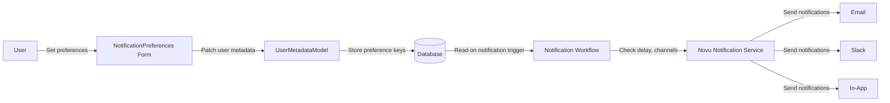

<!-- source: DeepWiki mcp.deepwiki.com · repo dust-tt/dust · page 17.1 Notification System · fetched 2026-10-26 -->

# Notification System

<details>
<summary>Relevant source files</summary>

The following files were used as context for generating this wiki page:

- [front/components/UserSettingsPopover.tsx](front/components/UserSettingsPopover.tsx)
- [front/components/agent_builder/observability/constants.ts](front/components/agent_builder/observability/constants.ts)
- [front/components/me/NotificationPreferences.tsx](front/components/me/NotificationPreferences.tsx)
- [front/components/me/SoundNotificationPreferences.tsx](front/components/me/SoundNotificationPreferences.tsx)
- [front/hooks/useAgentsSectionVisibility.ts](front/hooks/useAgentsSectionVisibility.ts)
- [front/lib/api/programmatic_usage/common.ts](front/lib/api/programmatic_usage/common.ts)
- [front/lib/notifications/conversation_fetch.ts](front/lib/notifications/conversation_fetch.ts)
- [front/lib/notifications/email-templates/activation-new-conversation.tsx](front/lib/notifications/email-templates/activation-new-conversation.tsx)
- [front/lib/notifications/email-templates/conversations-unread.tsx](front/lib/notifications/email-templates/conversations-unread.tsx)
- [front/lib/notifications/helpers.test.ts](front/lib/notifications/helpers.test.ts)
- [front/lib/notifications/helpers.ts](front/lib/notifications/helpers.ts)
- [front/lib/notifications/index.ts](front/lib/notifications/index.ts)
- [front/lib/notifications/triggers/project-new-conversation.test.ts](front/lib/notifications/triggers/project-new-conversation.test.ts)
- [front/lib/notifications/triggers/project-new-conversation.ts](front/lib/notifications/triggers/project-new-conversation.ts)
- [front/lib/notifications/workflows/activation-new-conversation.test.ts](front/lib/notifications/workflows/activation-new-conversation.test.ts)
- [front/lib/notifications/workflows/activation-new-conversation.ts](front/lib/notifications/workflows/activation-new-conversation.ts)
- [front/lib/notifications/workflows/conversation-unread.test.ts](front/lib/notifications/workflows/conversation-unread.test.ts)
- [front/lib/notifications/workflows/conversation-unread.ts](front/lib/notifications/workflows/conversation-unread.ts)
- [front/lib/resources/mention_resource.test.ts](front/lib/resources/mention_resource.test.ts)
- [front/lib/swr/notifications.ts](front/lib/swr/notifications.ts)
- [front/public/sounds/Bell.mp3](front/public/sounds/Bell.mp3)
- [front/public/sounds/Digital Synth.mp3](front/public/sounds/Digital Synth.mp3)
- [front/public/sounds/Game.mp3](front/public/sounds/Game.mp3)
- [front/public/sounds/Horn.mp3](front/public/sounds/Horn.mp3)
- [front/public/sounds/Kalimba.mp3](front/public/sounds/Kalimba.mp3)
- [front/public/sounds/Marimba.mp3](front/public/sounds/Marimba.mp3)
- [front/public/sounds/Pluck.mp3](front/public/sounds/Pluck.mp3)
- [front/public/sounds/Skeumorphic.mp3](front/public/sounds/Skeumorphic.mp3)
- [front/public/sounds/Tuba.mp3](front/public/sounds/Tuba.mp3)
- [front/types/notification_preferences.ts](front/types/notification_preferences.ts)

</details>


This page documents the Dust platform's notification system, detailing the workflows that manage notifications for unread conversations and activation of new conversations. It describes the email notification templates, the integration with the Novu notification service, user preferences for notifications, and how notifications are triggered for new project conversations. The document includes technical explanations of key classes, functions, data structures, and workflows, with mermaid diagrams bridging conceptual notification workflows with code implementations.

---

## 1. Purpose and Scope

The notification system handles delivering timely, relevant notifications to users about conversation activity within their Dust workspace and activation prompts for new recommended conversations. It integrates with external services like Novu and Slack to send emails and chat messages, respects user-configured preferences, and applies various rules and delays to prevent spamming users. This documentation covers:

- Core notification workflows (`conversation-unread`, `activation-new-conversation`)
- Email notification templates and their rendering logic
- Novu client usage and Slack channel configuration
- User notification preferences, including channels and delay settings
- Triggering notifications specifically for new project conversations

---

## 2. Notification Workflows Overview

### 2.1 Workflow Types

- **Conversation Unread Workflow (`conversation-unread`)**: Sends digest notifications about unread messages in conversations. It aggregates activities and respects user notification preferences such as delay, channels (email, in-app, Slack), and conditions (all messages, only mentions, never).
- **Activation New Conversation Workflow (`activation-new-conversation`)**: Dedicated email notifications to users about newly activated recommendation conversations (activation pods). This workflow sends standalone emails without aggregation.

### 2.2 Novu Integration

The notification workflows are implemented using the Novu SDK (`@novu/framework`), which manages subscribers, triggers workflows, sends notifications, and handles channel connections such as Slack integrations.

---

## 3. Conversation Unread Notification Workflow

### 3.1 Workflow Implementation

Located in `front/lib/notifications/workflows/conversation-unread.ts`, this workflow executes the following key steps:

- **Payload**: Uses a shared `ConversationDetailsPayload` containing workspace ID, conversation ID, and related metadata.
- **Skip Logic**: Calls `shouldSkipConversationExternalNotification(workspaceId)` to determine if external notifications are enabled for the workspace.
- **User Filtering**: Filters users based on notification conditions like "all_messages", "only_mentions", or "never" by checking stored user metadata and project-level preferences.
- **Delay Handling**: Uses configured user preferences to batch notifications after delays (e.g., 5 minutes, 1 hour, or weekly).
- **Message Origin Filtering**: Notifies only for certain user message origins, excluding internal or system-generated origins.

### 3.2 Core Functions and Classes

- `shouldSendNotificationForAgentAnswer(userMessageOrigin)` determines if a notification should be sent for agent replies based on the origin of the user's message [front/lib/notifications/workflows/conversation-unread.ts:70-110]().
- `shouldSkipConversationExternalNotification(workspaceId)` checks if external notifications are disabled for a workspace [front/lib/notifications/workflows/conversation-unread.ts:58-68]().
- `shouldSkipConversation(...)` and `shouldSkipNewProjectConversation(...)` contain logic to avoid sending notifications for deleted conversations, conversations the user has already seen, or for users who are participants [front/lib/notifications/workflows/conversation-unread.ts:118-234]().
- `triggerConversationUnreadNotifications(...)`: Main function to trigger the unread notification workflow via Novu with filtered users and constructed payloads.

### 3.3 Email Template

The email content for "conversations-unread" notifications is generated using the email template in `front/lib/notifications/email-templates/conversations-unread.tsx`, rendered with React Email. The template includes conversation summaries and links to the Dust app [front/lib/notifications/email-templates/conversations-unread.tsx] (not shown fully here).

---

## 4. Activation New Conversation Notification Workflow

### 4.1 Workflow Details

This dedicated email notification workflow handles sending emails to users when a new activation pod conversation is created on their project.

- It triggers only for pod (project) conversations.
- It ignores conversations created from project tasks or "todos".
- Waits a small delay (15 seconds) before triggering notifications to ensure data consistency.
- Skips notification if there is no unread agent reply for the user.
- Checks workspace settings to avoid sending if notifications are disabled.
- Integrates with Novu for sending emails.

The workflow is implemented in `front/lib/notifications/workflows/activation-new-conversation.ts`.

### 4.2 Email Template and Subject

- The email subject is generated by `getActivationNewConversationEmailSubject` which formats the subject line with the recommendation name or a fallback [front/lib/notifications/workflows/activation-new-conversation.ts:32-39]().
- The email template `ActivationNewConversationEmailTemplate` in `front/lib/notifications/email-templates/activation-new-conversation.tsx` sends a rich HTML email describing the activation pod concept, providing how it works steps and a call-to-action button [front/lib/notifications/email-templates/activation-new-conversation.tsx:50-217]().

### 4.3 Trigger Function for New Project Conversations

The logic to trigger this workflow when a new project conversation is created is in `front/lib/notifications/triggers/project-new-conversation.ts`:

- Verifies that the conversation is a pod conversation and not a todo.
- Filters project members based on notification preferences.
- Avoids sending notifications if the workspace has activation pods (which send their own emails).
- Uses the Novu client to bulk trigger the `conversation-unread` workflow for filtered users except the conversation creator [front/lib/notifications/triggers/project-new-conversation.ts:89-212]().

---

## 5. Notification Preferences and User Settings

### 5.1 Notification Preferences Data Types

Defined in `front/types/notification_preferences.ts`:

- `NOTIFICATION_DELAY_OPTIONS`: Predefined delays like "5_minutes", "15_minutes", "daily", "weekly".
- `NotificationCondition`: Conditions like "all_messages", "only_mentions", "never".
- `DEFAULT_NOTIFICATION_DELAY`: Defaults to "5_minutes" in development, "weekly" otherwise.
- Keys to store user preferences in metadata like `conversation_notify_condition` [front/types/notification_preferences.ts:8-182]().

### 5.2 Preference Management Components

- `NotificationPreferences` component and `useNotificationPreferencesForm` hook in `front/components/me/NotificationPreferences.tsx` manage the UI and state for user notification settings.
- Allows users to set preferred channels (email, in-app, Slack), notification frequency delays, and conditions.
- Supports "For You" dedicated activation email opt-out toggle.
- Integrates Slack notification enablement based on workspace feature flags and connection status.
- Form state is managed with React Hook Form and validated with Zod schemas.

### 5.3 Sound Notification Preferences

The platform supports selecting sound notifications for in-app alerts with predefined sound options implemented in `front/components/me/SoundNotificationPreferences.tsx`.

---

## 6. Novu Integration and Slack Channel Configuration

### 6.1 Novu Client and Subscriber Hashing

- Novu integration is centralized in `front/lib/notifications/index.ts` and `front/lib/notifications/novu-client.ts` (not shown fully).
- `getNovuClient()` returns a configured Novu SDK client instance.
- Subscriber identity hashing is done via `computeSubscriberHash(subscriberId: string)` using HMAC SHA256 keyed by `NOVU_SECRET_KEY` for secure subscriber identification [front/lib/notifications/index.ts:30-48]().

### 6.2 Slack Integration for Notifications

- Slack channel configuration is handled by linking user Slack tokens and creating Novu "channel connections" and "channel endpoints".
- Key functions:
  - `getSlackToken(auth: Authenticator)` fetches Slack bot OAuth token.
  - `configureNovuSlackChannelForUser(subscriberId, workspaceId)` creates Novu Slack channel connections [front/lib/notifications/index.ts:135-268]().

---

## 7. Data Flow and Workflow Trigger Example for New Project Conversations

### 7.1 Sequence

```mermaid
sequenceDiagram
  participant Auth as Authenticator
  participant ConvRes as ConversationResource
  participant SpaceRes as SpaceResource
  participant Novu as NovuClient
  participant UserMeta as UserMetadataModel

  Note over Auth,ConvRes,SpaceRes: New project conversation created event triggers
  Auth->>ConvRes: Fetch conversation by ID
  ConvRes->>SpaceRes: Fetch project space
  SpaceRes->>Auth: Fetch manual group memberships
  Auth->>UserMeta: Fetch user notification preferences
  UserMeta->>Auth: Return filtered members to notify
  Auth->>Novu: Trigger bulk notifications (conversation-unread workflow)
  Novu-->>User: Send notifications via email/slack/in-app
```

Sources:  
`front/lib/notifications/triggers/project-new-conversation.ts:89-212`  
`front/lib/notifications/workflows/conversation-unread.ts:1-234`  
`front/lib/notifications/index.ts:30-268`  

### 7.2 Natural Language to Code Entity Mapping

```mermaid
graph TD
  A["New project conversation created"] -->|Trigger new convo notifications| B[triggerProjectNewConversationNotifications()]
  B --> C[filterMembersByNotifyCondition()]
  C --> D[UserProjectPreferencesResource.fetchNotificationPreferenceMap()]
  D --> E[UserMetadataModel.findAll()]
  B --> F[NovuClient.triggerBulk()]
  F --> G[activationNewConversationWorkflow (Novu Workflow)]
  G --> H[renderEmail in activation-new-conversation.tsx]
  G --> I[skip: shouldSkipActivationNewConversation()]
  G --> J[send email]
```

Sources:  
`front/lib/notifications/triggers/project-new-conversation.ts`  
`front/lib/notifications/workflows/activation-new-conversation.ts`  
`front/lib/notifications/email-templates/activation-new-conversation.tsx`  

---

## 8. Key Classes and Functions Overview

| Concept                            | Code Implementation/Location                                   | Description                                                  |
|----------------------------------|---------------------------------------------------------------|--------------------------------------------------------------|
| Notification Workflow Trigger     | `triggerConversationUnreadNotifications(...)`                 | Invokes Novu workflows for unread conversation notifications |
| Conversation Filtering Logic      | `shouldSkipConversation(...)`, `shouldSkipNewProjectConversation(...)` | Logic to skip sending notifications when inappropriate         |
| Activation New Conversation Email | `activationNewConversationWorkflow` in `activation-new-conversation.ts` | Sends standalone activation emails via Novu                   |
| Email Template Rendering          | `renderEmail` functions in email-template files               | Generates React-email HTML templates for sending              |
| User Notification Preferences Form| `useNotificationPreferencesForm()` & `NotificationPreferences` component | React form to manage user preferences and update metadata     |
| Novu Client Setup                | `getNovuClient()`                                              | Returns configured Novu API client instance                   |
| Slack Notification Setup          | `configureNovuSlackChannelForUser()`                           | Configures Slack channel for Novu notifications per user      |
| User Metadata Keys               | Constants in `notification_preferences.ts` (e.g. `conversation_notify_condition`) | Metadata keys for storing user preferences                    |

---

## 9. User Notification Preferences Data Flow



Sources:  
`front/components/me/NotificationPreferences.tsx`  
`front/types/notification_preferences.ts`  
`front/lib/notifications/index.ts`  

---

## 10. Summary

The Dust notification system is a sophisticated multi-channel notification platform integrated tightly with the conversation and activation pod workflows. It leverages:

- **Novu** for workflow-driven notifications across email, Slack, and in-app channels.
- **User preferences** for granular control over notification conditions and delays.
- **Custom email templates** rendered with React Email for rich content deliverability.
- **Slack channel configuration** to support Slack-based notifications.
- **Trigger mechanisms** based on events in conversation and project lifecycle, especially new conversation creation in projects.

This ensures users receive relevant updates that respect their preferences without noise, delivered through their preferred channels.

---

# References and Sources

- `front/lib/notifications/workflows/conversation-unread.ts:1-234`  
- `front/lib/notifications/workflows/activation-new-conversation.ts:1-210`  
- `front/lib/notifications/triggers/project-new-conversation.ts:1-212`  
- `front/lib/notifications/email-templates/activation-new-conversation.tsx:1-218`  
- `front/types/notification_preferences.ts:1-183`  
- `front/components/me/NotificationPreferences.tsx:1-213`  
- `front/lib/notifications/index.ts:1-268`

---

