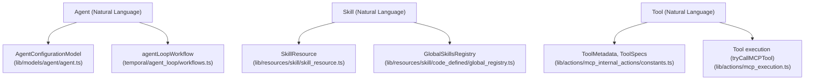
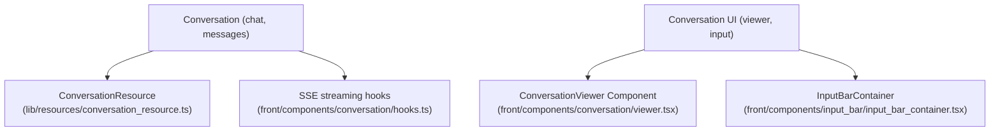

<!-- source: DeepWiki mcp.deepwiki.com · repo dust-tt/dust · page 18 Glossary · fetched 2026-10-26 -->

# Glossary

Relevant source files

The following files were used as context for generating this wiki page:

- [connectors/package.json](connectors/package.json)
- [extension/css.d.ts](extension/css.d.ts)
- [extension/package.json](extension/package.json)
- [extension/platforms/chrome/manifests/manifest.base.json](extension/platforms/chrome/manifests/manifest.base.json)
- [extension/platforms/firefox/manifests/manifest.base.json](extension/platforms/firefox/manifests/manifest.base.json)
- [extension/tsconfig.json](extension/tsconfig.json)
- [extension/ui/hooks/useFileUploaderService.ts](extension/ui/hooks/useFileUploaderService.ts)
- [extension/ui/hooks/useSavePageToPod.ts](extension/ui/hooks/useSavePageToPod.ts)
- [front-api/routes/poke/workspaces/[wId]/spaces/[spaceId]/details.ts](front-api/routes/poke/workspaces/[wId]/spaces/[spaceId]/details.ts)
- [front-api/routes/poke/workspaces/[wId]/switch_contract.test.ts](front-api/routes/poke/workspaces/[wId]/switch_contract.test.ts)
- [front-api/routes/poke/workspaces/[wId]/switch_contract.ts](front-api/routes/poke/workspaces/[wId]/switch_contract.ts)
- [front-api/routes/v1/w/[wId]/skills/[skillId].test.ts](front-api/routes/v1/w/[wId]/skills/[skillId].test.ts)
- [front-api/routes/v1/w/[wId]/skills/[skillId].ts](front-api/routes/v1/w/[wId]/skills/[skillId].ts)
- [front-api/routes/v1/w/[wId]/skills/index.test.ts](front-api/routes/v1/w/[wId]/skills/index.test.ts)
- [front-api/routes/v1/w/[wId]/skills/index.ts](front-api/routes/v1/w/[wId]/skills/index.ts)
- [front-api/routes/w/[wId]/assistant/conversations/[cId]/sandbox/index.ts](front-api/routes/w/[wId]/assistant/conversations/[cId]/sandbox/index.ts)
- [front-api/routes/w/[wId]/governance-permissions.test.ts](front-api/routes/w/[wId]/governance-permissions.test.ts)
- [front-api/routes/w/[wId]/governance-permissions.ts](front-api/routes/w/[wId]/governance-permissions.ts)
- [front-api/routes/w/[wId]/keys/groups.test.ts](front-api/routes/w/[wId]/keys/groups.test.ts)
- [front-api/routes/w/[wId]/keys/groups.ts](front-api/routes/w/[wId]/keys/groups.ts)
- [front-api/routes/w/[wId]/permissions.ts](front-api/routes/w/[wId]/permissions.ts)
- [front-api/routes/w/[wId]/skills/[sId]/editors.test.ts](front-api/routes/w/[wId]/skills/[sId]/editors.test.ts)
- [front-api/routes/w/[wId]/skills/[sId]/editors.ts](front-api/routes/w/[wId]/skills/[sId]/editors.ts)
- [front-api/routes/w/[wId]/skills/[sId]/index.test.ts](front-api/routes/w/[wId]/skills/[sId]/index.test.ts)
- [front-api/routes/w/[wId]/skills/[sId]/index.ts](front-api/routes/w/[wId]/skills/[sId]/index.ts)
- [front-api/routes/w/[wId]/skills/[sId]/reinforcement.test.ts](front-api/routes/w/[wId]/skills/[sId]/reinforcement.test.ts)
- [front-api/routes/w/[wId]/skills/[sId]/reinforcement.ts](front-api/routes/w/[wId]/skills/[sId]/reinforcement.ts)
- [front-api/routes/w/[wId]/skills/availability.test.ts](front-api/routes/w/[wId]/skills/availability.test.ts)
- [front-api/routes/w/[wId]/skills/availability.ts](front-api/routes/w/[wId]/skills/availability.ts)
- [front-api/routes/w/[wId]/skills/index.test.ts](front-api/routes/w/[wId]/skills/index.test.ts)
- [front-api/routes/w/[wId]/skills/index.ts](front-api/routes/w/[wId]/skills/index.ts)
- [front-api/routes/w/[wId]/spaces/[spaceId]/leave.test.ts](front-api/routes/w/[wId]/spaces/[spaceId]/leave.test.ts)
- [front-api/routes/w/[wId]/spaces/[spaceId]/leave.ts](front-api/routes/w/[wId]/spaces/[spaceId]/leave.ts)
- [front-spa/package.json](front-spa/package.json)
- [front-spa/vite.config.ts](front-spa/vite.config.ts)
- [front/admin/audit_log_schemas/workspace.governance_permission_updated.json](front/admin/audit_log_schemas/workspace.governance_permission_updated.json)
- [front/components/pages/workspace/governance/GovernancePageSkeleton.tsx](front/components/pages/workspace/governance/GovernancePageSkeleton.tsx)
- [front/components/poke/subscriptions/FreePlanUpgradeDialog.tsx](front/components/poke/subscriptions/FreePlanUpgradeDialog.tsx)
- [front/components/poke/subscriptions/SwitchContractDialog.tsx](front/components/poke/subscriptions/SwitchContractDialog.tsx)
- [front/css.d.ts](front/css.d.ts)
- [front/hooks/useFileUploaderService.ts](front/hooks/useFileUploaderService.ts)
- [front/lib/actions/action_output_limits.ts](front/lib/actions/action_output_limits.ts)
- [front/lib/actions/data_source_file_system_read_targets.ts](front/lib/actions/data_source_file_system_read_targets.ts)
- [front/lib/actions/mcp.ts](front/lib/actions/mcp.ts)
- [front/lib/actions/mcp_actions.test.ts](front/lib/actions/mcp_actions.test.ts)
- [front/lib/actions/mcp_actions.ts](front/lib/actions/mcp_actions.ts)
- [front/lib/actions/mcp_authentication.test.ts](front/lib/actions/mcp_authentication.test.ts)
- [front/lib/actions/mcp_authentication.ts](front/lib/actions/mcp_authentication.ts)
- [front/lib/actions/mcp_execution.test.ts](front/lib/actions/mcp_execution.test.ts)
- [front/lib/actions/mcp_execution.ts](front/lib/actions/mcp_execution.ts)
- [front/lib/actions/mcp_internal_actions/__snapshots__/mcp_servers_metadata.test.ts.snap](front/lib/actions/mcp_internal_actions/__snapshots__/mcp_servers_metadata.test.ts.snap)
- [front/lib/actions/mcp_internal_actions/constants.test.ts](front/lib/actions/mcp_internal_actions/constants.test.ts)
- [front/lib/actions/mcp_internal_actions/constants.ts](front/lib/actions/mcp_internal_actions/constants.ts)
- [front/lib/actions/mcp_internal_actions/exit_events.test.ts](front/lib/actions/mcp_internal_actions/exit_events.test.ts)
- [front/lib/actions/mcp_internal_actions/exit_events.ts](front/lib/actions/mcp_internal_actions/exit_events.ts)
- [front/lib/actions/mcp_internal_actions/internal_mcp_server_availability.snapshot.json](front/lib/actions/mcp_internal_actions/internal_mcp_server_availability.snapshot.json)
- [front/lib/actions/mcp_internal_actions/output_schemas.ts](front/lib/actions/mcp_internal_actions/output_schemas.ts)
- [front/lib/actions/mcp_internal_actions/servers/index.ts](front/lib/actions/mcp_internal_actions/servers/index.ts)
- [front/lib/actions/mcp_metadata.ts](front/lib/actions/mcp_metadata.ts)
- [front/lib/actions/mcp_oauth_provider.ts](front/lib/actions/mcp_oauth_provider.ts)
- [front/lib/actions/mcp_utils.ts](front/lib/actions/mcp_utils.ts)
- [front/lib/actions/tool_display_labels.test.ts](front/lib/actions/tool_display_labels.test.ts)
- [front/lib/actions/tool_display_labels.ts](front/lib/actions/tool_display_labels.ts)
- [front/lib/actions/types/index.ts](front/lib/actions/types/index.ts)
- [front/lib/api/actions/servers/bm25_tool_search.test.ts](front/lib/api/actions/servers/bm25_tool_search.test.ts)
- [front/lib/api/actions/servers/bm25_tool_search_utils.test.ts](front/lib/api/actions/servers/bm25_tool_search_utils.test.ts)
- [front/lib/api/actions/servers/shopify/client.test.ts](front/lib/api/actions/servers/shopify/client.test.ts)
- [front/lib/api/actions/servers/shopify/client.ts](front/lib/api/actions/servers/shopify/client.ts)
- [front/lib/api/actions/servers/shopify/helpers.ts](front/lib/api/actions/servers/shopify/helpers.ts)
- [front/lib/api/actions/servers/shopify/metadata.test.ts](front/lib/api/actions/servers/shopify/metadata.test.ts)
- [front/lib/api/actions/servers/shopify/metadata.ts](front/lib/api/actions/servers/shopify/metadata.ts)
- [front/lib/api/actions/servers/shopify/rendering.ts](front/lib/api/actions/servers/shopify/rendering.ts)
- [front/lib/api/actions/servers/shopify/tools/index.ts](front/lib/api/actions/servers/shopify/tools/index.ts)
- [front/lib/api/actions/servers/shopify/types.ts](front/lib/api/actions/servers/shopify/types.ts)
- [front/lib/api/actions/servers/skill_authoring/metadata.ts](front/lib/api/actions/servers/skill_authoring/metadata.ts)
- [front/lib/api/actions/servers/skill_authoring/tools/index.test.ts](front/lib/api/actions/servers/skill_authoring/tools/index.test.ts)
- [front/lib/api/actions/servers/skill_authoring/tools/index.ts](front/lib/api/actions/servers/skill_authoring/tools/index.ts)
- [front/lib/api/credits/credit_based_payg.ts](front/lib/api/credits/credit_based_payg.ts)
- [front/lib/api/file_system/sandbox/gcs_sandbox_mount_adapter.test.ts](front/lib/api/file_system/sandbox/gcs_sandbox_mount_adapter.test.ts)
- [front/lib/api/file_system/sandbox/gcs_sandbox_mount_adapter.ts](front/lib/api/file_system/sandbox/gcs_sandbox_mount_adapter.ts)
- [front/lib/api/files/action_output_fs/index.ts](front/lib/api/files/action_output_fs/index.ts)
- [front/lib/api/files/action_output_fs/naming.ts](front/lib/api/files/action_output_fs/naming.ts)
- [front/lib/api/files/action_output_fs/registry.ts](front/lib/api/files/action_output_fs/registry.ts)
- [front/lib/api/keys/scopable_groups.ts](front/lib/api/keys/scopable_groups.ts)
- [front/lib/api/marketing/integrations.ts](front/lib/api/marketing/integrations.ts)
- [front/lib/api/mcp/error.ts](front/lib/api/mcp/error.ts)
- [front/lib/api/mcp/run_tool.ts](front/lib/api/mcp/run_tool.ts)
- [front/lib/api/mcp_server/README.md](front/lib/api/mcp_server/README.md)
- [front/lib/api/mcp_server/server.test.ts](front/lib/api/mcp_server/server.test.ts)
- [front/lib/api/mcp_server/server.ts](front/lib/api/mcp_server/server.ts)
- [front/lib/api/mcp_server/tools/index.ts](front/lib/api/mcp_server/tools/index.ts)
- [front/lib/api/mcp_server/tools/skills/create.ts](front/lib/api/mcp_server/tools/skills/create.ts)
- [front/lib/api/mcp_server/tools/skills/index.ts](front/lib/api/mcp_server/tools/skills/index.ts)
- [front/lib/api/membership.test.ts](front/lib/api/membership.test.ts)
- [front/lib/api/membership.ts](front/lib/api/membership.ts)
- [front/lib/api/metronome/credit_state_dispatcher.test.ts](front/lib/api/metronome/credit_state_dispatcher.test.ts)
- [front/lib/api/metronome/credit_state_dispatcher.ts](front/lib/api/metronome/credit_state_dispatcher.ts)
- [front/lib/api/metronome/process_webhook.ts](front/lib/api/metronome/process_webhook.ts)
- [front/lib/api/metronome/reconcile_credit_state.test.ts](front/lib/api/metronome/reconcile_credit_state.test.ts)
- [front/lib/api/metronome/reconcile_credit_state.ts](front/lib/api/metronome/reconcile_credit_state.ts)
- [front/lib/api/metronome/seat_sync.ts](front/lib/api/metronome/seat_sync.ts)
- [front/lib/api/permissions/governance.ts](front/lib/api/permissions/governance.ts)
- [front/lib/api/permissions/governance_seeding.test.ts](front/lib/api/permissions/governance_seeding.test.ts)
- [front/lib/api/permissions/governance_seeding.ts](front/lib/api/permissions/governance_seeding.ts)
- [front/lib/api/poke/group_permissions.ts](front/lib/api/poke/group_permissions.ts)
- [front/lib/api/poke/plugins/workspaces/sync_metronome_seats.ts](front/lib/api/poke/plugins/workspaces/sync_metronome_seats.ts)
- [front/lib/api/poke/switch_contract.ts](front/lib/api/poke/switch_contract.ts)
- [front/lib/api/sandbox/gcs/token.test.ts](front/lib/api/sandbox/gcs/token.test.ts)
- [front/lib/api/sandbox/gcs/token.ts](front/lib/api/sandbox/gcs/token.ts)
- [front/lib/api/sandbox/hardening.ts](front/lib/api/sandbox/hardening.ts)
- [front/lib/api/sandbox/image/egress/dust-egress-nftables.service](front/lib/api/sandbox/image/egress/dust-egress-nftables.service)
- [front/lib/api/sandbox/image/egress/dust-egress-resolver.service](front/lib/api/sandbox/image/egress/dust-egress-resolver.service)
- [front/lib/api/sandbox/image/egress/egress-nftables.sh](front/lib/api/sandbox/image/egress/egress-nftables.sh)
- [front/lib/api/sandbox/image/token/dust-gcs-token-firewall.sh](front/lib/api/sandbox/image/token/dust-gcs-token-firewall.sh)
- [front/lib/api/sandbox/instrumentation.ts](front/lib/api/sandbox/instrumentation.ts)
- [front/lib/api/sandbox/lifecycle.test.ts](front/lib/api/sandbox/lifecycle.test.ts)
- [front/lib/api/sandbox/lifecycle.ts](front/lib/api/sandbox/lifecycle.ts)
- [front/lib/api/sandbox/provider.ts](front/lib/api/sandbox/provider.ts)
- [front/lib/api/sandbox/providers/e2b.test.ts](front/lib/api/sandbox/providers/e2b.test.ts)
- [front/lib/api/sandbox/providers/e2b.ts](front/lib/api/sandbox/providers/e2b.ts)
- [front/lib/api/sandbox/sandbox_child_block.test.ts](front/lib/api/sandbox/sandbox_child_block.test.ts)
- [front/lib/api/sandbox/sandbox_child_block.ts](front/lib/api/sandbox/sandbox_child_block.ts)
- [front/lib/api/skills/detection/files/import_skills.ts](front/lib/api/skills/detection/files/import_skills.ts)
- [front/lib/api/skills/detection/github/import_skills.ts](front/lib/api/skills/detection/github/import_skills.ts)
- [front/lib/auth.fromjson.test.ts](front/lib/auth.fromjson.test.ts)
- [front/lib/auth.ts](front/lib/auth.ts)
- [front/lib/auth.workspace_permission.test.ts](front/lib/auth.workspace_permission.test.ts)
- [front/lib/credits/credit_payg.ts](front/lib/credits/credit_payg.ts)
- [front/lib/dev/byok_seed.sql](front/lib/dev/byok_seed.sql)
- [front/lib/dev/dust_hive_seed.sql](front/lib/dev/dust_hive_seed.sql)
- [front/lib/dev/dust_hive_seed_schema.test.ts](front/lib/dev/dust_hive_seed_schema.test.ts)
- [front/lib/duration_recorder.ts](front/lib/duration_recorder.ts)
- [front/lib/editor/instructions_block_conflict.ts](front/lib/editor/instructions_block_conflict.ts)
- [front/lib/metronome/alerts/per_user_credit_balance.ts](front/lib/metronome/alerts/per_user_credit_balance.ts)
- [front/lib/metronome/alerts/usage_cap.ts](front/lib/metronome/alerts/usage_cap.ts)
- [front/lib/metronome/client.ts](front/lib/metronome/client.ts)
- [front/lib/metronome/constants.ts](front/lib/metronome/constants.ts)
- [front/lib/metronome/contracts.test.ts](front/lib/metronome/contracts.test.ts)
- [front/lib/metronome/contracts.ts](front/lib/metronome/contracts.ts)
- [front/lib/metronome/live_user_credit_inputs.test.ts](front/lib/metronome/live_user_credit_inputs.test.ts)
- [front/lib/metronome/live_user_credit_inputs.ts](front/lib/metronome/live_user_credit_inputs.ts)
- [front/lib/metronome/seat_types.test.ts](front/lib/metronome/seat_types.test.ts)
- [front/lib/metronome/seat_types.ts](front/lib/metronome/seat_types.ts)
- [front/lib/metronome/seats.test.ts](front/lib/metronome/seats.test.ts)
- [front/lib/metronome/seats.ts](front/lib/metronome/seats.ts)
- [front/lib/metronome/seats_sync.test.ts](front/lib/metronome/seats_sync.test.ts)
- [front/lib/metronome/setup_common.ts](front/lib/metronome/setup_common.ts)
- [front/lib/metronome/setup_legacy.ts](front/lib/metronome/setup_legacy.ts)
- [front/lib/metronome/setup_new_pricing.ts](front/lib/metronome/setup_new_pricing.ts)
- [front/lib/metronome/types.test.ts](front/lib/metronome/types.test.ts)
- [front/lib/metronome/types.ts](front/lib/metronome/types.ts)
- [front/lib/metronome/user_credit_state_machine.test.ts](front/lib/metronome/user_credit_state_machine.test.ts)
- [front/lib/metronome/user_credit_state_machine.ts](front/lib/metronome/user_credit_state_machine.ts)
- [front/lib/model_tiers/allowed_tiers.ts](front/lib/model_tiers/allowed_tiers.ts)
- [front/lib/models/skill.ts](front/lib/models/skill.ts)
- [front/lib/plans/credit_priced_plans.ts](front/lib/plans/credit_priced_plans.ts)
- [front/lib/plans/stripe.test.ts](front/lib/plans/stripe.test.ts)
- [front/lib/plans/stripe.ts](front/lib/plans/stripe.ts)
- [front/lib/reinforcement/skill_suggestion_pruning.test.ts](front/lib/reinforcement/skill_suggestion_pruning.test.ts)
- [front/lib/reinforcement/skill_suggestion_pruning.ts](front/lib/reinforcement/skill_suggestion_pruning.ts)
- [front/lib/resources/conversation_sandbox_adapter.ts](front/lib/resources/conversation_sandbox_adapter.ts)
- [front/lib/resources/group_permission_governance.test.ts](front/lib/resources/group_permission_governance.test.ts)
- [front/lib/resources/group_permission_registry.test.ts](front/lib/resources/group_permission_registry.test.ts)
- [front/lib/resources/group_permission_registry.ts](front/lib/resources/group_permission_registry.ts)
- [front/lib/resources/group_permission_resource.test.ts](front/lib/resources/group_permission_resource.test.ts)
- [front/lib/resources/group_permission_resource.ts](front/lib/resources/group_permission_resource.ts)
- [front/lib/resources/membership_resource.ts](front/lib/resources/membership_resource.ts)
- [front/lib/resources/pod_sandbox_adapter.ts](front/lib/resources/pod_sandbox_adapter.ts)
- [front/lib/resources/sandbox_resource.test.ts](front/lib/resources/sandbox_resource.test.ts)
- [front/lib/resources/sandbox_resource.ts](front/lib/resources/sandbox_resource.ts)
- [front/lib/resources/skill/skill_resource.test.ts](front/lib/resources/skill/skill_resource.test.ts)
- [front/lib/resources/skill/skill_resource.ts](front/lib/resources/skill/skill_resource.ts)
- [front/lib/resources/storage/models/membership.ts](front/lib/resources/storage/models/membership.ts)
- [front/lib/resources/storage/models/sandbox.ts](front/lib/resources/storage/models/sandbox.ts)
- [front/lib/resources/subscription_resource.ts](front/lib/resources/subscription_resource.ts)
- [front/lib/swr/governance.ts](front/lib/swr/governance.ts)
- [front/lib/utils/async_utils.ts](front/lib/utils/async_utils.ts)
- [front/migrations/20260605_backfill_membership_pool_cap_overrides.ts](front/migrations/20260605_backfill_membership_pool_cap_overrides.ts)
- [front/migrations/20260828_backfill_skill_manually_requested_spaces.ts](front/migrations/20260828_backfill_skill_manually_requested_spaces.ts)
- [front/migrations/pre-deploy/20260724155601_add_sandbox_reaper_indexes.sql](front/migrations/pre-deploy/20260724155601_add_sandbox_reaper_indexes.sql)
- [front/migrations/pre-deploy/20260729153513_add_pool_cap_override_expires_at_to_memberships.sql](front/migrations/pre-deploy/20260729153513_add_pool_cap_override_expires_at_to_memberships.sql)
- [front/migrations/pre-deploy/20260730131801_add_sandbox_reaper_kill_requested_sleeping_index.sql](front/migrations/pre-deploy/20260730131801_add_sandbox_reaper_kill_requested_sleeping_index.sql)
- [front/migrations/pre-deploy/20260826122416_prepare_frames_v2_schema.sql](front/migrations/pre-deploy/20260826122416_prepare_frames_v2_schema.sql)
- [front/package.json](front/package.json)
- [front/scripts/metronome_setup.ts](front/scripts/metronome_setup.ts)
- [front/scripts/sandbox_security_check.test.ts](front/scripts/sandbox_security_check.test.ts)
- [front/scripts/sandbox_security_check.ts](front/scripts/sandbox_security_check.ts)
- [front/scripts/seed_missing_governance_capabilities.ts](front/scripts/seed_missing_governance_capabilities.ts)
- [front/temporal/agent_loop/activities/compaction.ts](front/temporal/agent_loop/activities/compaction.ts)
- [front/temporal/agent_loop/activities/cost_threshold_warnings.ts](front/temporal/agent_loop/activities/cost_threshold_warnings.ts)
- [front/temporal/agent_loop/activities/finalize_sandbox_child_tool.test.ts](front/temporal/agent_loop/activities/finalize_sandbox_child_tool.test.ts)
- [front/temporal/agent_loop/activities/finalize_sandbox_child_tool.ts](front/temporal/agent_loop/activities/finalize_sandbox_child_tool.ts)
- [front/temporal/agent_loop/activities/instrumentation.ts](front/temporal/agent_loop/activities/instrumentation.ts)
- [front/temporal/agent_loop/activities/run_model_and_create_actions_wrapper.ts](front/temporal/agent_loop/activities/run_model_and_create_actions_wrapper.ts)
- [front/temporal/agent_loop/activities/run_tool.ts](front/temporal/agent_loop/activities/run_tool.ts)
- [front/temporal/agent_loop/client.ts](front/temporal/agent_loop/client.ts)
- [front/temporal/agent_loop/config.ts](front/temporal/agent_loop/config.ts)
- [front/temporal/agent_loop/lib/compaction.test.ts](front/temporal/agent_loop/lib/compaction.test.ts)
- [front/temporal/agent_loop/lib/compaction.ts](front/temporal/agent_loop/lib/compaction.ts)
- [front/temporal/agent_loop/lib/run_model.test.ts](front/temporal/agent_loop/lib/run_model.test.ts)
- [front/temporal/agent_loop/lib/run_model.ts](front/temporal/agent_loop/lib/run_model.ts)
- [front/temporal/agent_loop/lib/workflow_ids.ts](front/temporal/agent_loop/lib/workflow_ids.ts)
- [front/temporal/agent_loop/sinks.ts](front/temporal/agent_loop/sinks.ts)
- [front/temporal/agent_loop/worker.ts](front/temporal/agent_loop/worker.ts)
- [front/temporal/agent_loop/workflows.test.ts](front/temporal/agent_loop/workflows.test.ts)
- [front/temporal/agent_loop/workflows.ts](front/temporal/agent_loop/workflows.ts)
- [front/temporal/sandbox_reaper/activities.test.ts](front/temporal/sandbox_reaper/activities.test.ts)
- [front/temporal/sandbox_reaper/activities.ts](front/temporal/sandbox_reaper/activities.ts)
- [front/temporal/sandbox_reaper/config.ts](front/temporal/sandbox_reaper/config.ts)
- [front/temporal/sandbox_reaper/kill_requester/activities.test.ts](front/temporal/sandbox_reaper/kill_requester/activities.test.ts)
- [front/temporal/sandbox_reaper/kill_requester/activities.ts](front/temporal/sandbox_reaper/kill_requester/activities.ts)
- [front/temporal/sandbox_reaper/kill_requester/client.test.ts](front/temporal/sandbox_reaper/kill_requester/client.test.ts)
- [front/temporal/sandbox_reaper/kill_requester/client.ts](front/temporal/sandbox_reaper/kill_requester/client.ts)
- [front/temporal/sandbox_reaper/kill_requester/helpers.ts](front/temporal/sandbox_reaper/kill_requester/helpers.ts)
- [front/temporal/sandbox_reaper/kill_requester/workflows.ts](front/temporal/sandbox_reaper/kill_requester/workflows.ts)
- [front/temporal/sandbox_reaper/worker.ts](front/temporal/sandbox_reaper/worker.ts)
- [front/temporal/sandbox_reaper/workflows.test.ts](front/temporal/sandbox_reaper/workflows.test.ts)
- [front/temporal/sandbox_reaper/workflows.ts](front/temporal/sandbox_reaper/workflows.ts)
- [front/tests/utils/MembershipFactory.ts](front/tests/utils/MembershipFactory.ts)
- [front/tests/utils/SandboxFactory.ts](front/tests/utils/SandboxFactory.ts)
- [front/tests/utils/SkillFactory.ts](front/tests/utils/SkillFactory.ts)
- [front/tests/utils/WorkspaceFactory.ts](front/tests/utils/WorkspaceFactory.ts)
- [front/tests/utils/metronome_contracts.ts](front/tests/utils/metronome_contracts.ts)
- [front/types/api/governance.ts](front/types/api/governance.ts)
- [front/types/assistant/agent.ts](front/types/assistant/agent.ts)
- [front/types/assistant/agent_run.ts](front/types/assistant/agent_run.ts)
- [front/types/assistant/compaction.ts](front/types/assistant/compaction.ts)
- [front/types/group_permissions.ts](front/types/group_permissions.ts)
- [front/types/memberships.test.ts](front/types/memberships.test.ts)
- [front/types/memberships.ts](front/types/memberships.ts)
- [front/types/shared/feature_flags.ts](front/types/shared/feature_flags.ts)
- [package-lock.json](package-lock.json)
- [package.json](package.json)
- [sdks/js/package.json](sdks/js/package.json)
- [sdks/js/src/types.ts](sdks/js/src/types.ts)
- [sdks/js/tsconfig.json](sdks/js/tsconfig.json)
- [sparkle/package.json](sparkle/package.json)
- [sparkle/tsconfig.json](sparkle/tsconfig.json)
- [viz/package.json](viz/package.json)
- [x/pr/branching.md](x/pr/branching.md)
- [x/spolu/compaction/compaction.md](x/spolu/compaction/compaction.md)
- [x/spolu/compaction/plan.md](x/spolu/compaction/plan.md)

This page defines key codebase-specific terms, jargon, abbreviations, and domain concepts used throughout the Dust codebase. It is intended to help onboarding engineers quickly understand important concepts, their technical implementation, data flow, and relevant code entities. Each term is accompanied by references to specific files, classes, and functions essential for deeper exploration within the Dust monorepo.

---

## Agent

An **Agent** in Dust is a configurable AI entity that can interact conversationally, execute workflows, employ skills, and integrate with external tools. Agents are central to Dust’s AI platform, enabling task automation, question answering, and multi-step reasoning.

- **Configuration and Lifecycle:** Agents are configured via CRUD APIs and stored as `AgentConfigurationModel` instances. Their lifecycle states include pending, active, and archived.

- **Execution:** Agent runs are orchestrated using Temporal workflows (`agentLoopWorkflow`), which implement agent message processing, prompt construction, LLM calls, and tool invocation.

- **Skills and Tools:** Agents leverage a skill system (`SkillResource`) providing reusable capabilities, and integrate with tools via Model Context Protocol (MCP) servers.

**Key Code Entities:**

- `AgentConfigurationModel` — models/agent/agent.ts
- Agent Loop workflow — temporal/agent_loop/workflows.ts
- Agent Builder UI — front/components/agent_builder/
- Agent execution lib — temporal/agent_loop/lib/run_model.ts

---

## MCP (Model Context Protocol)

MCP is a protocol defining how Dust connects AI agents with external tools and services. It supports internal, remote, client-side, and Just-In-Time (JIT) MCP servers, allowing dynamic discovery and invocation of tools within an agent workflow.

- **Server Types:**
  - *Internal MCP Servers:* Built-in Dust MCP servers exposing internal actions.
  - *Remote MCP Servers:* External hosted MCP servers.
  - *Client-side MCP Servers:* Executed on the client (e.g., browser extension).
  - *JIT MCP Servers:* Dynamically instantiated servers at runtime.

- **Tool Discovery and Execution:** MCP tools are discovered, validated, and executed through standardized tool specifications. Tools can require authentication via OAuth or API keys and support approval workflows.

**Key Code Entities:**

- Internal MCP servers registry — lib/actions/mcp_internal_actions/constants.ts
- MCP server configuration — lib/resources/mcp_server_view_resource.ts
- MCP tool discovery — lib/actions/mcp_actions.ts
- Tool execution helpers — lib/actions/mcp_execution.ts

---

## Skill

A **Skill** is a reusable, modular capability that an agent can perform. Skills may be code-defined or database-defined, and can include attached files and MCP server integrations.

- **Skill Resource:** The `SkillResource` class manages skill lifecycle, versioning, permissions, and metadata.

- **Global vs. Custom Skills:** Global skills are centrally registered (`GlobalSkillsRegistry`) for common use, while custom skills are created and managed within a workspace.

- **Knowledge Attachment:** Skills can be associated with knowledge bases or data sources, enabling agents to utilize domain knowledge.

**Key Code Entities:**

- `SkillResource` — lib/resources/skill/skill_resource.ts
- Global skills registry — lib/resources/skill/code_defined/global_registry.ts
- Skill authoring tool — front-api/routes/w/[wId]/skills/index.ts

---

## Feature Flags

Dust uses **Feature Flags** to control access to experimental or gated capabilities per workspace or globally, facilitating gradual rollout and testing.

- **WhitelistableFeature:** A special category of feature flags that can be enabled on-demand for specific customers.

- **Flag Checking:** `hasFeatureFlag` methods in the `Authenticator` class check if a feature is active.

**Key Code Entities:**

- Feature flag definitions — front/types/shared/feature_flags.ts
- Authenticator with flag checks — front/lib/auth.ts
- Global feature flag resource — lib/resources/global_feature_flag_resource.ts

---

## Conversation

A **Conversation** is a structured chat record involving user and agent messages that persists interaction context.

- **Management API:** CRUD operations and message posting functions.

- **Event Streaming:** Real-time updates of conversation events via SSE streams and Redis.

- **UI Components:** React components for rendering messages, input bars, and side panels.

**Key Code Entities:**

- `ConversationResource` — lib/resources/conversation_resource.ts
- Event streaming hooks — front/components/conversation/hooks.ts
- Conversation UI — front/components/conversation/

---

## Sandbox

The **Sandbox** is a secure execution environment for running untrusted code as part of Dust functions or pods.

- **Infrastructure:** Managed by `SandboxResource`, employs Temporal workflows for lifecycle including creation, activity execution, and cleanup.

- **Functions:** Sandboxed pod functions are defined with `SandboxFunctionResource` and invoked with `SandboxFunctionInvocationResource`.

- **Security Features:** Network access egress controlled via nftables, tokens for execution authentication.

**Key Code Entities:**

- `SandboxResource` — lib/resources/sandbox_resource.ts
- Temporal sandbox reaper — temporal/sandbox_reaper/activities.ts
- E2B sandbox provider — lib/api/sandbox/providers/e2b.ts

---

## Metronome

**Metronome** is Dust's integrated billing and usage analytics system.

- **Client & Integration:** The `getMetronomeClient()` function creates a cached SDK client to interact with billing APIs.

- **Event Ingestion:** Usage events are batched and sent to Metronome for accurate billing.

- **Contracts and Seats:** Handles workspace contracts, seat counting, and subscription lifecycle.

**Key Code Entities:**

- Metronome client — lib/metronome/client.ts
- Event ingestion function — lib/metronome/client.ts:ingestMetronomeEvents
- Subscription resource — lib/resources/subscription_resource.ts

---

## Authenticator

The `Authenticator` class encapsulates the permissioning and authorization logic for workspace users and API keys.

- Resolves a user's role and group memberships, linked subscription, and feature access.

- Enforces permissions on resources and API verbs across the system.

- Evaluates feature flags, supports scoped permissions, and handles API key attribution.

**Key Code Entities:**

- `Authenticator` class — lib/auth.ts

---

## Global Agents

Predefined agents in Dust that serve special purposes such as global assistant or system helpers.

- Identified by enum `GLOBAL_AGENTS_SID`.

- Provide automated suggestions, sidekick context, or specialized domain expertise.

**Key Code Entities:**

- `GLOBAL_AGENTS_SID` enum — front/types/assistant/assistant.ts
- Global agents retrieval — lib/api/assistant/global_agents/api.ts
- Integration with prompt context — temporal/agent_loop/lib/run_model.ts (e.g., `globalAgentInjectsToolsets`)

---

## Tool

A **Tool** is an atomic action provided by MCP servers that agents can invoke to perform external API calls, data retrieval, or other operations.

- Tools have metadata, billing categories, usage restrictions, and permission requirements.

- Tool specifications describe inputs, outputs, and invocation details.

- Tools may be eager or deferred depending on usage patterns (important for token counting in prompts).

**Key Code Entities:**

- Tool metadata constants — lib/actions/mcp_internal_actions/constants.ts
- Tool invocation helpers — lib/actions/mcp_execution.ts
- Agent action specifications — lib/actions/types/agent.ts

---

## Model Provider and Model IDs

Dust supports multiple LLM providers and models, defined with enumeration schemas for validation and client-API compatibility.

- `ModelProviderIdSchema` enumerates all supported providers (e.g., OpenAI, Anthropic, Mistral, Deepseek).

- `KnownModelLLMId` enumerates all known model strings used in the system with flexible extensions.

- Model selection objects combine provider, model ID, and reasoning effort.

**Key Code Entities:**

- Model and provider schemas — sdks/js/src/types.ts (`PublicModelSelectionSchema`)
- Model constants and features — front/types/shared/feature_flags.ts (feature gating by model)

---

## Sidekick Context

The sidekick context is additional agent context enabling enhanced agent suggestions, feedback, and insights functionality.

- Built from workspace and user context.

- Injected into agent prompts for sidekick global agents.

**Key Code Entities:**

- Sidekick context builders — temporal/agent_loop/lib/run_model.ts (`buildUserContext`, `buildWorkspaceContext`)
- Sidekick API servers — lib/actions/mcp_internal_actions/servers/agent_sidekick_context.ts

---

## Workspace, Group, Space

- **Workspace:** The top-level organizational unit containing users, groups, spaces, agents, and data.

- **Group:** A collection of users with shared permissions; groups drive governance and role-based access control.

- **Space:** Scoped areas inside workspaces (system-level, project/pod-level, or conversation spaces) controlling resource visibility.

**Key Code Entities:**

- Workspace resource — lib/resources/workspace_resource.ts
- Group resource — lib/resources/group_resource.ts
- Space resource — lib/resources/space_resource.ts
- Permission checks — lib/auth.ts (`Authenticator`), group permissions registry

---

## Prompt Construction and LLM Integration

Dust orchestrates LLM input prompts from multi-tier structured input and conversation rendering:

- Supports injecting tool definitions, agent instructions, and contextual messages.

- Manages token budgeting and streaming of LLM outputs.

- Handles error classification and retry logic for LLM calls.

**Key Code Entities:**

- Prompt construction — lib/api/assistant/generation.ts (`constructPromptMultiActions`)
- LLM client abstraction — lib/api/llm/index.ts (`getStreamLLM`)
- Agent loop run model — temporal/agent_loop/lib/run_model.ts

---

## Temporal Workflows

Dust relies heavily on **Temporal** for orchestrating complex, scalable asynchronous workflows such as agent execution loops, sandbox lifecycle management, and connector syncs.

- Agents run under Temporal `agentLoopWorkflow`.

- Sandbox provisioning and cleanup are Temporal activities triggered from API calls or scheduled processes.

- Temporal workflow and activity definitions manage state, retries, concurrency, and error handling.

**Key Code Entities:**

- temporal/agent_loop/workflows.ts
- temporal/sandbox_reaper/activities.ts
- front/temporal/agent_loop/activities/run_model_and_create_actions_wrapper.ts

---

## Mermaid Diagrams

### Diagram 1: Mapping Natural Language Concepts of Agents, Skills, Tools to Code Entities

### Diagram 2: Bridging Natural Language "Conversation" and "Conversation UI" to Code Entities

---

| Term                  | Description                                                                                                                 | Key Files / Classes / Functions                             |
|-----------------------|-----------------------------------------------------------------------------------------------------------------------------|------------------------------------------------------------|
| Agent                 | Configurable AI entity managing conversation, tools, and skills.                                                            | `AgentConfigurationModel` (models/agent/agent.ts), `agentLoopWorkflow` (temporal/agent_loop/workflows.ts) |
| MCP (Model Context Protocol) | Protocol for connecting an agent to tools and servers, including internal, remote, client-side, and JIT MCP servers.          | `mcp_internal_actions/constants.ts`, `mcp_server_view_resource.ts`, `mcp_actions.ts`              |
| Skill                 | Modular capabilities used by agents, managed by `SkillResource` including global and custom skills.                         | `SkillResource` (lib/resources/skill/skill_resource.ts), `GlobalSkillsRegistry`                   |
| Feature Flags         | System to enable/disable features per workspace or globally.                                                                | `feature_flags.ts`, `Authenticator` (lib/auth.ts)          |
| Conversation          | Persistent user-agent chat with API, event streaming, and UI components.                                                    | `ConversationResource` (lib/resources/conversation_resource.ts), UI components in front/           |
| Sandbox               | Secure isolated environment to run untrusted code or pod functions with lifecycle managed by Temporal.                      | `SandboxResource` (lib/resources/sandbox_resource.ts), sandbox_reaper Temporal workflow          |
| Metronome             | Billing and usage system integrated with Dust via SDK client, tracking events, subscriptions, and seat usage.               | `lib/metronome/client.ts`, subscription_resource.ts         |
| Authenticator         | Permission enforcement and role management class controlling access across Dust.                                             | `lib/auth.ts`                                              |
| Global Agents         | Preconfigured special agents with predefined behavior and sidekick context integration.                                      | `GLOBAL_AGENTS_SID` enum, `global_agents/api.ts`           |
| Tool                  | Atomic external actions callable by agents provided by MCP servers, with metadata and billing.                              | `mcp_internal_actions/constants.ts`, `mcp_execution.ts`    |
| Model Provider / Model ID | Enumerated LLM providers and model IDs supported by Dust with schemas for robust validation and feature gating.                | `sdks/js/src/types.ts`                                     |
| Sidekick Context      | Additional contextual data injected into agents to enhance suggestions and insights.                                         | `run_model.ts` (temporal/agent_loop/lib/run_model.ts)      |
| Workspace / Group / Space | Organizational entities in Dust: Workspace is the root, groups manage users and permissions, spaces scope resources.            | `workspace_resource.ts`, `group_resource.ts`, `space_resource.ts`, `lib/auth.ts`                  |
| Prompt Construction & LLM Integration | Building multi-tier prompts, token budgeting, streaming responses, and LLM error handling.                                    | `generation.ts`, `llm/index.ts`, `run_model.ts`            |
| Temporal Workflows    | Orchestration system for asynchronous processes like agent execution and sandbox management.                                | `temporal/agent_loop/workflows.ts`, `temporal/sandbox_reaper/activities.ts`                      |

---

This glossary page serves as a reference map linking Dust's natural language domain concepts to their concrete technical representations and code locations. Familiarity with these terms and their implementations is essential to effectively navigate and contribute to the Dust platform.

---

## Sources

- sdks/js/src/types.ts
- front/types/shared/feature_flags.ts
- front/lib/resources/skill/skill_resource.ts
- front/lib/actions/mcp_internal_actions/constants.ts
- temporal/agent_loop/lib/run_model.ts
- lib/resources/conversation_resource.ts
- front/lib/auth.ts
- lib/metronome/client.ts
- lib/resources/subscription_resource.ts