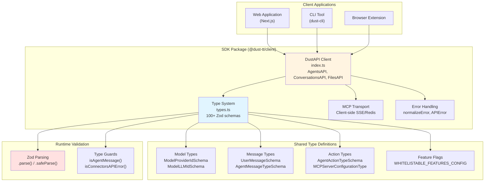
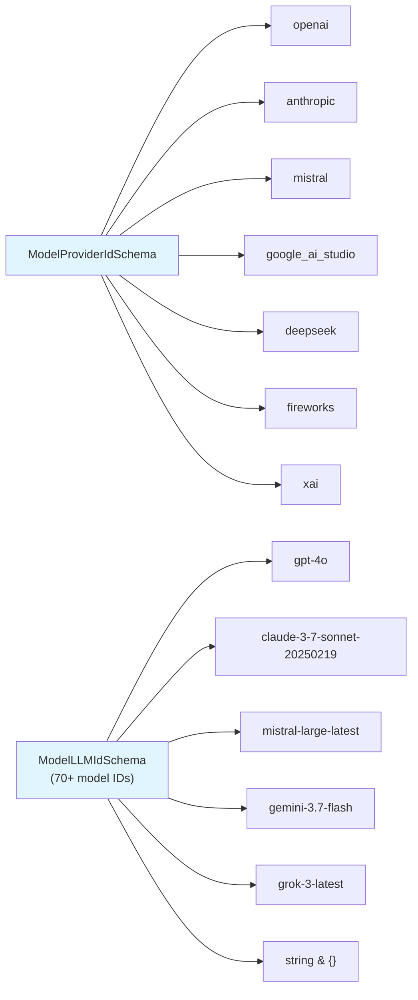

<!-- source: DeepWiki mcp.deepwiki.com · repo dust-tt/dust · page 2 Type System and SDK · fetched 2026-10-26 -->

# Type System and SDK

Relevant source files

The following files were used as context for generating this wiki page:

- [front/lib/actions/data_source_file_system_read_targets.ts](front/lib/actions/data_source_file_system_read_targets.ts)
- [front/lib/actions/mcp_internal_actions/__snapshots__/mcp_servers_metadata.test.ts.snap](front/lib/actions/mcp_internal_actions/__snapshots__/mcp_servers_metadata.test.ts.snap)
- [front/lib/actions/mcp_internal_actions/constants.test.ts](front/lib/actions/mcp_internal_actions/constants.test.ts)
- [front/lib/actions/mcp_internal_actions/constants.ts](front/lib/actions/mcp_internal_actions/constants.ts)
- [front/lib/actions/mcp_internal_actions/internal_mcp_server_availability.snapshot.json](front/lib/actions/mcp_internal_actions/internal_mcp_server_availability.snapshot.json)
- [front/lib/actions/mcp_internal_actions/servers/index.ts](front/lib/actions/mcp_internal_actions/servers/index.ts)
- [front/lib/actions/tool_display_labels.test.ts](front/lib/actions/tool_display_labels.test.ts)
- [front/lib/actions/tool_display_labels.ts](front/lib/actions/tool_display_labels.ts)
- [front/lib/api/actions/servers/bm25_tool_search.test.ts](front/lib/api/actions/servers/bm25_tool_search.test.ts)
- [front/lib/api/actions/servers/bm25_tool_search_utils.test.ts](front/lib/api/actions/servers/bm25_tool_search_utils.test.ts)
- [front/lib/api/actions/servers/shopify/client.test.ts](front/lib/api/actions/servers/shopify/client.test.ts)
- [front/lib/api/actions/servers/shopify/client.ts](front/lib/api/actions/servers/shopify/client.ts)
- [front/lib/api/actions/servers/shopify/helpers.ts](front/lib/api/actions/servers/shopify/helpers.ts)
- [front/lib/api/actions/servers/shopify/metadata.test.ts](front/lib/api/actions/servers/shopify/metadata.test.ts)
- [front/lib/api/actions/servers/shopify/metadata.ts](front/lib/api/actions/servers/shopify/metadata.ts)
- [front/lib/api/actions/servers/shopify/rendering.ts](front/lib/api/actions/servers/shopify/rendering.ts)
- [front/lib/api/actions/servers/shopify/tools/index.ts](front/lib/api/actions/servers/shopify/tools/index.ts)
- [front/lib/api/actions/servers/shopify/types.ts](front/lib/api/actions/servers/shopify/types.ts)
- [front/lib/api/marketing/integrations.ts](front/lib/api/marketing/integrations.ts)
- [front/temporal/agent_loop/lib/run_model.test.ts](front/temporal/agent_loop/lib/run_model.test.ts)
- [front/temporal/agent_loop/lib/run_model.ts](front/temporal/agent_loop/lib/run_model.ts)
- [front/types/shared/feature_flags.ts](front/types/shared/feature_flags.ts)
- [sdks/js/src/types.ts](sdks/js/src/types.ts)

## Purpose and Scope

This document covers the **shared type system** and **JavaScript SDK** (`@dust-tt/client`) that provide the foundational type definitions and API client for the Dust platform. The type system uses Zod schemas to enforce runtime type safety across all API boundaries, while the SDK provides a TypeScript client for interacting with Dust's REST and streaming APIs.

For information about how agents use these types during execution, see [Agent Execution and Temporal Workflows](#3.3). For details on the MCP server architecture that consumes these types, see [MCP Server Architecture](#4.1).

**Sources:** [sdks/js/src/types.ts:1-100](), [sdks/js/src/index.ts:1-50]()

---

## Architecture Overview

The type system and SDK form the contract layer between clients (web, CLI, extensions) and the Dust backend. All communication flows through Zod-validated types, ensuring type safety at both compile-time and runtime.

**Diagram: Type System Architecture and Component Relationships**

The SDK package exports three main APIs:
- **AgentsAPI**: Agent configuration CRUD operations.
- **ConversationsAPI**: Conversation and message management with streaming.
- **FilesAPI**: File upload and content fragment management.

**Sources:** [sdks/js/src/index.ts:1-100](), [sdks/js/src/types.ts:1-30]()

---

## Core Type Definitions

### Model Provider and Model ID Types

The type system begins with foundational enums for supported LLM providers and model identifiers. These use `FlexibleEnumSchema` to allow both known values (with autocompletion) and unknown strings, ensuring the SDK remains compatible as new models are added.

**Diagram: Model Provider and Model ID Type Hierarchy**

| Schema | Purpose | Location |
|--------|---------|----------|
| `ModelProviderIdSchema` | Enum of supported LLM providers (openai, anthropic, etc.) | [sdks/js/src/types.ts:17-29]() |
| `ModelLLMIdSchema` | 70+ known model IDs including O1, Claude 3.7, and Grok 3 | [sdks/js/src/types.ts:31-122]() |
| `PublicModelSelectionSchema` | Per-message model + reasoning effort selection | [sdks/js/src/types.ts:136-140]() |

**Sources:** [sdks/js/src/types.ts:17-140]()

### Feature Flags and Capabilities

Feature flags control access to experimental and premium features across workspaces. These are defined in a central configuration that maps flags to stages (`dust_only`, `self_serve`, `ask_owner`).

| Flag | Stage | Description |
|-------|-------------|---------------|
| `dust_filesystem` | `dust_only` | Allow fresh Pods to use database-backed filesystem | [front/types/shared/feature_flags.ts:8-13]() |
| `claude_4_opus_feature` | `self_serve` | Access to Claude 4 Opus in agent builder | [front/types/shared/feature_flags.ts:91-95]() |
| `google_sheets_tool` | `ask_owner` | Google Sheets MCP tool access | [front/types/shared/feature_flags.ts:134-138]() |
| `sandbox` | `self_serve` | Access to code execution sandbox | [front/types/shared/feature_flags.ts:225-229]() |

For a complete list of flags and their schema, see [Core Types and Schemas](#2.1).

**Sources:** [front/types/shared/feature_flags.ts:1-250]()

---

## MCP Tool and Server Types

The type system provides the foundation for the **Model Context Protocol (MCP)** integration. This includes definitions for internal servers, tool schemas, and billing metadata.

### Internal MCP Servers
Dust maintains a registry of built-in servers such as `google_drive`, `slack`, and `github`. Each server defines a set of tools with specific schemas.

| Server Name | Example Tools | Billing Category |
|-------------|---------------|------------------|
| `agent_memory` | `retrieve`, `record_entries` | `basic` |
| `google_drive` | `search_files`, `get_file_content` | `advanced` |
| `sandbox` | `run_code` | `basic` |

**Sources:** [front/lib/actions/mcp_internal_actions/constants.ts:217-250](), [front/lib/actions/mcp_internal_actions/__snapshots__/mcp_servers_metadata.test.ts.snap:41-62]()

### Tool Search and Discovery
To manage large numbers of tools, Dust uses a **BM25-based search** mechanism. The `TOOL_SEARCH_TOOL` allows the LLM to search for relevant tools dynamically when they are not explicitly in the initial context.

**Sources:** [front/temporal/agent_loop/lib/run_model.ts:149-165](), [front/lib/api/actions/servers/bm25_tool_search.test.ts:6-25]()

For detailed transport implementation, see [MCP Transport Protocol](#2.3).

---

## Content Type System

Dust supports a wide array of file formats that can be processed into conversation content fragments.

| Category | MIME Types | Extensions |
|----------|------------|------------|
| Documents | `application/pdf`, `text/markdown`, `text/plain` | `.pdf`, `.md`, `.txt` |
| Office | `application/msword`, `application/vnd.ms-excel` | `.doc`, `.xls`, `.xlsx` |
| Data | `text/csv`, `text/tsv`, `application/json` | `.csv`, `.tsv`, `.json` |
| Special | `application/vnd.dust.section.json` | `.json` |

**Sources:** [sdks/js/src/types.ts:195-225]()

---

## DustAPI Client

The `DustAPI` client class is the primary interface for external applications to interact with the Dust platform. It provides high-level abstractions for managing agents and conversations.

### Key Capabilities:
- **Conversation Management**: Creating conversations, posting user messages, and handling mentions.
- **Agent Interaction**: Retrieving agent configurations and managing agent-specific settings.
- **Event Streaming**: Consuming Server-Sent Events (SSE) for real-time token generation and tool execution updates.
- **Error Normalization**: Using `isConnectorsAPIError` and `ConnectorsAPIErrorSchema` to provide consistent error structures.

For implementation details and method signatures, see [DustAPI Client](#2.2).

**Sources:** [sdks/js/src/index.ts:1-100](), [sdks/js/src/types.ts:169-192]()

---

## Child Pages

- [Core Types and Schemas](#2.1) — Detailed documentation of Zod schemas, model provider IDs, and feature flags.
- [DustAPI Client](#2.2) — Technical guide for the JS SDK, authentication, and conversation methods.
- [MCP Transport Protocol](#2.3) — Explanation of the SSE and Redis-based transport for client-side MCP servers.

---

