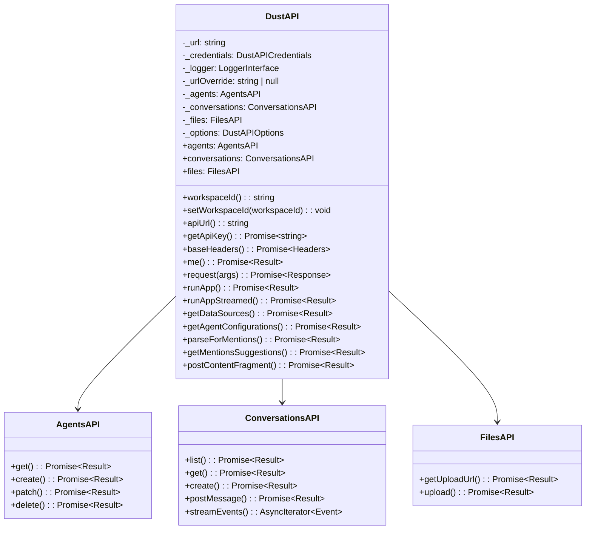
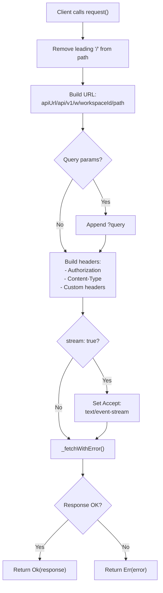

<!-- source: DeepWiki mcp.deepwiki.com · repo dust-tt/dust · page 2.2 DustAPI Client · fetched 2026-10-26 -->

# DustAPI Client

<details>
<summary>Relevant source files</summary>

The following files were used as context for generating this wiki page:

- [cli/dust-cli/src/ui/commands/Chat.tsx](cli/dust-cli/src/ui/commands/Chat.tsx)
- [cli/dust-cli/src/ui/components/AgentSelector.tsx](cli/dust-cli/src/ui/components/AgentSelector.tsx)
- [cli/dust-cli/src/utils/tokenStorage.ts](cli/dust-cli/src/utils/tokenStorage.ts)
- [cli/dust-cli/src/utils/toolsCache.ts](cli/dust-cli/src/utils/toolsCache.ts)
- [connectors/src/api/webhooks/teams/adaptive_cards.ts](connectors/src/api/webhooks/teams/adaptive_cards.ts)
- [connectors/src/api/webhooks/teams/bot.ts](connectors/src/api/webhooks/teams/bot.ts)
- [connectors/src/api/webhooks/webhook_slack_bot_interaction.ts](connectors/src/api/webhooks/webhook_slack_bot_interaction.ts)
- [connectors/src/connectors/slack/bot.ts](connectors/src/connectors/slack/bot.ts)
- [connectors/src/connectors/slack/chat/action_utils.ts](connectors/src/connectors/slack/chat/action_utils.ts)
- [connectors/src/connectors/slack/chat/blocks.ts](connectors/src/connectors/slack/chat/blocks.ts)
- [connectors/src/connectors/slack/chat/plan_message_handler.ts](connectors/src/connectors/slack/chat/plan_message_handler.ts)
- [connectors/src/connectors/slack/chat/slack_stream_handler.ts](connectors/src/connectors/slack/chat/slack_stream_handler.ts)
- [connectors/src/connectors/slack/chat/stream_conversation_handler.ts](connectors/src/connectors/slack/chat/stream_conversation_handler.ts)
- [connectors/src/connectors/slack/lib/errors.test.ts](connectors/src/connectors/slack/lib/errors.test.ts)
- [connectors/src/connectors/slack/lib/errors.ts](connectors/src/connectors/slack/lib/errors.ts)
- [connectors/src/lib/bot/mentions.test.ts](connectors/src/lib/bot/mentions.test.ts)
- [connectors/src/lib/bot/mentions.ts](connectors/src/lib/bot/mentions.ts)
- [connectors/src/types/shared/redis_client.ts](connectors/src/types/shared/redis_client.ts)
- [firebase-functions/webhook-router/docker-compose.yml](firebase-functions/webhook-router/docker-compose.yml)
- [front-api/routes/v1/w/[wId]/assistant/conversations/[cId]/index.ts](front-api/routes/v1/w/[wId]/assistant/conversations/[cId]/index.ts)
- [front/lib/actions/data_source_file_system_read_targets.ts](front/lib/actions/data_source_file_system_read_targets.ts)
- [front/lib/actions/mcp_internal_actions/__snapshots__/mcp_servers_metadata.test.ts.snap](front/lib/actions/mcp_internal_actions/__snapshots__/mcp_servers_metadata.test.ts.snap)
- [front/lib/actions/mcp_internal_actions/constants.test.ts](front/lib/actions/mcp_internal_actions/constants.test.ts)
- [front/lib/actions/mcp_internal_actions/constants.ts](front/lib/actions/mcp_internal_actions/constants.ts)
- [front/lib/actions/mcp_internal_actions/internal_mcp_server_availability.snapshot.json](front/lib/actions/mcp_internal_actions/internal_mcp_server_availability.snapshot.json)
- [front/lib/actions/mcp_internal_actions/servers/index.ts](front/lib/actions/mcp_internal_actions/servers/index.ts)
- [front/lib/actions/tool_display_labels.test.ts](front/lib/actions/tool_display_labels.test.ts)
- [front/lib/actions/tool_display_labels.ts](front/lib/actions/tool_display_labels.ts)
- [front/lib/api/actions/servers/bm25_tool_search.test.ts](front/lib/api/actions/servers/bm25_tool_search.test.ts)
- [front/lib/api/actions/servers/bm25_tool_search_utils.test.ts](front/lib/api/actions/servers/bm25_tool_search_utils.test.ts)
- [front/lib/api/actions/servers/shopify/client.test.ts](front/lib/api/actions/servers/shopify/client.test.ts)
- [front/lib/api/actions/servers/shopify/client.ts](front/lib/api/actions/servers/shopify/client.ts)
- [front/lib/api/actions/servers/shopify/helpers.ts](front/lib/api/actions/servers/shopify/helpers.ts)
- [front/lib/api/actions/servers/shopify/metadata.test.ts](front/lib/api/actions/servers/shopify/metadata.test.ts)
- [front/lib/api/actions/servers/shopify/metadata.ts](front/lib/api/actions/servers/shopify/metadata.ts)
- [front/lib/api/actions/servers/shopify/rendering.ts](front/lib/api/actions/servers/shopify/rendering.ts)
- [front/lib/api/actions/servers/shopify/tools/index.ts](front/lib/api/actions/servers/shopify/tools/index.ts)
- [front/lib/api/actions/servers/shopify/types.ts](front/lib/api/actions/servers/shopify/types.ts)
- [front/lib/api/marketing/integrations.ts](front/lib/api/marketing/integrations.ts)
- [front/temporal/agent_loop/lib/run_model.test.ts](front/temporal/agent_loop/lib/run_model.test.ts)
- [front/temporal/agent_loop/lib/run_model.ts](front/temporal/agent_loop/lib/run_model.ts)
- [front/types/shared/feature_flags.ts](front/types/shared/feature_flags.ts)
- [sdks/js/src/index.ts](sdks/js/src/index.ts)
- [sdks/js/src/types.ts](sdks/js/src/types.ts)

</details>


This document covers the `DustAPI` client class, which provides a JavaScript/TypeScript SDK for interacting with the Dust platform API. The client handles authentication, request/response management, streaming, and error handling for all Dust API operations.

For information about the underlying type system and schemas, see [Core Types and Schemas](2.1). For details about the MCP transport protocol used for client-side servers, see [MCP Transport Protocol](2.3).

---

## Purpose and Scope

The `DustAPI` client is the primary interface for external applications (browser extensions, CLI tools, custom integrations) to communicate with the Dust platform. It provides:

- Type-safe API method calls with Zod schema validation.
- Authentication management supporting static API keys and dynamic OAuth tokens.
- Streaming response handling for real-time events via Server-Sent Events (SSE).
- Workspace-scoped operations with automatic URL construction.
- High-level API namespaces for conversations, agents, and files.
- Automatic error handling and retry logic for transient network failures.

**Sources:** [sdks/js/src/index.ts:1-220](), [sdks/js/package.json:1-60]()

---

## Installation

The client is distributed as the `@dust-tt/client` npm package. It is used as a core dependency across the monorepo:

| Package | Usage |
|---------|-------|
| `front` | Server-side API operations and assistant logic [front/package.json:43]() |
| `extension` | Browser extension interactions with the main platform [extension/package.json:52-77]() |
| `connectors` | Connector service API calls for Slack/Notion syncing [connectors/package.json:27]() |
| `cli` | Command-line tool for workspace management [cli/dust-cli/package.json:37]() |

---

## DustAPI Class Overview

### Class Structure



The `DustAPI` class provides three lazy-loaded namespace objects (`agents`, `conversations`, `files`) that group related functionality. The main class handles authentication, request construction, and low-level API operations.

**Sources:** [sdks/js/src/index.ts:220-282]()

---

## Constructor Patterns

The client supports both a modern options-based constructor and a legacy positional argument constructor.

### Modern Constructor (Recommended)
Uses the `DustAPIOptions` interface for clarity.
```typescript
const dustAPI = new DustAPI({
  workspaceId: "workspace-123",
  apiKey: "sk_...",
  baseUrl: "https://dust.tt", // Optional, defaults to https://dust.tt
  logger: console,              // Optional
  extraHeaders: {               // Optional
    "X-Custom-Header": "value"
  }
});
```

### Legacy Constructor
Still supported for backward compatibility.
```typescript
const dustAPI = new DustAPI(
  { url: "https://dust.tt" },
  { workspaceId: "w123", apiKey: "sk_..." },
  console,
  null
);
```

**Sources:** [sdks/js/src/index.ts:231-261]()

---

## Authentication and Credentials

### API Key Patterns
The client handles `apiKey` as either a static string or an asynchronous function, enabling easy integration with OAuth token refresh logic.

| Pattern | Use Case | Implementation |
|---------|----------|----------------|
| Static API Key | Server-side workspace keys | `apiKey: "sk_..."` |
| Dynamic API Key | OAuth tokens, token refresh | `apiKey: async () => getToken()` |
| Extra Headers | Custom auth, tracking | `extraHeaders: { "X-User-Id": "..." }` |

**Sources:** [sdks/js/src/index.ts:303-311](), [sdks/js/src/high_level/types.ts]()

---

## High-Level API Namespaces

The client uses lazy loading for API namespace objects to minimize initialization overhead. When a property like `client.agents` is accessed, the client checks if the internal `_agents` instance exists; if not, it instantiates the specific API class.

| Namespace | Location | Purpose |
|-----------|----------|---------|
| `agents` | [sdks/js/src/high_level/agents.ts]() | Agent CRUD and configuration management. |
| `conversations` | [sdks/js/src/high_level/conversations.ts]() | Message posting and event streaming. |
| `files` | [sdks/js/src/high_level/files.ts]() | Signed URL generation and file uploads. |

**Sources:** [sdks/js/src/index.ts:263-282]()

---

## Request and Response Flow

### Request Construction
The core `request()` method automatically handles workspace-scoped URL construction:
`{apiUrl}/api/v1/w/{workspaceId}/{path}`



### Result Pattern and Zod Validation
The client uses a `Result<T, E>` pattern (`Ok` or `Err`) to force explicit error handling. Responses are validated against Zod schemas (e.g., `PublicModelSelectionSchema`) to ensure runtime type safety.

**Sources:** [sdks/js/src/index.ts:344-372](), [sdks/js/src/types.ts:136-140]()

---

## Error Handling and Retries

The client includes specialized logic to handle the nuances of AI and streaming APIs.

### Transient Error Handling
The `_fetchWithError` method performs a single retry with a 100ms delay if it encounters a `CONNECTION_CLOSED_RETRY_DELAY_MS` error (e.g., `ECONNRESET` or `socket hang up`), which often occurs with pooled keep-alive sockets.

### Error Classification
- **Stream Termination:** Detected via `isStreamTerminationError()`, covering `AbortError` or network-induced stream cuts [sdks/js/src/index.ts:124-148]().
- **Transient HTTP:** Retries on `408` (Timeout) and `429` (Rate Limit) [sdks/js/src/index.ts:175-178]().
- **Connectors Errors:** Specialized parsing for connector-specific failures like `slack_channel_not_found` using `isConnectorsAPIError()` [sdks/js/src/types.ts:182-192]().

**Sources:** [sdks/js/src/index.ts:154-173](), [sdks/js/src/types.ts:146-167]()

---

## Streaming Responses

The client uses `eventsource-parser` to process Server-Sent Events (SSE) from Dust App runs or Assistant conversations.

### Event Processing Loop
1.  **Request:** Client sends `stream: true`.
2.  **Parsing:** `createParser` is initialized to handle `text/event-stream` chunks [sdks/js/src/index.ts:430-450]().
3.  **Iteration:** Events are yielded through an `AsyncGenerator`.
4.  **Finalization:** The `dustRunId` is extracted from the stream once the `run_status` or `final` event is received.

### Event Types
- `tokens`: Real-time LLM generation.
- `run_status`: Workflow lifecycle updates.
- `block_execution`: Output from specific Dust app blocks.
- `error`: Structured API errors within the stream.

**Sources:** [sdks/js/src/index.ts:430-669](), [sdks/js/src/types.ts:28-58]()

---

## Model and Feature Integration

The client interacts with Dust's extensive model and feature flag system.

### Model Selection
The `PublicModelSelectionSchema` allows consumers to override default agent models by providing specific `providerId` (e.g., `anthropic`, `openai`) and `modelId` (e.g., `gpt-4o`, `claude-3-5-sonnet-20241022`) [sdks/js/src/types.ts:17-142]().

### Feature Flags
The client respects workspace-level feature flags such as `dust_filesystem`, `google_sheets_tool`, and `advanced_notion_management` which dictate which API capabilities are available to the authenticated user [front/types/shared/feature_flags.ts:1-150]().

**Sources:** [sdks/js/src/types.ts:17-142](), [front/types/shared/feature_flags.ts:1-150]()

---

