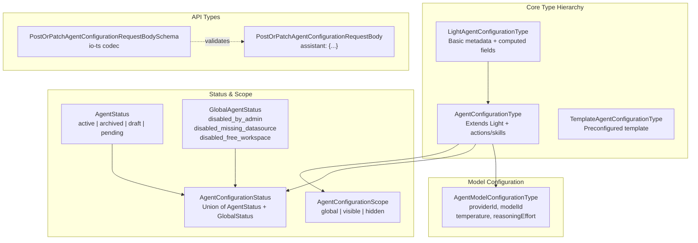
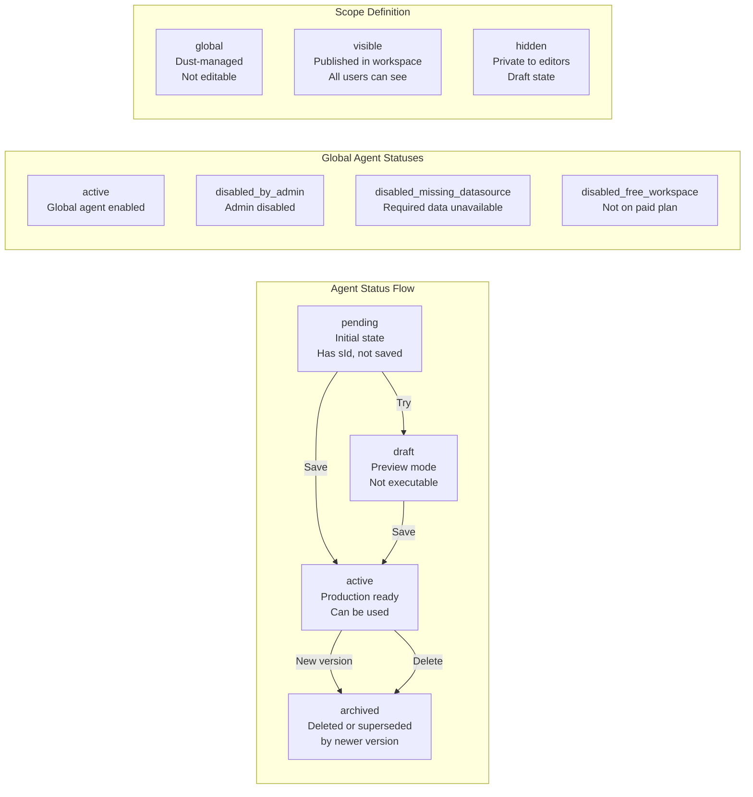
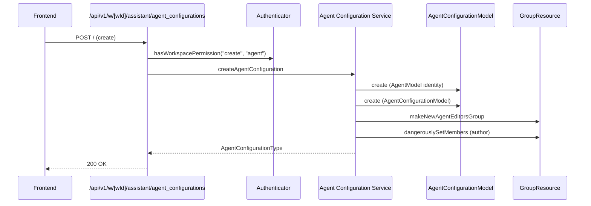

<!-- source: DeepWiki mcp.deepwiki.com · repo dust-tt/dust · page 3.1 Agent Configuration and Management · fetched 2026-10-26 -->

# Agent Configuration and Management

Relevant source files

The following files were used as context for generating this wiki page:

- [front-api/public/swagger.json](front-api/public/swagger.json)
- [front-api/routes/poke/workspaces/[wId]/agent_configurations/[aId]/index.ts](front-api/routes/poke/workspaces/[wId]/agent_configurations/[aId]/index.ts)
- [front-api/routes/swagger_private_schemas.ts](front-api/routes/swagger_private_schemas.ts)
- [front-api/routes/v1/w/[wId]/assistant/agent_configurations/[sId]/index.ts](front-api/routes/v1/w/[wId]/assistant/agent_configurations/[sId]/index.ts)
- [front-api/routes/v1/w/[wId]/index.ts](front-api/routes/v1/w/[wId]/index.ts)
- [front-api/routes/v1/w/[wId]/swagger_schemas.ts](front-api/routes/v1/w/[wId]/swagger_schemas.ts)
- [front-api/routes/w/[wId]/assistant/agent_configurations/[aId]/editors.test.ts](front-api/routes/w/[wId]/assistant/agent_configurations/[aId]/editors.test.ts)
- [front-api/routes/w/[wId]/assistant/agent_configurations/[aId]/editors.ts](front-api/routes/w/[wId]/assistant/agent_configurations/[aId]/editors.ts)
- [front-api/routes/w/[wId]/assistant/agent_configurations/[aId]/index.test.ts](front-api/routes/w/[wId]/assistant/agent_configurations/[aId]/index.test.ts)
- [front-api/routes/w/[wId]/assistant/agent_configurations/[aId]/index.ts](front-api/routes/w/[wId]/assistant/agent_configurations/[aId]/index.ts)
- [front-api/routes/w/[wId]/assistant/agent_configurations/[aId]/linked_slack_channels.ts](front-api/routes/w/[wId]/assistant/agent_configurations/[aId]/linked_slack_channels.ts)
- [front-api/routes/w/[wId]/assistant/agent_configurations/[aId]/tags.ts](front-api/routes/w/[wId]/assistant/agent_configurations/[aId]/tags.ts)
- [front-api/routes/w/[wId]/assistant/agent_configurations/batch_update_scope.test.ts](front-api/routes/w/[wId]/assistant/agent_configurations/batch_update_scope.test.ts)
- [front-api/routes/w/[wId]/assistant/agent_configurations/batch_update_tags.test.ts](front-api/routes/w/[wId]/assistant/agent_configurations/batch_update_tags.test.ts)
- [front-api/routes/w/[wId]/assistant/agent_configurations/batch_update_tags.ts](front-api/routes/w/[wId]/assistant/agent_configurations/batch_update_tags.ts)
- [front-api/routes/w/[wId]/files/[fileId]/index.test.ts](front-api/routes/w/[wId]/files/[fileId]/index.test.ts)
- [front-api/routes/w/[wId]/files/[fileId]/index.ts](front-api/routes/w/[wId]/files/[fileId]/index.ts)
- [front-api/routes/w/[wId]/skills/[sId]/files/[fileId]/content.test.ts](front-api/routes/w/[wId]/skills/[sId]/files/[fileId]/content.test.ts)
- [front/components/assistant/AgentEditBar.tsx](front/components/assistant/AgentEditBar.tsx)
- [front/components/assistant/CreateDropdown.tsx](front/components/assistant/CreateDropdown.tsx)
- [front/components/assistant/DeleteAssistantsDialog.tsx](front/components/assistant/DeleteAssistantsDialog.tsx)
- [front/components/assistant/ModelsFilterMenu.tsx](front/components/assistant/ModelsFilterMenu.tsx)
- [front/components/assistant/ModelsMenuContent.tsx](front/components/assistant/ModelsMenuContent.tsx)
- [front/components/assistant/SetModelAssistantsDialog.tsx](front/components/assistant/SetModelAssistantsDialog.tsx)
- [front/components/assistant/TagsFilterMenu.tsx](front/components/assistant/TagsFilterMenu.tsx)
- [front/components/assistant/UnpublishAssistantsDialog.tsx](front/components/assistant/UnpublishAssistantsDialog.tsx)
- [front/components/assistant/manager/AssistantsTable.tsx](front/components/assistant/manager/AssistantsTable.tsx)
- [front/components/pages/builder/agents/ManageAgentsPage.tsx](front/components/pages/builder/agents/ManageAgentsPage.tsx)
- [front/components/pages/builder/skills/ManageSkillsPage.tsx](front/components/pages/builder/skills/ManageSkillsPage.tsx)
- [front/components/pages/workspace/governance/GovernancePage.tsx](front/components/pages/workspace/governance/GovernancePage.tsx)
- [front/components/pages/workspace/governance/GovernanceSettingRow.tsx](front/components/pages/workspace/governance/GovernanceSettingRow.tsx)
- [front/components/shared/BulkSelectionBar.tsx](front/components/shared/BulkSelectionBar.tsx)
- [front/components/shared/SpaceLinks.tsx](front/components/shared/SpaceLinks.tsx)
- [front/components/skill_builder/SkillBuilderAvailabilityMessage.tsx](front/components/skill_builder/SkillBuilderAvailabilityMessage.tsx)
- [front/components/skill_builder/SkillBuilderSettingsSection.tsx](front/components/skill_builder/SkillBuilderSettingsSection.tsx)
- [front/components/skills/ArchiveSkillsDialog.tsx](front/components/skills/ArchiveSkillsDialog.tsx)
- [front/components/skills/SkillsBatchEdit.tsx](front/components/skills/SkillsBatchEdit.tsx)
- [front/components/skills/SkillsTable.tsx](front/components/skills/SkillsTable.tsx)
- [front/lib/agent_builder/server_side_props_helpers.ts](front/lib/agent_builder/server_side_props_helpers.ts)
- [front/lib/agent_yaml_converter/converter.ts](front/lib/agent_yaml_converter/converter.ts)
- [front/lib/agent_yaml_converter/schemas.ts](front/lib/agent_yaml_converter/schemas.ts)
- [front/lib/api/assistant/configuration/agent.test.ts](front/lib/api/assistant/configuration/agent.test.ts)
- [front/lib/api/assistant/configuration/agent.ts](front/lib/api/assistant/configuration/agent.ts)
- [front/lib/api/assistant/configuration/yaml_export.ts](front/lib/api/assistant/configuration/yaml_export.ts)
- [front/lib/api/assistant/configuration/yaml_import.test.ts](front/lib/api/assistant/configuration/yaml_import.test.ts)
- [front/lib/api/assistant/configuration/yaml_import.ts](front/lib/api/assistant/configuration/yaml_import.ts)
- [front/lib/api/assistant/streaming/events.ts](front/lib/api/assistant/streaming/events.ts)
- [front/lib/api/assistant/streaming/types.ts](front/lib/api/assistant/streaming/types.ts)
- [front/lib/api/projects/list.test.ts](front/lib/api/projects/list.test.ts)
- [front/lib/resources/tags_resource.ts](front/lib/resources/tags_resource.ts)
- [front/lib/resources/user_resource.ts](front/lib/resources/user_resource.ts)
- [front/lib/user_search/search.test.ts](front/lib/user_search/search.test.ts)
- [front/lib/user_search/search.ts](front/lib/user_search/search.ts)
- [front/migrations/20260828_restore_agent_editor_memberships.ts](front/migrations/20260828_restore_agent_editor_memberships.ts)

This document covers the agent configuration system, including type definitions, CRUD operations, status management, and the form-to-API transformation pipeline. For information about the Agent Builder UI components, see page [3.2](). For agent execution workflows, see page [3.3]().

## Overview

The agent configuration system provides the data structures and APIs for creating, reading, updating, and deleting AI agents within workspaces. It manages agent metadata (name, description, picture), model settings, instructions, actions, skills, triggers, and access permissions. The system maintains multiple representations of agent configurations: database models, server-side types, form data types, and API request/response types, with explicit transformation functions between each layer.

**Sources:** [front/types/assistant/agent.ts:1-403](), [front/lib/api/assistant/configuration/agent.ts:1-156]()

## Type System Architecture

The type system uses three validation layers: Zod schemas for form data, io-ts codecs for API requests, and TypeScript types for runtime safety. Each agent configuration includes a version number that increments on updates, enabling version history tracking.

**Sources:** [front/types/assistant/agent.ts:25-191](), [front/lib/api/assistant/configuration/agent.ts:47-56]()

## Agent Status and Scope

The status field controls agent executability and visibility. `pending` status is created when opening the agent builder for new agents via `createPendingAgentConfiguration` [front/lib/api/assistant/configuration/agent.ts:91-156](), allowing the frontend to capture a stable `sId` before the first save. `draft` status is used for preview/test functionality. Global agents use extended statuses to represent workspace-level restrictions.

The scope field determines access control: `global` agents are Dust-provided and immutable, `visible` agents are workspace-wide and discoverable, `hidden` agents are only visible to editors and the creator.

**Sources:** [front/types/assistant/agent.ts:25-58](), [front/lib/api/assistant/configuration/agent.ts:118-120]()

## Agent Configuration CRUD API

The API provides endpoints for managing agents. GET supports query parameters for filtering (view, withUsage, withAuthors, withFeedbacks) and pagination.

`createAgentConfiguration` handles the creation of a new agent version. If an `agentConfigurationId` is provided, it checks if the existing configuration is `pending`. If so, it converts the pending agent to `active` [front/lib/api/assistant/configuration/agent.test.ts:161-190]().

**Sources:** [front/lib/api/assistant/configuration/agent.ts:91-156](), [front/lib/api/assistant/configuration/agent.test.ts:1-11](), [front-api/public/swagger.json:235-260]()

## Configuration Lifecycle Management

| Lifecycle Stage | Status | Key Operations |
|----------------|--------|----------------|
| **Builder Open (New)** | `pending` | `createPendingAgentConfiguration` [front/lib/api/assistant/configuration/agent.ts:91](). Captures `sId` early and creates an editors group. |
| **First Save** | `active` or `draft` | `createAgentConfiguration`. Converts pending to active if applicable. |
| **Subsequent Edits** | `active` | `createAgentConfiguration` (with `agentConfigurationId`). Archives previous version, increments version number. |
| **Duplication** | `pending` → `active` | Load existing config, reset scope to "hidden", set editors to current user, then POST. |
| **Deletion** | `archived` | `archiveAgentConfiguration` [front/lib/api/assistant/configuration/agent.test.ts:2](). Sets status to archived. |
| **Hard Deletion** | N/A | `unsafeHardDeleteAgentConfiguration` [front/lib/api/assistant/configuration/agent.test.ts:9](). Used for cleanup and test isolation. |

### Pending Agent Creation

New agents create a "pending" configuration to capture a stable `sId` [front/lib/api/assistant/configuration/agent.ts:102](). This process also initializes a dedicated **Editors Group** via `GroupResource.makeNewAgentEditorsGroup` [front/lib/api/assistant/configuration/agent.ts:138-141](), ensuring the creator has immediate write permissions.

### Versioning and Identity

The system maintains a stable identity across versions using the `AgentModel` (linked via `agentId`) while `AgentConfigurationModel` stores the specific version data [front/lib/api/assistant/configuration/agent.test.ts:82-103](). 

- **Identity Reuse**: One `AgentModel` is reused across multiple `AgentConfigurationModel` versions [front/lib/api/assistant/configuration/agent.test.ts:83-103]().
- **Restoration**: `restoreAgentConfiguration` can revert an agent to a previous version [front/lib/api/assistant/configuration/agent.test.ts:8]().

**Sources:** [front/lib/api/assistant/configuration/agent.ts:91-156](), [front/lib/api/assistant/configuration/agent.test.ts:82-158]()

## Tags and Editor Groups

Agents can be tagged for organization and filtering. The `TagResource` and `TagAgentModel` manage these associations [front/lib/api/assistant/configuration/agent.ts:30-38]().

### Editor Groups
Every custom agent has a specific editors group.
- **Creation**: `makeNewAgentEditorsGroup` is called during initial configuration creation [front/lib/api/assistant/configuration/agent.ts:138]().
- **Membership**: The author is added to this group by default [front/lib/api/assistant/configuration/agent.ts:149-152]().
- **Permissions**: Write access to an agent is governed by membership in its specific editors group [front/lib/api/assistant/configuration/agent.ts:143-148]().

### Tag Management
Workspace-level tags can be applied to agents to facilitate discovery in the `AssistantsTable` [front/components/assistant/manager/AssistantsTable.tsx:67-68]().
- **Filtering**: The `ManageAgentsPage` uses `TagsFilterMenu` to filter the list of configurations [front/components/pages/builder/agents/ManageAgentsPage.tsx:8]().
- **Batch Updates**: The API supports batch updating tags for multiple agents [front-api/routes/w/[wId]/assistant/agent_configurations/batch_update_tags.ts]().

**Sources:** [front/lib/api/assistant/configuration/agent.ts:138-153](), [front/components/assistant/manager/AssistantsTable.tsx:214-222](), [front/components/pages/builder/agents/ManageAgentsPage.tsx:132-140]()

## API Endpoints Summary

| Method | Path | Description |
|--------|------|-------------|
| `GET` | `/api/v1/w/{wId}/assistant/agent_configurations` | List agent configurations for a workspace. |
| `POST` | `/api/v1/w/{wId}/assistant/agent_configurations` | Create a new agent configuration or a new version. |
| `POST` | `/api/v1/w/{wId}/assistant/agent_configurations/create-pending` | Create a placeholder configuration for a new agent. |
| `PATCH` | `/api/v1/w/{wId}/assistant/agent_configurations/{sId}` | Update metadata (scope, status) of an agent. |
| `DELETE` | `/api/v1/w/{wId}/assistant/agent_configurations/{sId}` | Archive an agent configuration. |

**Sources:** [front-api/public/swagger.json:235-260](), [front/lib/api/assistant/configuration/agent.ts:91-156]()

---

