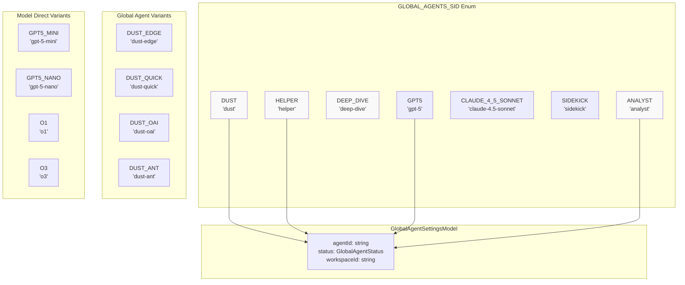
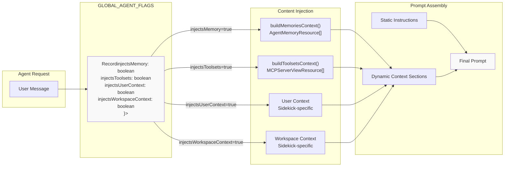
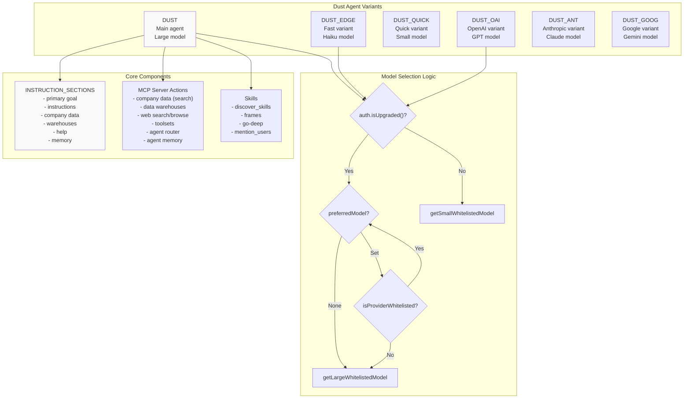
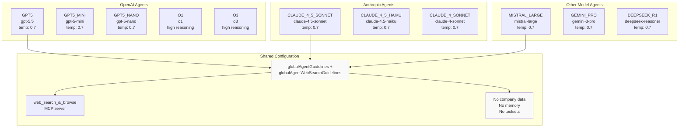
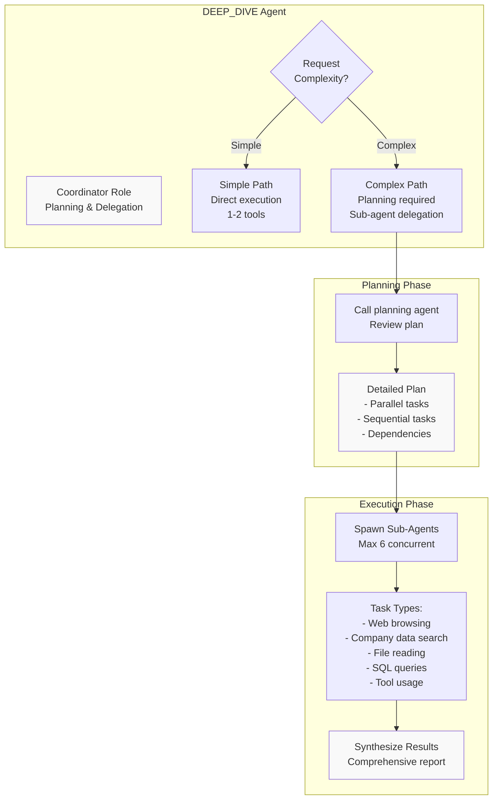
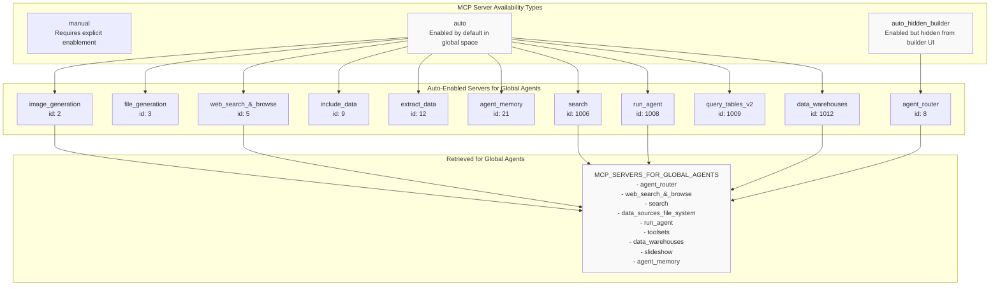
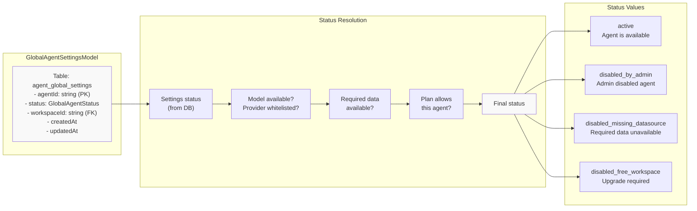
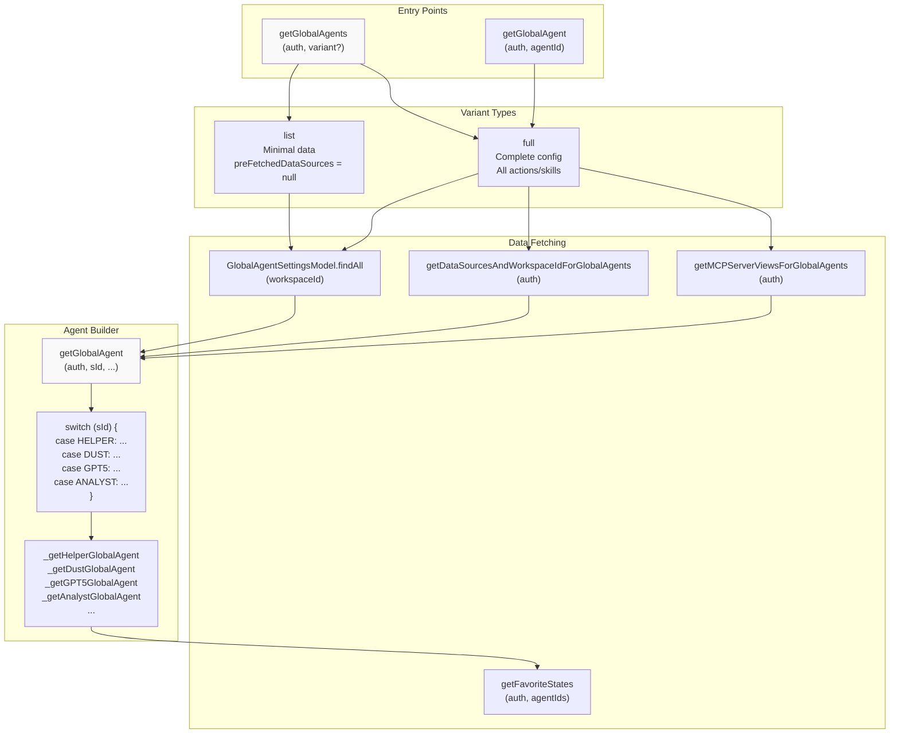

<!-- source: DeepWiki mcp.deepwiki.com · repo dust-tt/dust · page 3.7 Global Agents · fetched 2026-10-26 -->

# Global Agents

<details>
<summary>Relevant source files</summary>

The following files were used as context for generating this wiki page:

- [front-api/routes/poke/workspaces/[wId]/conversations/index.ts](front-api/routes/poke/workspaces/[wId]/conversations/index.ts)
- [front/components/agent_builder/sidekick/tools/getAgentConfig.ts](front/components/agent_builder/sidekick/tools/getAgentConfig.ts)
- [front/components/markdown/suggestion/SidekickSuggestionCard.tsx](front/components/markdown/suggestion/SidekickSuggestionCard.tsx)
- [front/components/poke/suggestions/columns.tsx](front/components/poke/suggestions/columns.tsx)
- [front/components/poke/suggestions/table.tsx](front/components/poke/suggestions/table.tsx)
- [front/components/providers/model_configs.ts](front/components/providers/model_configs.ts)
- [front/components/shared/utils.ts](front/components/shared/utils.ts)
- [front/lib/api/actions/servers/agent_sidekick_context/agent_sidekick_context.test.ts](front/lib/api/actions/servers/agent_sidekick_context/agent_sidekick_context.test.ts)
- [front/lib/api/actions/servers/agent_sidekick_context/metadata.ts](front/lib/api/actions/servers/agent_sidekick_context/metadata.ts)
- [front/lib/api/actions/servers/agent_sidekick_context/tools/index.ts](front/lib/api/actions/servers/agent_sidekick_context/tools/index.ts)
- [front/lib/api/assistant/agent_suggestion_pruning.test.ts](front/lib/api/assistant/agent_suggestion_pruning.test.ts)
- [front/lib/api/assistant/agent_suggestion_pruning.ts](front/lib/api/assistant/agent_suggestion_pruning.ts)
- [front/lib/api/assistant/builder/sidekick_prompts.ts](front/lib/api/assistant/builder/sidekick_prompts.ts)
- [front/lib/api/assistant/content_fragments.test.ts](front/lib/api/assistant/content_fragments.test.ts)
- [front/lib/api/assistant/conversation_rendering/helpers.test.ts](front/lib/api/assistant/conversation_rendering/helpers.test.ts)
- [front/lib/api/assistant/conversation_rendering/helpers.ts](front/lib/api/assistant/conversation_rendering/helpers.ts)
- [front/lib/api/assistant/conversation_rendering/message_rendering.test.ts](front/lib/api/assistant/conversation_rendering/message_rendering.test.ts)
- [front/lib/api/assistant/conversation_rendering/message_rendering.ts](front/lib/api/assistant/conversation_rendering/message_rendering.ts)
- [front/lib/api/assistant/generation.test.ts](front/lib/api/assistant/generation.test.ts)
- [front/lib/api/assistant/generation.ts](front/lib/api/assistant/generation.ts)
- [front/lib/api/assistant/global_agents/configurations/dust/agent_suggestions_shared.ts](front/lib/api/assistant/global_agents/configurations/dust/agent_suggestions_shared.ts)
- [front/lib/api/assistant/global_agents/configurations/dust/deep-dive.ts](front/lib/api/assistant/global_agents/configurations/dust/deep-dive.ts)
- [front/lib/api/assistant/global_agents/configurations/dust/dust.ts](front/lib/api/assistant/global_agents/configurations/dust/dust.ts)
- [front/lib/api/assistant/global_agents/configurations/dust/sidekick.ts](front/lib/api/assistant/global_agents/configurations/dust/sidekick.ts)
- [front/lib/api/assistant/global_agents/global_agent_metadata.ts](front/lib/api/assistant/global_agents/global_agent_metadata.ts)
- [front/lib/api/assistant/global_agents/global_agents.test.ts](front/lib/api/assistant/global_agents/global_agents.test.ts)
- [front/lib/api/assistant/global_agents/global_agents.ts](front/lib/api/assistant/global_agents/global_agents.ts)
- [front/lib/api/assistant/global_agents/sidekick_context.ts](front/lib/api/assistant/global_agents/sidekick_context.ts)
- [front/lib/api/assistant/skills_rendering.test.ts](front/lib/api/assistant/skills_rendering.test.ts)
- [front/lib/api/assistant/skills_rendering.ts](front/lib/api/assistant/skills_rendering.ts)
- [front/lib/api/assistant/token_pricing/global.ts](front/lib/api/assistant/token_pricing/global.ts)
- [front/lib/api/assistant/workspace_capabilities.ts](front/lib/api/assistant/workspace_capabilities.ts)
- [front/lib/api/poke/plugins/agents/clean_suggestions.ts](front/lib/api/poke/plugins/agents/clean_suggestions.ts)
- [front/lib/api/poke/plugins/agents/index.ts](front/lib/api/poke/plugins/agents/index.ts)
- [front/lib/models/agent/actions/agent_step_content_tool_execution.ts](front/lib/models/agent/actions/agent_step_content_tool_execution.ts)
- [front/lib/models/agent/agent_suggestion.ts](front/lib/models/agent/agent_suggestion.ts)
- [front/lib/resources/agent_suggestion_resource.test.ts](front/lib/resources/agent_suggestion_resource.test.ts)
- [front/lib/resources/agent_suggestion_resource.ts](front/lib/resources/agent_suggestion_resource.ts)
- [front/lib/resources/skill/code_defined/global/go_deep.test.ts](front/lib/resources/skill/code_defined/global/go_deep.test.ts)
- [front/lib/resources/skill/code_defined/global/go_deep.ts](front/lib/resources/skill/code_defined/global/go_deep.ts)
- [front/migrations/pre-deploy/20260824122407_add_covering_step_content_index_on_tool_executions.sql](front/migrations/pre-deploy/20260824122407_add_covering_step_content_index_on_tool_executions.sql)
- [front/scripts/seed/factories/seedAgentSuggestions.ts](front/scripts/seed/factories/seedAgentSuggestions.ts)
- [front/tests/sidekick-evals/SIDEKICK_TEST.md](front/tests/sidekick-evals/SIDEKICK_TEST.md)
- [front/tests/sidekick-evals/lib/config.ts](front/tests/sidekick-evals/lib/config.ts)
- [front/tests/sidekick-evals/lib/judge.ts](front/tests/sidekick-evals/lib/judge.ts)
- [front/tests/sidekick-evals/lib/mock-responses.ts](front/tests/sidekick-evals/lib/mock-responses.ts)
- [front/tests/sidekick-evals/lib/sidekick-executor.ts](front/tests/sidekick-evals/lib/sidekick-executor.ts)
- [front/tests/sidekick-evals/lib/types.ts](front/tests/sidekick-evals/lib/types.ts)
- [front/tests/sidekick-evals/sidekick-eval.test.ts](front/tests/sidekick-evals/sidekick-eval.test.ts)
- [front/tests/sidekick-evals/test-suites/minimal-instructions.ts](front/tests/sidekick-evals/test-suites/minimal-instructions.ts)
- [front/tests/sidekick-evals/test-suites/new-agent.ts](front/tests/sidekick-evals/test-suites/new-agent.ts)
- [front/tests/sidekick-evals/test-suites/shrink-wrap.ts](front/tests/sidekick-evals/test-suites/shrink-wrap.ts)
- [front/tests/sidekick-evals/test-suites/well-structured-instructions.ts](front/tests/sidekick-evals/test-suites/well-structured-instructions.ts)
- [front/tests/utils/AgentSuggestionFactory.ts](front/tests/utils/AgentSuggestionFactory.ts)
- [front/tests/utils/conversation_test_factories.ts](front/tests/utils/conversation_test_factories.ts)
- [front/types/assistant/assistant.ts](front/types/assistant/assistant.ts)
- [front/types/assistant/models/models.ts](front/types/assistant/models/models.ts)
- [front/types/suggestions/agent_suggestion.ts](front/types/suggestions/agent_suggestion.ts)

</details>


This document describes the pre-configured **global agents** that are built into the Dust platform. Global agents are system-defined agents with specific identifiers, models, and behaviors that are available to all workspaces. For information about custom workspace-specific agents, see [Agent Configuration and Management](). For details on how agents execute tasks, see [Agent Execution and Temporal Workflows]().

---

## Overview and Purpose

Global agents are pre-configured AI agents that come with the Dust platform. Unlike custom agents created by users, global agents have:

- **Fixed identifiers** defined in the `GLOBAL_AGENTS_SID` enum
- **Pre-defined instructions and behaviors** configured in code
- **Automatic MCP server enablement** for specific tools
- **Dynamic content injection** (memory, toolsets, context) based on agent type
- **Workspace-level settings** for enabling/disabling specific agents

Global agents fall into three main categories:
1. **Dust family agents** - General-purpose agents with company data access (DUST, DUST_EDGE, etc.)
2. **Model-direct agents** - Direct access to specific LLM models (GPT5, CLAUDE_4_5_SONNET, etc.)
3. **Special purpose agents** - Task-specific agents (HELPER, DEEP_DIVE, SIDEKICK, ANALYST)

Sources: [front/types/assistant/assistant.ts:42-149](), [front/lib/api/assistant/global_agents/global_agents.ts:1-102]()

---

## Global Agent Identifier System



**Global Agent Identifier System**

All global agents are identified by string constants in the `GLOBAL_AGENTS_SID` enum. The system uses the `isGlobalAgentId` function to check if a given string ID corresponds to a global agent.

| Function | Purpose | Location |
|----------|---------|----------|
| `isGlobalAgentId` | Type guard to check if string is a valid global agent ID | [front/types/assistant/assistant.ts:151-153]() |
| `getGlobalAgentAuthorName` | Returns display name for the agent's author/provider | [front/types/assistant/assistant.ts:201-230]() |
| `compareAgentsForSort` | Sorting function with global agents prioritized | [front/types/assistant/assistant.ts:253-291]() |

Sources: [front/types/assistant/assistant.ts:42-149](), [front/lib/api/assistant/global_agents/global_agents.ts:498-516]()

---

## Dynamic Content Injection



**Dynamic Content Injection System**

Global agents support injecting dynamic, per-user content into prompts to improve cache hit rates. The `GLOBAL_AGENT_FLAGS` record defines which agents support each type of injection:

| Agent Type | Memory | Toolsets | User Context | Workspace Context |
|------------|--------|----------|--------------|-------------------|
| DUST family | ✓ | ✓ | ✗ | ✗ |
| SIDEKICK | ✗ | ✗ | ✓ | ✓ |
| Model-direct agents | ✗ | ✗ | ✗ | ✗ |
| HELPER | ✗ | ✗ | ✗ | ✗ |
| DEEP_DIVE | ✗ | ✗ | ✗ | ✗ |
| ANALYST | ✓ | ✓ | ✗ | ✗ |

**Memory Injection**: The `buildMemoriesContext` function formats user-specific memories that were saved by the agent in previous conversations:

```
<existing_memories>
- CFO at Series B startup, 50 employees (saved Jan 15, 2025).
- Prefers concise answers with bullet points (saved Jan 20, 2025).
</existing_memories>
```

**Toolsets Injection**: The `buildToolsetsContext` function lists available toolsets (MCP servers) that can be dynamically enabled:

```
<toolsets_guidelines>
The "toolsets" tools allow listing and enabling additional tools.
<available_toolsets>
- **Google Sheets** (toolsetId: `google_sheets_123`): Read and write data
- **Salesforce** (toolsetId: `salesforce_456`): Query and update CRM
</available_toolsets>
...
```

Sources: [front/lib/api/assistant/global_agents/global_agents.ts:107-488](), [front/lib/api/assistant/global_agents/configurations/dust/dust.ts:217-272]()

---

## The Dust Agent Family



**Dust Agent Family Architecture**

The Dust agent family provides general-purpose AI assistance with access to company data, web search, and tools. All Dust family agents share the same core functionality but differ in their underlying LLM model.

**Instruction Structure**: Instructions are assembled from modular sections defined in `INSTRUCTION_SECTIONS`:

| Section | Purpose | Conditional |
|---------|---------|-------------|
| `primary` | Primary goal and general guidelines | Always included |
| `instructions` | Task routing (company data vs. web vs. internal knowledge) | Always included |
| `goDeepInstructions` | Delegation to DEEP_DIVE for complex tasks | If `hasDeepDive=true` |
| `companyData` | File system navigation and search guidelines | If company data available |
| `warehouses` | Data warehouse query guidelines | If warehouses available |
| `help` | Dust platform support guidelines | Always included |
| `memory` | Memory system usage guidelines | If `hasAgentMemory=true` |

**MCP Server Actions**: The `_getDustLikeGlobalAgent` function builds a list of MCP server configurations:

1. **Company Data Action** (`getCompanyDataAction`): File system navigation and semantic search
2. **Data Warehouses Action** (`getCompanyDataWarehousesAction`): SQL queries against data warehouses
3. **Web Actions** (`_getDefaultWebActionsForGlobalAgent`): Web search and browsing
4. **Toolsets Action** (`_getToolsetsToolsConfiguration`): Dynamic toolset enablement
5. **Agent Router Action** (`_getAgentRouterToolsConfiguration`): Agent suggestions
6. **Agent Memory Action**: Persistent user memory storage

**Model Selection**: The agent uses a priority-based model selection:

```typescript
if (!auth.isUpgraded()) {
    return getSmallWhitelistedModel(owner);
}

if (preferredModelConfiguration) {
    if (isProviderWhitelisted(owner, preferredModelConfiguration.providerId)) {
        return preferredModelConfiguration;
    }
}

return getLargeWhitelistedModel(owner);
```

Sources: [front/lib/api/assistant/global_agents/configurations/dust/dust.ts:68-488](), [front/lib/api/assistant/global_agents/configurations/dust/dust.ts:274-296]()

---

## Model-Direct Agents



**Model-Direct Agents**

Model-direct agents provide direct access to specific LLM models with minimal additional functionality. They are designed for users who want a "pure" model experience without company data integration.

**Common Characteristics**:
- **Instructions**: Combine `globalAgentGuidelines` and `globalAgentWebSearchGuidelines`
- **Tools**: Only web search and browsing (no company data, no memory, no toolsets)
- **Temperature**: Fixed at 0.7 for all models
- **Status**: Can be disabled via workspace settings or missing provider credentials

**Model Availability by Provider**:

| Provider | Global Agents | Feature Flag Required |
|----------|---------------|----------------------|
| OpenAI | GPT5, GPT5_MINI, GPT5_NANO, O1, O1_MINI, O3, O3_MINI | Some require feature flags |
| Anthropic | CLAUDE_4_5_SONNET, CLAUDE_4_5_HAIKU, CLAUDE_4_SONNET, CLAUDE_3_OPUS, etc. | No |
| Mistral | MISTRAL_LARGE, MISTRAL_MEDIUM, MISTRAL_SMALL | No |
| Google | GEMINI_PRO | No |
| DeepSeek | DEEPSEEK_R1 | `deepseek_r1_global_agent_feature` |

**Provider Whitelisting**: Each workspace has a `whiteListedProviders` configuration. If a model's provider is not whitelisted, the agent is disabled:

```typescript
status: isProviderWhitelisted(auth.getNonNullableWorkspace(), modelConfig.providerId)
    ? settings?.status ?? "active"
    : "disabled_by_admin"
```

Sources: [front/lib/api/assistant/global_agents/configurations/openai.ts:36-293](), [front/lib/api/assistant/global_agents/configurations/anthropic.ts:1-309](), [front/lib/api/assistant/global_agents/configurations/google.ts:1-67](), [front/lib/api/assistant/global_agents/configurations/mistral.ts:1-139]()

---

## HELPER Agent

The HELPER agent provides support and guidance on using the Dust platform itself.

**Purpose**: Answer questions about Dust features, capabilities, integrations, and usage patterns.

**Configuration**:
- **Model**: `getSmallWhitelistedModel(owner)` - Uses smallest available model
- **Instructions**: Focused on platform support with web search for documentation
- **Tools**: Web search, browsing, agent router for suggesting other agents
- **Restrictions**: Should only activate when user explicitly asks about Dust

**Instruction Highlights**:
```
<dust_platform_support_guidelines>
Follow these guidelines when the user unambiguously asks support questions 
specifically about how to use Dust features...

1. Perform web searches using site:dust.tt
2. Fetch https://docs.dust.tt/llms.txt for documentation sitemap
3. Provide clear, straightforward answers with bullet points
4. NEVER invent features or capabilities
5. NEVER make promises about future features
6. Only refer to URLs mentioned in documentation
</dust_platform_support_guidelines>
```

Sources: [front/lib/api/assistant/global_agents/configurations/helper.ts:1-100](), [front/lib/api/assistant/global_agents/global_agent_metadata.ts:43-50]()

---

## DEEP_DIVE Agent



**DEEP_DIVE Agent for Complex Research**

The DEEP_DIVE agent is designed for complex, multi-step research tasks that benefit from decomposition and parallel execution.

**Core Concept**: Acts as a coordinator that:
1. Assesses request complexity (simple vs. complex)
2. For complex requests, creates a plan using the planning agent
3. Decomposes tasks into atomic, self-contained sub-tasks
4. Spawns sub-agents to execute tasks in parallel (max 6 concurrent)
5. Synthesizes results into comprehensive reports

**Request Complexity Assessment**:

| Simple Request | Complex Request |
|----------------|-----------------|
| Answered with internal knowledge | Requires deep data exploration (3+ searches) |
| 1-2 quick semantic searches | Multiple web searches (3+ pages) |
| Simple websearch + 1-3 pages | SQL queries needed |
| 1-2 steps of tool use | 3+ steps of tool use |

**Sub-Agent Guidelines** (from instructions):
```
<delegation_policy>
- Do not delegate the entire request to a single sub-agent
- Decompose complex tasks into concrete sub-tasks (parallelize when feasible)
- Only delegate monolithic tasks when there's clear benefit (heavy browsing, isolation)

<web_browsing_delegation>
Avoid browsing several web pages yourself. Delegate browsing tasks to sub-agents
</web_browsing_delegation>

<company_data_delegation>
- Avoid reading entire files directly using `cat` tool
- Delegate file reading to sub-agent with content node ID
</company_data_delegation>
</delegation_policy>

<concurrency_limits>
- Use parallel tool calling for SIMULTANEOUS sub-agent tasks
- Max 6 concurrent sub-agent tasks
- Queue remainder if more than 6 needed
</concurrency_limits>
```

**Model Selection**: Uses `getLargeWhitelistedModel(owner)` or Opus for Dust/Enterprise plans via `shouldUseOpus()`.

**Associated Agents**:
- **DUST_PLANNING** agent: Reviews and improves research plans
- **DUST_TASK** agent: Executes individual research sub-tasks
- **DUST_BROWSER_SUMMARY** agent: (Archived) Previously for web browsing

Sources: [front/lib/api/assistant/global_agents/configurations/dust/deep-dive.ts:1-456](), [front/lib/api/assistant/global_agents/configurations/dust/consts.ts:1-3]()

---

## SIDEKICK Agent

The SIDEKICK agent provides contextual assistance within the Agent Builder interface, helping users configure and improve their custom agents.

**Purpose**: AI-assisted agent building with access to user context and workspace metadata.

**Configuration**:
- **Model**: `getLargeWhitelistedModel(owner)`
- **Context Injection**: Both `injectsUserContext` and `injectsWorkspaceContext` are `true`
- **Restrictions**: `scope: "global"`, but `canShowAgentConversationActions()` returns `false` - hidden from normal conversation UI

**Sidekick Context** (built by `buildSidekickContext`):
```typescript
{
  agentsMetadata: Array<{
    sId: string;
    name: string;
    description: string;
    instructions: string | null;
    lastAuthors: string[];
    ...
  }>;
  dataSources: DataSourceType[];
  spaces: SpaceType[];
  plans: PlanType;
  mcpServerViews: MCPServerViewResource[];
}
```

The context provides SIDEKICK with full visibility into:
- All agents in the workspace (names, descriptions, instructions, authors)
- Available data sources and spaces
- Workspace plan limits
- Available MCP servers for tool configuration

**Feature Flag**: Access to SIDEKICK is controlled by `agent_builder_copilot` feature flag.

Sources: [front/lib/api/assistant/global_agents/configurations/dust/sidekick.ts:1-198](), [front/lib/api/assistant/global_agents/sidekick_context.ts:1-77](), [front/lib/api/assistant/global_agents/global_agents.ts:290-295]()

---

## Analyst Agent

The ANALYST agent is a specialized agent designed to assist with data analysis tasks, particularly involving SQL queries against data warehouses.

**Purpose**: To provide data analysis capabilities, leveraging SQL tools and data visualization.

**Configuration**:
- **Model**: `getLargeWhitelistedModel(owner)`
- **Instructions**: Emphasizes SQL query generation, data interpretation, and visualization.
- **Tools**: Primarily `query_tables_v2` for SQL execution, `data_warehouses` for schema introspection, and `slideshow` for visualization.
- **Context Injection**: `injectsMemory` and `injectsToolsets` are `true`.

**Instruction Highlights**:
```
<primary_goal>
You are an expert data analyst. Your primary role is to help users analyze data by writing and executing SQL queries against their data warehouses.
</primary_goal>

<sql_guidelines>
- Always use the `query_tables_v2` tool to execute SQL queries.
- Before writing SQL, use the `data_warehouses` tool to inspect the schema of relevant tables.
- If the user asks for a chart or visualization, use the `slideshow` tool to generate it.
</sql_guidelines>
```

**Feature Flag**: Access to the ANALYST agent is controlled by the `analyst_global_agent` feature flag.

Sources: [front/lib/api/assistant/global_agents/configurations/analyst.ts:1-74](), [front/lib/api/assistant/global_agents/global_agents.ts:176-181]()

---

## Auto-Enabled MCP Servers



**Auto-Enabled MCP Servers**

Global agents automatically have access to specific internal MCP servers based on their `availability` configuration in `INTERNAL_MCP_SERVERS`.

**Availability Modes**:
- `"manual"`: User must explicitly add the server to their agent
- `"auto"`: Automatically enabled in global space, visible in Agent Builder
- `"auto_hidden_builder"`: Automatically enabled but hidden from builder UI (system tools)

**Auto-Enabled Servers** (from test snapshot):

| Server Name | ID | Type | Purpose |
|-------------|-----|------|---------|
| `image_generation` | 2 | auto | Generate and edit images |
| `file_generation` | 3 | auto | Create documents, spreadsheets, etc. |
| `web_search_&_browse` | 5 | auto | Web search and page browsing |
| `agent_router` | 8 | auto_hidden | Suggest agents to users |
| `include_data` | 9 | auto | Retrieve recent documents |
| `extract_data` | 12 | auto | Extract structured data from documents |
| `missing_action_catcher` | 13 | auto_hidden | Catch unsupported actions |
| `conversation_files` | 17 | auto_hidden | Access conversation attachments |
| `agent_memory` | 21 | auto | Persistent user memory |
| `interactive_content` | 23 | auto_hidden | Display interactive UI elements |
| `slideshow` | 28 | auto | Create presentations (feature flag) |
| `speech_generator` | 34 | auto | Generate audio |
| `search` | 1006 | auto | Semantic search in company data |
| `run_agent` | 1008 | auto | Spawn sub-agents |
| `query_tables_v2` | 1009 | auto | Query tables in company data |
| `data_sources_file_system` | 1010 | auto_hidden | Advanced file system navigation |
| `data_warehouses` | 1012 | auto | Query data warehouses |
| `toolsets` | 1013 | auto | Enable additional toolsets |

**MCP Server Retrieval**: The `getMCPServerViewsForGlobalAgents` function retrieves specific MCP server views needed by global agents:

```typescript
const MCP_SERVERS_FOR_GLOBAL_AGENTS = [
  "agent_router",
  "web_search_&_browse",
  "search",
  "data_sources_file_system",
  "run_agent",
  "toolsets",
  "data_warehouses",
  "slideshow",
  "agent_memory",
] as const;
```

Sources: [front/lib/actions/mcp_internal_actions/constants.ts:217-953](), [front/lib/actions/mcp_internal_actions/constants.test.ts:27-75](), [front/lib/api/assistant/global_agents/tools.ts:24-39]()

---

## Global Agent Settings



**Global Agent Settings and Status**

Each workspace can customize the availability of global agents through the `GlobalAgentSettingsModel`.

**Status Types** (from `GlobalAgentStatusSchema`):
- `"active"`: Agent is enabled and available to users
- `"disabled_by_admin"`: Workspace admin has disabled this agent
- `"disabled_missing_datasource"`: Required company data or configuration is missing
- `"disabled_free_workspace"`: Agent requires a paid plan

**Status Resolution Logic**:

1. **Settings Check**: Load `GlobalAgentSettingsModel` for the agent+workspace
2. **Model Availability**: Check if model provider is whitelisted for workspace
3. **Data Requirements**: Verify required data sources exist (e.g., company data for DUST)
4. **Plan Restrictions**: Check if workspace plan allows this agent
5. **Feature Flags**: Verify required feature flags are enabled

Example from DUST agent:
```typescript
if (
  (settings && settings.status === "disabled_by_admin") ||
  !modelConfiguration
) {
  return {
    ...dustAgent,
    status: "disabled_by_admin",
    actions: [..._getDefaultWebActionsForGlobalAgent({ agentId, mcpServerViews })],
    maxStepsPerRun: 0,
  };
}
```

**Internal Global Agents**: The `dust_internal_global_agents` feature flag controls access to Dust-internal variants (DUST_EDGE, DUST_QUICK, DUST_OAI, etc.).

Sources: [front/lib/models/agent/agent.ts]() (model definition), [front/lib/api/assistant/global_agents/configurations/dust/dust.ts:403-418](), [front/types/shared/feature_flags.ts:20-24](), [sdks/js/src/types.ts:835-849]()

---

## Global Agent Fetching



**Global Agent Fetching System**

The system provides two main entry points for fetching global agents:

**`getGlobalAgents` Function**:
```typescript
async function getGlobalAgents(
  auth: Authenticator,
  variant: AgentFetchVariant = "list"
): Promise<AgentConfigurationType[]>
```

- **Purpose**: Fetch all global agents visible to the user
- **Variants**:
  - `"list"`: Returns minimal data (no actions/skills), fast
  - `"full"`: Returns complete configuration with all actions/skills
- **Filtering**: Excludes SIDEKICK and internal agents unless feature flags permit
- **Output**: Array of `AgentConfigurationType` with `scope: "global"`

**`getGlobalAgent` Function** (internal):
```typescript
function getGlobalAgent({
  auth,
  sId,
  preFetchedDataSources,
  globalAgentSettings,
  mcpServerViews,
  sidekickContext,
  hasDeepDive,
  globalAgentContext,
}): AgentConfigurationType | null
```

- **Purpose**: Build a single global agent configuration
- **Routing**: Large switch statement based on `sId` calls agent-specific builder functions
- **Builders**: `_getHelperGlobalAgent`, `_getDustGlobalAgent`, `_getGPT5GlobalAgent`, `_getAnalystGlobalAgent`, etc.
- **Returns**: `null` if agent is not available (disabled, missing requirements)

**Pre-fetched Data**:
- **Data Sources**: Fetched once via `getDataSourcesAndWorkspaceIdForGlobalAgents` for efficiency
- **MCP Server Views**: Retrieved via `getMCPServerViewsForGlobalAgents` for specific servers
- **Settings**: All global agent settings for workspace loaded at once
- **Sidekick Context**: Special context built only for SIDEKICK agent

Sources: [front/lib/api/assistant/global_agents/global_agents.ts:773-893](), [front/lib/api/assistant/global_agents/global_agents.ts:498-771](), [front/lib/api/assistant/global_agents/tools.ts:19-92]()

---

