<!-- source: DeepWiki mcp.deepwiki.com · repo dust-tt/dust · page 4 MCP Tool System · fetched 2026-10-26 -->

# MCP Tool System

<details>
<summary>Relevant source files</summary>

The following files were used as context for generating this wiki page:

- [front-api/routes/w/[wId]/assistant/skills/[sId]/suggestions.test.ts](front-api/routes/w/[wId]/assistant/skills/[sId]/suggestions.test.ts)
- [front-api/routes/w/[wId]/mcp/[serverId]/index.test.ts](front-api/routes/w/[wId]/mcp/[serverId]/index.test.ts)
- [front-api/routes/w/[wId]/mcp/[serverId]/index.ts](front-api/routes/w/[wId]/mcp/[serverId]/index.ts)
- [front-api/routes/w/[wId]/mcp/[serverId]/sync.test.ts](front-api/routes/w/[wId]/mcp/[serverId]/sync.test.ts)
- [front-api/routes/w/[wId]/mcp/connections/[connectionType]/[cId]/index.test.ts](front-api/routes/w/[wId]/mcp/connections/[connectionType]/[cId]/index.test.ts)
- [front-api/routes/w/[wId]/mcp/connections/[connectionType]/[cId]/index.ts](front-api/routes/w/[wId]/mcp/connections/[connectionType]/[cId]/index.ts)
- [front-api/routes/w/[wId]/mcp/views/[viewId]/index.test.ts](front-api/routes/w/[wId]/mcp/views/[viewId]/index.test.ts)
- [front-api/routes/w/[wId]/mcp/views/[viewId]/index.ts](front-api/routes/w/[wId]/mcp/views/[viewId]/index.ts)
- [front-api/routes/w/[wId]/me/approvals.ts](front-api/routes/w/[wId]/me/approvals.ts)
- [front-api/routes/w/[wId]/members/index.test.ts](front-api/routes/w/[wId]/members/index.test.ts)
- [front-api/routes/w/[wId]/skills/[sId]/history/index.test.ts](front-api/routes/w/[wId]/skills/[sId]/history/index.test.ts)
- [front-api/routes/w/[wId]/skills/[sId]/restore.test.ts](front-api/routes/w/[wId]/skills/[sId]/restore.test.ts)
- [front-api/routes/w/[wId]/skills/reinforcement_daily_spend.test.ts](front-api/routes/w/[wId]/skills/reinforcement_daily_spend.test.ts)
- [front-api/routes/w/[wId]/skills/reinforcement_spend.test.ts](front-api/routes/w/[wId]/skills/reinforcement_spend.test.ts)
- [front-api/routes/w/[wId]/spaces/[spaceId]/mcp/available.test.ts](front-api/routes/w/[wId]/spaces/[spaceId]/mcp/available.test.ts)
- [front-api/routes/w/[wId]/spaces/[spaceId]/mcp_views/index.test.ts](front-api/routes/w/[wId]/spaces/[spaceId]/mcp_views/index.test.ts)
- [front-api/routes/w/[wId]/spaces/[spaceId]/webhook_source_views/index.test.ts](front-api/routes/w/[wId]/spaces/[spaceId]/webhook_source_views/index.test.ts)
- [front/lib/actions/action_output_limits.ts](front/lib/actions/action_output_limits.ts)
- [front/lib/actions/mcp.ts](front/lib/actions/mcp.ts)
- [front/lib/actions/mcp_actions.test.ts](front/lib/actions/mcp_actions.test.ts)
- [front/lib/actions/mcp_actions.ts](front/lib/actions/mcp_actions.ts)
- [front/lib/actions/mcp_authentication.test.ts](front/lib/actions/mcp_authentication.test.ts)
- [front/lib/actions/mcp_authentication.ts](front/lib/actions/mcp_authentication.ts)
- [front/lib/actions/mcp_execution.test.ts](front/lib/actions/mcp_execution.test.ts)
- [front/lib/actions/mcp_execution.ts](front/lib/actions/mcp_execution.ts)
- [front/lib/actions/mcp_internal_actions/exit_events.test.ts](front/lib/actions/mcp_internal_actions/exit_events.test.ts)
- [front/lib/actions/mcp_internal_actions/exit_events.ts](front/lib/actions/mcp_internal_actions/exit_events.ts)
- [front/lib/actions/mcp_internal_actions/output_schemas.ts](front/lib/actions/mcp_internal_actions/output_schemas.ts)
- [front/lib/actions/mcp_metadata.ts](front/lib/actions/mcp_metadata.ts)
- [front/lib/actions/mcp_metadata_extraction.ts](front/lib/actions/mcp_metadata_extraction.ts)
- [front/lib/actions/mcp_oauth_provider.ts](front/lib/actions/mcp_oauth_provider.ts)
- [front/lib/actions/mcp_utils.ts](front/lib/actions/mcp_utils.ts)
- [front/lib/actions/types/index.ts](front/lib/actions/types/index.ts)
- [front/lib/api/files/action_output_fs/index.ts](front/lib/api/files/action_output_fs/index.ts)
- [front/lib/api/files/action_output_fs/naming.ts](front/lib/api/files/action_output_fs/naming.ts)
- [front/lib/api/files/action_output_fs/registry.ts](front/lib/api/files/action_output_fs/registry.ts)
- [front/lib/api/mcp/error.ts](front/lib/api/mcp/error.ts)
- [front/lib/api/mcp/run_tool.ts](front/lib/api/mcp/run_tool.ts)
- [front/lib/api/mcp/views.ts](front/lib/api/mcp/views.ts)
- [front/lib/api/mcp_oauth_prerequisites.ts](front/lib/api/mcp_oauth_prerequisites.ts)
- [front/lib/api/poke/plugins/mcp_server_views/update-mcp-url.ts](front/lib/api/poke/plugins/mcp_server_views/update-mcp-url.ts)
- [front/lib/resources/internal_mcp_server_in_memory_resource.ts](front/lib/resources/internal_mcp_server_in_memory_resource.ts)
- [front/lib/resources/mcp_server_connection_resource.test.ts](front/lib/resources/mcp_server_connection_resource.test.ts)
- [front/lib/resources/mcp_server_connection_resource.ts](front/lib/resources/mcp_server_connection_resource.ts)
- [front/lib/resources/mcp_server_view_resource.test.ts](front/lib/resources/mcp_server_view_resource.test.ts)
- [front/lib/resources/mcp_server_view_resource.ts](front/lib/resources/mcp_server_view_resource.ts)
- [front/lib/resources/remote_mcp_servers_resource.test.ts](front/lib/resources/remote_mcp_servers_resource.test.ts)
- [front/lib/resources/remote_mcp_servers_resource.ts](front/lib/resources/remote_mcp_servers_resource.ts)
- [front/temporal/agent_loop/activities/run_tool.ts](front/temporal/agent_loop/activities/run_tool.ts)
- [front/types/assistant/agent.ts](front/types/assistant/agent.ts)
- [front/types/assistant/agent_run.ts](front/types/assistant/agent_run.ts)

</details>


The MCP (Model Context Protocol) Tool System enables agents to execute external tools and integrations through a standardized protocol. This system manages tool discovery, configuration, approval workflows, and execution across three distinct server types: internal servers with 40+ built-in tools, client-side servers for desktop integration, and remote servers for workspace-configured external services.

For information about the agent execution loop that orchestrates tool calls, see [Agent Execution and Temporal Workflows](#3.3). For LLM integration details, see [Prompt Construction and LLM Integration](#3.4).

## Architecture Overview

The MCP Tool System consists of multiple layers: server registration and configuration, tool discovery and metadata extraction, approval and validation workflows, and execution with progress streaming.

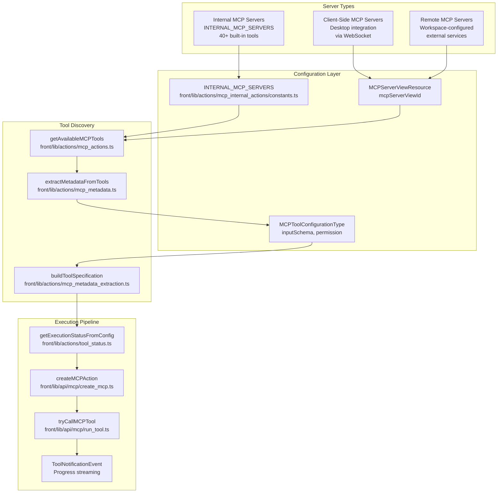

**Sources:** [front/lib/actions/mcp_internal_actions/constants.ts:215-1006](), [front/lib/actions/mcp.ts:1-323](), [front/lib/actions/mcp_actions.ts:1-900](), [front/lib/actions/mcp_metadata.ts:56-61](), [front/lib/actions/mcp_metadata_extraction.ts:1-33](), [front/lib/actions/tool_status.ts:1-228](), [front/lib/api/mcp/create_mcp.ts:1-58](), [front/lib/api/mcp/run_tool.ts:1-170]()

## Server Types and Registration

The system supports three distinct server types, each with its own registration and connection mechanism. For detailed information on each server type, see [MCP Server Architecture](#4.1).

### Internal MCP Servers

Internal servers are defined in `INTERNAL_MCP_SERVERS` with stable IDs, availability settings, and tool configurations. Each server has metadata including `tools_stakes`, `tools_retry_policies`, and `tools_arguments_requiring_approval`.

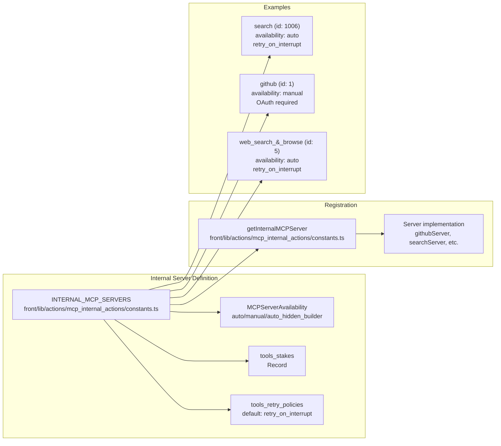

**Sources:** [front/lib/actions/mcp_internal_actions/constants.ts:215-1006](), [front/lib/actions/mcp_internal_actions/servers/index.ts:100-249]()

### Client-Side MCP Servers

Client-side servers enable desktop integration through a registration and heartbeat protocol. For details, see [MCP Server Architecture](#4.1).

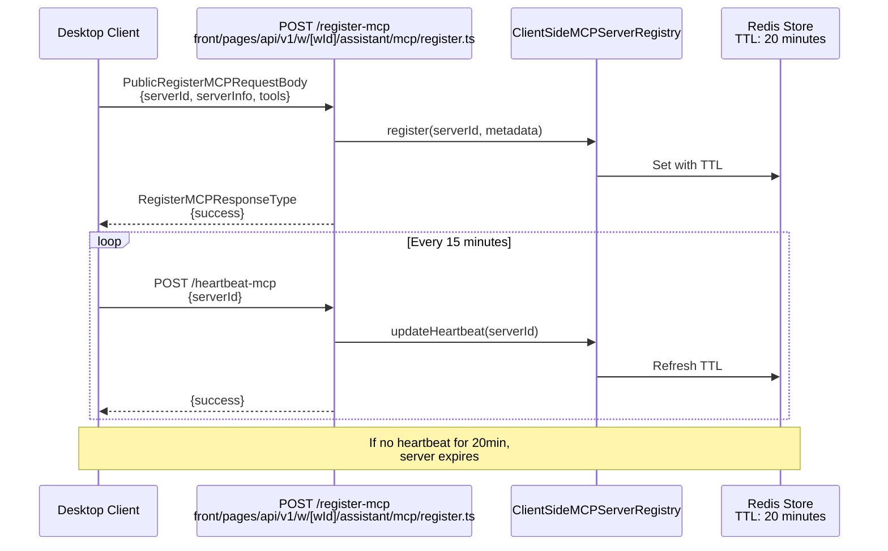

**Sources:** [front/pages/api/v1/w/[wId]/assistant/mcp/register.ts:1-100](), [front/lib/api/actions/mcp/client_side_registry.ts:1-200](), [sdks/js/src/index.ts:800-850]()

### Remote MCP Servers

Remote servers are configured at the workspace level with connection parameters stored in `MCPServerViewResource`. For details, see [MCP Server Architecture](#4.1).

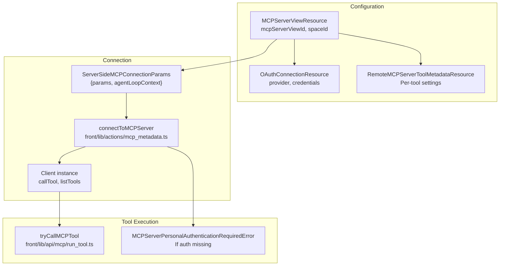

**Sources:** [front/lib/resources/mcp_server_view_resource.ts:1-400](), [front/lib/actions/mcp_metadata.ts:1-500](), [front/lib/actions/mcp_authentication.ts:1-179](), [front/lib/api/mcp/run_tool.ts:1-170]()

## Tool Discovery and Configuration

Tool discovery aggregates tools from all available servers and enriches them with metadata about permissions, retry policies, and approval requirements. For detailed information, see [Tool Discovery Pipeline](#4.2).

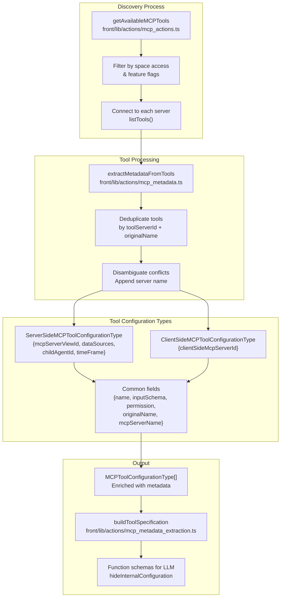

**Sources:** [front/lib/actions/mcp_actions.ts:600-900](), [front/lib/actions/mcp_metadata_extraction.ts:1-33](), [front/lib/actions/mcp.ts:240-257](), [front/lib/actions/mcp_metadata.ts:56-61]()

### Tool Naming and Disambiguation

Tools are prefixed with their server name and disambiguated when conflicts occur.

```mermaid
graph LR
    subgraph "Tool Naming"
        OriginalName["Original tool name<br/>e.g., 'search'"]
        Prefix["Add server prefix<br/>TOOL_NAME_SEPARATOR '__'"]
        FullName["Full name<br/>'search__semantic_search'"]
    end
    
    subgraph "Disambiguation"
        CheckConflict["Check for name conflicts<br/>in tool list"]
        AppendServer["Append server name<br/>if conflict exists"]
        FinalName["Final tool name<br/>'search__semantic_search__server1'"]
    end
    
    subgraph "Storage"
        ToolConfig["MCPToolConfigurationType<br/>{name, originalName, mcpServerName}"]
        FunctionCall["Agent function call<br/>Uses full prefixed name"]
    end
    
    OriginalName --> Prefix
    Prefix --> FullName
    FullName --> CheckConflict
    CheckConflict --> AppendServer
    AppendServer --> FinalName
    FinalName --> ToolConfig
    ToolConfig --> FunctionCall
```

**Sources:** [front/lib/actions/constants.ts:16-18](), [front/lib/actions/mcp_actions.ts:700-800]()

## Tool Execution Pipeline

Tool execution follows a multi-stage pipeline with status determination, action creation, and execution with progress streaming. For detailed information, see [Tool Execution and Authentication](#4.3).

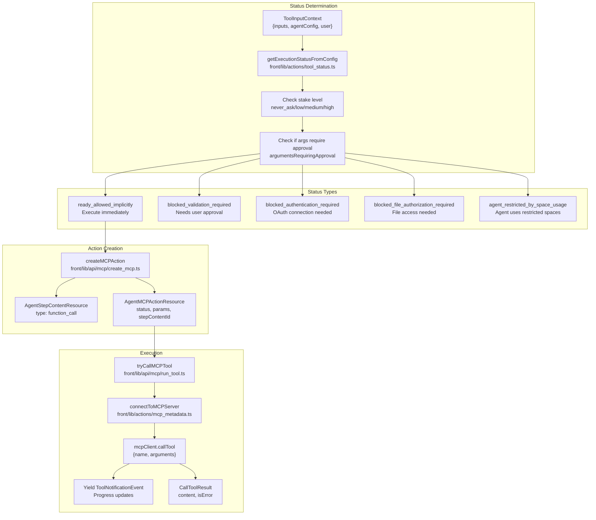

**Sources:** [front/lib/actions/tool_status.ts:100-228](), [front/lib/api/mcp/create_mcp.ts:1-58](), [front/lib/api/mcp/run_tool.ts:1-170](), [front/lib/actions/mcp_metadata.ts:56-61]()

### Action Status Lifecycle

Action statuses transition through various states during execution.

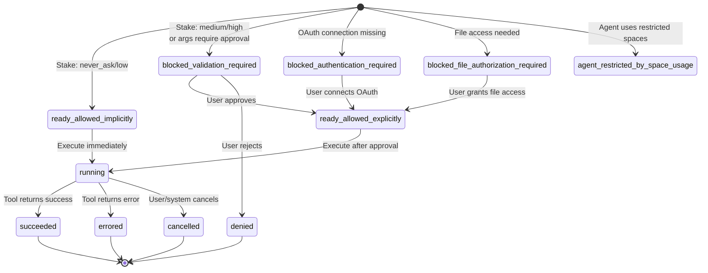

**Sources:** [front/lib/actions/statuses.ts:1-83](), [front/lib/actions/tool_status.ts:1-228](), [front/lib/resources/agent_mcp_action_resource.ts:1-700]()

## Approval and Validation System

The approval system enables user control over tool execution through a validation workflow. For detailed information, see [Tool Execution and Authentication](#4.3).

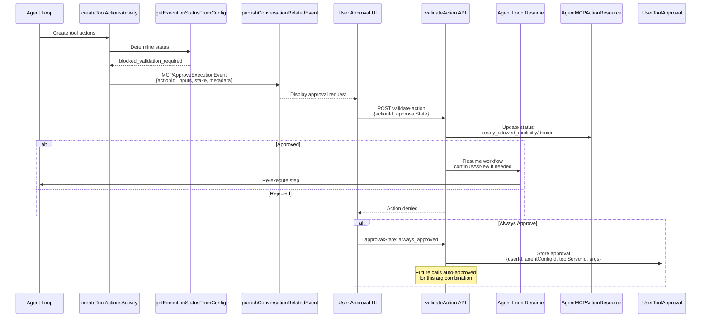

**Sources:** [front/lib/api/assistant/conversation/validate_actions.ts:1-300](), [front/temporal/agent_loop/lib/create_tool_actions.ts:1-200](), [front/pages/api/v1/w/[wId]/assistant/conversations/[cId]/messages/[mId]/validate-action.ts:1-150]()

### Argument-Level Approval

For medium-stake tools, specific arguments can require approval (e.g., email recipients).

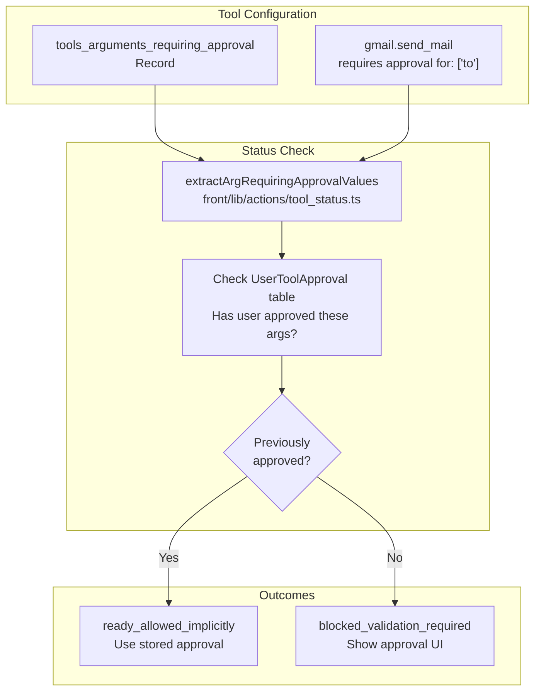

**Sources:** [front/lib/actions/tool_status.ts:228](), [front/lib/actions/mcp_internal_actions/constants.ts:350-400](), [front/lib/models/agent/actions/user_tool_approval.ts:1-100]()

## Integration with Agent Loop

The MCP Tool System integrates tightly with the agent loop workflow orchestrated by Temporal.

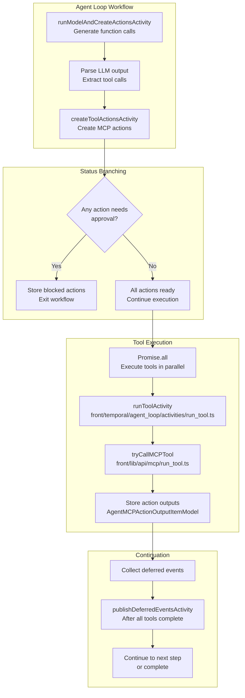

**Sources:** [front/temporal/agent_loop/workflows.ts:1-350](), [front/temporal/agent_loop/activities/run_tool.ts:1-250](), [front/temporal/agent_loop/lib/create_tool_actions.ts:1-200](), [front/lib/api/mcp/run_tool.ts:1-170]()

### Retry Policies

Tools can have different retry policies for handling interruptions.

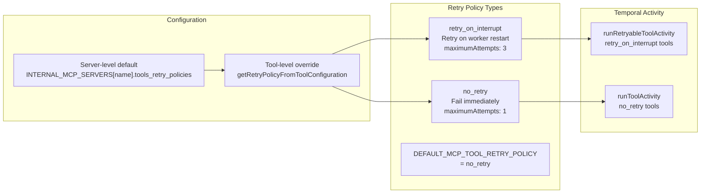

**Sources:** [front/lib/api/mcp.ts:1-100](), [front/temporal/agent_loop/workflows.ts:70-88](), [front/lib/actions/constants.ts:1-50]()

## Tool Output and Progress Streaming

Tool execution streams progress notifications and final results back to the client.

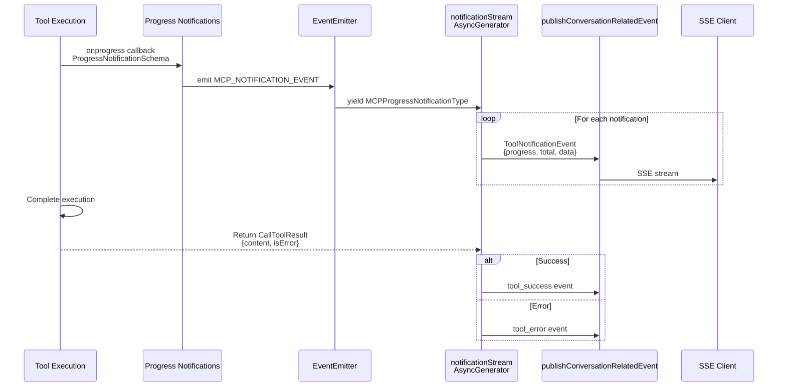

**Sources:** [front/lib/actions/mcp_actions.ts:375-500](), [front/lib/api/mcp/run_tool.ts:1-170](), [front/lib/actions/mcp_internal_actions/output_schemas.ts:1-200]()

### Output Item Storage

Tool results are stored as structured output items with content size validation. This includes handling file offloading for large outputs.

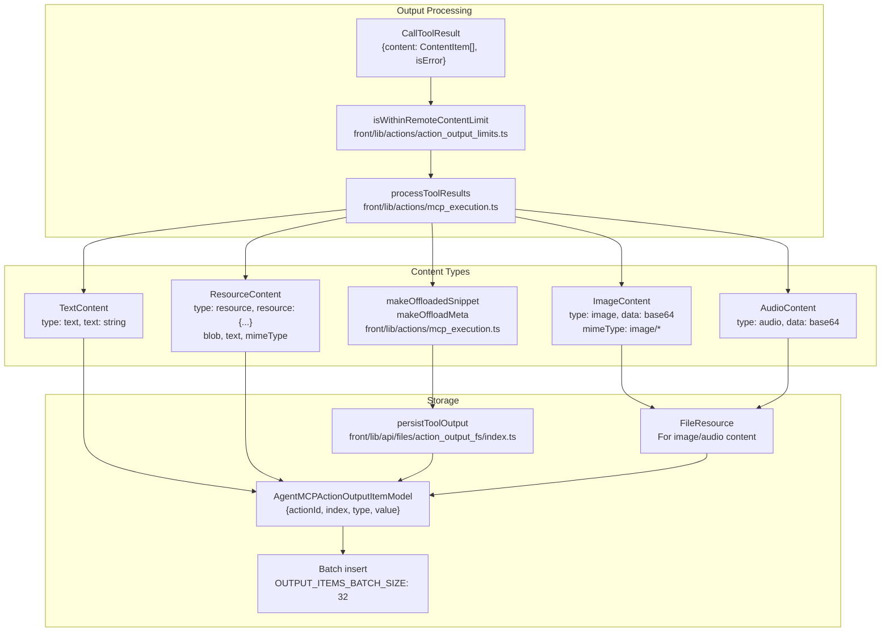

**Sources:** [front/lib/resources/agent_mcp_action_resource.ts:500-700](), [front/lib/actions/action_output_limits.ts:1-100](), [front/lib/models/agent/actions/mcp.ts:1-200](), [front/lib/actions/mcp_execution.ts:1-75](), [front/lib/api/files/action_output_fs/index.ts:1-100]()

## Key Classes and Resources

### `AgentMCPActionResource`

Primary resource for managing MCP action execution.

```typescript
// front/lib/resources/agent_mcp_action_resource.ts
class AgentMCPActionResource {
  // Core fields
  id: ModelId;
  workspaceId: string;
  toolConfiguration: LightMCPToolConfigurationType;
  functionCallName: string;
  status: ToolExecutionStatus;
  params: Record<string, unknown>;
  
  // Related resources
  stepContent: AgentStepContentResource;
  metadata: {
    internalMCPServerName: InternalMCPServerNameType | null;
    mcpServerId: string;
  };
  
  // Methods
  static makeNew(auth, blob, transaction): Promise<AgentMCPActionResource>
  static fetchByModelIdWithAuth(auth, actionId): Promise<AgentMCPActionResource>
  fetchOutputItems(): Promise<AgentMCPActionOutputItemModel[]>
  toPublicType(): AgentMCPActionWithOutputType
}
```

**Sources:** [front/lib/resources/agent_mcp_action_resource.ts:70-700]()

### `MCPServerViewResource`

Manages server configuration and access control.

```typescript
// front/lib/resources/mcp_server_view_resource.ts
class MCPServerViewResource {
  id: ModelId;
  mcpServerId: string;
  spaceId: string;
  
  static fetchByIds(auth, mcpServerViewIds): Promise<MCPServerViewResource[]>
  static listForSpace(auth, spaceId): Promise<MCPServerViewResource[]>
  isMCPServerAccessibleByUser(auth): Promise<boolean>
}
```

**Sources:** [front/lib/resources/mcp_server_view_resource.ts:1-400]()

### Tool Configuration Types

```typescript
// front/lib/actions/mcp.ts

type ServerSideMCPToolConfigurationType = {
  type: "mcp_configuration";
  name: string;
  originalName: string;
  mcpServerName: string;
  inputSchema: JSONSchema;
  permission: MCPToolStakeLevelType; // "never_ask" | "low" | "medium" | "high"
  toolServerId: string;
  retryPolicy: MCPToolRetryPolicyType; // "no_retry" | "retry_on_interrupt"
  mcpServerViewId: string;
  argumentsRequiringApproval?: string[];
  // Data source/table/agent configuration
  dataSources: DataSourceConfiguration[];
  tables: TableDataSourceConfiguration[];
  childAgentId: string | null;
};

type ClientSideMCPToolConfigurationType = {
  type: "mcp_configuration";
  name: string;
  originalName: string;
  mcpServerName: string;
  inputSchema: JSONSchema;
  permission: MCPToolStakeLevelType;
  toolServerId: string;
  clientSideMcpServerId: string;
};
```

**Sources:** [front/lib/actions/mcp.ts:59-144]()

## Error Handling and Authentication

The system handles various error conditions including authentication failures and authorization requirements. For detailed information, see [Tool Execution and Authentication](#4.3).

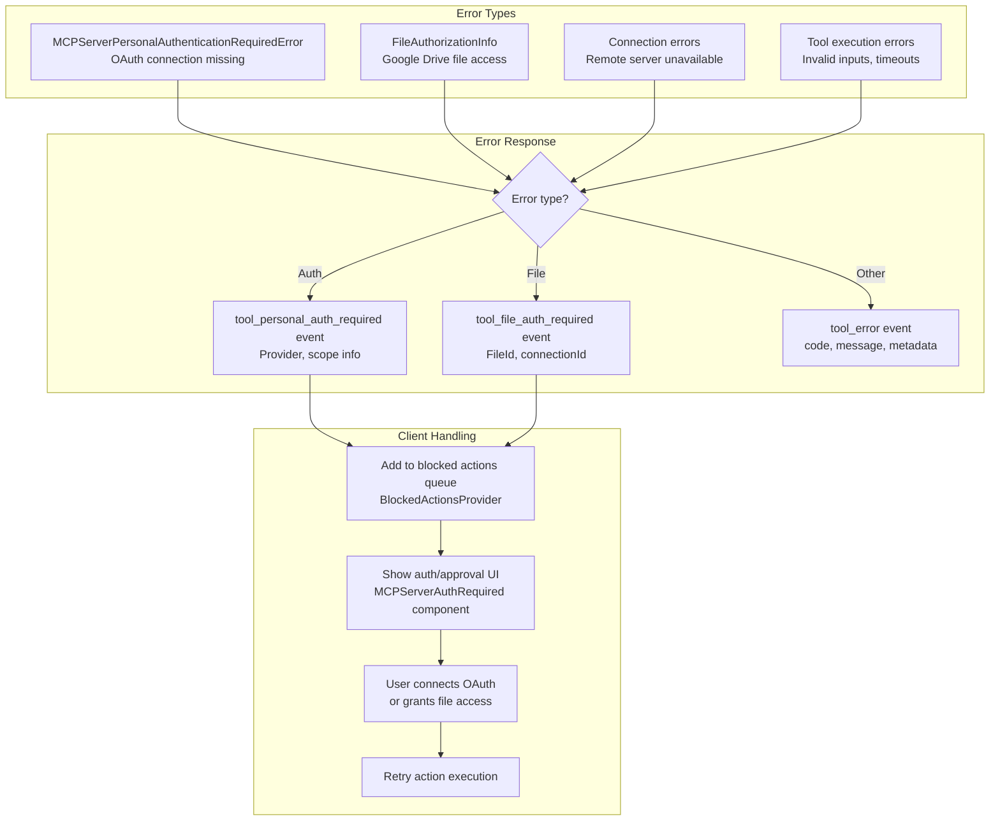

**Sources:** [front/lib/actions/mcp_authentication.ts:1-179](), [front/lib/actions/types.ts:300-400](), [front/components/assistant/conversation/MCPServerPersonalAuthenticationRequired.tsx:1-68]()

## Constants and Configuration

Key constants that control MCP behavior:

| Constant | Value | Location | Purpose |
|----------|-------|----------|---------|
| `DEFAULT_MCP_REQUEST_TIMEOUT_MS` | 180,000 (3 min) | [front/lib/actions/constants.ts:12]() | Default tool execution timeout |
| `RUN_AGENT_CALL_TOOL_TIMEOUT_MS` | 300,000 (5 min) | [front/lib/actions/constants.ts:11]() | `run_agent` tool timeout |
| `RETRY_ON_INTERRUPT_MAX_ATTEMPTS` | 3 | [front/lib/actions/constants.ts:13]() | Max retries for interrupted tools |
| `TOOL_NAME_SEPARATOR` | `"__"` | [front/lib/actions/constants.ts:16]() | Tool name prefix separator |
| `OUTPUT_ITEMS_BATCH_SIZE` | 32 | [front/lib/resources/agent_mcp_action_resource.ts:63]() | Batch size for output fetching |
| `MAX_OUTPUT_ITEMS` | 128 | [front/lib/actions/mcp_actions.ts:100]() | Maximum output items per action |
| `CLIENT_SIDE_MCP_SERVER_TTL_MS` | 1,200,000 (20 min) | [front/lib/api/actions/mcp/client_side_registry.ts:15]() | Client server registration TTL |

**Sources:** [front/lib/actions/constants.ts:1-50](), [front/lib/resources/agent_mcp_action_resource.ts:63](), [front/lib/actions/mcp_actions.ts:100](), [front/lib/api/actions/mcp/client_side_registry.ts:15]()

---

