<!-- source: DeepWiki mcp.deepwiki.com · repo dust-tt/dust · page 4.2 Tool Discovery Pipeline · fetched 2026-10-26 -->

# Tool Discovery Pipeline

<details>
<summary>Relevant source files</summary>

The following files were used as context for generating this wiki page:

- [front-api/routes/poke/workspaces/[wId]/conversations/[cId]/render.ts](front-api/routes/poke/workspaces/[wId]/conversations/[cId]/render.ts)
- [front/lib/actions/action_output_limits.ts](front/lib/actions/action_output_limits.ts)
- [front/lib/actions/constants.ts](front/lib/actions/constants.ts)
- [front/lib/actions/data_source_file_system_read_targets.ts](front/lib/actions/data_source_file_system_read_targets.ts)
- [front/lib/actions/mcp.ts](front/lib/actions/mcp.ts)
- [front/lib/actions/mcp_actions.test.ts](front/lib/actions/mcp_actions.test.ts)
- [front/lib/actions/mcp_actions.ts](front/lib/actions/mcp_actions.ts)
- [front/lib/actions/mcp_authentication.test.ts](front/lib/actions/mcp_authentication.test.ts)
- [front/lib/actions/mcp_authentication.ts](front/lib/actions/mcp_authentication.ts)
- [front/lib/actions/mcp_execution.test.ts](front/lib/actions/mcp_execution.test.ts)
- [front/lib/actions/mcp_execution.ts](front/lib/actions/mcp_execution.ts)
- [front/lib/actions/mcp_internal_actions/__snapshots__/mcp_servers_metadata.test.ts.snap](front/lib/actions/mcp_internal_actions/__snapshots__/mcp_servers_metadata.test.ts.snap)
- [front/lib/actions/mcp_internal_actions/constants.test.ts](front/lib/actions/mcp_internal_actions/constants.test.ts)
- [front/lib/actions/mcp_internal_actions/constants.ts](front/lib/actions/mcp_internal_actions/constants.ts)
- [front/lib/actions/mcp_internal_actions/exit_events.test.ts](front/lib/actions/mcp_internal_actions/exit_events.test.ts)
- [front/lib/actions/mcp_internal_actions/exit_events.ts](front/lib/actions/mcp_internal_actions/exit_events.ts)
- [front/lib/actions/mcp_internal_actions/internal_mcp_server_availability.snapshot.json](front/lib/actions/mcp_internal_actions/internal_mcp_server_availability.snapshot.json)
- [front/lib/actions/mcp_internal_actions/output_schemas.ts](front/lib/actions/mcp_internal_actions/output_schemas.ts)
- [front/lib/actions/mcp_internal_actions/servers/index.ts](front/lib/actions/mcp_internal_actions/servers/index.ts)
- [front/lib/actions/mcp_metadata.ts](front/lib/actions/mcp_metadata.ts)
- [front/lib/actions/mcp_oauth_provider.ts](front/lib/actions/mcp_oauth_provider.ts)
- [front/lib/actions/mcp_utils.ts](front/lib/actions/mcp_utils.ts)
- [front/lib/actions/tool_display_labels.test.ts](front/lib/actions/tool_display_labels.test.ts)
- [front/lib/actions/tool_display_labels.ts](front/lib/actions/tool_display_labels.ts)
- [front/lib/actions/types/index.ts](front/lib/actions/types/index.ts)
- [front/lib/api/actions/servers/bm25_tool_search.test.ts](front/lib/api/actions/servers/bm25_tool_search.test.ts)
- [front/lib/api/actions/servers/bm25_tool_search_utils.test.ts](front/lib/api/actions/servers/bm25_tool_search_utils.test.ts)
- [front/lib/api/actions/servers/interactive_content/template_utils.ts](front/lib/api/actions/servers/interactive_content/template_utils.ts)
- [front/lib/api/actions/servers/shopify/client.test.ts](front/lib/api/actions/servers/shopify/client.test.ts)
- [front/lib/api/actions/servers/shopify/client.ts](front/lib/api/actions/servers/shopify/client.ts)
- [front/lib/api/actions/servers/shopify/helpers.ts](front/lib/api/actions/servers/shopify/helpers.ts)
- [front/lib/api/actions/servers/shopify/metadata.test.ts](front/lib/api/actions/servers/shopify/metadata.test.ts)
- [front/lib/api/actions/servers/shopify/metadata.ts](front/lib/api/actions/servers/shopify/metadata.ts)
- [front/lib/api/actions/servers/shopify/rendering.ts](front/lib/api/actions/servers/shopify/rendering.ts)
- [front/lib/api/actions/servers/shopify/tools/index.ts](front/lib/api/actions/servers/shopify/tools/index.ts)
- [front/lib/api/actions/servers/shopify/types.ts](front/lib/api/actions/servers/shopify/types.ts)
- [front/lib/api/assistant/jit/common_utilities.ts](front/lib/api/assistant/jit/common_utilities.ts)
- [front/lib/api/assistant/jit/conversation.ts](front/lib/api/assistant/jit/conversation.ts)
- [front/lib/api/assistant/jit/folder.ts](front/lib/api/assistant/jit/folder.ts)
- [front/lib/api/assistant/jit/query_tables_v2.ts](front/lib/api/assistant/jit/query_tables_v2.ts)
- [front/lib/api/assistant/jit/skills.ts](front/lib/api/assistant/jit/skills.ts)
- [front/lib/api/assistant/jit_actions.test.ts](front/lib/api/assistant/jit_actions.test.ts)
- [front/lib/api/assistant/jit_actions.ts](front/lib/api/assistant/jit_actions.ts)
- [front/lib/api/assistant/skill_actions.test.ts](front/lib/api/assistant/skill_actions.test.ts)
- [front/lib/api/assistant/skill_actions.ts](front/lib/api/assistant/skill_actions.ts)
- [front/lib/api/file_system/index.ts](front/lib/api/file_system/index.ts)
- [front/lib/api/files/action_output_fs/index.ts](front/lib/api/files/action_output_fs/index.ts)
- [front/lib/api/files/action_output_fs/naming.ts](front/lib/api/files/action_output_fs/naming.ts)
- [front/lib/api/files/action_output_fs/registry.ts](front/lib/api/files/action_output_fs/registry.ts)
- [front/lib/api/llm/batch_llm.ts](front/lib/api/llm/batch_llm.ts)
- [front/lib/api/llm/cache_diagnostics.ts](front/lib/api/llm/cache_diagnostics.ts)
- [front/lib/api/llm/types/options.ts](front/lib/api/llm/types/options.ts)
- [front/lib/api/marketing/integrations.ts](front/lib/api/marketing/integrations.ts)
- [front/lib/api/mcp/error.ts](front/lib/api/mcp/error.ts)
- [front/lib/api/mcp/run_tool.ts](front/lib/api/mcp/run_tool.ts)
- [front/lib/resources/skill/code_defined/shared.ts](front/lib/resources/skill/code_defined/shared.ts)
- [front/lib/resources/skill/code_defined/system_registry.ts](front/lib/resources/skill/code_defined/system_registry.ts)
- [front/scripts/investigate_render_conversation.ts](front/scripts/investigate_render_conversation.ts)
- [front/temporal/agent_loop/activities/run_tool.ts](front/temporal/agent_loop/activities/run_tool.ts)
- [front/temporal/agent_loop/lib/get_output_from_llm.ts](front/temporal/agent_loop/lib/get_output_from_llm.ts)
- [front/temporal/agent_loop/lib/prompt_commands.ts](front/temporal/agent_loop/lib/prompt_commands.ts)
- [front/temporal/agent_loop/lib/run_model.test.ts](front/temporal/agent_loop/lib/run_model.test.ts)
- [front/temporal/agent_loop/lib/run_model.ts](front/temporal/agent_loop/lib/run_model.ts)
- [front/temporal/agent_loop/lib/types.ts](front/temporal/agent_loop/lib/types.ts)
- [front/types/assistant/agent.ts](front/types/assistant/agent.ts)
- [front/types/assistant/agent_run.ts](front/types/assistant/agent_run.ts)
- [front/types/shared/feature_flags.ts](front/types/shared/feature_flags.ts)
- [sdks/js/src/types.ts](sdks/js/src/types.ts)

</details>


## Purpose and Scope

The Tool Discovery Pipeline is responsible for aggregating, validating, and preparing MCP (Model Context Protocol) tools for use by AI agents. It collects tools from multiple sources (agent-configured servers, skill servers, JIT servers, client-side servers), resolves naming conflicts, validates schemas, and enhances tool descriptions before presenting them to the agent loop.

For information about the different types of MCP servers and their configuration, see [MCP Server Architecture](#4.1). For details on how discovered tools are executed, see [Tool Execution and Authentication](#4.3).

---

## Discovery Flow Overview

The tool discovery pipeline executes during agent loop initialization, before the model generates its first response. The pipeline aggregates tools from all available sources, applies transformations to ensure uniqueness and validity, then returns a list of tool configurations ready for LLM consumption.

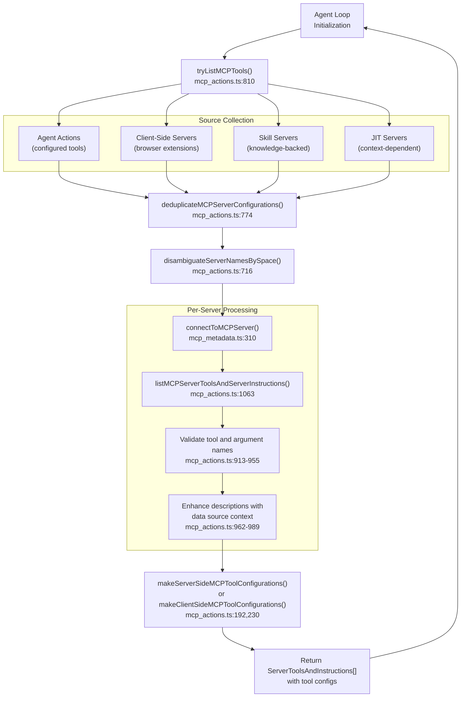

**Sources:**
- [front/lib/actions/mcp_actions.ts:810-1030]()
- [front/temporal/agent_loop/lib/run_model.ts]()

---

## Source Aggregation and Deduplication

### Input Sources

The pipeline accepts tools from four distinct sources, each with different priorities and characteristics:

| Source | Priority | Characteristics | Code Location |
|--------|----------|-----------------|---------------|
| **Agent Actions** | 1 (Highest) | Explicitly configured by agent builder | `agentConfiguration.actions` |
| **Client-Side Servers** | 2 | Running in user's browser via Redis transport | `clientSideActionConfigurations` |
| **Skill Servers** | 3 | Pre-configured servers from skills | `skillServers` parameter |
| **JIT Servers** | 4 (Lowest) | Dynamically created based on context | `jitServers` parameter |

### Deduplication Logic

The `deduplicateMCPServerConfigurations` function ensures each unique (viewId, serverName) pair appears only once, with priority-based conflict resolution:

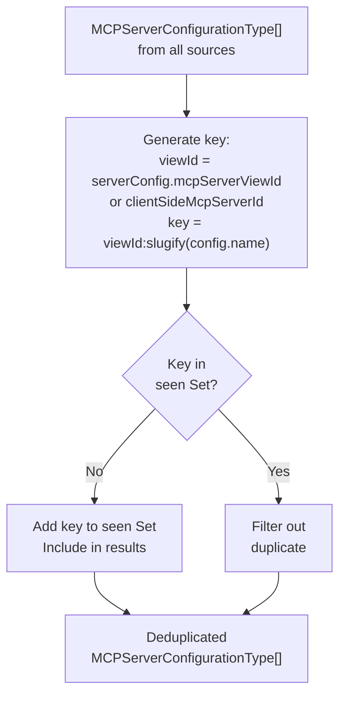

**Sources:**
- [front/lib/actions/mcp_actions.ts:774-804]()

---

## Name Disambiguation

When multiple server configurations share the same server name but have different `mcpServerViewId` values (indicating the same server configured in different spaces), the pipeline prepends the space name to avoid collisions.

### Disambiguation Algorithm

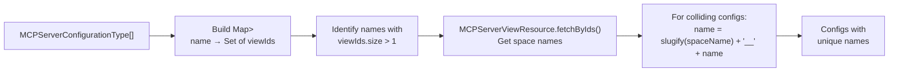

The `TOOL_NAME_SEPARATOR` constant (`"__"`) is used to join the space name and server name.

**Example:**
- Original: `google_sheets` (in "Marketing" space) and `google_sheets` (in "Engineering" space)
- After disambiguation: `marketing__google_sheets` and `engineering__google_sheets`

**Sources:**
- [front/lib/actions/mcp_actions.ts:716-768]()
- [front/lib/actions/constants.ts:18]() (TOOL_NAME_SEPARATOR)

---

## Tool Listing from Servers

For each deduplicated and disambiguated server configuration, the pipeline establishes a connection and retrieves the available tools.

### Server-Side Tool Listing

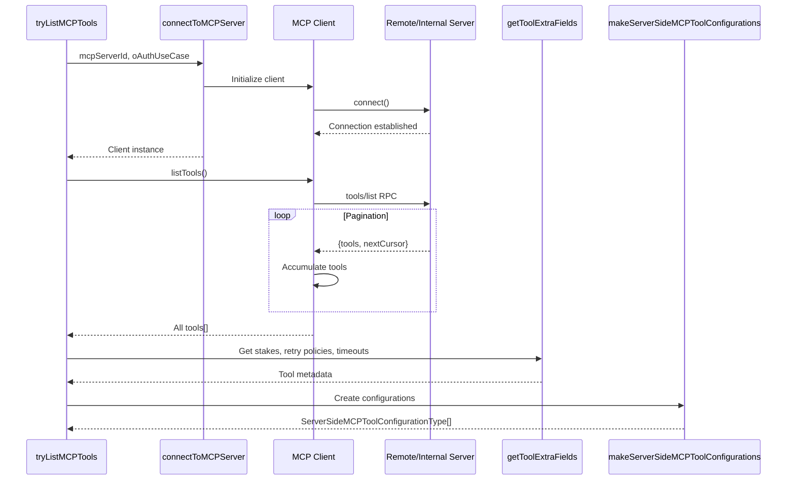

The `listToolsForServerSideMCPServer` function at [front/lib/actions/mcp_actions.ts:1063-1138]() handles:
1. Fetching cached tool metadata from `RemoteMCPServerToolMetadataResource`
2. Connecting to the server with appropriate authentication
3. Paginating through all available tools
4. Extracting tool stakes (permissions) from metadata or internal server definitions using `getToolExtraFields` [front/lib/actions/mcp_actions.ts:167-180]()
5. Attaching retry policies and timeouts

### Client-Side Tool Listing

Client-side servers use Redis transport and follow a simpler flow without metadata persistence:

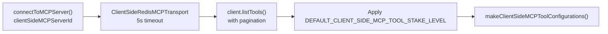

**Sources:**
- [front/lib/actions/mcp_actions.ts:1032-1061]() (client-side)
- [front/lib/actions/mcp_actions.ts:1063-1206]() (server-side)
- [front/lib/actions/mcp_metadata.ts:310-676]()
- [front/lib/actions/mcp_actions.ts:167-180]()

---

## Tool Validation

### Name Validation

All tool names and argument names must conform to model-compatible patterns. The validation occurs at [front/lib/actions/mcp_actions.ts:913-955]().

**Tool Name Requirements:**
- Fixed by `getPrefixedToolName()` to include server prefix
- Format: `serverName__toolName` (using `TOOL_NAME_SEPARATOR`)

**Argument Name Requirements:**
- Pattern: `/^[a-zA-Z0-9_.-]+$/`
- Invalid characters cause the tool to be skipped with a warning log

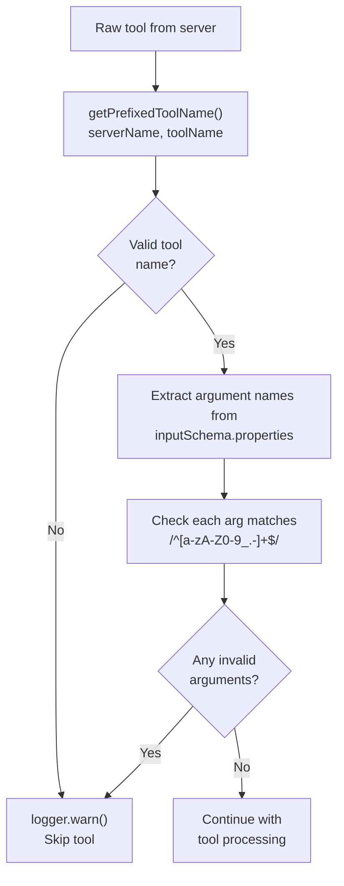

### Schema Validation

Input schemas are also validated:
- Empty schemas are normalized to `{properties: {}, required: [], type: "object"}` at [front/lib/actions/mcp_actions.ts:204-205]()
- The `hideInternalConfiguration()` function removes properties with internal MIME types before exposing to models

**Sources:**
- [front/lib/actions/mcp_actions.ts:913-956]()
- [front/lib/actions/tool_name_utils.ts]()
- [front/lib/actions/mcp_actions.ts:204-205]()

---

## Description Enhancement

For tools that reference pre-configured data sources or tables, the pipeline enriches the tool description with contextual information to help the model make better decisions.

### Enhancement Logic

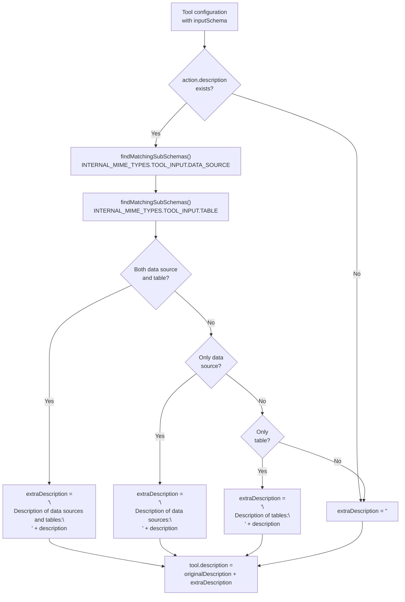

This replicates the behavior of the Retrieval action, providing context about which data sources the tool will search. The enhanced description helps the model understand tool capabilities without requiring the model to parse the entire input schema.

**Sources:**
- [front/lib/actions/mcp_actions.ts:962-997]()
- [front/lib/actions/mcp_internal_actions/input_configuration.ts]() (findMatchingSubSchemas)

---

## Configuration Assembly

The final step creates typed tool configurations with all metadata attached.

### Server-Side Configuration Assembly

The `makeServerSideMCPToolConfigurations` function at [front/lib/actions/mcp_actions.ts:192-228]() creates configurations with:

| Field | Source | Description |
|-------|--------|-------------|
| `sId` | `generateRandomModelSId()` | Unique identifier |
| `type` | `"mcp_configuration"` | Discriminator |
| `name` | `tool.name` | Prefixed tool name |
| `description` | `tool.description` + extra | Enhanced description |
| `inputSchema` | `tool.inputSchema` | Normalized schema |
| `icon` | `config.icon` | Server icon |
| `mcpServerViewId` | `config.mcpServerViewId` | View reference |
| `internalMCPServerId` | `config.internalMCPServerId` | Internal server ID (if applicable) |
| `dataSources` | `config.dataSources` | Pre-configured data sources |
| `tables` | `config.tables` | Pre-configured tables |
| `availability` | `tool.availability` | `"auto"` or `"manual"` |
| `permission` | `tool.stakeLevel` | `"low"`, `"medium"`, or `"high"` |
| `toolServerId` | `tool.toolServerId` | Server identifier for tool grouping |
| `retryPolicy` | `tool.retryPolicy` | `"retry_on_interrupt"` or `"no_retry"` |
| `timeoutMs` | `tool.timeoutMs` | Optional timeout override |
| `argumentsRequiringApproval` | `toolsArgumentsRequiringApproval[tool.name]` | Medium-stake approval fields |
| `originalName` | `tool.name` | Unprefixed tool name |
| `mcpServerName` | `config.name` | Display name |

### Client-Side Configuration Assembly

The `makeClientSideMCPToolConfigurations` function at [front/lib/actions/mcp_actions.ts:230-254]() creates simpler configurations:

- Uses `getBaseServerId()` to normalize the `toolServerId` across instances
- Always sets `availability` to `"manual"` (cannot be auto-invoked)
- Uses `DEFAULT_CLIENT_SIDE_MCP_TOOL_STAKE_LEVEL` for permissions
- Omits retry policies (not supported for client-side tools)

### Configuration Flow Diagram

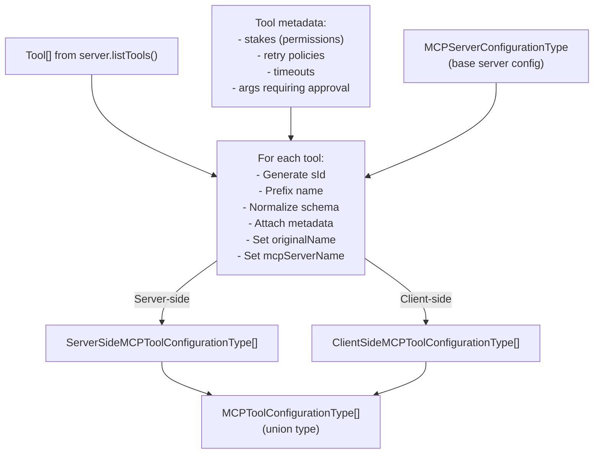

**Sources:**
- [front/lib/actions/mcp_actions.ts:192-254]()
- [front/lib/actions/mcp.ts]() (type definitions)

---

## Result Format

The `tryListMCPTools` function returns a `ServerToolsAndInstructions[]` structure defined at [front/lib/actions/mcp_actions.ts:132-136]():

```typescript
export interface ServerToolsAndInstructions {
  serverName: string;              // Display name of the server
  instructions?: string;           // Optional server-level instructions
  tools: MCPToolConfigurationType[]; // Fully configured tools
}
```

### Aggregate Structure

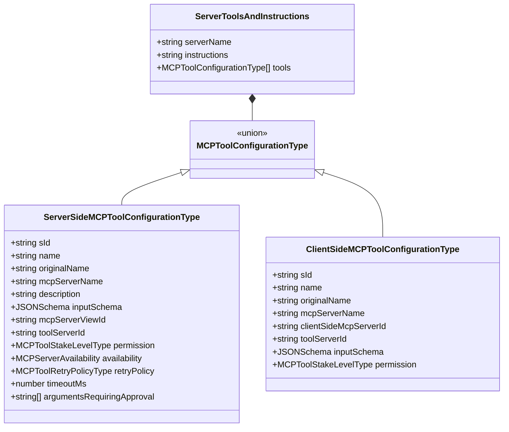

This structure groups tools by their source server, preserving server-level context (like instructions) while providing per-tool configuration. The agent loop uses this to construct prompts with appropriate tool descriptions.

**Sources:**
- [front/lib/actions/mcp_actions.ts:132-136]()
- [front/lib/actions/mcp.ts:80-145]()

---

## Error Handling

The pipeline implements graceful degradation when individual servers fail:

### Per-Server Error Collection

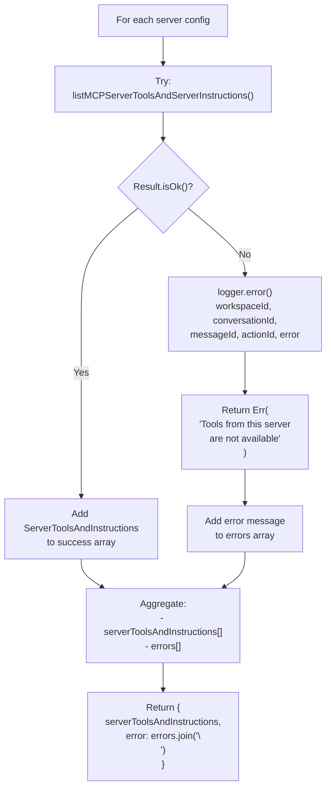

Errors are logged with full context but do not abort the entire discovery process. The agent receives tools from successful servers and an aggregated error message for diagnostics.

**Sources:**
- [front/lib/actions/mcp_actions.ts:884-906]()
- [front/lib/actions/mcp_actions.ts:1010-1029]()

---

## Integration with Agent Loop

The tool discovery pipeline is invoked by the agent loop before each model generation step:

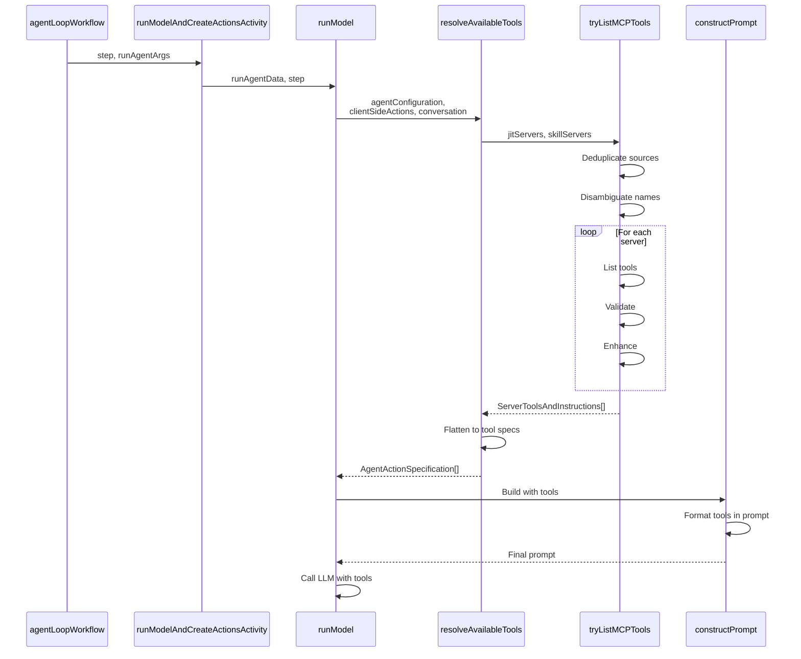

The discovered tools are converted to `AgentActionSpecification` format (containing only `name`, `description`, and `inputSchema`) before being included in the model prompt.

**Sources:**
- [front/temporal/agent_loop/lib/run_model.ts]()
- [front/temporal/agent_loop/activities/run_model_and_create_actions_wrapper.ts:50-276]()

---

