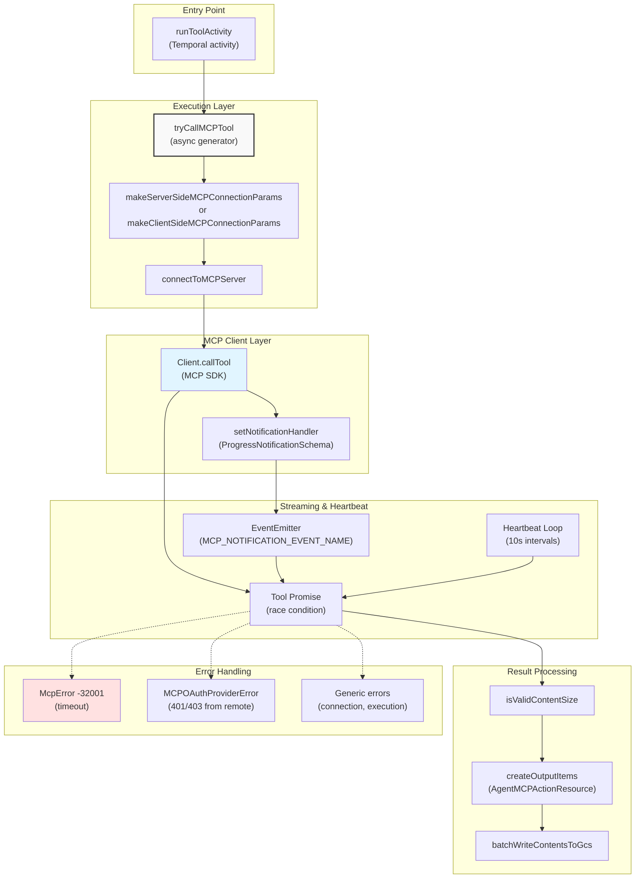
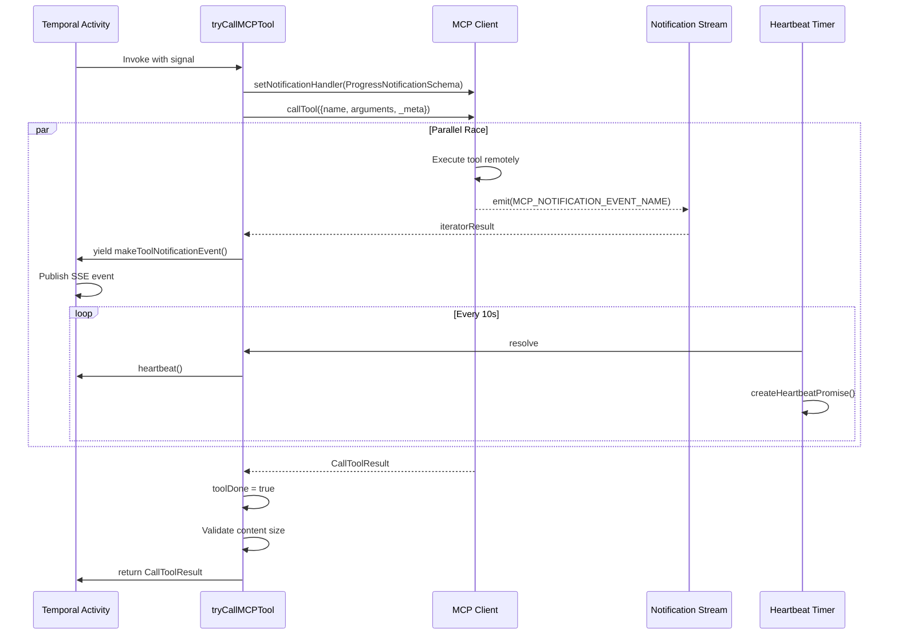
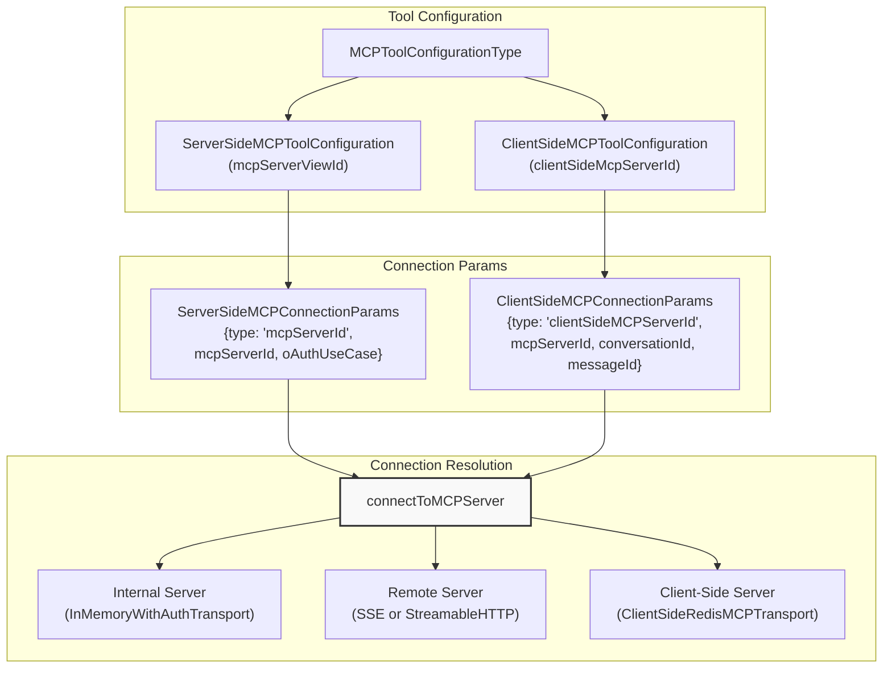
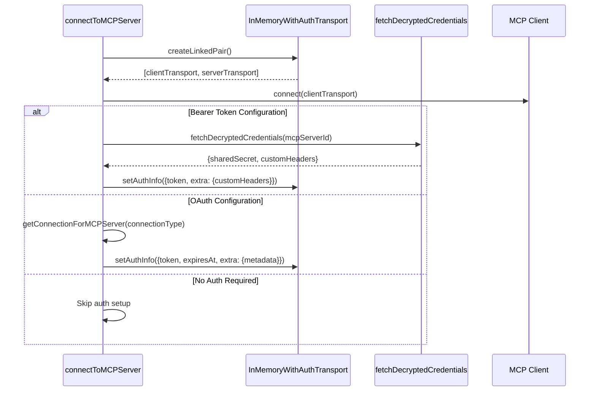
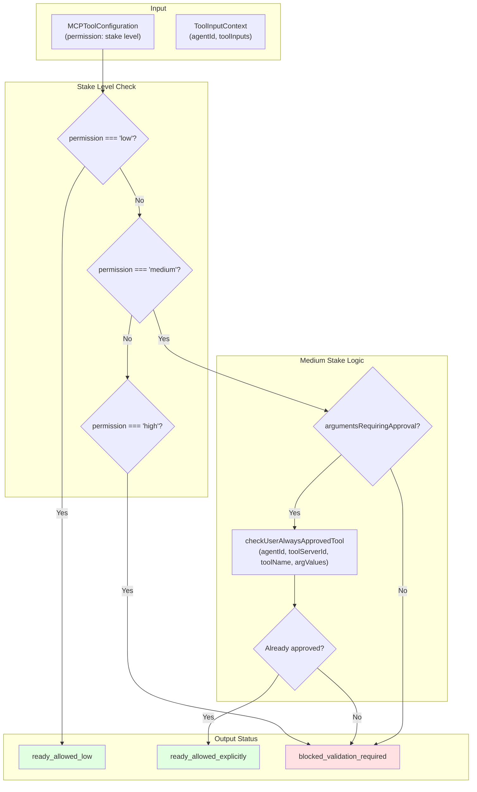
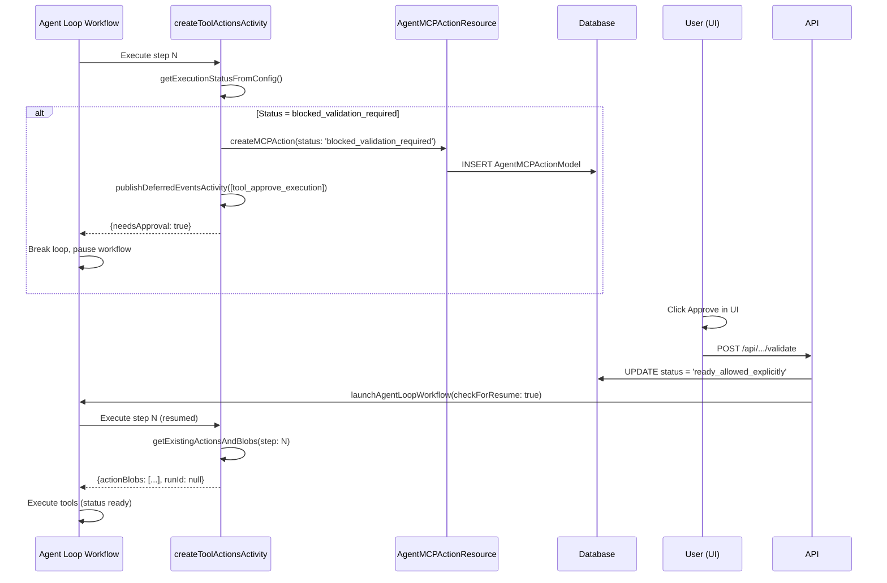
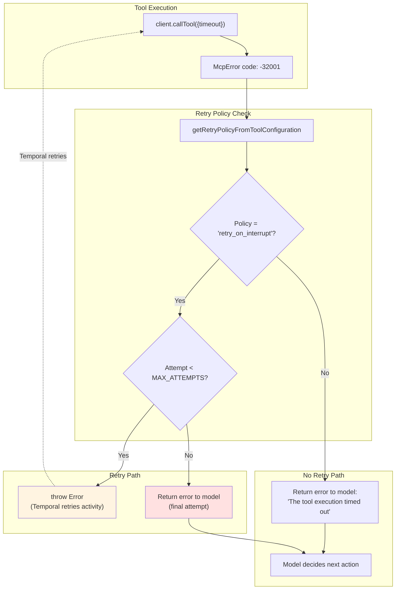
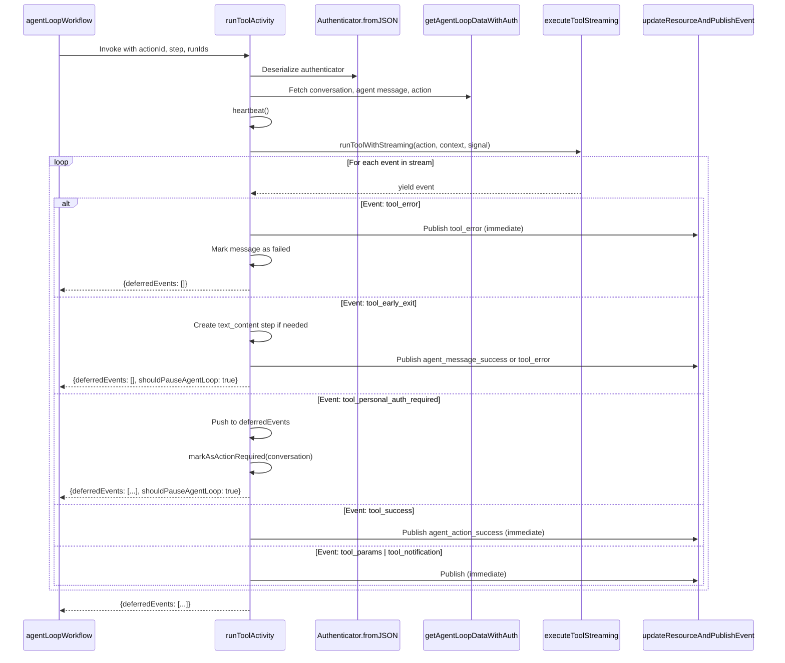
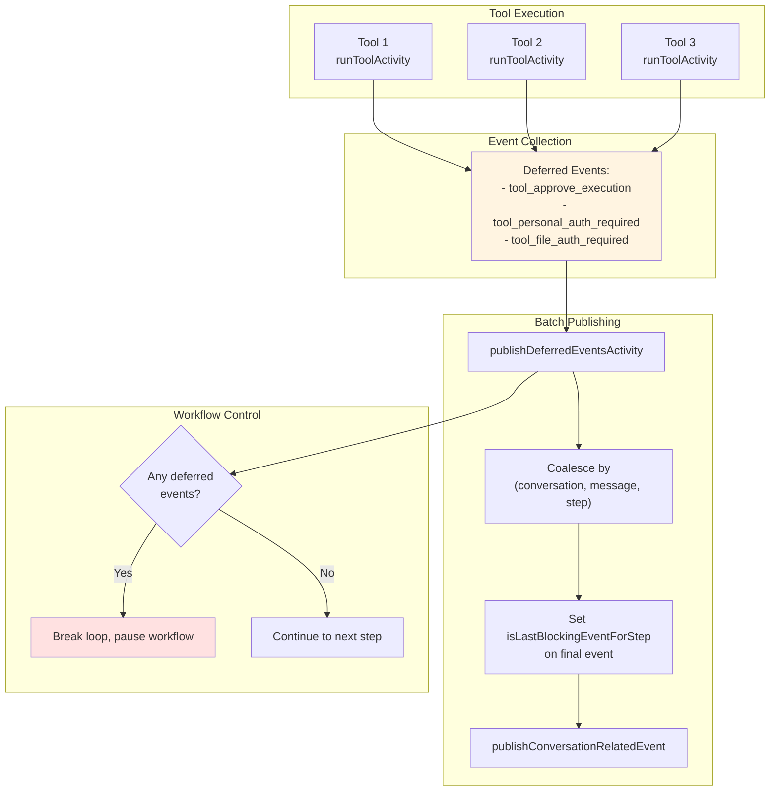
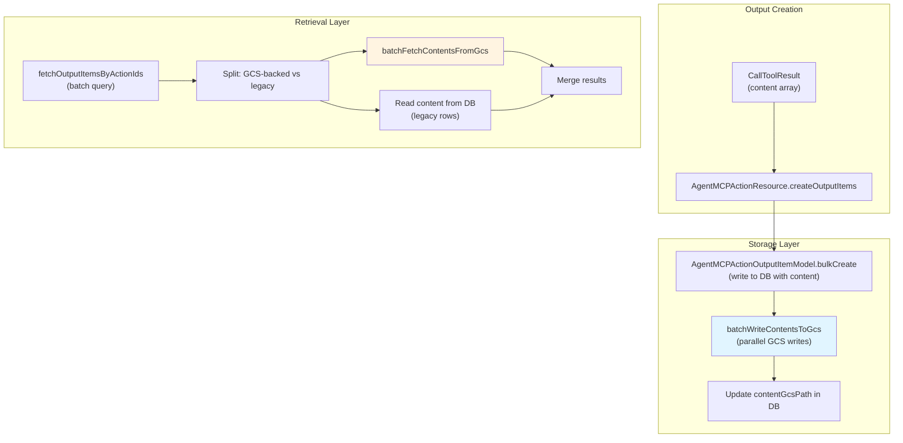

<!-- source: DeepWiki mcp.deepwiki.com · repo dust-tt/dust · page 4.3 Tool Execution and Authentication · fetched 2026-10-26 -->

# Tool Execution and Authentication

<details>
<summary>Relevant source files</summary>

The following files were used as context for generating this wiki page:

- [front/components/actions/ActionDetailsWrapper.tsx](front/components/actions/ActionDetailsWrapper.tsx)
- [front/components/actions/blocked/PersonalAuthenticationCard.tsx](front/components/actions/blocked/PersonalAuthenticationCard.tsx)
- [front/components/actions/blocked/SandboxFunctionPersonalAuthCard.test.tsx](front/components/actions/blocked/SandboxFunctionPersonalAuthCard.test.tsx)
- [front/components/actions/blocked/SandboxFunctionPersonalAuthCard.tsx](front/components/actions/blocked/SandboxFunctionPersonalAuthCard.tsx)
- [front/components/actions/blocked/SandboxFunctionToolApprovalCard.tsx](front/components/actions/blocked/SandboxFunctionToolApprovalCard.tsx)
- [front/components/actions/blocked/ToolValidationCard.tsx](front/components/actions/blocked/ToolValidationCard.tsx)
- [front/components/actions/blocked/toolValidationLabels.ts](front/components/actions/blocked/toolValidationLabels.ts)
- [front/components/actions/mcp/details/MCPActionDetails.tsx](front/components/actions/mcp/details/MCPActionDetails.tsx)
- [front/components/actions/mcp/details/MCPExtractActionDetails.tsx](front/components/actions/mcp/details/MCPExtractActionDetails.tsx)
- [front/components/actions/mcp/details/MCPSandboxActionDetails.tsx](front/components/actions/mcp/details/MCPSandboxActionDetails.tsx)
- [front/components/actions/mcp/details/MCPSkillEnableActionDetails.tsx](front/components/actions/mcp/details/MCPSkillEnableActionDetails.tsx)
- [front/components/actions/mcp/details/MCPToolOutputDetails.tsx](front/components/actions/mcp/details/MCPToolOutputDetails.tsx)
- [front/components/actions/mcp/details/types.ts](front/components/actions/mcp/details/types.ts)
- [front/components/assistant/conversation/ContextUsageWarningBanner.tsx](front/components/assistant/conversation/ContextUsageWarningBanner.tsx)
- [front/components/assistant/conversation/GoogleDriveFileAuthorizationRequired.tsx](front/components/assistant/conversation/GoogleDriveFileAuthorizationRequired.tsx)
- [front/components/assistant/conversation/MCPServerPersonalAuthenticationRequired.test.tsx](front/components/assistant/conversation/MCPServerPersonalAuthenticationRequired.test.tsx)
- [front/components/assistant/conversation/MCPServerPersonalAuthenticationRequired.tsx](front/components/assistant/conversation/MCPServerPersonalAuthenticationRequired.tsx)
- [front/components/assistant/conversation/MCPToolValidationRequired.tsx](front/components/assistant/conversation/MCPToolValidationRequired.tsx)
- [front/components/assistant/conversation/ToolValidationDetails.tsx](front/components/assistant/conversation/ToolValidationDetails.tsx)
- [front/components/assistant/conversation/attachment/AttachmentCitation.tsx](front/components/assistant/conversation/attachment/AttachmentCitation.tsx)
- [front/components/assistant/conversation/attachment/types.ts](front/components/assistant/conversation/attachment/types.ts)
- [front/components/assistant/conversation/attachment/utils.tsx](front/components/assistant/conversation/attachment/utils.tsx)
- [front/components/assistant/conversation/editable_tool_validation/EditableToolValidation.tsx](front/components/assistant/conversation/editable_tool_validation/EditableToolValidation.tsx)
- [front/components/assistant/conversation/editable_tool_validation/gmail/GmailEditableToolValidation.tsx](front/components/assistant/conversation/editable_tool_validation/gmail/GmailEditableToolValidation.tsx)
- [front/components/assistant/conversation/editable_tool_validation/gmail/tools/GmailSendMailValidation.tsx](front/components/assistant/conversation/editable_tool_validation/gmail/tools/GmailSendMailValidation.tsx)
- [front/components/assistant/conversation/editable_tool_validation/types.ts](front/components/assistant/conversation/editable_tool_validation/types.ts)
- [front/components/assistant/conversation/input_bar/ContextUsageIndicator.tsx](front/components/assistant/conversation/input_bar/ContextUsageIndicator.tsx)
- [front/components/assistant/conversation/input_bar/InputBarAttachments.tsx](front/components/assistant/conversation/input_bar/InputBarAttachments.tsx)
- [front/components/assistant/conversation/tool_validation/SandboxFunctionPublishValidationDetails.tsx](front/components/assistant/conversation/tool_validation/SandboxFunctionPublishValidationDetails.tsx)
- [front/components/assistant/conversation/tool_validation/SandboxFunctionUnpublishValidationDetails.tsx](front/components/assistant/conversation/tool_validation/SandboxFunctionUnpublishValidationDetails.tsx)
- [front/components/markdown/MCPReferenceCitation.tsx](front/components/markdown/MCPReferenceCitation.tsx)
- [front/components/misc/DropzoneContainer.tsx](front/components/misc/DropzoneContainer.tsx)
- [front/hooks/conversations/useConversationContextUsage.ts](front/hooks/conversations/useConversationContextUsage.ts)
- [front/hooks/useDocumentScrollMode.ts](front/hooks/useDocumentScrollMode.ts)
- [front/hooks/useEditAndValidateAction.ts](front/hooks/useEditAndValidateAction.ts)
- [front/hooks/useGooglePicker.ts](front/hooks/useGooglePicker.ts)
- [front/hooks/useLockDocumentScroll.ts](front/hooks/useLockDocumentScroll.ts)
- [front/lib/actions/action_output_limits.ts](front/lib/actions/action_output_limits.ts)
- [front/lib/actions/mcp.ts](front/lib/actions/mcp.ts)
- [front/lib/actions/mcp_actions.test.ts](front/lib/actions/mcp_actions.test.ts)
- [front/lib/actions/mcp_actions.ts](front/lib/actions/mcp_actions.ts)
- [front/lib/actions/mcp_authentication.test.ts](front/lib/actions/mcp_authentication.test.ts)
- [front/lib/actions/mcp_authentication.ts](front/lib/actions/mcp_authentication.ts)
- [front/lib/actions/mcp_execution.test.ts](front/lib/actions/mcp_execution.test.ts)
- [front/lib/actions/mcp_execution.ts](front/lib/actions/mcp_execution.ts)
- [front/lib/actions/mcp_internal_actions/exit_events.test.ts](front/lib/actions/mcp_internal_actions/exit_events.test.ts)
- [front/lib/actions/mcp_internal_actions/exit_events.ts](front/lib/actions/mcp_internal_actions/exit_events.ts)
- [front/lib/actions/mcp_internal_actions/output_schemas.ts](front/lib/actions/mcp_internal_actions/output_schemas.ts)
- [front/lib/actions/mcp_metadata.ts](front/lib/actions/mcp_metadata.ts)
- [front/lib/actions/mcp_oauth_provider.ts](front/lib/actions/mcp_oauth_provider.ts)
- [front/lib/actions/mcp_utils.ts](front/lib/actions/mcp_utils.ts)
- [front/lib/actions/tool_approval_events.ts](front/lib/actions/tool_approval_events.ts)
- [front/lib/actions/types/index.ts](front/lib/actions/types/index.ts)
- [front/lib/api/actions/servers/gmail/types.ts](front/lib/api/actions/servers/gmail/types.ts)
- [front/lib/api/assistant/conversation/answer_user_question.ts](front/lib/api/assistant/conversation/answer_user_question.ts)
- [front/lib/api/assistant/conversation/resolve_authentication.ts](front/lib/api/assistant/conversation/resolve_authentication.ts)
- [front/lib/api/assistant/conversation/retry_blocked_actions.ts](front/lib/api/assistant/conversation/retry_blocked_actions.ts)
- [front/lib/api/assistant/conversation/validate_actions.test.ts](front/lib/api/assistant/conversation/validate_actions.test.ts)
- [front/lib/api/assistant/conversation/validate_actions.ts](front/lib/api/assistant/conversation/validate_actions.ts)
- [front/lib/api/assistant/email/validate_tool_from_email.test.ts](front/lib/api/assistant/email/validate_tool_from_email.test.ts)
- [front/lib/api/assistant/email/validate_tool_from_email.ts](front/lib/api/assistant/email/validate_tool_from_email.ts)
- [front/lib/api/assistant/messages.ts](front/lib/api/assistant/messages.ts)
- [front/lib/api/files/action_output_fs/index.ts](front/lib/api/files/action_output_fs/index.ts)
- [front/lib/api/files/action_output_fs/naming.ts](front/lib/api/files/action_output_fs/naming.ts)
- [front/lib/api/files/action_output_fs/registry.ts](front/lib/api/files/action_output_fs/registry.ts)
- [front/lib/api/mcp/create_mcp.ts](front/lib/api/mcp/create_mcp.ts)
- [front/lib/api/mcp/error.ts](front/lib/api/mcp/error.ts)
- [front/lib/api/mcp/run_tool.ts](front/lib/api/mcp/run_tool.ts)
- [front/lib/documentScrollLayoutClasses.ts](front/lib/documentScrollLayoutClasses.ts)
- [front/lib/models/agent/actions/mcp.ts](front/lib/models/agent/actions/mcp.ts)
- [front/lib/notifications/events.ts](front/lib/notifications/events.ts)
- [front/lib/reinforcement/tool_execution.ts](front/lib/reinforcement/tool_execution.ts)
- [front/lib/resources/agent_mcp_action/output_storage.ts](front/lib/resources/agent_mcp_action/output_storage.ts)
- [front/lib/resources/agent_mcp_action_resource.test.ts](front/lib/resources/agent_mcp_action_resource.test.ts)
- [front/lib/resources/agent_mcp_action_resource.ts](front/lib/resources/agent_mcp_action_resource.ts)
- [front/lib/swr/tool_actions.ts](front/lib/swr/tool_actions.ts)
- [front/migrations/20260512_backfill_step_content_tool_execution.ts](front/migrations/20260512_backfill_step_content_tool_execution.ts)
- [front/migrations/pre-deploy/20260813145341_add_generated_files_lookup_index.sql](front/migrations/pre-deploy/20260813145341_add_generated_files_lookup_index.sql)
- [front/scripts/backfill_mcp_action_output_item_gcs_paths.ts](front/scripts/backfill_mcp_action_output_item_gcs_paths.ts)
- [front/temporal/agent_loop/activities/run_tool.ts](front/temporal/agent_loop/activities/run_tool.ts)
- [front/tests/utils/ConversationFactory.ts](front/tests/utils/ConversationFactory.ts)
- [front/types/assistant/agent.ts](front/types/assistant/agent.ts)
- [front/types/assistant/agent_run.ts](front/types/assistant/agent_run.ts)
- [sparkle/src/components/Separator.tsx](sparkle/src/components/Separator.tsx)
- [sparkle/src/components/Tooltip.tsx](sparkle/src/components/Tooltip.tsx)
- [sparkle/src/components/VoicePicker.tsx](sparkle/src/components/VoicePicker.tsx)
- [sparkle/src/hooks/index.ts](sparkle/src/hooks/index.ts)
- [sparkle/src/hooks/useTranscribingProgress.ts](sparkle/src/hooks/useTranscribingProgress.ts)

</details>


## Purpose and Scope

This page documents the execution layer of the MCP tool system, detailing how tools are invoked, how authentication credentials are resolved, and how execution flows through the Temporal activity framework. It covers the runtime mechanics of tool calls including connection establishment, progress streaming, approval workflows, retry policies, and error handling.

For information about how MCP servers are configured and stored, see [MCP Server Architecture](#4.1). For details on how tools are discovered and prepared for execution, see [Tool Discovery Pipeline](#4.2).

---

## Tool Execution Flow Overview

Tool execution flows through the `tryCallMCPTool` async generator which orchestrates connection establishment, tool invocation, progress streaming, and result collection. The execution model supports three key capabilities: streaming progress notifications, workflow cancellation, and transparent retry on interruption.

### Core Execution Pipeline



**Diagram: Tool Execution Pipeline from Temporal Activity to Result Storage**

Sources: [front/temporal/agent_loop/activities/run_tool.ts:30-133](), [front/lib/actions/mcp_actions.ts:281-675]()

### Tool Call Mechanics

The `tryCallMCPTool` function implements an async generator pattern that yields progress notifications and returns the final tool result:

| Phase | Function/Class | Key Responsibilities |
|-------|---------------|---------------------|
| **Connection** | `connectToMCPServer` | Establish MCP client transport (internal/remote/client-side) |
| **Notification Setup** | `mcpClient.setNotificationHandler` | Subscribe to progress notifications before tool execution |
| **Parallel Execution** | `Promise.race` | Race tool promise against notification stream and heartbeat |
| **Streaming** | `yield makeToolNotificationEvent` | Stream notifications to UI via SSE |
| **Heartbeat** | `heartbeat()` (10s interval) | Keep Temporal activity alive, detect cancellation |
| **Result Validation** | `isValidContentSize` | Enforce size limits on remote server outputs |
| **Storage** | `createOutputItems` + `batchWriteContentsToGcs` | Persist large outputs to GCS, small outputs to DB |

Sources: [front/lib/actions/mcp_actions.ts:281-675](), [front/temporal/agent_loop/activities/run_tool.ts:135-350]()

### Event Stream and Race Condition

Tool execution operates as a race between three concurrent operations:



**Diagram: Concurrent Execution Model with Notifications and Heartbeat**

The loop at [front/lib/actions/mcp_actions.ts:469-496]() uses `Promise.race` to handle whichever completes first: a notification, the tool result, or a heartbeat timeout. This enables responsive UI updates while maintaining workflow liveness.

Sources: [front/lib/actions/mcp_actions.ts:410-496]()

---

## Authentication and Connection Management

Authentication credentials are resolved based on server type (internal/remote/client-side) and OAuth use case (personal vs workspace). The system supports four authentication models: OAuth tokens, shared secrets, bearer tokens, and no authentication.

### Connection Parameter Construction



**Diagram: Connection Parameter Flow from Tool Configuration to Transport**

Sources: [front/lib/actions/mcp_actions.ts:677-705](), [front/lib/actions/mcp_metadata.ts:310-676]()

### OAuth Token Resolution for Remote Servers

Remote MCP servers requiring OAuth use a prioritized resolution strategy:

| Use Case | Execution Context | Token Priority | Fallback |
|----------|------------------|----------------|----------|
| `personal_actions` | Tool execution | **Personal token (required)** | Error → `MCPServerPersonalAuthenticationRequiredError` |
| `personal_actions` | Tool listing (user session) | Personal token | **Workspace token** |
| `personal_actions` | Tool listing (sync/no user) | **Workspace token** | Error → `MCPServerRequiresAdminAuthenticationError` |
| `platform_actions` | Any context | **Workspace token** | Error → `MCPServerRequiresAdminAuthenticationError` |

The resolution logic at [front/lib/actions/mcp_metadata.ts:174-308]() implements this strategy:

```mermaid
graph TB
    subgraph "Entry"
        Resolve["resolveRemoteServerOAuthToken"]
    end
    
    subgraph "Check Server Auth Type"
        SharedSecret{Shared Secret?}
        NoAuth{No Authorization?}
        OAuthRequired["OAuth Required"]
    end
    
    subgraph "Determine Connection Type"
        PersonalExec{personal_actions<br/>+ isToolExecution?}
        PersonalList{personal_actions<br/>+ auth.user()?}
        TryPersonal["Try Personal Connection"]
        UseWorkspace["Use Workspace Connection"]
    end
    
    subgraph "Fetch Connection"
        GetConnection["getConnectionForMCPServer<br/>(connectionType)"]
        Success["Return OAuthTokens"]
        Error["Return Error"]
    end
    
    subgraph "Error Classification"
        PersonalError["MCPServerPersonalAuthenticationRequiredError"]
        AdminError["MCPServerRequiresAdminAuthenticationError"]
        CheckAdmin{Admin connection exists?}
    end
    
    Resolve --> SharedSecret
    SharedSecret -->|Yes| Success
    SharedSecret -->|No| NoAuth
    NoAuth -->|Yes| Success
    NoAuth -->|No| OAuthRequired
    
    OAuthRequired --> PersonalExec
    PersonalExec -->|Yes| GetConnection
    PersonalExec -->|No| PersonalList
    PersonalList -->|Yes| TryPersonal
    PersonalList -->|No| UseWorkspace
    TryPersonal -->|Ok| Success
    TryPersonal -->|Err| UseWorkspace
    UseWorkspace --> GetConnection
    
    GetConnection -->|Ok| Success
    GetConnection -->|Err| CheckAdmin
    CheckAdmin -->|No| AdminError
    CheckAdmin -->|Yes| PersonalError
    
    style OAuthRequired fill:#e1f5ff
    style PersonalError fill:#ffe1e1
    style AdminError fill:#ffe1e1
```

**Diagram: OAuth Token Resolution Decision Tree**

Sources: [front/lib/actions/mcp_metadata.ts:174-308]()

### Authentication Flow for Internal Servers

Internal MCP servers use in-memory transports with authentication injected via `setAuthInfo`:



**Diagram: Internal Server Authentication Setup**

The authentication info is set on both client and server sides of the linked pair at [front/lib/actions/mcp_metadata.ts:338-495]().

Sources: [front/lib/actions/mcp_metadata.ts:330-497](), [front/lib/resources/internal_mcp_server_in_memory_resource.ts:220-264]()

### OAuth Token Refresh on 401/403

When remote servers reject OAuth tokens (401/403), the MCP SDK calls unimplemented methods on `MCPOAuthProvider` which throw `MCPOAuthProviderError`. This triggers token invalidation and re-authentication:

```typescript
// Detection in tryCallMCPTool at [front/lib/actions/mcp_actions.ts:621-661]()
if (
  error instanceof MCPOAuthProviderError &&
  isServerSideMCPToolConfiguration(toolConfiguration)
) {
  // Invalidate cached token
  invalidateOAuthConnectionAccessTokenCache(connection.value.connectionId);
  
  // Return re-auth error to pause workflow
  return {
    isError: false, // Processed as special exit condition
    content: makePersonalAuthenticationError(provider, scope).content,
  };
}
```

This error propagates through `getExitOrPauseEvents` and causes the workflow to pause until the user re-authenticates.

Sources: [front/lib/actions/mcp_actions.ts:621-661](), [front/lib/actions/mcp_metadata.ts:544-574]()

---

## Approval Workflows and Tool Stakes

Tool execution may require user approval based on the tool's **stake level** and **per-argument approval configuration**. The system enforces three stake levels with different approval requirements.

### Tool Stake Levels

| Stake Level | Approval Requirement | Example Tools |
|-------------|---------------------|---------------|
| **low** | Auto-approved, executes immediately | `read_data_sources`, `list_files` |
| **medium** | Per-agent or per-argument approval | `create_agent`, `send_email` with specific recipients |
| **high** | Always requires user approval | `execute_code`, `delete_resource` |

Stake levels are configured per-server at [front/lib/actions/mcp_internal_actions/constants.ts]() and can be overridden in `RemoteMCPServerToolMetadataModel`.

Sources: [front/lib/actions/constants.ts:6-10](), [front/lib/actions/mcp_actions.ts:138-190]()

### Approval Status Determination

The `getExecutionStatusFromConfig` function at [front/lib/actions/tool_status.ts]() determines whether a tool needs approval:



**Diagram: Tool Execution Status Determination Logic**

Sources: [front/lib/actions/tool_status.ts:68-149]()

### Validation and Resume Flow

When a tool requires approval, the workflow pauses and publishes a `tool_approve_execution` event:



**Diagram: Approval Pause and Resume Flow**

The validation API at [front/lib/api/assistant/conversation/validate_actions.ts:25-104]() updates action status and optionally records the approval in `ToolUsageValidationTable` for future auto-approval. The `MCPToolValidationRequired` component at [front/components/assistant/conversation/MCPToolValidationRequired.tsx:23-150]() renders the UI for user approval, handling both simple and editable validation.

Sources: [front/lib/api/assistant/conversation/validate_actions.ts:25-155](), [front/temporal/agent_loop/lib/create_tool_actions.ts:40-109](), [front/temporal/agent_loop/activities/run_model_and_create_actions_wrapper.ts:205-218](), [front/components/assistant/conversation/MCPToolValidationRequired.tsx:23-150]()

### Per-Argument Approval for Medium Stakes

Medium stake tools can specify `argumentsRequiringApproval` to require approval only when specific arguments match previously-approved values:

```typescript
// Configuration at [front/lib/actions/mcp_internal_actions/constants.ts]()
tools_arguments_requiring_approval: {
  "create_agent": ["name", "instructions"],
  "send_email": ["to", "subject"]
}

// Approval check at [front/lib/actions/tool_status.ts:107-138]()
const argValues = extractArgRequiringApprovalValues(
  argumentsRequiringApproval,
  toolInputs
);
const isApproved = await checkUserAlwaysApprovedTool(auth, {
  agentId,
  toolServerId,
  toolName,
  argRequiringApprovalValues: argValues,
});
```

This enables fine-grained approval: e.g., `create_agent` is auto-approved for previously-used names but requires approval for new names.

Sources: [front/lib/actions/tool_status.ts:25-149](), [front/temporal/agent_loop/lib/create_tool_actions.ts:156-167]()

---

## Retry Policies and Error Handling

Tool execution supports two retry policies that control behavior when tools timeout or encounter interruptions. Retry policies are configured per-server and per-tool.

### Retry Policy Types

| Policy | Temporal Activity Config | Timeout Behavior | Use Cases |
|--------|-------------------------|------------------|-----------|
| **no_retry** | `maximumAttempts: 1` | Return error to model | Default for all tools; model decides next action |
| **retry_on_interrupt** | `maximumAttempts: 3` | Retry activity up to 3 times | Long-running data processing tools that can recover from interruption |

Configuration:

```typescript
// Activity proxy at [front/temporal/agent_loop/workflows.ts:66-84]()
const { runToolActivity } = proxyActivities<typeof runToolActivities>({
  startToCloseTimeout: toolActivityStartToCloseTimeoutMs,
  heartbeatTimeout: TOOL_ACTIVITY_HEARTBEAT_TIMEOUT_MS,
  retry: { maximumAttempts: 1 }, // no_retry
});

const { runToolActivity: runRetryableToolActivity } = proxyActivities<typeof runToolActivities>({
  startToCloseTimeout: toolActivityStartToCloseTimeoutMs,
  heartbeatTimeout: TOOL_ACTIVITY_HEARTBEAT_TIMEOUT_MS,
  retry: { maximumAttempts: RETRY_ON_INTERRUPT_MAX_ATTEMPTS }, // retry_on_interrupt
});

// Selection at [front/temporal/agent_loop/workflows.ts:304-320]()
actionBlobs.map(({ actionId, retryPolicy }) =>
  retryPolicy === "no_retry"
    ? runToolActivity(...)
    : runRetryableToolActivity(...)
)
```

Sources: [front/temporal/agent_loop/workflows.ts:66-84](), [front/temporal/agent_loop/workflows.ts:304-320]()

### Timeout Handling

When a tool times out (MCP error code `-32001`), the behavior depends on retry policy:



**Diagram: Timeout Handling Based on Retry Policy**

Sources: [front/lib/actions/mcp_actions.ts:595-615]()

### Error Categories and Propagation

Tool execution errors are classified and propagated differently based on their type:

| Error Type | Source | Handling | Workflow Impact |
|-----------|--------|----------|----------------|
| **Size Limit** | `isValidContentSize` | Return `isError: true` | Marks message as failed |
| **Timeout** | `McpError -32001` | Depends on retry policy | Retry or surface to model |
| **OAuth Expired** | `MCPOAuthProviderError` | Return re-auth content | Pauses workflow for user action |
| **Admin Auth Required** | `MCPServerRequiresAdminAuthenticationError` | Return error to model | Surfaces to UI as tool error |
| **Connection Error** | `connectToMCPServer` failure | Return generic error | Marks message as failed |
| **Cancellation** | `abortSignal?.aborted` | Return cancellation message | Workflow cancelled |

Authentication errors are special-cased to return `isError: false` with special content that triggers workflow pause via `getExitOrPauseEvents` at [front/lib/actions/mcp_internal_actions/utils.ts]().

Sources: [front/lib/actions/mcp_actions.ts:349-394](), [front/lib/actions/mcp_actions.ts:504-512](), [front/lib/actions/mcp_actions.ts:583-671]()

---

## Activity Integration and Event Publishing

Tool execution is wrapped in a Temporal activity (`runToolActivity`) that manages lifecycle, heartbeat, cancellation, and event publishing. The activity integrates with the broader agent loop workflow and event streaming infrastructure.

### Activity Lifecycle



**Diagram: Temporal Activity Execution Flow with Event Handling**

Sources: [front/temporal/agent_loop/activities/run_tool.ts:30-350]()

### Deferred Event Publishing

Events that block workflow execution (approval, authentication) are collected and published in batch after all parallel tool executions complete:



**Diagram: Deferred Event Publishing After Parallel Tool Execution**

The `publishDeferredEventsActivity` at [front/temporal/agent_loop/activities/publish_deferred_events.ts]() marks the last event with `isLastBlockingEventForStep: true` so the UI knows when to show approval buttons.

Sources: [front/temporal/agent_loop/workflows.ts:304-344](), [front/temporal/agent_loop/activities/publish_deferred_events.ts:9-78]()

### Heartbeat and Cancellation

The activity uses Temporal heartbeat to maintain liveness and detect cancellation:

```typescript
// Heartbeat setup at [front/lib/actions/mcp_actions.ts:456-466]()
const createHeartbeatPromise = (): Promise<void> =>
  new Promise((resolve) => {
    setTimeout(() => {
      logger.info(toolLogContext, "MCP tool heartbeat");
      heartbeat();
      resolve();
    }, 10_000); // 10 second intervals
  });

// Cancellation detection at [front/lib/actions/mcp_actions.ts:504-512]()
try {
  toolCallResult = await toolPromise;
} catch (toolError) {
  if (abortSignal?.aborted) {
    return makeMCPToolExit({
      message: "The tool execution was cancelled.",
      isError: true,
    });
  }
  throw toolError;
}
```

The `abortSignal` is passed through from `Context.current().cancellationSignal` at [front/temporal/agent_loop/activities/run_tool.ts:155]() to enable immediate cancellation of HTTP requests.

Sources: [front/lib/actions/mcp_actions.ts:408-512](), [front/temporal/agent_loop/activities/run_tool.ts:155-168]()

### Event Coalescing for High Throughput

To reduce Redis stream load, events are coalesced using a global instance that batches events by conversation and step:

```typescript
// Global coalescer at [front/temporal/agent_loop/lib/event_coalescer.ts]()
export const globalCoalescer = new EventCoalescer();

// Usage at [front/temporal/agent_loop/activities/common.ts:371-382]()
const key = `${conversation.sId}-${event.messageId}-${step}`;
const flushIntervalMs = conversation.depth > 0 
  ? DEEP_CONVERSATION_FLUSH_INTERVAL_MS 
  : undefined;
await globalCoalescer.handleEvent({
  conversationId: conversation.sId,
  event,
  key,
  step,
  flushIntervalMs,
});
```

The coalescer batches events with the same key and flushes them periodically (1s for deep conversations, default for main conversations).

Sources: [front/temporal/agent_loop/activities/common.ts:342-382](), [front/temporal/agent_loop/lib/event_coalescer.ts]()

---

## Output Storage and Size Limits

Tool outputs are stored using a hybrid approach: small outputs in PostgreSQL, large outputs in Google Cloud Storage, with automatic migration to GCS during the transition period.

### Storage Strategy

| Output Size | Storage Location | Access Pattern |
|-------------|------------------|----------------|
| Small (< limit) | PostgreSQL JSONB column | Direct database read |
| Large (> limit) | GCS bucket | Fetch via `batchFetchContentsFromGcs` |
| Migration period | Both (dual write) | GCS preferred, fallback to DB |



**Diagram: Hybrid Storage Architecture for Tool Outputs**

Sources: [front/lib/resources/agent_mcp_action_resource.ts:638-689](), [front/lib/resources/agent_mcp_action_resource.ts:691-790]()

### File Offloading and Snippets

When tool output content exceeds a certain size (`FILE_OFFLOAD_TEXT_SIZE_BYTES`), it is offloaded to GCS. A snippet of the content is kept in the database, along with metadata pointing to the full content in GCS.

The `makeOffloadedSnippet` function at [front/lib/actions/mcp_execution.ts:95-115]() generates the snippet, which includes a `[Full content archived at <path>]` marker. For sandbox functions, JSON content gets a parse-safe stub with an explicit offload pointer object.

```typescript
// Snippet generation at [front/lib/actions/mcp_execution.ts:95-115]()
function makeOffloadedSnippet(
  text: string,
  offload: PersistedToolOutput,
  runContext: ToolRunContext
): string {
  const archiveSentence = `[Full content archived at ${offload.scopedPath}]`;

  if (
    isSandboxFunctionRunContext(runContext) &&
    offload.contentType === "application/json"
  ) {
    return `${makeParseSafeOffloadStub(text, offload)}\n${archiveSentence}`;
  }

  const head = text.substring(0, FILE_OFFLOAD_SNIPPET_LENGTH);
  const truncatedSuffix = head.length < text.length ? "... (truncated)" : "";
  return `${head}${truncatedSuffix}\n${archiveSentence}`;
}
```

The `_meta` payload for offloaded content, generated by `makeOffloadMeta` at [front/lib/actions/mcp_execution.ts:149-155](), provides a machine-readable descriptor for locating the full content.

Sources: [front/lib/actions/mcp_execution.ts:95-155](), [front/lib/actions/action_output_limits.ts:2-5]()

### Size Validation for Remote Servers

Remote server outputs are validated against size limits before storage:

```typescript
// Validation at [front/lib/actions/mcp_actions.ts:542-562]()
if (serverType === "remote") {
  const isValid = isValidContentSize(content);
  
  if (!isValid) {
    const contentMetadata = generateContentMetadata(content);
    logger.info({ contentMetadata, isValid }, "Information on MCP tool result");
    
    return {
      isError: true,
      content: [{
        type: "text",
        text: "The tool execution failed because of a tool result content size exceeding the maximum limit."
      }],
    };
  }
}
```

The validation function `isValidContentSize` at [front/lib/actions/action_output_limits.ts]() checks both individual item sizes and total output size against per-type limits.

Sources: [front/lib/actions/mcp_actions.ts:542-562](), [front/lib/actions/action_output_limits.ts]()

---

