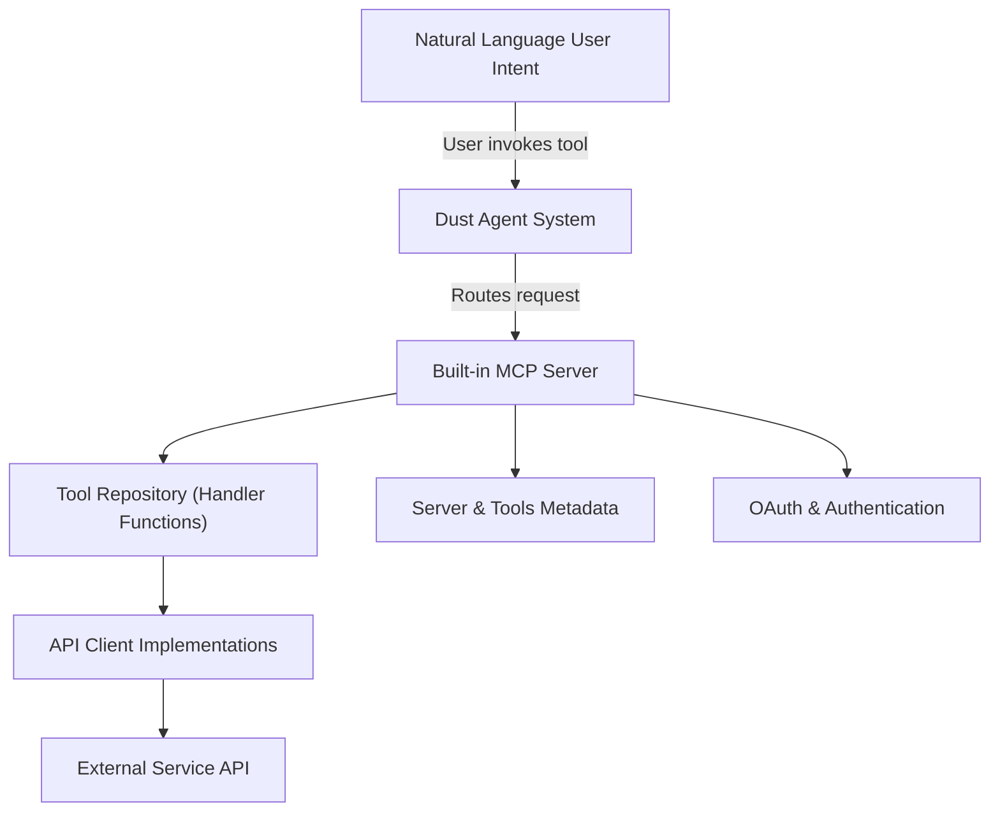
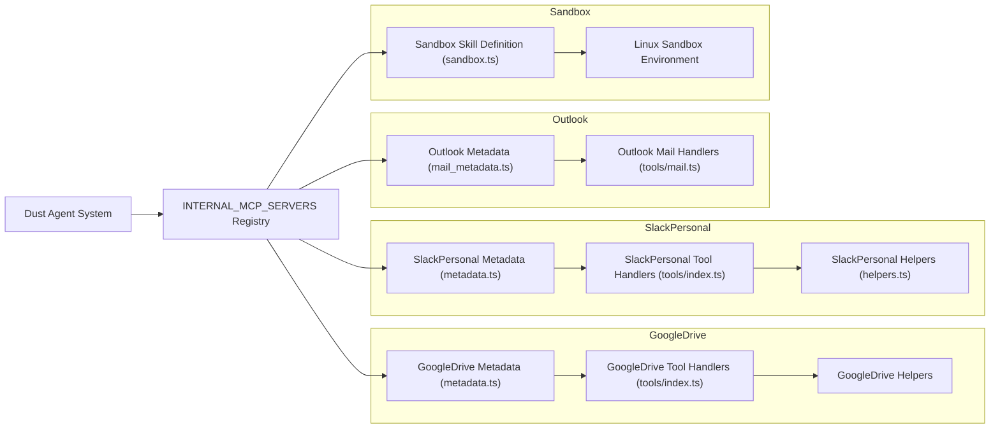

<!-- source: DeepWiki mcp.deepwiki.com · repo dust-tt/dust · page 4.4 Built-in MCP Servers · fetched 2026-10-26 -->

# Built-in MCP Servers

<details>
<summary>Relevant source files</summary>

The following files were used as context for generating this wiki page:

- [connectors/src/types/shared/headers.ts](connectors/src/types/shared/headers.ts)
- [core/src/oauth/providers/hubspot.rs](core/src/oauth/providers/hubspot.rs)
- [front/components/actions/mcp/details/ChildAgentActivityTimeline.tsx](front/components/actions/mcp/details/ChildAgentActivityTimeline.tsx)
- [front/components/actions/mcp/details/MCPAskUserQuestionActionDetails.tsx](front/components/actions/mcp/details/MCPAskUserQuestionActionDetails.tsx)
- [front/components/actions/mcp/details/MCPRunAgentActionDetails.tsx](front/components/actions/mcp/details/MCPRunAgentActionDetails.tsx)
- [front/components/assistant/conversation/actions/inline/ActivityTimeline.tsx](front/components/assistant/conversation/actions/inline/ActivityTimeline.tsx)
- [front/components/assistant/conversation/actions/inline/utils.ts](front/components/assistant/conversation/actions/inline/utils.ts)
- [front/hooks/useAnswerUserQuestion.ts](front/hooks/useAnswerUserQuestion.ts)
- [front/lib/actions/user_question.ts](front/lib/actions/user_question.ts)
- [front/lib/api/actions/servers/agent_router/metadata.ts](front/lib/api/actions/servers/agent_router/metadata.ts)
- [front/lib/api/actions/servers/ashby/client.ts](front/lib/api/actions/servers/ashby/client.ts)
- [front/lib/api/actions/servers/ashby/helpers.ts](front/lib/api/actions/servers/ashby/helpers.ts)
- [front/lib/api/actions/servers/ashby/index.ts](front/lib/api/actions/servers/ashby/index.ts)
- [front/lib/api/actions/servers/ashby/metadata.ts](front/lib/api/actions/servers/ashby/metadata.ts)
- [front/lib/api/actions/servers/ashby/rendering.ts](front/lib/api/actions/servers/ashby/rendering.ts)
- [front/lib/api/actions/servers/ashby/tools/index.ts](front/lib/api/actions/servers/ashby/tools/index.ts)
- [front/lib/api/actions/servers/ashby/types.ts](front/lib/api/actions/servers/ashby/types.ts)
- [front/lib/api/actions/servers/ask_user_question/metadata.ts](front/lib/api/actions/servers/ask_user_question/metadata.ts)
- [front/lib/api/actions/servers/ask_user_question/tools/index.ts](front/lib/api/actions/servers/ask_user_question/tools/index.ts)
- [front/lib/api/actions/servers/data_warehouses/metadata.ts](front/lib/api/actions/servers/data_warehouses/metadata.ts)
- [front/lib/api/actions/servers/file_generation/metadata.ts](front/lib/api/actions/servers/file_generation/metadata.ts)
- [front/lib/api/actions/servers/file_generation/tools/index.ts](front/lib/api/actions/servers/file_generation/tools/index.ts)
- [front/lib/api/actions/servers/front/helpers.test.ts](front/lib/api/actions/servers/front/helpers.test.ts)
- [front/lib/api/actions/servers/front/helpers.ts](front/lib/api/actions/servers/front/helpers.ts)
- [front/lib/api/actions/servers/front/index.ts](front/lib/api/actions/servers/front/index.ts)
- [front/lib/api/actions/servers/front/metadata.ts](front/lib/api/actions/servers/front/metadata.ts)
- [front/lib/api/actions/servers/front/tools/index.ts](front/lib/api/actions/servers/front/tools/index.ts)
- [front/lib/api/actions/servers/github/index.ts](front/lib/api/actions/servers/github/index.ts)
- [front/lib/api/actions/servers/github/metadata.ts](front/lib/api/actions/servers/github/metadata.ts)
- [front/lib/api/actions/servers/github/tools/index.test.ts](front/lib/api/actions/servers/github/tools/index.test.ts)
- [front/lib/api/actions/servers/github/tools/index.ts](front/lib/api/actions/servers/github/tools/index.ts)
- [front/lib/api/actions/servers/gmail/helpers.test.ts](front/lib/api/actions/servers/gmail/helpers.test.ts)
- [front/lib/api/actions/servers/gmail/helpers.ts](front/lib/api/actions/servers/gmail/helpers.ts)
- [front/lib/api/actions/servers/gmail/index.ts](front/lib/api/actions/servers/gmail/index.ts)
- [front/lib/api/actions/servers/gmail/metadata.ts](front/lib/api/actions/servers/gmail/metadata.ts)
- [front/lib/api/actions/servers/gmail/tools/index.ts](front/lib/api/actions/servers/gmail/tools/index.ts)
- [front/lib/api/actions/servers/gong/metadata.ts](front/lib/api/actions/servers/gong/metadata.ts)
- [front/lib/api/actions/servers/google_calendar/helpers.test.ts](front/lib/api/actions/servers/google_calendar/helpers.test.ts)
- [front/lib/api/actions/servers/google_calendar/helpers.ts](front/lib/api/actions/servers/google_calendar/helpers.ts)
- [front/lib/api/actions/servers/google_calendar/index.ts](front/lib/api/actions/servers/google_calendar/index.ts)
- [front/lib/api/actions/servers/google_calendar/metadata.ts](front/lib/api/actions/servers/google_calendar/metadata.ts)
- [front/lib/api/actions/servers/google_calendar/tools/index.ts](front/lib/api/actions/servers/google_calendar/tools/index.ts)
- [front/lib/api/actions/servers/google_drive/helpers.ts](front/lib/api/actions/servers/google_drive/helpers.ts)
- [front/lib/api/actions/servers/google_drive/index.ts](front/lib/api/actions/servers/google_drive/index.ts)
- [front/lib/api/actions/servers/google_drive/metadata.ts](front/lib/api/actions/servers/google_drive/metadata.ts)
- [front/lib/api/actions/servers/google_drive/tools/index.test.ts](front/lib/api/actions/servers/google_drive/tools/index.test.ts)
- [front/lib/api/actions/servers/google_drive/tools/index.ts](front/lib/api/actions/servers/google_drive/tools/index.ts)
- [front/lib/api/actions/servers/http_client/tools/index.ts](front/lib/api/actions/servers/http_client/tools/index.ts)
- [front/lib/api/actions/servers/hubspot/client.ts](front/lib/api/actions/servers/hubspot/client.ts)
- [front/lib/api/actions/servers/hubspot/helpers.ts](front/lib/api/actions/servers/hubspot/helpers.ts)
- [front/lib/api/actions/servers/hubspot/index.ts](front/lib/api/actions/servers/hubspot/index.ts)
- [front/lib/api/actions/servers/hubspot/metadata.ts](front/lib/api/actions/servers/hubspot/metadata.ts)
- [front/lib/api/actions/servers/hubspot/rendering.ts](front/lib/api/actions/servers/hubspot/rendering.ts)
- [front/lib/api/actions/servers/hubspot/tools/index.ts](front/lib/api/actions/servers/hubspot/tools/index.ts)
- [front/lib/api/actions/servers/microsoft/utils.ts](front/lib/api/actions/servers/microsoft/utils.ts)
- [front/lib/api/actions/servers/microsoft_drive/metadata.ts](front/lib/api/actions/servers/microsoft_drive/metadata.ts)
- [front/lib/api/actions/servers/microsoft_drive/tools/index.ts](front/lib/api/actions/servers/microsoft_drive/tools/index.ts)
- [front/lib/api/actions/servers/microsoft_excel/helpers.ts](front/lib/api/actions/servers/microsoft_excel/helpers.ts)
- [front/lib/api/actions/servers/microsoft_excel/index.ts](front/lib/api/actions/servers/microsoft_excel/index.ts)
- [front/lib/api/actions/servers/microsoft_excel/metadata.ts](front/lib/api/actions/servers/microsoft_excel/metadata.ts)
- [front/lib/api/actions/servers/microsoft_excel/tools/index.ts](front/lib/api/actions/servers/microsoft_excel/tools/index.ts)
- [front/lib/api/actions/servers/microsoft_teams/metadata.ts](front/lib/api/actions/servers/microsoft_teams/metadata.ts)
- [front/lib/api/actions/servers/microsoft_teams/microsoft_teams_rendering.ts](front/lib/api/actions/servers/microsoft_teams/microsoft_teams_rendering.ts)
- [front/lib/api/actions/servers/microsoft_teams/tools/index.ts](front/lib/api/actions/servers/microsoft_teams/tools/index.ts)
- [front/lib/api/actions/servers/microsoft_teams/tools/pagination.test.ts](front/lib/api/actions/servers/microsoft_teams/tools/pagination.test.ts)
- [front/lib/api/actions/servers/microsoft_teams/tools/pagination.ts](front/lib/api/actions/servers/microsoft_teams/tools/pagination.ts)
- [front/lib/api/actions/servers/openai_usage/client.ts](front/lib/api/actions/servers/openai_usage/client.ts)
- [front/lib/api/actions/servers/openai_usage/metadata.ts](front/lib/api/actions/servers/openai_usage/metadata.ts)
- [front/lib/api/actions/servers/outlook/mail_metadata.ts](front/lib/api/actions/servers/outlook/mail_metadata.ts)
- [front/lib/api/actions/servers/outlook/tools/mail.ts](front/lib/api/actions/servers/outlook/tools/mail.ts)
- [front/lib/api/actions/servers/query_tables_v2/metadata.ts](front/lib/api/actions/servers/query_tables_v2/metadata.ts)
- [front/lib/api/actions/servers/run_agent/conversation.test.ts](front/lib/api/actions/servers/run_agent/conversation.test.ts)
- [front/lib/api/actions/servers/run_agent/conversation.ts](front/lib/api/actions/servers/run_agent/conversation.ts)
- [front/lib/api/actions/servers/run_agent/file_paths.test.ts](front/lib/api/actions/servers/run_agent/file_paths.test.ts)
- [front/lib/api/actions/servers/run_agent/file_paths.ts](front/lib/api/actions/servers/run_agent/file_paths.ts)
- [front/lib/api/actions/servers/run_agent/index.ts](front/lib/api/actions/servers/run_agent/index.ts)
- [front/lib/api/actions/servers/run_agent/metadata.ts](front/lib/api/actions/servers/run_agent/metadata.ts)
- [front/lib/api/actions/servers/salesloft/helpers.ts](front/lib/api/actions/servers/salesloft/helpers.ts)
- [front/lib/api/actions/servers/salesloft/metadata.ts](front/lib/api/actions/servers/salesloft/metadata.ts)
- [front/lib/api/actions/servers/slab/metadata.ts](front/lib/api/actions/servers/slab/metadata.ts)
- [front/lib/api/actions/servers/slack/block.ts](front/lib/api/actions/servers/slack/block.ts)
- [front/lib/api/actions/servers/slack/helpers.ts](front/lib/api/actions/servers/slack/helpers.ts)
- [front/lib/api/actions/servers/slack/update_message.test.ts](front/lib/api/actions/servers/slack/update_message.test.ts)
- [front/lib/api/actions/servers/slack_bot/metadata.ts](front/lib/api/actions/servers/slack_bot/metadata.ts)
- [front/lib/api/actions/servers/slack_bot/tools/index.ts](front/lib/api/actions/servers/slack_bot/tools/index.ts)
- [front/lib/api/actions/servers/slack_personal/metadata.ts](front/lib/api/actions/servers/slack_personal/metadata.ts)
- [front/lib/api/actions/servers/slack_personal/tools/index.ts](front/lib/api/actions/servers/slack_personal/tools/index.ts)
- [front/lib/api/actions/servers/snowflake/index.ts](front/lib/api/actions/servers/snowflake/index.ts)
- [front/lib/api/actions/servers/snowflake/metadata.ts](front/lib/api/actions/servers/snowflake/metadata.ts)
- [front/lib/api/actions/servers/statuspage/client.ts](front/lib/api/actions/servers/statuspage/client.ts)
- [front/lib/api/actions/servers/statuspage/metadata.ts](front/lib/api/actions/servers/statuspage/metadata.ts)
- [front/lib/api/actions/servers/statuspage/tools/index.ts](front/lib/api/actions/servers/statuspage/tools/index.ts)
- [front/lib/api/actions/servers/val_town/helpers.ts](front/lib/api/actions/servers/val_town/helpers.ts)
- [front/lib/api/actions/servers/web_search_browse/metadata.ts](front/lib/api/actions/servers/web_search_browse/metadata.ts)
- [front/lib/api/dust_app_secrets.ts](front/lib/api/dust_app_secrets.ts)
- [front/lib/api/oauth/providers/hubspot.ts](front/lib/api/oauth/providers/hubspot.ts)
- [front/lib/api/oauth/providers/microsoft_tools.ts](front/lib/api/oauth/providers/microsoft_tools.ts)
- [front/lib/api/workos/client.ts](front/lib/api/workos/client.ts)
- [front/lib/api/workos/user.ts](front/lib/api/workos/user.ts)
- [front/lib/providers/google_drive/search.ts](front/lib/providers/google_drive/search.ts)
- [front/lib/providers/google_drive/utils.ts](front/lib/providers/google_drive/utils.ts)
- [front/lib/resources/skill/code_defined/global/docx.ts](front/lib/resources/skill/code_defined/global/docx.ts)
- [front/lib/resources/skill/code_defined/global/sandbox.test.ts](front/lib/resources/skill/code_defined/global/sandbox.test.ts)
- [front/lib/resources/skill/code_defined/global/sandbox.ts](front/lib/resources/skill/code_defined/global/sandbox.ts)
- [front/lib/resources/skill/code_defined/global/xlsx.ts](front/lib/resources/skill/code_defined/global/xlsx.ts)
- [front/types/shared/utils/http_headers.test.ts](front/types/shared/utils/http_headers.test.ts)
- [front/types/shared/utils/http_headers.ts](front/types/shared/utils/http_headers.ts)
- [sdks/js/src/http_headers.ts](sdks/js/src/http_headers.ts)

</details>


This page documents the collection of built-in internal MCP (Model Context Protocol) servers integrated within the Dust platform. These servers provide native connectivity and toolsets for popular external services and internal sandboxing capabilities. Each server is implemented with a consistent architecture consisting of metadata definitions, tool handler implementations, and client integration code. This page covers prominent built-in servers like Sandbox, Google Drive, Slack (both personal and bot modes), Gmail, Outlook, Microsoft Teams, GitHub, Shopify, Salesforce, Ashby, HubSpot, Gong, and others.

---

## Purpose and Scope

Built-in MCP servers are internal Dust platform services that expose predefined tools (APIs/actions) to Dust agents and conversations. These servers enable agents to interact programmatically with external applications or internal execution environments. Their implementations consolidate:

- **Metadata** describing server capabilities, OAuth scopes, and tool input schemas.
- **Tool handlers**, which implement the actual integration logic for each supported API action.
- **Client-side components** and authentication flows to manage connections and sessions.

This page documents their common structural patterns, key code entities, and the catalogue of servers currently bundled into Dust.

---

## MCP Server Architecture Overview

Each built-in MCP server consists of the following core parts:

1. **Server Metadata**: Defines the server identity, supported OAuth scopes, and the available tools. Tools define name, description, input schemas (typically using Zod), and execution stakes.

2. **Tool Handlers**: Implement the business logic of each tool. They receive tool parameters and contextual information (like authentication tokens) and perform external API calls or internal operations. Handlers return tool results as structured responses or errors.

3. **Client Implementations and Utilities**: These encapsulate external API clients (e.g., GitHub REST client, Google Drive SDK) and helper functions like token validation, pagination, or error handling.

4. **Integration with Dust MCP System**: The server and tools register with Dust’s `INTERNAL_MCP_SERVERS` registry, enabling agents to discover and invoke their functionality.

---

## Core Classes and Functions

- `ServerMetadata` (type): Defines server-wide metadata including tool schemas and OAuth scopes. Found in server-specific `metadata.ts` files.

- `ToolHandlers<T>`: Type-safe mapping of tool names to handler functions implementing the tool logic. Located in `tools/index.ts`.

- `makeInternalMCPServer`: Utility to define and register an internal MCP server with Dust infrastructure.

- Authentication utilities: Common helpers to validate tokens, handle 403 errors, and manage OAuth flows (e.g., in helpers files and OAuth provider modules).

---

## Data Flow and Execution Model

When an agent or conversation invokes a tool on a built-in MCP server:

1. The Dust platform performs authentication checks using OAuth token info managed internally.

2. The tool handler is invoked with validated parameters and execution context.

3. The handler calls the external API or performs sandbox/local operations as needed.

4. The handler returns a `ToolHandlerResult` indicating success with output or an `MCPError`.

5. Results can include structured text content, file attachments, or references consumable by other Dust systems.

---

# Catalogue of Built-in Servers

Below is an in-depth overview of key built-in MCP servers, their structure, notable tools, and key code references.

---

## 1. Sandbox MCP Server

### Purpose

Provides an isolated Linux sandbox environment ("the Computer") where agents can run code, shell commands, and scripts securely. This server exposes tools for executing commands, managing files, and running embedded tools within the sandbox environment.

### Structure

- Metadata (`front/lib/resources/skill/code_defined/global/sandbox.ts` lines 1-125) describes the sandbox environment and usage instructions.

- Filesystem access is managed through mounted GCS-backed paths (`/files/conversation`, `/files/pod`).

- Tools allow executing bash commands with structured arguments, return output as text or JSON results.

- Sandbox files and tool outputs are automatically persisted and exposed via the `files` MCP server.

- The environment lifecycle and security policies are managed via sandbox resource APIs and egress policies.

### Key Metadata & Instructions

```ts
function buildSandboxInstructionProse({ hasDsbxTools }: { hasDsbxTools: boolean }): string {
// Returns detailed user instructions on how to use sandbox, including dsbx CLI usage.
}
```

### References

- `front/lib/resources/skill/code_defined/global/sandbox.ts:1-125`()

---

## 2. Google Drive MCP Server

### Purpose

Enables programmatic access to Google Drive documents (Docs, Sheets, Slides) and files. Agents can list drives, search files, read file contents, and perform document operations.

### Metadata

- `GOOGLE_DRIVE_TOOLS_METADATA` defines tools like `list_drives`, `search_files`, `get_file_content` with detailed Zod input schemas.

- Required OAuth scopes are specified in `GOOGLE_DRIVE_SCOPES`.

### Implementation

- Tool handlers are defined in `tools/index.ts`, implementing API calls to Google Drive REST and Docs APIs.

- Utility functions handle file text extraction, binary file resource creation, and error classification based on Google API error reasons.

- Handlers support content pagination, MIME type normalization, and attachment processing.

### Example Tool Definition Snippet

```ts
{
  name: "search_files",
  description: "Search and find files in Google Drive by name or content. Locate Docs, Sheets, Slides, and folders.",
  schema: {
    q: z.string().optional(), // Google Drive search query
    driveId: z.string().optional(),
    includeSharedDrives: z.boolean().default(true),
    ...
  },
  stake: "never_ask",
  displayLabels: {...},
  toolCostCategory: "advanced",
  freeUsage: false,
}
```

### References

- Metadata: `front/lib/api/actions/servers/google_drive/metadata.ts:1-150`()

- Tool handlers: `front/lib/api/actions/servers/google_drive/tools/index.ts:1-140`()

---

## 3. Slack MCP Servers

Dust integrates two Slack MCP servers serving different scopes:

- **Slack Personal** (`slack_personal`): Tools acting on behalf of a user’s personal Slack account, supporting message search, posting, scheduling, and user lookup.

- **Slack Bot** (`slack_bot`): Tools where actions are taken by the workspace bot/app user, mainly posting and editing messages in channels where the bot is a member.

### Metadata and Tools

- Both servers define Zod schemas for inputs, detailed descriptions, and stakes.

- Tools include searching messages (keyword and semantic), posting messages, editing messages, listing channels and users, and scheduling messages.

### Implementation

- Helpers provide Slack API client instantiation (`getSlackClient`), caching for channels and users, and utilities for message formatting and markdown conversion.

- Tool handlers implement Slack Web API calls and error handling, including graceful handling of missing scopes.

### Metadata Example: Tool to Search Slack Messages (Personal)

```ts
{
  name: "search_messages",
  description: "Search Slack messages by keyword...",
  schema: {
    keywords: z.string().array().min(1),
    channels: z.string().array().optional(),
    ...
  },
  stake: "never_ask",
  toolCostCategory: "advanced",
}
```

### References

- Slack Personal Metadata: `front/lib/api/actions/servers/slack_personal/metadata.ts:1-90`()

- Slack Personal Helpers & utils: `front/lib/api/actions/servers/slack/helpers.ts:1-210`()

- Slack Bot Metadata: `front/lib/api/actions/servers/slack_bot/metadata.ts:1-180`()

---

## 4. Outlook MCP Server

### Purpose

Allows interacting with Outlook mailboxes via Microsoft Graph API, including listing messages, folders, attachments, drafts, and sending emails.

### Metadata

- The tool metadata defines operations like `get_messages`, `list_folders`, `list_attachments`, `get_attachment`, etc., with corresponding Zod schemas and parameters for mailbox selection and paging.

### Implementation

- Tool handlers perform calls to Microsoft Graph API endpoints with proper OAuth authentication.

- Utilities handle attachment fetching, sanitization, and API retry headers.

- Provides detailed error handling with parsing of Graph API responses.

### References

- Metadata: `front/lib/api/actions/servers/outlook/mail_metadata.ts:1-170`()

- Tool handlers: `front/lib/api/actions/servers/outlook/tools/mail.ts:1-150`()

---

## 5. Microsoft Teams MCP Server

### Purpose

Exposes Microsoft Teams data and messages similarly to Outlook, supporting conversations, chats, and files managed within Teams.

### Metadata & Tools

- Metadata and tool definitions include querying Teams channels, reading messages, and posting.

### References

- Metadata: `front/lib/api/actions/servers/microsoft_teams/metadata.ts` (not fully shown)

- Tools: `front/lib/api/actions/servers/microsoft_teams/tools/index.ts`

---

## 6. GitHub MCP Server

### Purpose

Facilitates querying GitHub repositories, issues, pull requests, and other GitHub data programmatically.

### Structure

- Metadata defining search and retrieval tools.

- Tool handlers using GitHub REST API client.

### References

- Metadata: `front/lib/api/actions/servers/github/metadata.ts`

- Tools: `front/lib/api/actions/servers/github/tools/index.ts`

---

## 7. Shopify MCP Server

### Purpose

Allows interaction with Shopify store data like orders, customers, and products.

### Structure

- Tools and metadata conforming to Shopify API endpoints and query parameters.

### References

- Metadata and tools likely defined in `front/lib/api/actions/servers/shopify/*` (not shown here)

---

## 8. Salesforce MCP Server

### Purpose

Exposes Salesforce CRM data, including records, reports, and custom objects.

### Structure

- Metadata with APIs for searching objects and querying reports.

- Implementation handling Salesforce OAuth and API limits.

### References

- Metadata and tools in respective Salesforce action directories.

---

## 9. Ashby MCP Server

### Purpose

Integration with Ashby HR/recruiting platform for candidate, application, and feedback management.

### Metadata

- Extensive Zod schemas describing API error models, candidate search, reports, feedback submissions, notes, and applications.

- Robust request/response structures for synchronous report fetching and candidate note management.

### Structure

- Tools implementing searching candidates, listing applications, creating notes.

- Client utilities to handle API pagination and error responses.

### References

- Metadata: `front/lib/api/actions/servers/ashby/types.ts` and `metadata.ts`

- Tools: `front/lib/api/actions/servers/ashby/tools/index.ts`

- Client helpers: `front/lib/api/actions/servers/ashby/helpers.ts`

---

## 10. HubSpot MCP Server

### Purpose

Integrates HubSpot CRM objects, allowing querying contacts, companies, deals, meetings, owners, and custom objects.

### Metadata

- Defines rich schemas for filters, associations, paging, and property retrieval.

- Tools cover reading object properties, searching CRM records, counting records, meeting retrieval.

### Implementation

- Tool handlers use official HubSpot SDK and implement search, property listing, and metadata fetch.

- Handles HubSpot specific errors and rate limiting.

### References

- Metadata: `front/lib/api/actions/servers/hubspot/metadata.ts`()

- Tools: `front/lib/api/actions/servers/hubspot/tools/index.ts`()

- Client SDK + utils: `front/lib/api/actions/servers/hubspot/client.ts`()

---

## 11. Gong MCP Server

### Purpose

Exposes Gong conversation intelligence data like calls, transcripts, and engagement analytics.

### Metadata

- Tool metadata describing Gong API endpoints and input schemas.

### References

- Metadata: `front/lib/api/actions/servers/gong/metadata.ts`

---

## Common Pattern in Built-in MCP Servers

| Component           | Description                                                                                 | Typical Location                                  |
|---------------------|---------------------------------------------------------------------------------------------|--------------------------------------------------|
| Server Metadata     | Tool definitions, OAuth scopes, tool stakes, descriptions, and Zod input schemas            | `servers/{server-name}/metadata.ts`               |
| Tool Implementations | Handler functions for each tool performing API calls and returning structured results       | `servers/{server-name}/tools/index.ts`             |
| Helper Functions    | Utility methods for API client creation, error normalization, token validation, and caching | `servers/{server-name}/helpers.ts`                 |
| Client Integrations | OAuth provider modules and SDK clients for external service API access                      | `lib/api/oauth/providers/`, `lib/api/actions/servers/{server-name}/client.ts` |
| Server Registration | Internal MCP server registered in `INTERNAL_MCP_SERVERS` for global discovery              | `lib/actions/mcp_internal_actions/utils.ts`        |

---

## Diagram 1: Natural Language Space to MCP Server Code Entities Overview



**Description**: User intents expressed in natural language trigger agent pipelines that route commands to MCP servers. MCP servers use metadata and tool handlers to execute integrated API client calls against external services, enforcing OAuth authentication.

Sources: `front/lib/api/actions/servers/google_drive/metadata.ts`, `front/lib/api/actions/servers/google_drive/tools/index.ts`, `front/lib/api/actions/servers/slack/helpers.ts`, `front/lib/api/actions/servers/outlook/mail_metadata.ts`, `front/lib/api/actions/servers/ashby/types.ts`, `front/lib/resources/skill/code_defined/global/sandbox.ts`()

---

## Diagram 2: Code Entity Mapping for Selected Built-in MCP Servers



**Description**: Shows how major dust agent system interacts with the internal MCP server registry and the connection to server metadata, tools, and helper implementations for four major built-in MCP servers.

Sources: `front/lib/api/actions/servers/google_drive/metadata.ts`, `front/lib/api/actions/servers/google_drive/tools/index.ts`, `front/lib/api/actions/servers/slack_personal/metadata.ts`, `front/lib/api/actions/servers/slack/helpers.ts`, `front/lib/api/actions/servers/outlook/mail_metadata.ts`, `front/lib/api/actions/servers/outlook/tools/mail.ts`, `front/lib/resources/skill/code_defined/global/sandbox.ts`()

---

## Summary Table of Notable Built-in MCP Servers

| Server Name         | Key Features                                           | OAuth Scopes / Permissions            | Tool Examples                            | Client API & Helpers                    |
|---------------------|-------------------------------------------------------|-------------------------------------|-----------------------------------------|---------------------------------------|
| Sandbox             | Isolated Linux environment, code/shell execution      | Internal, no external OAuth          | Execute bash commands, file operations  | `sandbox.ts`, egress policies         |
| Google Drive        | File browsing, searching, reading, Docs/Sheets ops    | `drive.file`, `drive.readonly`       | `search_files`, `get_file_content`      | Google APIs, extraction utils         |
| Slack Personal      | Search messages, post, schedule, user lookups         | User OAuth token                    | `search_messages`, `post_message`       | Slack Web API client wrappers         |
| Slack Bot           | Post and edit messages as bot user                     | Bot token in workspace              | `post_message`, `edit_message`          | Slack bot specific helpers            |
| Outlook             | Mail folders, messages, attachments management        | Microsoft Graph scopes              | `get_messages`, `list_folders`           | MS Graph client helpers               |
| Microsoft Teams     | Teams channels, messages, files                        | Microsoft OAuth scopes              | List channels, post/read messages        | Teams-specific Graph API client       |
| GitHub              | Repository, issue, pull request data                   | GitHub OAuth scopes                 | Search repos, issues                     | Octokit client wrappers               |
| Shopify             | Store data access (orders, customers, products)       | Shopify API OAuth scopes            | List products, orders                    | Shopify client modules                |
| Salesforce          | CRM data access, reports                               | Salesforce OAuth                   | Retrieve records, reports                | Salesforce API helpers                |
| Ashby               | Recruiting data: candidates, applications, feedback   | Ashby API keys/OAuth                | Search candidates, create notes          | Typed client with Zod schemas         |
| HubSpot             | CRM objects and records                                | HubSpot OAuth                      | Search CRM objects, get properties        | HubSpot SDK and API client           |
| Gong                | Conversation intelligence data                         | Gong API OAuth                    | Fetch calls and transcripts              | Gong API client functions            |

---

# Conclusion

Built-in MCP servers are foundational Dust platform integrations providing tightly coupled APIs to external services and internal capabilities such as sandbox execution. Each server is architected with clear metadata describing tools and schemas, robust tool handler implementations, and client mechanisms handling authentication and API interaction. This modular design enables Dust agents to uniformly invoke these external services while maintaining security, reliability, and observability.

---

Sources:  
`front/lib/api/actions/servers/google_drive/metadata.ts`, `front/lib/api/actions/servers/google_drive/tools/index.ts`,  
`front/lib/api/actions/servers/slack_personal/metadata.ts`, `front/lib/api/actions/servers/slack/helpers.ts`,  
`front/lib/api/actions/servers/outlook/mail_metadata.ts`, `front/lib/api/actions/servers/outlook/tools/mail.ts`,  
`front/lib/api/actions/servers/microsoft_drive/tools/index.ts`,  
`front/lib/resources/skill/code_defined/global/sandbox.ts`,  
`front/lib/api/actions/servers/ashby/types.ts`, `front/lib/api/actions/servers/ashby/tools/index.ts`,  
`front/lib/api/actions/servers/hubspot/metadata.ts`, `front/lib/api/actions/servers/hubspot/tools/index.ts`

---

