<!-- source: DeepWiki mcp.deepwiki.com · repo dust-tt/dust · page 5.1 Conversation Management API · fetched 2026-10-26 -->

# Conversation Management API

<details>
<summary>Relevant source files</summary>

The following files were used as context for generating this wiki page:

- [front-api/routes/w/[wId]/assistant/conversations/[cId]/messages/index.ts](front-api/routes/w/[wId]/assistant/conversations/[cId]/messages/index.ts)
- [front-api/routes/w/[wId]/assistant/conversations/index.test.ts](front-api/routes/w/[wId]/assistant/conversations/index.test.ts)
- [front-api/routes/w/[wId]/assistant/conversations/index.ts](front-api/routes/w/[wId]/assistant/conversations/index.ts)
- [front-api/routes/w/[wId]/spaces/index.test.ts](front-api/routes/w/[wId]/spaces/index.test.ts)
- [front/admin/db.ts](front/admin/db.ts)
- [front/components/assistant/conversation/AgentMessage.tsx](front/components/assistant/conversation/AgentMessage.tsx)
- [front/components/assistant/conversation/CompactionMessage.tsx](front/components/assistant/conversation/CompactionMessage.tsx)
- [front/components/assistant/conversation/ConversationViewer.tsx](front/components/assistant/conversation/ConversationViewer.tsx)
- [front/components/assistant/conversation/MentionInvalid.tsx](front/components/assistant/conversation/MentionInvalid.tsx)
- [front/components/assistant/conversation/MentionValidationRequired.tsx](front/components/assistant/conversation/MentionValidationRequired.tsx)
- [front/components/assistant/conversation/MessageItem.tsx](front/components/assistant/conversation/MessageItem.tsx)
- [front/components/assistant/conversation/UserMessage.tsx](front/components/assistant/conversation/UserMessage.tsx)
- [front/components/assistant/conversation/actions/AgentActionsPanel.tsx](front/components/assistant/conversation/actions/AgentActionsPanel.tsx)
- [front/components/assistant/conversation/actions/inline/InlineActivitySteps.tsx](front/components/assistant/conversation/actions/inline/InlineActivitySteps.tsx)
- [front/components/assistant/conversation/actions/inline/TimelineRow.tsx](front/components/assistant/conversation/actions/inline/TimelineRow.tsx)
- [front/components/assistant/conversation/types.ts](front/components/assistant/conversation/types.ts)
- [front/hooks/conversations/index.ts](front/hooks/conversations/index.ts)
- [front/hooks/conversations/useConversationMessages.ts](front/hooks/conversations/useConversationMessages.ts)
- [front/hooks/useAgentMessageStream.test.ts](front/hooks/useAgentMessageStream.test.ts)
- [front/hooks/useAgentMessageStream.ts](front/hooks/useAgentMessageStream.ts)
- [front/hooks/useChildAgentStream.ts](front/hooks/useChildAgentStream.ts)
- [front/hooks/useConversationEvents.ts](front/hooks/useConversationEvents.ts)
- [front/lib/api/assistant/activity_steps.test.ts](front/lib/api/assistant/activity_steps.test.ts)
- [front/lib/api/assistant/activity_steps.ts](front/lib/api/assistant/activity_steps.ts)
- [front/lib/api/assistant/conversation.test.ts](front/lib/api/assistant/conversation.test.ts)
- [front/lib/api/assistant/conversation.ts](front/lib/api/assistant/conversation.ts)
- [front/lib/api/assistant/conversation/destroy.ts](front/lib/api/assistant/conversation/destroy.ts)
- [front/lib/api/assistant/conversation/fetch.ts](front/lib/api/assistant/conversation/fetch.ts)
- [front/lib/api/assistant/conversation/forks.test.ts](front/lib/api/assistant/conversation/forks.test.ts)
- [front/lib/api/assistant/conversation/forks.ts](front/lib/api/assistant/conversation/forks.ts)
- [front/lib/api/assistant/conversation/mentions.test.ts](front/lib/api/assistant/conversation/mentions.test.ts)
- [front/lib/api/assistant/conversation/mentions.ts](front/lib/api/assistant/conversation/mentions.ts)
- [front/lib/api/assistant/conversation/messages.test.ts](front/lib/api/assistant/conversation/messages.test.ts)
- [front/lib/api/assistant/conversation/messages.ts](front/lib/api/assistant/conversation/messages.ts)
- [front/lib/api/assistant/conversation/permissions.test.ts](front/lib/api/assistant/conversation/permissions.test.ts)
- [front/lib/api/assistant/conversation/permissions.ts](front/lib/api/assistant/conversation/permissions.ts)
- [front/lib/api/assistant/conversation/selected_spaces.test.ts](front/lib/api/assistant/conversation/selected_spaces.test.ts)
- [front/lib/api/assistant/conversation/selected_spaces.ts](front/lib/api/assistant/conversation/selected_spaces.ts)
- [front/lib/api/assistant/conversation/validate_agent_mention.ts](front/lib/api/assistant/conversation/validate_agent_mention.ts)
- [front/lib/api/assistant/premium_model_limit.test.ts](front/lib/api/assistant/premium_model_limit.test.ts)
- [front/lib/api/assistant/premium_model_limit.ts](front/lib/api/assistant/premium_model_limit.ts)
- [front/lib/api/config.test.ts](front/lib/api/config.test.ts)
- [front/lib/api/file_system/backends/database_file_system_backend.test.ts](front/lib/api/file_system/backends/database_file_system_backend.test.ts)
- [front/lib/api/file_system/backends/database_file_system_backend.ts](front/lib/api/file_system/backends/database_file_system_backend.ts)
- [front/lib/api/file_system/sandbox/database_sandbox_mount_adapter.test.ts](front/lib/api/file_system/sandbox/database_sandbox_mount_adapter.test.ts)
- [front/lib/api/file_system/sandbox/database_sandbox_mount_adapter.ts](front/lib/api/file_system/sandbox/database_sandbox_mount_adapter.ts)
- [front/lib/api/projects/conversations.test.ts](front/lib/api/projects/conversations.test.ts)
- [front/lib/api/projects/conversations.ts](front/lib/api/projects/conversations.ts)
- [front/lib/api/spaces/access.ts](front/lib/api/spaces/access.ts)
- [front/lib/models/agent/conversation.ts](front/lib/models/agent/conversation.ts)
- [front/lib/models/agent/conversation_selected_space.ts](front/lib/models/agent/conversation_selected_space.ts)
- [front/lib/resources/conversation_resource.test.ts](front/lib/resources/conversation_resource.test.ts)
- [front/lib/resources/conversation_resource.ts](front/lib/resources/conversation_resource.ts)
- [front/lib/resources/conversation_selected_space_resource.test.ts](front/lib/resources/conversation_selected_space_resource.test.ts)
- [front/lib/resources/conversation_selected_space_resource.ts](front/lib/resources/conversation_selected_space_resource.ts)
- [front/lib/resources/data_source_resource.test.ts](front/lib/resources/data_source_resource.test.ts)
- [front/lib/resources/resource_with_space.ts](front/lib/resources/resource_with_space.ts)
- [front/lib/resources/storage/models/files.ts](front/lib/resources/storage/models/files.ts)
- [front/lib/resources/string_ids.ts](front/lib/resources/string_ids.ts)
- [front/lib/swr/mentions.tsx](front/lib/swr/mentions.tsx)
- [front/migrations/20250428_backfill_editor_groups.ts](front/migrations/20250428_backfill_editor_groups.ts)
- [front/migrations/20250429_update_agent_scopes.ts](front/migrations/20250429_update_agent_scopes.ts)
- [front/migrations/20251117_backfill_missing_agent_editor_groups.ts](front/migrations/20251117_backfill_missing_agent_editor_groups.ts)
- [front/migrations/20260114_backfill_project_metadata.ts](front/migrations/20260114_backfill_project_metadata.ts)
- [front/migrations/20260402_backfill_project_content_fragments.ts](front/migrations/20260402_backfill_project_content_fragments.ts)
- [front/migrations/20260820_prune_skill_dangling_requested_spaces.ts](front/migrations/20260820_prune_skill_dangling_requested_spaces.ts)
- [front/migrations/20260825_backfill_open_space_admin_manager_members.ts](front/migrations/20260825_backfill_open_space_admin_manager_members.ts)
- [front/migrations/20260825_reset_open_space_members.ts](front/migrations/20260825_reset_open_space_members.ts)
- [front/migrations/post-deploy/20260721120000_drop_shareable_files_workspace_id_file_id_index.sql](front/migrations/post-deploy/20260721120000_drop_shareable_files_workspace_id_file_id_index.sql)
- [front/migrations/pre-deploy/20260624143314_add_conversation_selected_spaces.sql](front/migrations/pre-deploy/20260624143314_add_conversation_selected_spaces.sql)
- [front/migrations/pre-deploy/20260720180500_add_index_shareable_files_file_id.sql](front/migrations/pre-deploy/20260720180500_add_index_shareable_files_file_id.sql)
- [front/migrations/pre-deploy/20260819134521_add_file_system_node_id_to_files.sql](front/migrations/pre-deploy/20260819134521_add_file_system_node_id_to_files.sql)
- [front/poke/temporal/activities.ts](front/poke/temporal/activities.ts)
- [front/types/api/assistant.ts](front/types/api/assistant.ts)
- [front/types/assistant/conversation.ts](front/types/assistant/conversation.ts)
- [sparkle/src/components/ConversationMessages.tsx](sparkle/src/components/ConversationMessages.tsx)

</details>


## Purpose and Scope

This document describes the core API for managing conversations in the Dust platform, including conversation lifecycle operations (creation, updating, deletion), message posting and editing, and the `ConversationResource` interface. This covers the fundamental operations that enable users and agents to create and interact with conversations.

For information about real-time event streaming and message propagation, see [Message Flow and Event Streaming](). For details on mention validation and user invitation workflows, see [Tool Execution and Authentication](#4.3). For UI components that use these APIs, see [Conversation UI Components]().

## Overview

The Conversation Management API provides the programmatic interface for all conversation operations in Dust. Conversations are the primary container for interactions between users and agents, organizing messages into versioned sequences with rank-based ordering. The system supports:

- **Multi-visibility conversations**: Private (`unlisted`), soft-deleted (`deleted`), and test (`test`) modes
- **Space-based permissions**: Conversations inherit access control from associated spaces
- **Message versioning**: Users can edit messages, creating new versions while preserving history
- **Participant tracking**: Automatic tracking of user participation, read status, and action requirements
- **Transaction safety**: Advisory locks prevent race conditions during concurrent message posting

**Key Components:**

| Component | Purpose | Location |
|-----------|---------|----------|
| `ConversationResource` | Resource class for conversation data access and permission filtering | [front/lib/resources/conversation_resource.ts]() |
| `postUserMessage` | Creates user messages and triggers agent responses | [front/lib/api/assistant/conversation.ts:523-822]() |
| `editUserMessage` | Creates new versions of user messages | [front/lib/api/assistant/conversation.ts:851-1131]() |
| `retryAgentMessage` | Retries failed or cancelled agent messages | [front/lib/api/assistant/conversation.ts:1180-1357]() |
| `ConversationModel` | Sequelize model for conversation data | [front/lib/models/agent/conversation.ts:21-106]() |

Sources: [front/lib/api/assistant/conversation.ts](), [front/lib/resources/conversation_resource.ts](), [front/lib/models/agent/conversation.ts]()

## Core Data Models

### Database Schema

The conversation system uses several interconnected tables to manage conversations, messages, and participation:

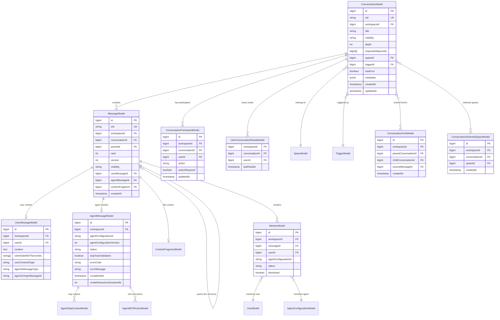

**Key Model Characteristics:**

- **`ConversationModel`**: Central entity with visibility control, space association, and metadata support
- **`MessageModel`**: Versioning support via `rank` (position in conversation) and `version` (edit number), with `parentId` linking versions
- **`UserMessageModel`** / **`AgentMessageModel`**: Separate tables for user and agent content, referenced by `MessageModel`
- **`MentionModel`**: Tracks both user and agent mentions with status for approval workflows
- **`ConversationParticipantModel`**: Records user interactions (posted, reacted, subscribed) with action-required flag
- **`UserConversationReadsModel`**: Separate table for tracking last-read timestamps per user
- **`ConversationForkModel`**: Links conversations that are forked from one another.
- **`ConversationSelectedSpaceModel`**: Stores explicit space selections for a conversation.

Sources: [front/lib/models/agent/conversation.ts:21-425](), [front/lib/resources/conversation_resource.ts](), [front/lib/models/agent/conversation_fork.ts](), [front/lib/models/agent/conversation_selected_space.ts]()

### Type Definitions

```typescript
// Core conversation type with full content
type ConversationType = {
  id: ModelId;
  owner: WorkspaceType;
  created: number;
  updated: number;
  sId: string;
  title: string | null;
  depth: number;
  content: (UserMessageType[] | AgentMessageType[] | ContentFragmentType[])[];
  lastReadMs: number;
  unread: boolean;
  actionRequired: boolean;
  hasError: boolean;
  visibility: ConversationVisibility;
  requestedSpaceIds: string[];
  spaceId: string | null;
  triggerId: string | null;
  metadata: ConversationMetadata;
  forkedFrom: ConversationForkedFromType | null;
  forkedChildren: ConversationForkedChildType[];
  selectedSpaceIds: string[];
};

// Lightweight version without content (for listings)
type ConversationWithoutContentType = Omit<ConversationType, 'owner' | 'visibility' | 'content'>;

// Visibility states
type ConversationVisibility = "unlisted" | "deleted" | "test";
```

The `content` array uses a two-dimensional structure: `content[rank][version]`, where:
- **`rank`**: Position of the message in the conversation (0, 1, 2, ...)
- **`version`**: Edit version at that rank (0 for original, 1+ for edits)

This structure enables both message editing (new versions at the same rank) and conversation flow (sequential ranks).

Sources: [front/types/assistant/conversation.ts:279-327]()

## Conversation Lifecycle

### Creating Conversations

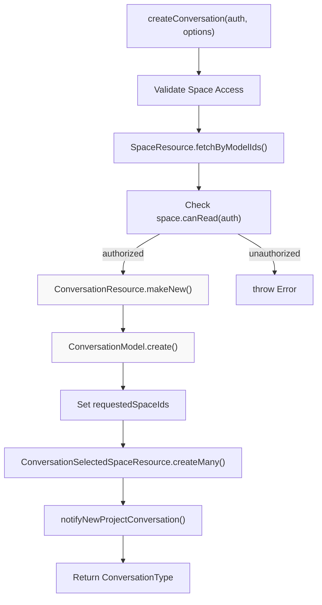

**Function:** `createConversation(auth, options)`

**Parameters:**
- `title`: Initial conversation title (nullable)
- `visibility`: `"unlisted"` (default), `"deleted"`, or `"test"`
- `spaceId`: Optional space association for project conversations
- `triggerId`: Optional trigger that created this conversation
- `depth`: Nesting level for multi-agent conversations (default: 0)
- `metadata`: Custom metadata object
- `selectedSpaceIds`: Optional array of space SIDs explicitly selected for the conversation.

**Process:**
1. Validates space existence and user permissions via `SpaceResource.fetchByModelIds()` [front/lib/api/assistant/conversation.ts:139-147]()
2. Creates conversation with `ConversationResource.makeNew()`, which:
   - Generates a random `sId` using `generateRandomModelSId()`
   - Adds `spaceId` to `requestedSpaceIds` array
   - Creates database record via `ConversationModel.create()`
   - Creates `ConversationSelectedSpaceModel` entries for `selectedSpaceIds` [front/lib/resources/conversation_resource.ts:97-134]()
3. For project conversations, triggers notification via `notifyNewProjectConversation()` [front/lib/api/assistant/conversation.ts:166-170]()
4. Returns full `ConversationType` object with empty `content` array

**Example:**
```typescript
const conversation = await createConversation(auth, {
  title: "Customer Support Q&A",
  visibility: "unlisted",
  spaceId: projectSpace.id,
  metadata: { source: "zendesk", ticketId: "12345" },
  selectedSpaceIds: ["space_abc", "space_def"]
});
```

Sources: [front/lib/api/assistant/conversation.ts:118-191](), [front/lib/resources/conversation_resource.ts:97-134]()

### Updating Conversations

**Title Updates:**

```typescript
await updateConversationTitle(auth, {
  conversationId: "conv_abc123",
  title: "Updated Title"
});
```

Updates are performed via `conversation.updateTitle()` which directly modifies the `ConversationModel` record [front/lib/api/assistant/conversation.ts:193-215]().

**Requirements Updates:**

The `updateConversationRequirements()` function manages the `requestedSpaceIds` array based on mentioned agents and content fragments [front/lib/api/assistant/conversation/mentions.ts:360-454]():

- For **project conversations**: Strips all space requirements except the project's `spaceId`
- For **regular conversations**: Adds space requirements from agents and content fragments additively (never removes requirements)
- Uses `ConversationResource.updateRequirements()` within transactions

Sources: [front/lib/api/assistant/conversation.ts:193-215](), [front/lib/api/assistant/conversation/mentions.ts:360-454]()

### Deleting or Leaving Conversations

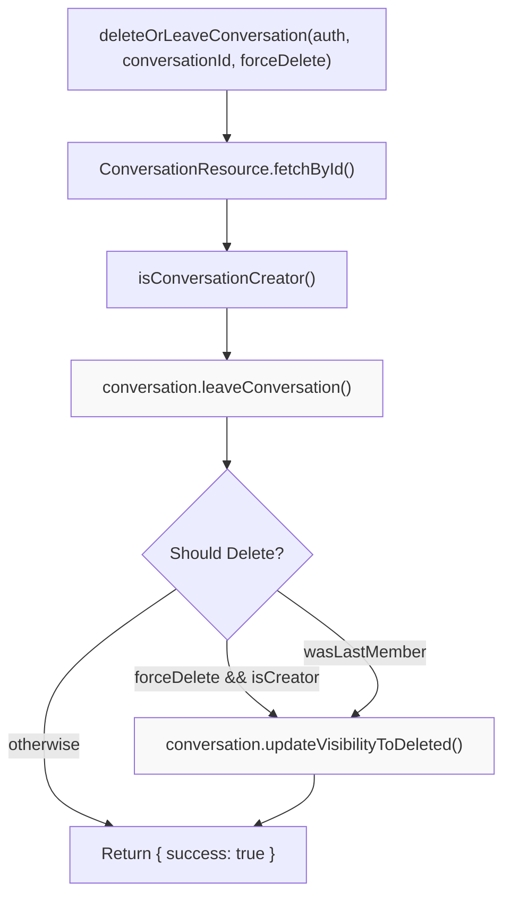

**Function:** `deleteOrLeaveConversation(auth, conversationId, forceDelete)`

**Deletion Logic:**
1. Fetches conversation (including soft-deleted ones) [front/lib/api/assistant/conversation.ts:233-239]()
2. Checks if user is the conversation creator
3. Calls `conversation.leaveConversation(auth)` which removes the user from `ConversationParticipantModel` [front/lib/resources/conversation_resource.ts:1195-1270]()
4. Soft-deletes the conversation (sets `visibility = 'deleted'`) if:
   - User was the last participant (`affectedCount === 0 && wasLastMember`)
   - User is creator and `forceDelete = true`

**Important:** Conversations are **never hard-deleted**. The `visibility = 'deleted'` flag hides them from normal queries but preserves data for audit purposes. The `destroyConversation` function, used internally by Poke, performs a hard delete, removing all associated messages, actions, content fragments, and sandbox policies. [front/lib/api/assistant/conversation/destroy.ts:219-249]()

Sources: [front/lib/api/assistant/conversation.ts:223-280](), [front/lib/resources/conversation_resource.ts:1195-1270](), [front/lib/api/assistant/conversation/destroy.ts:219-249]()

## Message Operations

### Posting User Messages

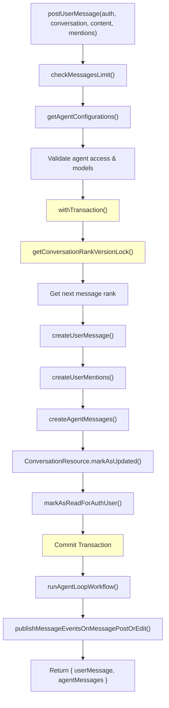

**Function:** `postUserMessage(auth, { conversation, content, mentions, context, skipToolsValidation })`

**Pre-Transaction Steps:**

1. **Rate Limiting**: Checks plan limits and rate limits via `checkMessagesLimit()` [front/lib/api/assistant/conversation.ts:590-593]()
2. **Agent Validation**: Fetches agent configurations and validates:
   - Agent is accessible (`canAccessAgent()`)
   - Model provider is whitelisted for workspace
   - Model feature flags are enabled [front/lib/api/assistant/conversation.ts:597-661]()
3. **Participation Update**: Upserts user participation (except for `run_agent` origin messages) [front/lib/api/assistant/conversation.ts:611-616]()

**Transaction Steps:**

Within a PostgreSQL transaction [front/lib/api/assistant/conversation.ts:664-765]():

1. **Advisory Lock**: Acquires conversation-specific lock via `pg_advisory_xact_lock()` to prevent concurrent message creation [front/lib/api/assistant/conversation.ts:437-462]()
2. **Clear Error Flag**: Resets `conversation.hasError = false` if set [front/lib/api/assistant/conversation.ts:671-679]()
3. **Get Next Rank**: Queries `MAX(rank)` from `MessageModel` and increments [front/lib/api/assistant/conversation.ts:681-687]()
4. **Create User Message**: Calls `createUserMessage()` which:
   - Creates `UserMessageModel` with content and context
   - Creates `MessageModel` with rank, version=0, and generated `sId`
   - Returns `UserMessageTypeWithoutMentions` [front/lib/api/assistant/conversation.ts:698-709]()
5. **Process Mentions**: 
   - User mentions via `createUserMentions()` [front/lib/api/assistant/conversation.ts:724-729]()
   - Agent mentions via `createAgentMessages()`, which creates `AgentMessageModel` and `MentionModel` records [front/lib/api/assistant/conversation.ts:731-743]()
6. **Update Conversation**: Marks conversation as updated and read by current user [front/lib/api/assistant/conversation.ts:753-759]()

**Post-Transaction Steps:**

After transaction commits [front/lib/api/assistant/conversation.ts:791-816]():

1. **Trigger Notifications**: Sends unread notification via `triggerConversationUnreadNotifications()` [front/lib/api/assistant/conversation.ts:776-779]()
2. **Track Analytics**: Records user message event via `ServerSideTracking.trackUserMessage()` [front/lib/api/assistant/conversation.ts:781-787]()
3. **Launch Agent Workflows**: Calls `runAgentLoopWorkflow()` for each agent message, which starts Temporal workflows [front/lib/api/assistant/conversation.ts:791-797]()
4. **Publish Events**: Sends real-time events to connected clients via Redis [front/lib/api/assistant/conversation.ts:799-816]()

**Key Design Decisions:**

- Agent loop workflows launch **after transaction commit** to ensure messages are persisted before execution starts [front/lib/api/assistant/conversation.ts:790]()
- Advisory lock prevents race conditions when multiple users post simultaneously
- `requestedSpaceIds` updated via `updateConversationRequirements()` to track all space permissions needed for conversation access

Sources: [front/lib/api/assistant/conversation.ts:523-822](), [front/lib/api/assistant/conversation/mentions.ts:360-454](), [front/lib/api/assistant/conversation/messages.ts:619-806]()

### Editing User Messages

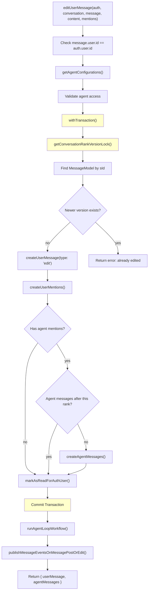

**Function:** `editUserMessage(auth, { conversation, message, content, mentions, skipToolsValidation })`

**Key Constraints:**

1. **Author-only editing**: Only the original author can edit their message [front/lib/api/assistant/conversation.ts:885-893]()
2. **Single edit at a time**: If a newer version exists (same rank, higher version), returns error [front/lib/api/assistant/conversation.ts:973-987]()
3. **Conditional agent messages**: New agent messages only created if:
   - Edit adds agent mentions, AND
   - No agent messages exist after this rank [front/lib/api/assistant/conversation.ts:1009-1052]()

**Versioning Logic:**

The edit creates a new `MessageModel` with:
- Same `rank` as original
- `version = original.version + 1`
- `parentId` pointing to original message
- New `UserMessageModel` with updated content

This preserves edit history while maintaining conversation order via rank [front/lib/api/assistant/conversation.ts:989-998]().

**Example Edit Scenario:**

```
Rank 0: User message (version 0) -> "Hello @Agent1"
Rank 1: Agent1 response
[User edits Rank 0]
Rank 0: User message (version 1) -> "Hello @Agent1 and @Agent2"
[NO new agent messages created because agent message already exists at Rank 1]
```

But if editing at the end of conversation:
```
Rank 0: User message (version 0) -> "Hello"
[User edits Rank 0]
Rank 0: User message (version 1) -> "Hello @Agent1"
Rank 1: Agent1 response (NEW)
```

Sources: [front/lib/api/assistant/conversation.ts:851-1131](), [front/lib/api/assistant/conversation.test.ts:304-461]()

### Retrying Agent Messages

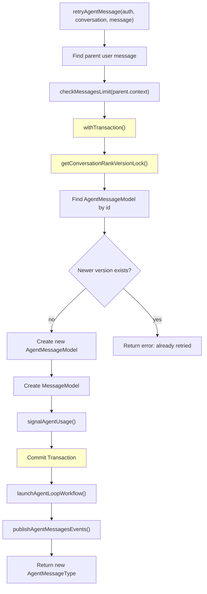

**Function:** `retryAgentMessage(auth, { conversation, message })`

**Rate Limiting Context:**

The retry uses the **parent user message's context** for rate limiting [front/lib/api/assistant/conversation.ts:1192-1217](). This ensures:
- Retries count toward the same origin (web vs. programmatic) as the original request
- API key limits apply correctly for programmatic retries
- Users can't bypass limits by repeatedly retrying

**Retry Process:**

1. Finds parent user message to extract original context [front/lib/api/assistant/conversation.ts:1192-1207]()
2. Checks rate limits using parent's `context` [front/lib/api/assistant/conversation.ts:1210-1217]()
3. Within transaction:
   - Acquires advisory lock
   - Verifies no newer version exists (same rank, higher version)
   - Creates new `AgentMessageModel` with `status = "created"`
   - Creates new `MessageModel` with `version = original.version + 1`, `parentId = original.id`
   - Signals agent usage for analytics
4. After commit:
   - Launches new agent loop workflow via `launchAgentLoopWorkflow()`
   - Publishes retry event to connected clients

**Retry vs. Edit:**

Unlike user message edits, agent message retries **always** create a new agent execution at the same rank. This allows users to retry failed/cancelled agents or try different responses.

Sources: [front/lib/api/assistant/conversation.ts:1180-1357](), [front/lib/api/assistant/conversation.test.ts:120-246]()

### Soft Deleting Messages

**Agent Messages:**

```typescript
await softDeleteAgentMessage(auth, {
  conversation,
  message
});
```

Creates a new message version with `visibility = "deleted"` [front/lib/api/assistant/conversation.ts:1364-1469]():
- Same rank and incremented version
- Sets `visibility` to `"deleted"` on new `MessageModel`
- Preserves original message data for audit trail

**User Messages:**

User message deletion uses the same `createUserMessage()` function with `type: "delete"` metadata [front/lib/api/assistant/conversation/messages.ts:506-516](), creating a new version marked as deleted.

Sources: [front/lib/api/assistant/conversation.ts:1364-1469](), [front/lib/api/assistant/conversation/messages.ts:456-617]()

## ConversationResource Interface

The `ConversationResource` class provides a resource-based abstraction over `ConversationModel` with built-in permission filtering and participation tracking.

### Core Methods

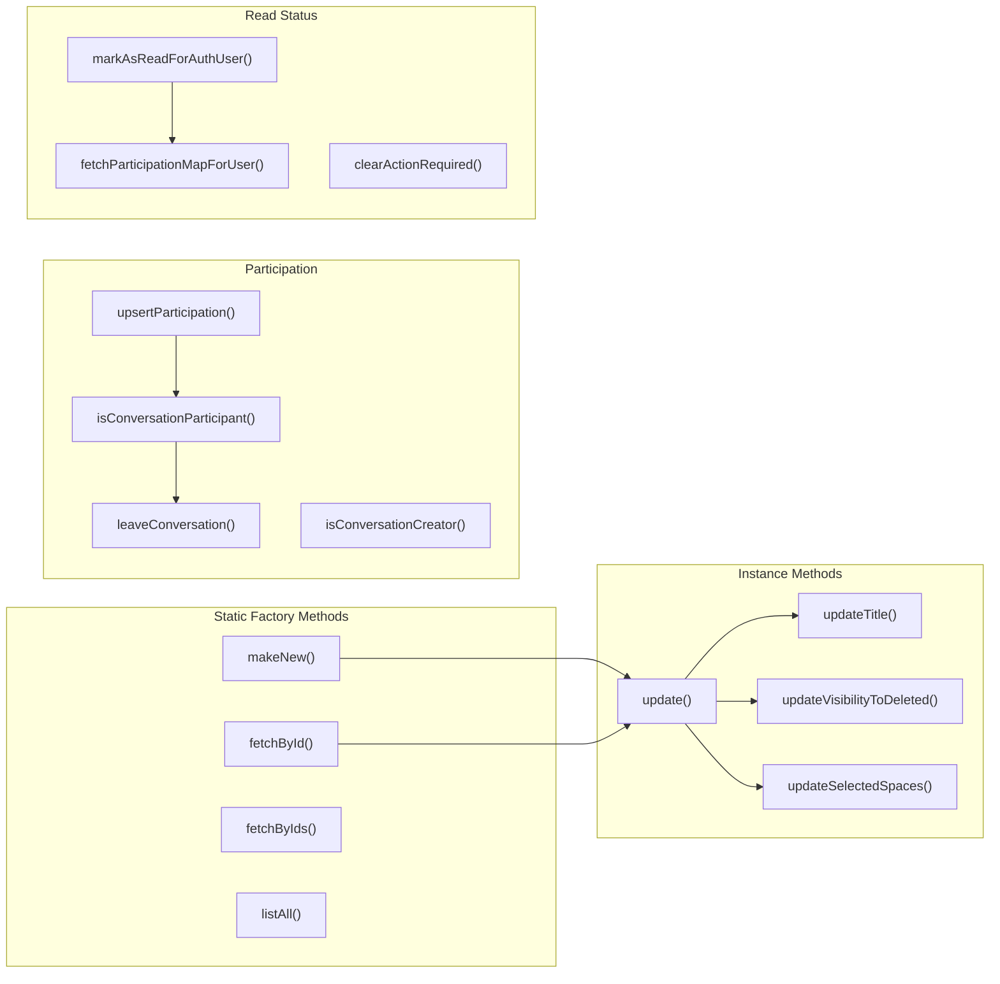

**Fetching Conversations:**

| Method | Purpose | Permission Filtering |
|--------|---------|---------------------|
| `fetchById(auth, sId, options?)` | Single conversation by ID | Yes (via `baseFetchWithAuthorization`) |
| `fetchByIds(auth, sIds[], options?)` | Multiple conversations | Yes |
| `listAll(auth, options?)` | All workspace conversations | Yes |
| `listPrivateConversationsForUser(auth)` | User's private conversations | Yes (via participation) |
| `listConversationsInSpace(auth, spaceId, options?)` | Space conversations | Yes |

**Permission Filtering Logic:**

All fetch methods use `baseFetchWithAuthorization()` which [front/lib/resources/conversation_resource.ts:180-256]():
1. Fetches conversations from database
2. Loads all referenced spaces via `SpaceResource.fetchByModelIds()`
3. Filters out conversations with missing/deleted spaces
4. Creates space-to-groups mapping for efficient permission checks
5. Filters conversations using `auth.canRead(createResourcePermissionsFromSpacesWithMap(...))`

This ensures users only see conversations where they have read access to **all** required spaces in `requestedSpaceIds`.

**Example:**
```typescript
// Fetch conversation with automatic permission check
const conversation = await ConversationResource.fetchById(auth, "conv_abc");
if (!conversation) {
  // Either doesn't exist or user lacks permission
}

// Fetch without permission filtering (internal use only)
const conversationRaw = await ConversationResource.fetchById(auth, "conv_abc", {
  dangerouslySkipPermissionFiltering: true
});
```

Sources: [front/lib/resources/conversation_resource.ts:180-256](), [front/lib/resources/conversation_resource.ts:374-394]()

### Participation Management

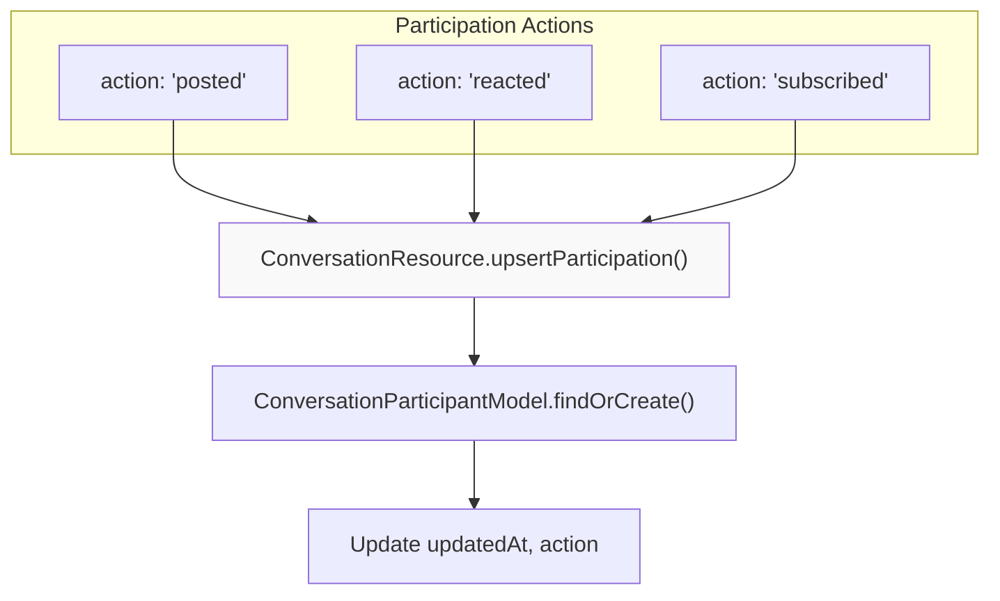

**Function:** `ConversationResource.upsertParticipation(auth, { conversation, action, user, lastReadAt?, transaction? })`

**Actions:**
- `"posted"`: User sent a message
- `"reacted"`: User added a reaction
- `"subscribed"`: User was invited/mentioned

**Implementation:**

Uses `ConversationParticipantModel.findOrCreate()` to insert or update participation record [front/lib/resources/conversation_resource.ts:1110-1147]():
- Creates record if first participation
- Updates `updatedAt` on subsequent actions
- Optionally sets `lastReadAt` for read tracking
- Records `actionRequired` flag for approval workflows

**Checking Participation:**

```typescript
const isParticipant = await ConversationResource.isConversationParticipant(
  auth,
  { conversation, user: user.toJSON() }
);
```

Queries `ConversationParticipantModel` for matching record [front/lib/resources/conversation_resource.ts:1149-1168]().

Sources: [front/lib/resources/conversation_resource.ts:1086-1193]()

### Read Status Management

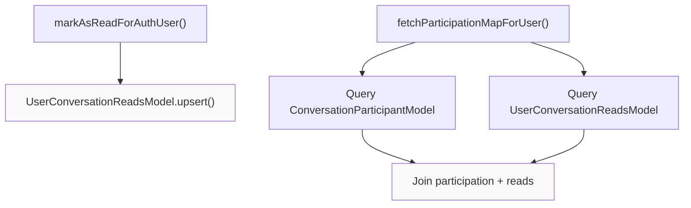

**Marking as Read:**

```typescript
await ConversationResource.markAsReadForAuthUser(auth, {
  conversation,
  transaction: t
});
```

Uses `UserConversationReadsModel.upsert()` to set `lastReadAt = NOW()` [front/lib/resources/conversation_resource.ts:1076-1084](). This is separate from participation tracking to allow non-participants to mark conversations as read.

**Fetching Participation + Read Status:**

```typescript
const participationMap = await ConversationResource.fetchParticipationMapForUser(
  auth,
  conversationIds?
);
// Returns Map<conversationId, { actionRequired, lastReadAt, updated }>
```

Performs two queries and joins the results [front/lib/resources/conversation_resource.ts:284-330]():
1. Fetches participation records for user
2. Fetches read status records for same conversations
3. Returns map with combined data

**Unread Detection:**

A conversation is unread if:
```typescript
lastReadAt === null || conversation.updatedAt > lastReadAt
```

This logic appears in multiple places, e.g., [front/lib/resources/conversation_resource.ts:793-805]().

Sources: [front/lib/resources/conversation_resource.ts:1076-1084](), [front/lib/resources/conversation_resource.ts:284-330]()

### Conversation Forks

The system supports conversation forking, allowing users to branch off a conversation at a specific message.

**Forking Logic:**

- When a conversation is forked, a new `ConversationModel` is created.
- A `ConversationForkModel` entry links the original (parent) conversation and the new (child) conversation, along with the `sourceMessageId` where the fork occurred. [front/lib/models/agent/conversation_fork.ts]()
- The `ConversationResource.fetchById` method can include forking data via the `includeForkingData` option. [front/lib/resources/conversation_resource.ts:83-84]()
- The `ConversationForkResource` provides methods to manage these relationships, such as `listByParentConversation` and `listByChildConversation`. [front/lib/resources/conversation_fork_resource.ts]()

**UI Representation:**

- The `ConversationViewer` component can display `ConversationForkNotice` messages to indicate where a conversation was forked. [front/components/assistant/conversation/ConversationViewer.tsx:171-177]()
- These notices include links to the child conversation.

Sources: [front/lib/models/agent/conversation_fork.ts](), [front/lib/resources/conversation_resource.ts:83-84](), [front/lib/resources/conversation_fork_resource.ts](), [front/components/assistant/conversation/ConversationViewer.tsx:171-177]()

### Selected Spaces

Conversations can have explicitly "selected" spaces, which are distinct from the `requestedSpaceIds` derived from mentions.

**Management:**

- `ConversationSelectedSpaceModel` stores the association between a conversation and a selected space. [front/lib/models/agent/conversation_selected_space.ts]()
- `ConversationSelectedSpaceResource` provides CRUD operations for these associations. [front/lib/resources/conversation_selected_space_resource.ts]()
- The `ConversationResource.updateSelectedSpaces` method allows updating the set of selected spaces for a conversation. [front/lib/resources/conversation_resource.ts:1272-1309]()

**Purpose:**

- Allows users to explicitly associate a conversation with certain spaces, even if no agents or content fragments in the conversation directly require those spaces.
- Used for filtering and organizing conversations within the UI.

Sources: [front/lib/models/agent/conversation_selected_space.ts](), [front/lib/resources/conversation_selected_space_resource.ts](), [front/lib/resources/conversation_resource.ts:1272-1309]()

## Message Versioning and Ranking

### Rank and Version System

Messages use a two-dimensional coordinate system:

| Coordinate | Meaning | Changes When |
|------------|---------|--------------|
| `rank` | Position in conversation | New message added (user or agent) |
| `version` | Edit iteration at this rank | Message edited or retried |

**Example Conversation:**

```
rank=0, version=0: User message "Hello"
rank=1, version=0: Agent message "Hi!"
rank=0, version=1: User message "Hello @Agent" (edit)
rank=1, version=1: Agent message "Hi! How can I help?" (retry)
rank=2, version=0: User message "Thanks"
```

**Content Array Structure:**

```typescript
content: [
  // Rank 0
  [
    { ...userMessage, version: 0 },
    { ...userMessage, version: 1 }  // Edit
  ],
  // Rank 1
  [
    { ...agentMessage, version: 0 },
    { ...agentMessage, version: 1 }  // Retry
  ],
  // Rank 2
  [
    { ...userMessage, version: 0 }
  ]
]
```

The UI typically displays only the **latest version** at each rank, but the full history is preserved in the database via `parentId` linkage.

Sources: [front/lib/api/assistant/conversation/fetch.ts:143-174]()

### Rank Allocation

**Next Rank Calculation:**

```typescript
let nextMessageRank = ((await MessageModel.max<number | null, MessageModel>("rank", {
  where: { conversationId: conversation.id },
  transaction: t
})) ?? -1) + 1;
```

This pattern appears in [front/lib/api/assistant/conversation.ts:681-687]() and ensures ranks are sequential starting from 0.

**Rank Allocation Rules:**

1. **User messages** always get the next available rank
2. **Agent messages** immediately follow their parent user message (nextRank++)
3. **Content fragments** get ranks before their associated user message [front/tests/utils/ConversationFactory.ts:72-91]()

Sources: [front/lib/api/assistant/conversation.ts:681-687](), [front/tests/utils/ConversationFactory.ts:72-91]()

## Rate Limiting

### Rate Limit Tiers

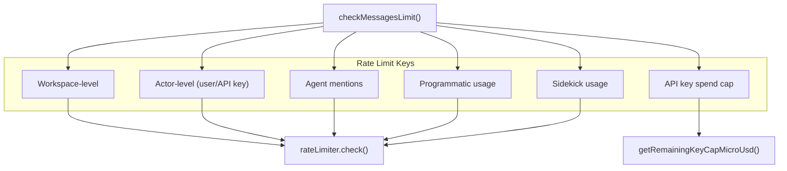

**Rate Limit Checks in `checkMessagesLimit()`:**

| Check | Key | Limit | Window |
|-------|-----|-------|--------|
| Per workspace | `message:workspace:{wId}` | Plan-dependent | 1 minute |
| Per actor | `message:workspace:{wId}:user:{userId}` or `...key:{keyId}` | 60 messages | 1 minute |
| Agent mentions | `agent_mentions:workspace:{wId}` | Plan-dependent | 1 hour |
| Key spend cap | `key_cap:{keyId}` | Key's `microUsdBudget` | No window |
| Programmatic usage | `programmatic_usage:workspace:{wId}` | Based on spend | 1 minute |
| Sidekick usage | `sidekick_message:workspace:{wId}:user:{userId}` | Plan-dependent | 1 day |

**Implementation:**

The function is located in [front/lib/api/assistant/conversation.ts:1508-1697]() and:

1. Computes effective limits based on plan and feature flags
2. Checks all applicable rate limiters using `rateLimiter.check()`
3. For API keys, checks remaining budget via `getRemainingKeyCapMicroUsd()`
4. For programmatic usage, converts spend to message allowance (1 message per $3)
5. Returns first limit error encountered, or `Ok(undefined)` if all pass

**Context-Aware Limiting:**

Rate limits distinguish between user and programmatic usage based on `context.origin`:
- **User origins**: `web`, `slack`, `email`, etc.
- **Programmatic origins**: `api`, `cli_programmatic`, `triggered_programmatic`, integrations (zapier, make, etc.)

This prevents API users from consuming workspace message limits intended for human users [front/lib/api/assistant/conversation.ts:1631-1697]().

Sources: [front/lib/api/assistant/conversation.ts:1508-1697](), [front/lib/api/assistant/rate_limits.ts]()

## Transaction Management

### Advisory Lock Mechanism

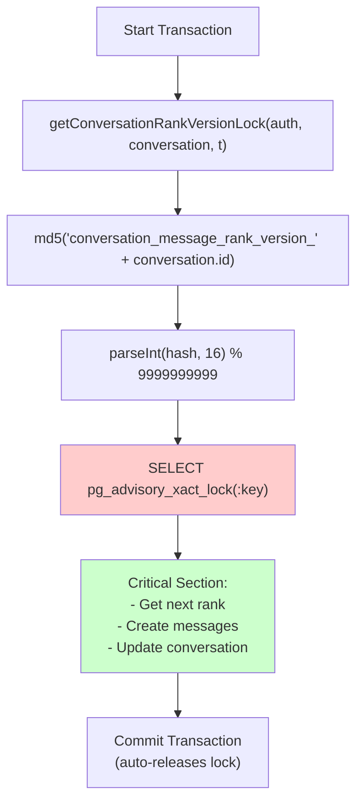

**Purpose:**

Prevents race conditions when multiple users post messages simultaneously to the same conversation. Without locking, concurrent requests could:
- Allocate the same rank to different messages
- Create version conflicts
- Corrupt message ordering

**Implementation:**

```typescript
async function getConversationRankVersionLock(
  auth: Authenticator,
  conversation: ConversationWithoutContentType,
  t: Transaction
) {
  const hash = md5(`conversation_message_rank_version_${conversation.id}`);
  const lockKey = parseInt(hash, 16) % 9999999999;
  
  await frontSequelize.query("SELECT pg_advisory_xact_lock(:key)", {
    transaction: t,
    replacements: { key: lockKey }
  });
}
```

[front/lib/api/assistant/conversation/lock.ts:13-24]()

**Advisory Lock Characteristics:**

- **Session-scoped**: Lock held for transaction duration only (`pg_advisory_xact_lock`)
- **Non-blocking**: If lock unavailable, query waits (no timeout)
- **Automatic release**: Lock released on transaction commit/rollback
- **Per-conversation**: Lock key derived from conversation ID, so different conversations can post concurrently

**Important Warning:**

Once the advisory lock is acquired, **no SQL queries should be issued outside the transaction** [front/lib/api/assistant/conversation/lock.ts:8-12](). This prevents deadlocks when the connection pool is exhausted—queries outside the transaction compete for connections, while the locked transaction holds a connection and waits for data.

Sources: [front/lib/api/assistant/conversation/lock.ts:13-24]()

### Transaction Scope

**What's in the transaction:**

```typescript
const result = await withTransaction(async (t) => {
  await getConversationRankVersionLock(auth, conversation, t);
  
  // All message creation
  const userMessage = await createUserMessage(..., t);
  const mentions = await createUserMentions(..., t);
  const agentMessages = await createAgentMessages(..., t);
  
  // Conversation updates
  await ConversationResource.markAsUpdated(auth, { conversation, t });
  await ConversationResource.markAsReadForAuthUser(auth, { conversation, t });
  
  return { userMessage, agentMessages };
});
```

**What's after the transaction:**

```typescript
// After commit, safe to do I/O
await runAgentLoopWorkflow({ auth, agentMessages, conversation, userMessage });
await publishMessageEventsOnMessagePostOrEdit(conversation, userMessage, agentMessages);
await ensureConversationTitle(auth, { conversation, userMessage });
```

The transaction ensures **atomicity** of message creation. If any step fails, all database changes roll back. Agent workflows launch only after commit to ensure messages are persisted before execution starts.

Sources: [front/lib/api/assistant/conversation.ts:664-822]()

## API Routes

**Primary Conversation Endpoints:**

| Method | Route | Handler Function | Purpose |
|--------|-------|------------------|---------|
| POST | `/api/w/[wId]/assistant/conversations` | `createConversation()` | Create new conversation |
| GET | `/api/w/[wId]/assistant/conversations/[cId]` | `getConversation()` | Fetch conversation with messages |
| PATCH | `/api/w/[wId]/assistant/conversations/[cId]` | `updateConversationTitle()` | Update title |
| DELETE | `/api/w/[wId]/assistant/conversations/[cId]` | `deleteOrLeaveConversation()` | Delete/leave conversation |
| POST | `/api/w/[wId]/assistant/conversations/[cId]/messages` | `postUserMessage()` | Post new user message |
| PATCH | `/api/w/[wId]/assistant/conversations/[cId]/messages/[mId]` | `editUserMessage()` | Edit user message |
| POST | `/api/w/[wId]/assistant/conversations/[cId]/messages/[mId]/retry` | `retryAgentMessage()` | Retry agent message |

**Space-Scoped Endpoints:**

| Method | Route | Purpose |
|--------|-------|---------|
| GET | `/api/w/[wId]/assistant/conversations/spaces` | Fetch unread conversations by space |
| GET | `/api/w/[wId]/assistant/conversations/spaces/[spaceId]` | Fetch conversations in specific space |

Sources: [front/lib/api/assistant/conversation.ts](), [front-api/routes/w/[wId]/assistant/conversations/index.ts](), [front-api/routes/w/[wId]/assistant/conversations/[cId]/messages/index.ts]()

---

