<!-- source: DeepWiki mcp.deepwiki.com · repo dust-tt/dust · page 5.3 Event Streaming and Real-time Updates · fetched 2026-10-26 -->

# Event Streaming and Real-time Updates

<details>
<summary>Relevant source files</summary>

The following files were used as context for generating this wiki page:

- [connectors/vite.setup.ts](connectors/vite.setup.ts)
- [front-api/lib/api/poke/cache_catalog.test.ts](front-api/lib/api/poke/cache_catalog.test.ts)
- [front-api/lib/api/poke/cache_catalog.ts](front-api/lib/api/poke/cache_catalog.ts)
- [front-api/public/swagger.json](front-api/public/swagger.json)
- [front-api/routes/poke/cache/catalog.ts](front-api/routes/poke/cache/catalog.ts)
- [front-api/routes/poke/cache/index.test.ts](front-api/routes/poke/cache/index.test.ts)
- [front-api/routes/poke/cache/index.ts](front-api/routes/poke/cache/index.ts)
- [front-api/routes/poke/workspaces/[wId]/agent_configurations/[aId]/index.ts](front-api/routes/poke/workspaces/[wId]/agent_configurations/[aId]/index.ts)
- [front-api/routes/swagger_private_schemas.ts](front-api/routes/swagger_private_schemas.ts)
- [front-api/routes/v1/w/[wId]/assistant/agent_configurations/[sId]/index.ts](front-api/routes/v1/w/[wId]/assistant/agent_configurations/[sId]/index.ts)
- [front-api/routes/v1/w/[wId]/index.ts](front-api/routes/v1/w/[wId]/index.ts)
- [front-api/routes/v1/w/[wId]/swagger_schemas.ts](front-api/routes/v1/w/[wId]/swagger_schemas.ts)
- [front-api/routes/w/[wId]/assistant/agent_configurations/[aId]/editors.test.ts](front-api/routes/w/[wId]/assistant/agent_configurations/[aId]/editors.test.ts)
- [front-api/routes/w/[wId]/assistant/agent_configurations/[aId]/editors.ts](front-api/routes/w/[wId]/assistant/agent_configurations/[aId]/editors.ts)
- [front-api/routes/w/[wId]/assistant/agent_configurations/[aId]/index.test.ts](front-api/routes/w/[wId]/assistant/agent_configurations/[aId]/index.test.ts)
- [front-api/routes/w/[wId]/assistant/agent_configurations/[aId]/index.ts](front-api/routes/w/[wId]/assistant/agent_configurations/[aId]/index.ts)
- [front-api/routes/w/[wId]/assistant/agent_configurations/[aId]/linked_slack_channels.ts](front-api/routes/w/[wId]/assistant/agent_configurations/[aId]/linked_slack_channels.ts)
- [front-api/routes/w/[wId]/assistant/agent_configurations/[aId]/tags.ts](front-api/routes/w/[wId]/assistant/agent_configurations/[aId]/tags.ts)
- [front-api/routes/w/[wId]/assistant/agent_configurations/batch_update_scope.test.ts](front-api/routes/w/[wId]/assistant/agent_configurations/batch_update_scope.test.ts)
- [front-api/routes/w/[wId]/assistant/agent_configurations/batch_update_tags.test.ts](front-api/routes/w/[wId]/assistant/agent_configurations/batch_update_tags.test.ts)
- [front-api/routes/w/[wId]/assistant/agent_configurations/batch_update_tags.ts](front-api/routes/w/[wId]/assistant/agent_configurations/batch_update_tags.ts)
- [front-api/routes/w/[wId]/files/[fileId]/index.test.ts](front-api/routes/w/[wId]/files/[fileId]/index.test.ts)
- [front-api/routes/w/[wId]/files/[fileId]/index.ts](front-api/routes/w/[wId]/files/[fileId]/index.ts)
- [front-api/routes/w/[wId]/skills/[sId]/files/[fileId]/content.test.ts](front-api/routes/w/[wId]/skills/[sId]/files/[fileId]/content.test.ts)
- [front/admin/db.ts](front/admin/db.ts)
- [front/components/assistant/conversation/AgentMessage.tsx](front/components/assistant/conversation/AgentMessage.tsx)
- [front/components/assistant/conversation/CompactionMessage.tsx](front/components/assistant/conversation/CompactionMessage.tsx)
- [front/components/assistant/conversation/ConversationViewer.tsx](front/components/assistant/conversation/ConversationViewer.tsx)
- [front/components/assistant/conversation/MessageItem.tsx](front/components/assistant/conversation/MessageItem.tsx)
- [front/components/assistant/conversation/UserMessage.tsx](front/components/assistant/conversation/UserMessage.tsx)
- [front/components/assistant/conversation/actions/AgentActionsPanel.tsx](front/components/assistant/conversation/actions/AgentActionsPanel.tsx)
- [front/components/assistant/conversation/actions/inline/InlineActivitySteps.tsx](front/components/assistant/conversation/actions/inline/InlineActivitySteps.tsx)
- [front/components/assistant/conversation/actions/inline/TimelineRow.tsx](front/components/assistant/conversation/actions/inline/TimelineRow.tsx)
- [front/components/assistant/conversation/types.ts](front/components/assistant/conversation/types.ts)
- [front/hooks/conversations/index.ts](front/hooks/conversations/index.ts)
- [front/hooks/conversations/useConversationMessages.ts](front/hooks/conversations/useConversationMessages.ts)
- [front/hooks/useAgentMessageStream.test.ts](front/hooks/useAgentMessageStream.test.ts)
- [front/hooks/useAgentMessageStream.ts](front/hooks/useAgentMessageStream.ts)
- [front/hooks/useChildAgentStream.ts](front/hooks/useChildAgentStream.ts)
- [front/hooks/useConversationEvents.ts](front/hooks/useConversationEvents.ts)
- [front/lib/api/assistant/activity_steps.test.ts](front/lib/api/assistant/activity_steps.test.ts)
- [front/lib/api/assistant/activity_steps.ts](front/lib/api/assistant/activity_steps.ts)
- [front/lib/api/assistant/configuration/agent.test.ts](front/lib/api/assistant/configuration/agent.test.ts)
- [front/lib/api/assistant/configuration/agent.ts](front/lib/api/assistant/configuration/agent.ts)
- [front/lib/api/assistant/conversation.test.ts](front/lib/api/assistant/conversation.test.ts)
- [front/lib/api/assistant/conversation.ts](front/lib/api/assistant/conversation.ts)
- [front/lib/api/assistant/conversation/destroy.ts](front/lib/api/assistant/conversation/destroy.ts)
- [front/lib/api/assistant/conversation/fetch.ts](front/lib/api/assistant/conversation/fetch.ts)
- [front/lib/api/assistant/conversation/forks.test.ts](front/lib/api/assistant/conversation/forks.test.ts)
- [front/lib/api/assistant/conversation/forks.ts](front/lib/api/assistant/conversation/forks.ts)
- [front/lib/api/assistant/conversation/messages.test.ts](front/lib/api/assistant/conversation/messages.test.ts)
- [front/lib/api/assistant/conversation/messages.ts](front/lib/api/assistant/conversation/messages.ts)
- [front/lib/api/assistant/conversation/permissions.test.ts](front/lib/api/assistant/conversation/permissions.test.ts)
- [front/lib/api/assistant/conversation/permissions.ts](front/lib/api/assistant/conversation/permissions.ts)
- [front/lib/api/assistant/conversation/validate_agent_mention.ts](front/lib/api/assistant/conversation/validate_agent_mention.ts)
- [front/lib/api/assistant/premium_model_limit.test.ts](front/lib/api/assistant/premium_model_limit.test.ts)
- [front/lib/api/assistant/premium_model_limit.ts](front/lib/api/assistant/premium_model_limit.ts)
- [front/lib/api/assistant/streaming/events.ts](front/lib/api/assistant/streaming/events.ts)
- [front/lib/api/assistant/streaming/types.ts](front/lib/api/assistant/streaming/types.ts)
- [front/lib/api/redis-hybrid-manager.ts](front/lib/api/redis-hybrid-manager.ts)
- [front/lib/api/redis.test.ts](front/lib/api/redis.test.ts)
- [front/lib/api/redis.ts](front/lib/api/redis.ts)
- [front/lib/api/resources/cached_resource_lookup.ts](front/lib/api/resources/cached_resource_lookup.ts)
- [front/lib/api/spaces/access.ts](front/lib/api/spaces/access.ts)
- [front/lib/models/agent/conversation.ts](front/lib/models/agent/conversation.ts)
- [front/lib/resources/conversation_resource.test.ts](front/lib/resources/conversation_resource.test.ts)
- [front/lib/resources/conversation_resource.ts](front/lib/resources/conversation_resource.ts)
- [front/lib/resources/storage/models/files.ts](front/lib/resources/storage/models/files.ts)
- [front/lib/resources/string_ids.ts](front/lib/resources/string_ids.ts)
- [front/lib/resources/tags_resource.ts](front/lib/resources/tags_resource.ts)
- [front/lib/utils/cache.test.ts](front/lib/utils/cache.test.ts)
- [front/lib/utils/cache.ts](front/lib/utils/cache.ts)
- [front/lib/utils/cache_operations.ts](front/lib/utils/cache_operations.ts)
- [front/migrations/20260828_restore_agent_editor_memberships.ts](front/migrations/20260828_restore_agent_editor_memberships.ts)
- [front/migrations/post-deploy/20260721120000_drop_shareable_files_workspace_id_file_id_index.sql](front/migrations/post-deploy/20260721120000_drop_shareable_files_workspace_id_file_id_index.sql)
- [front/migrations/pre-deploy/20260720180500_add_index_shareable_files_file_id.sql](front/migrations/pre-deploy/20260720180500_add_index_shareable_files_file_id.sql)
- [front/migrations/pre-deploy/20260819134521_add_file_system_node_id_to_files.sql](front/migrations/pre-deploy/20260819134521_add_file_system_node_id_to_files.sql)
- [front/poke/temporal/activities.ts](front/poke/temporal/activities.ts)
- [front/tests/utils/test_cls.ts](front/tests/utils/test_cls.ts)
- [front/types/assistant/conversation.ts](front/types/assistant/conversation.ts)
- [front/vite.setup.ts](front/vite.setup.ts)
- [sparkle/src/components/ConversationMessages.tsx](sparkle/src/components/ConversationMessages.tsx)

</details>


This document describes the event streaming infrastructure that delivers real-time updates to clients during conversation interactions. It covers the Redis pub/sub architecture, event coalescing mechanisms, SSE delivery, and how UI clients consume and render streaming events.

For information about message creation and persistence, see [Message Flow and Persistence](#5.2). For details about agent execution that generates these events, see [Agent Execution and Temporal Workflows](#3.3).

---

## Overview

The event streaming system enables real-time UI updates during agent execution through a Redis-based pub/sub architecture with Server-Sent Events (SSE) delivery:

1.  **Event Publishing**: Activities in Temporal workflows publish events to Redis channels as agent execution progresses
2.  **Event Coalescing**: A buffering mechanism batches rapid-fire events to reduce Redis load and network overhead
3.  **SSE Delivery**: Long-lived HTTP connections stream events from Redis to browser clients in real-time
4.  **Client Consumption**: React components subscribe to event streams and update the UI as tokens, actions, and status changes arrive

All conversation state changes flow through this streaming infrastructure, keeping multiple browser tabs synchronized with <100ms latency.

Sources: [front/lib/api/assistant/streaming/events.ts](), [front/temporal/agent_loop/activities/common.ts:112-197]()

---

## Redis Pub/Sub Architecture

### Channel Structure and Naming

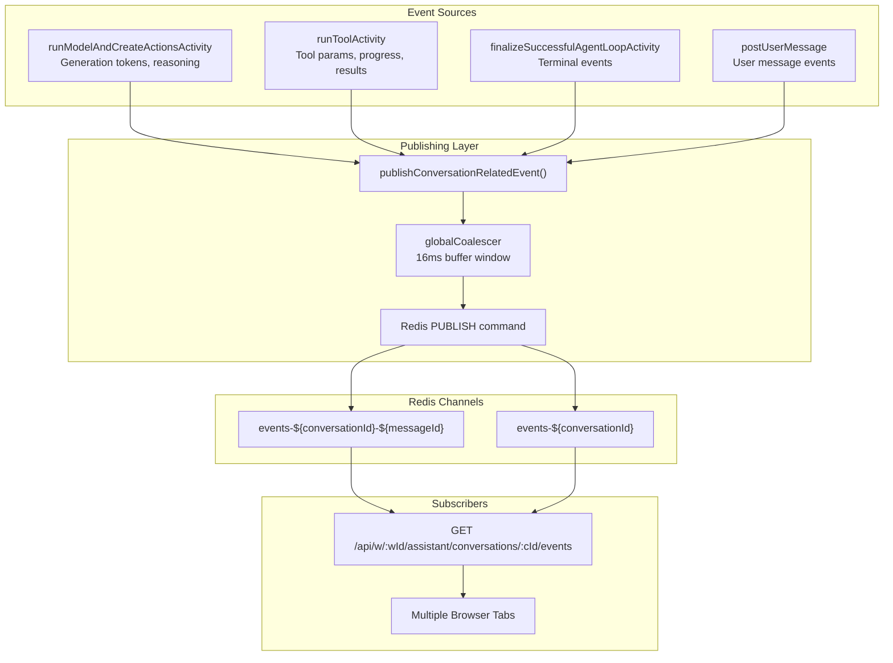

**Channel Identification**

Events are published to two types of Redis channels:

| Channel Pattern | Purpose | Example |
| :-------------- | :------------------------------------ | :------------------- |
| `events-${conversationId}-${messageId}` | Message-specific events (tokens, actions, status) | `events-conv123-msg456` |
| `events-${conversationId}` | Conversation-level events (title, butler suggestions) | `events-conv123` |

Clients subscribe to both channels to receive complete updates. The message channel uses the agent message ID, not the triggering user message ID.

Sources: [front/lib/api/assistant/streaming/events.ts](), [front/pages/api/w/[wId]/assistant/conversations/[cId]/events.ts]()

### Event Publishing Function

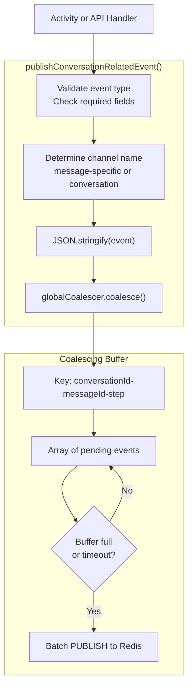

The `publishConversationRelatedEvent()` function serves as the central event publishing API. It:

1.  Validates the event structure against expected types
2.  Determines the appropriate Redis channel based on event type
3.  Serializes the event to JSON
4.  Passes it to the coalescer for batched publishing

Sources: [front/lib/api/assistant/streaming/events.ts](), [front/temporal/agent_loop/lib/event_coalescer.ts]()

---

## Event Coalescing Mechanism

### globalCoalescer Buffer Management

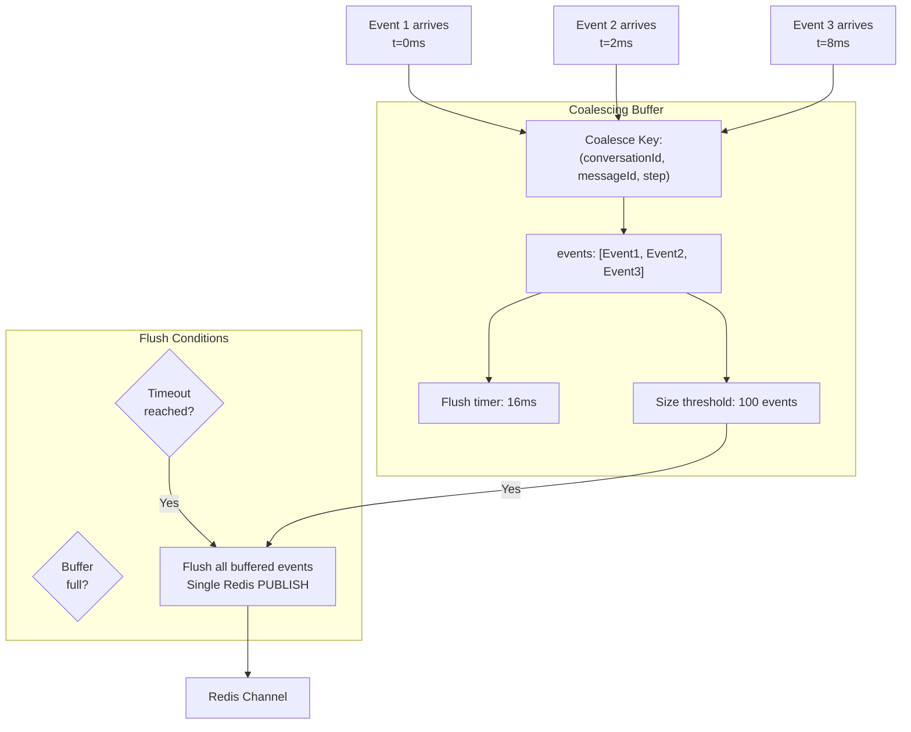

**Coalescing Strategy**

The `globalCoalescer` batches events using a composite key:
-   **Conversation ID**: Groups events for the same conversation
-   **Message ID**: Separates events for different agent messages
-   **Step**: Distinguishes multi-step agent executions

Events are buffered for up to 16ms or until the buffer contains 100 events, whichever comes first. This reduces Redis operations by ~10x during rapid token generation.

**Implementation Details**

```typescript
// Pseudo-code representation
class EventCoalescer {
  private buffers: Map<string, Event[]> = new Map();
  private timers: Map<string, NodeJS.Timeout> = new Map();
  
  coalesce(key: string, event: Event) {
    const buffer = this.buffers.get(key) || [];
    buffer.push(event);
    this.buffers.set(key, buffer);
    
    if (!this.timers.has(key)) {
      this.timers.set(key, setTimeout(() => this.flush(key), 16));
    }
    
    if (buffer.length >= 100) {
      this.flush(key);
    }
  }
  
  flush(key: string) {
    const events = this.buffers.get(key) || [];
    if (events.length > 0) {
      redis.publish(channelName, JSON.stringify(events));
      this.buffers.delete(key);
      this.timers.delete(key);
    }
  }
}
```

Sources: [front/lib/api/redis-hybrid-manager.ts](), [front/lib/api/assistant/streaming/events.ts]()

---

## SSE Endpoint and Delivery

### Connection Establishment

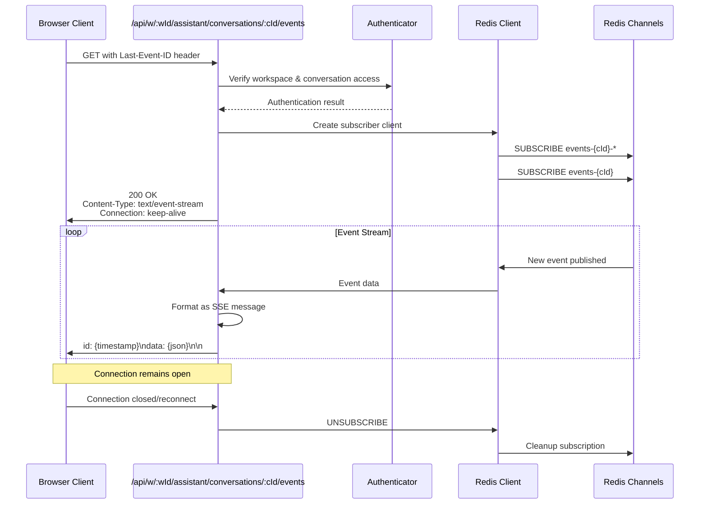

**SSE Response Format**

Each event is formatted according to the SSE specification:

```
id: 1704067200123
event: message
data: {"type":"agent_generation_tokens","text":"Hello","messageId":"msg-abc"}

id: 1704067200456
event: message
data: {"type":"tool_params","action":{...}}

```

The `id` field contains a millisecond timestamp, enabling clients to resume from their last received event using the `Last-Event-ID` header on reconnection.

Sources: [front/pages/api/w/[wId]/assistant/conversations/[cId]/events.ts]()

### Event Filtering and Delivery

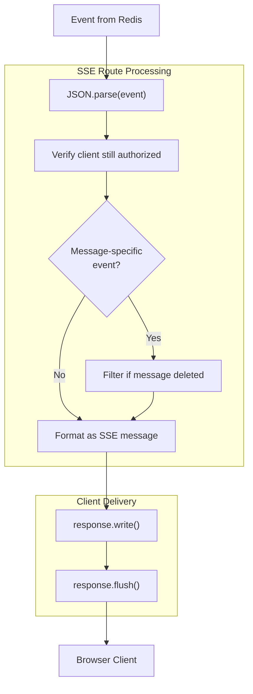

The SSE route performs minimal processing:
1.  Parses the JSON event from Redis
2.  Verifies the client still has access (conversation not deleted)
3.  Filters out events for deleted messages
4.  Formats as SSE and writes to the HTTP response stream

No buffering occurs at the SSE layer—events are forwarded immediately to maintain low latency.

Sources: [front/pages/api/w/[wId]/assistant/conversations/[cId]/events.ts]()

---

## Event Types and Publishing

### Agent Execution Events

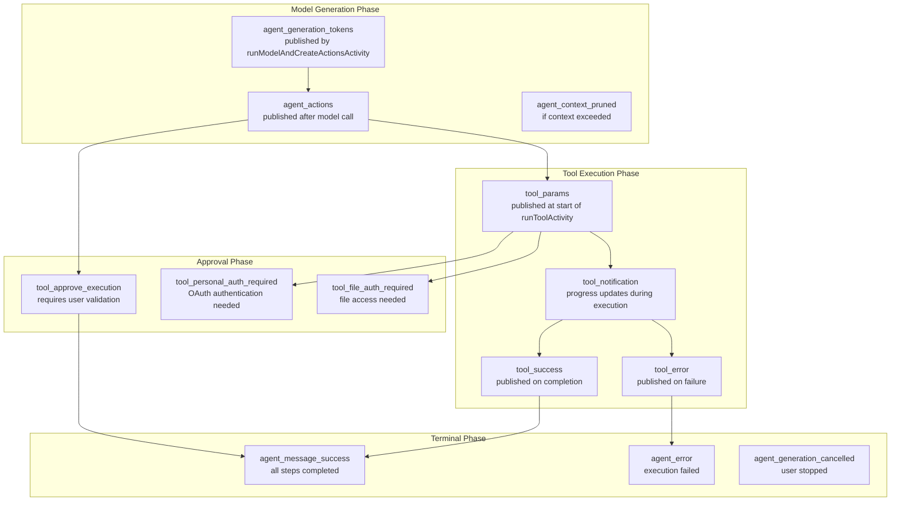

**Event Type Reference**

| Event Type | Source | Payload | Purpose |
| :-------------------------- | :---------------------------------- | :-------------------------------- | :------------------------------------ |
| `agent_generation_tokens` | `runModelAndCreateActionsActivity` | `{text, messageId, configurationId}` | Stream LLM output tokens |
| `agent_actions` | `runModelAndCreateActionsActivity` | `{actions[]}` | Announce tool calls |
| `tool_params` | `runToolActivity` | `{action}` | Show tool inputs |
| `tool_notification` | `runToolActivity` | `{notification, action}` | Progress updates |
| `tool_success` | `runToolActivity` | `{action}` | Tool completed |
| `tool_error` | `runToolActivity` | `{error, action}` | Tool failed |
| `tool_approve_execution` | `createToolActionsActivity` | `{actionId, stake, inputs}` | Request approval |
| `tool_personal_auth_required` | `runToolActivity` | `{authError, actionId}` | OAuth needed |
| `agent_message_success` | `finalizeSuccessfulAgentLoopActivity` | `{messageId}` | Execution complete |
| `agent_error` | `finalizeErroredAgentLoopActivity` | `{error}` | Execution failed |

Sources: [front/types/assistant/agent.ts](), [front/lib/api/assistant/streaming/types.ts](), [front/temporal/agent_loop/activities/run_tool.ts:101-260]()

### Conversation-Level Events

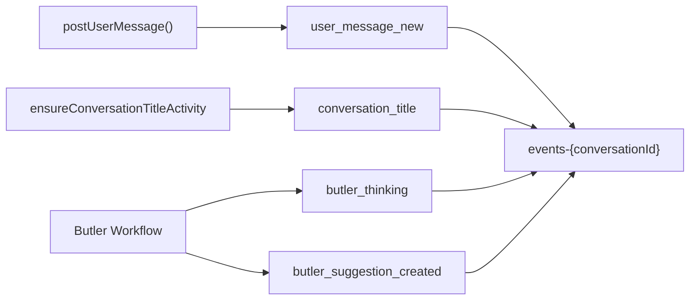

Conversation-level events are published to the conversation channel without a specific message ID:

-   `user_message_new`: Published immediately after user message creation
-   `conversation_title`: Published when title is generated or updated
-   `butler_thinking`: Butler is analyzing the conversation
-   `butler_suggestion_created`: Butler suggestion is ready

Sources: [front/lib/api/assistant/streaming/events.ts](), [front/types/assistant/conversation.ts:407-457]()

---

## Client-Side Event Consumption

### useConversationEvents Hook

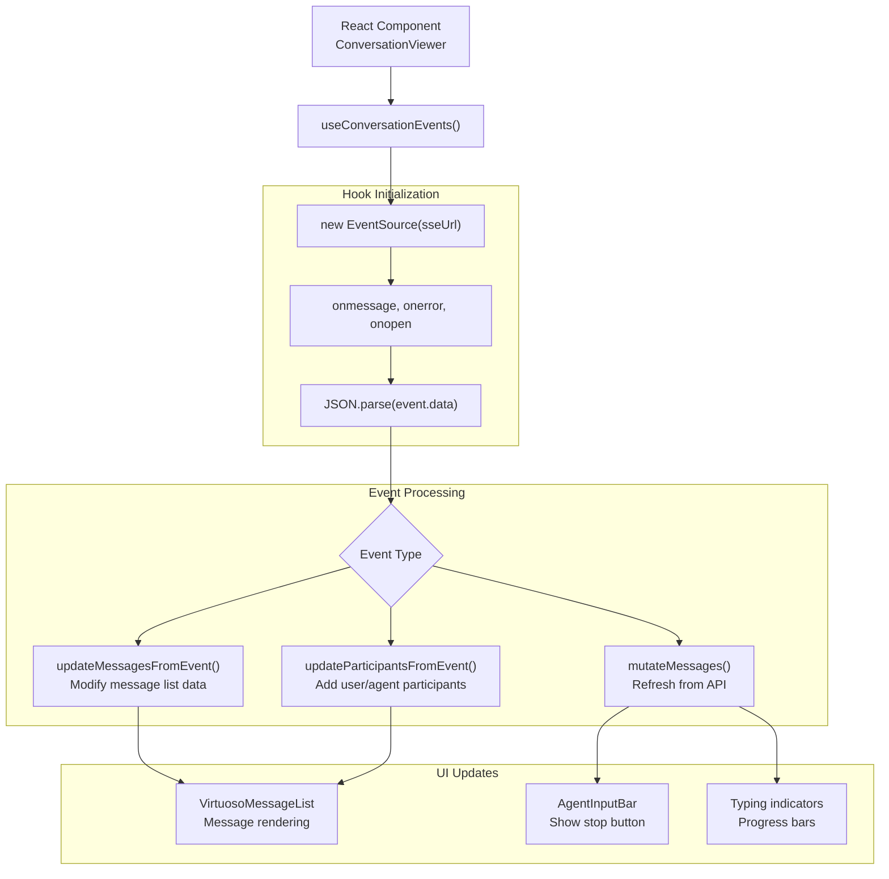

**Event Handler Implementation**

The `useConversationEvents` hook manages the SSE connection and routes events to appropriate handlers:

```typescript
// Conceptual implementation
function useConversationEvents(conversationId: string) {
  useEffect(() => {
    const eventSource = new EventSource(
      `/api/w/${workspaceId}/assistant/conversations/${conversationId}/events`,
      { withCredentials: true }
    );
    
    eventSource.onmessage = (event) => {
      const data = JSON.parse(event.data);
      
      switch (data.type) {
        case 'agent_generation_tokens':
          appendTokensToMessage(data);
          break;
        case 'tool_params':
          updateActionStatus(data.action.id, 'running');
          break;
        case 'agent_message_success':
          markMessageComplete(data.messageId);
          mutateMessages(); // Revalidate from API
          break;
        // ... other cases
      }
    };
    
    return () => eventSource.close();
  }, [conversationId]);
}
```

Sources: [front/hooks/conversations/index.ts:38](), [front/components/assistant/conversation/ConversationViewer.tsx:273-451]()

### useAgentMessageStream Hook

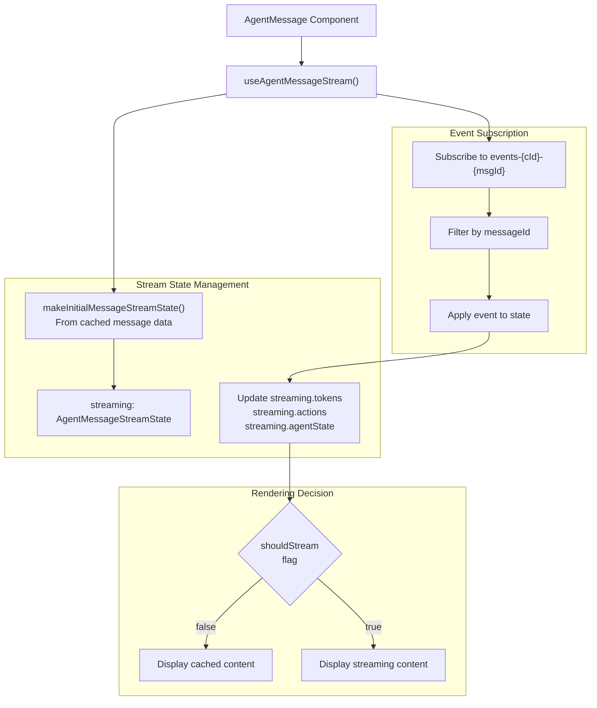

**Streaming State Structure**

The `useAgentMessageStream` hook maintains a local state object that accumulates streaming events:

```typescript
type AgentMessageStreamState = {
  tokens: string;              // Accumulated generation tokens
  actions: AgentMCPActionType[]; // Tool calls
  agentState: 'acting' | 'thinking' | 'done';
  citations: Record<string, CitationType>;
  generatedFiles: ActionGeneratedFileType[];
};
```

This state is updated as events arrive, causing React to re-render the message component with the latest content. The `shouldStream` flag determines whether to display this streaming state or the final cached data from the API.

Sources: [front/hooks/useAgentMessageStream.ts](), [front/components/assistant/conversation/types.ts:45-82]()

### Optimistic UI Updates

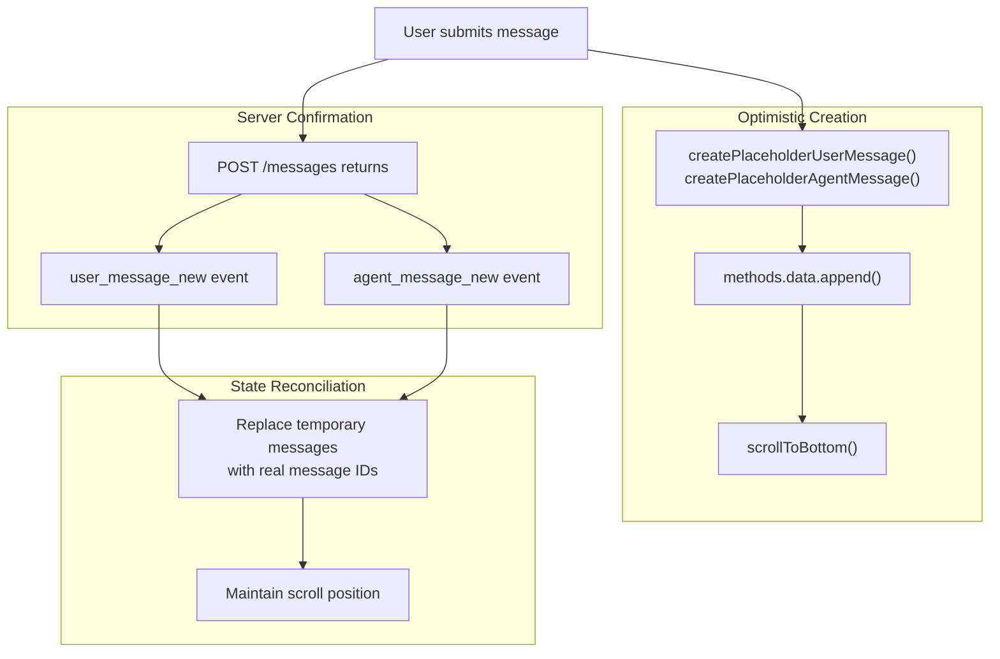

The conversation UI uses optimistic updates to provide instant feedback:

1.  **Immediate Display**: Placeholder messages are added to the message list immediately when the user submits
2.  **Temporary State**: Placeholders have `status: 'temporary'` and use client-generated IDs
3.  **Streaming Overlay**: As events arrive, streaming state is displayed over the placeholder
4.  **Final Reconciliation**: When the workflow completes, the API is revalidated and temporary messages are replaced with persisted data

This pattern ensures the UI feels responsive even though message creation and agent execution happen asynchronously.

Sources: [front/components/assistant/conversation/lib.ts](), [front/components/assistant/conversation/ConversationViewer.tsx:354-451]()

---

## Event Publishing Patterns

### updateResourceAndPublishEvent Pattern

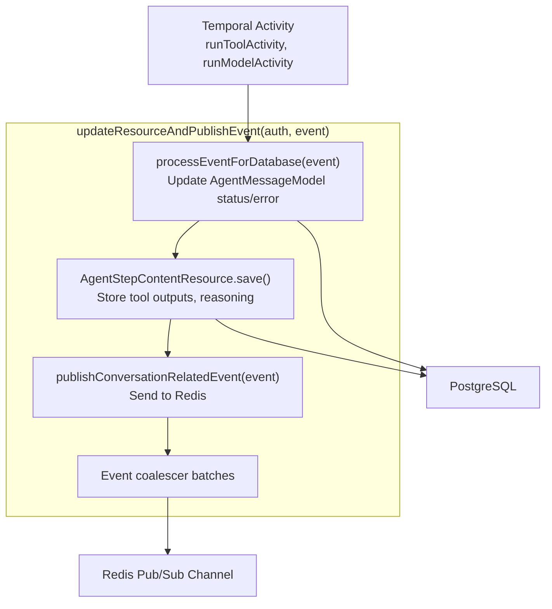

**Pattern Purpose**

The `updateResourceAndPublishEvent()` function ensures database updates and event publishing happen atomically within Temporal activity execution:

1.  **Database Updates**: Writes agent message status, error codes, completion timestamps
2.  **Step Content**: Persists tool outputs, reasoning, generation content
3.  **Event Publishing**: Publishes the event to Redis for SSE delivery
4.  **Coalescing**: Batches rapid events to reduce overhead

This pattern maintains consistency between database state and client-visible events, preventing scenarios where clients see events but the database reflects different state.

Sources: [front/temporal/agent_loop/activities/common.ts:38-197]()

### Deferred Event Publishing

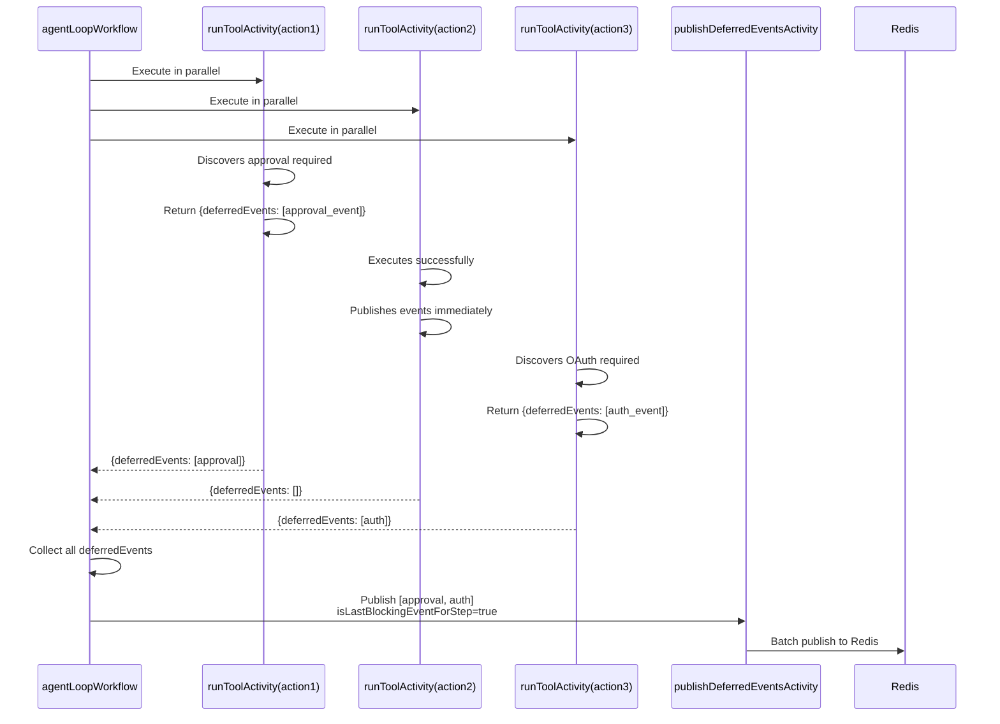

**Deferred Event Strategy**

When tools execute in parallel, approval-required events are deferred rather than published immediately. This prevents partial UI states where some tools show approval requests while others haven't completed yet.

**Implementation Flow**:

1.  Each `runToolActivity` returns a `deferredEvents` array containing approval/auth events
2.  The workflow collects all `deferredEvents` from parallel executions
3.  `publishDeferredEventsActivity` publishes them together with `isLastBlockingEventForStep: true` on the final event
4.  Clients wait for this flag before rendering approval UI

This ensures atomic approval requests, preventing race conditions and improving UX.

Sources: [front/temporal/agent_loop/workflows.ts:307-343](), [front/temporal/agent_loop/activities/publish_deferred_events.ts](), [front/temporal/agent_loop/lib/deferred_events.ts]()

### Terminal Event Processing

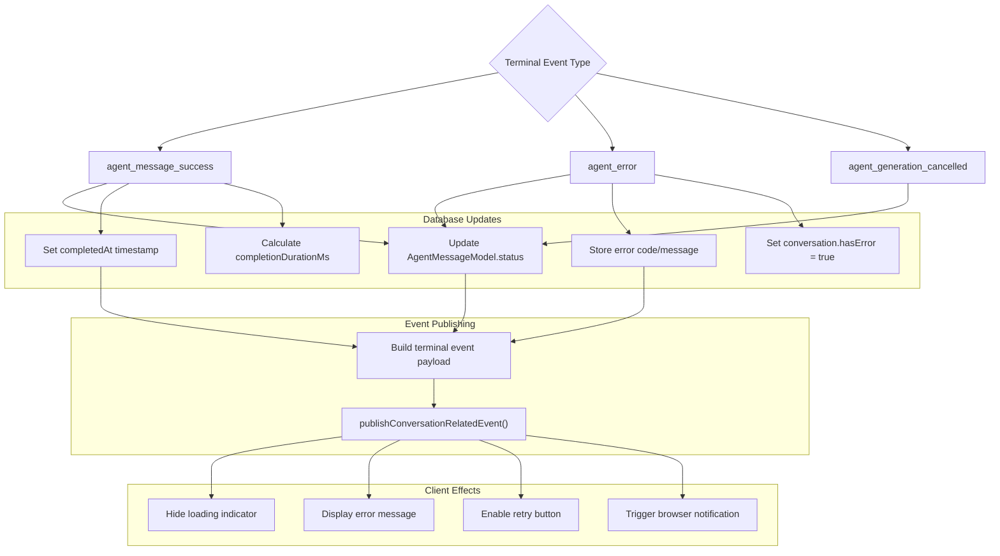

Terminal events mark the end of agent execution and trigger final state updates:

-   `agent_message_success`: Sets status to `"succeeded"`, calculates completion duration, publishes success event
-   `agent_error`: Sets status to `"failed"`, stores error details, marks conversation as errored, publishes error event
-   `agent_generation_cancelled`: Sets status to `"cancelled"`, publishes cancellation event

These events are always published immediately (never deferred) to ensure clients promptly recognize execution has ended.

Sources: [front/temporal/agent_loop/activities/finalize.ts](), [front/lib/api/assistant/streaming/types.ts:11-13](), [front/temporal/agent_loop/activities/common.ts:75-111]()

---

## Summary

The event streaming system provides real-time conversation updates through:

1.  **Redis Pub/Sub Architecture**: Separate channels for message-specific and conversation-level events enable targeted subscriptions
2.  **Event Coalescing**: A 16ms buffering window batches rapid events, reducing Redis operations by ~10x during token streaming
3.  **SSE Delivery**: Long-lived HTTP connections with `Last-Event-ID` support enable resilient streaming with automatic reconnection
4.  **Typed Event System**: 15+ event types cover the complete agent execution lifecycle from token generation to tool completion
5.  **Optimistic UI**: Placeholder messages and streaming state provide instant feedback while maintaining consistency with database state
6.  **Deferred Publishing**: Approval-required events are batched to ensure atomic UI updates for parallel tool execution

All state changes flow through this infrastructure, keeping multiple browser tabs synchronized with <100ms latency while maintaining consistency with the PostgreSQL database.

---

## Event Types and Flow Sequence

This section details the various event types and their typical sequence during a conversation.

**Conversation Events (`ConversationEvents`):**
These events are published to the `events-${conversationId}` channel and provide updates relevant to the entire conversation.

| Event Type | Description | Trigger |
| :-------------------------- | :----------------------------------------------------------------------------------------------------------------------------------------------------------------------------------------------------------------------------------------------------------------------------------------------------------------------------------------------------------------------------------------------------------------------------------------------------------------------------------------------------------------------------------------------------------------------------------------------------------------------------------------------------------------------------------------------------------------------------------------------------------------------------------------------------------------------------------------------------------------------------------------------------------------------------------------------------------------------------------------------------------------------------------------------------------------------------------------------------------------------------------------------------------------------------------------------------------------------------------------------------------------------------------------------------------------------------------------------------------------------------------------------------------------------------------------------------------------------------------------------------------------------------------------------------------------------------------------------------------------------------------------------------------------------------------------------------------------------------------------------------------------------------------------------------------------------------------------------------------------------------------------------------------------------------------------------------------------------------------------------------------------------------------------------------------------------------------------------------------------------------------------------------------------------------------------------------------------------------------------------------------------------------------------------------------------------------------------------------------------------------------------------------------------------------------------------------------------------------------------------------------------------------------------------------------------------------------------------------------------------------------------------------------------------------------------------------------------------------------------------------------------------------------------------------------------------------------------------------------------------------------------------------------------------------------------------------------------------------------------------------------------------------------------------------------------------------------------------------------------------------------------------------------------------------------------------------------------------------------------------------------------------------------------------------------------------------------------------------------------------------------------------------------------------------------------------------------------------------------------------------------------------------------------------------------------------------------------------------------------------------------------------------------------------------------------------------------------------------------------------------------------------------------------------------------------------------------------------------------------------------------------------------------------------------------------------------------------------------------------------------------------------------------------------------------------------------------------------------------------------------------------------------------------------------------------------------------------------------------------------------------------------------------------------------------------------------------------------------------------------------------------------------------------------------------------------------------------------------------------------------------------------------------------------------------------------------------------------------------------------------------------------------------------------------------------------------------------------------------------------------------------------------------------------------------------------------------------------------------------------------------------------------------------------------------------------------------------------------------------------------------------------------------------------------------------------------------------------------------------------------------------------------------------------------------------------------------------------------------------------------------------------------------------------------------------------------------------------------------------------------------------------------------------------------------------------------------------------------------------------------------------------------------------------------------------------------------------------------------------------------------------------------------------------------------------------------------------------------------------------------------------------------------------------------------------------------------------------------------------------------------------------------------------------------------------------------------------------------------------------------------------------------------------------------------------------------------------------------------------------------------------------------------------------------------------------------------------------------------------------------------------------------------------------------------------------------------------------------------------------------------------------------------------------------------------------------------------------------------------------------------------------------------------------------------------------------------------------------------------------------------------------------------------------------------------------------------------------------------------------------------------------------------------------------------------------------------------------------------------------------------------------------------------------------------------------------------------------------------------------------------------------------------------------------------------------------------------------------------------------------------------------------------------------------------------------------------------------------------------------------------------------------------------------------------------------------------------------------------------------------------------------------------------------------------------------------------------------------------------------------------------------------------------------------------------------------------------------------------------------------------------------------------------------------------------------------------------------------------------------------------------------------------------------------------------------------------------------------------------------------------------------------------------------------------------------------------------------------------------------------------------------------------------------------------------------------------------------------------------------------------------------------------------------------------------------------------------------------------------------------------------------------------------------------------------------------------------------------------------------------------------------------------------------------------------------------------------------------------------------------------------------------------------------------------------------------------------------------------------------------------------------------------------------------------------------------------------------------------------------------------------------------------------------------------------------------------------------------------------------------------------------------------------------------------------------------------------------------------------------------------------------------------------------------------------------------------------------------------------------------------------------------------------------------------------------------------------------------------------------------------------------------------------------------------------------------------------------------------------------------------------------------------------------------------------------------------------------------------------------------------------------------------------------------------------------------------------------------------------------------------------------------------------------------------------------------------------------------------------------------------------------------------------------------------------------------------------------------------------------------------------------------------------------------------------------------------------------------------------------------------------------------------------------------------------------------------------------------------------------------------------------------------------------------------------------------------------------------------------------------------------------------------------------------------------------------------------------------------------------------------------------------------------------------------------------------------------------------------------------------------------------------------------------------------------------------------------------------------------------------------------------------------------------------------------------------------------------------------------------------------------------------------------------------------------------------------------------------------------------------------------------------------------------------------------------------------------------------------------------------------------------------------------------------------------------------------------------------------------------------------------------------------------------------------------------------------------------------------------------------------------------------------------------------------------------------------------------------------------------------------------------------------------------------------------------------------------------------------------------------------------------------------------------------------------------------------------------------------------------------------------------------------------------------------------------------------------------------------------------------------------------------------------------------------------------------------------------------------------------------------------------------------------------------------------------------------------------------------------------------------------------------------------------------------------------------------------------------------------------------------------------------------------------------------------------------------------------------------------------------------------------------------------------------------------------------------------------------------------------------------------------------------------------------------------------------------------------------------------------------------------------------------------------------------------------------------------------------------------------------------------------------------------------------------------------------------------------------------------------------------------------------------------------------------------------------------------------------------------------------------------------------------------------------------------------------------------------------------------------------------------------------------------------------------------------------------------------------------------------------------------------------------------------------------------------------------------------------------------------------------------------------------------------------------------------------------------------------------------------------------------------------------------------------------------------------------------------------------------------------------------------------------------------------------------------------------------------------------------------------------------------------------------------------------------------------------------------------------------------------------------------------------------------------------------------------------------------------------------------------------------------------------------------------------------------------------------------------------------------------------------------------------------------------------------------------------------------------------------------------------------------------------------------------------------------------------------------------------------------------------------------------------------------------------------------------------------------------------------------------------------------------------------------------------------------------------------------------------------------------------------------------------------------------------------------------------------------------------------------------------------------------------------------------------------------------------------------------------------------------------------------------------------------------------------------------------------------------------------------------------------------------------------------------------------------------------------------------------------------------------------------------------------------------------------------------------------------------------------------------------------------------------------------------------------------------------------------------------------------------------------------------------------------------------------------------------------------------------------------------------------------------------------------------------------------------------------------------------------------------------------------------------------------------------------------------------------------------------------------------------------------------------------------------------------------------------------------------------------------------------------------------------------------------------------------------------------------------------------------------------------------------------------------------------------------------------------------------------------------------------------------------------------------------------------------------------------------------------------------------------------------------------------------------------------------------------------------------------------------------------------------------------------------------------------------------------------------------------------------------------------------------------------------------------------------------------------------------------------------------------------------------------------------------------------------------------------------------------------------------------------------------------------------------------------------------------------------------------------------------------------------------------------------------------------------------------------------------------------------------------------------------------------------------------------------------------------------------------------------------------------------------------------------------------------------------------------------------------------------------------------------------------------------------------------------------------------------------------------------------------------------------------------------------------------------------------------------------------------------------------------------------------------------------------------------------------------------------------------------------------------------------------------------------------------------------------------------------------------------------------------------------------------------------------------------------------------------------------------------------------------------------------------------------------------------------------------------------------------------------------------------------------------------------------------------------------------------------------------------------------------------------------------------------------------------------------------------------------------------------------------------------------------------------------------------------------------------------------------------------------------------------------------------------------------------------------------------------------------------------------------------------------------------------------------------------------------------------------------------------------------------------------------------------------------------------------------------------------------------------------------------------------------------------------------------------------------------------------------------------------------------------------------------------------------------------------------------------------------------------------------------------------------------------------------------------------------------------------------------------------------------------------------------------------------------------------------------------------------------------------------------------------------------------------------------------------------------------------------------------------------------------------------------------------------------------------------------------------------------------------------------------------------------------------------------------------------------------------------------------------------------------------------------------------------------------------------------------------------------------------------------------------------------------------------------------------------------------------------------------------------------------------------------------------------------------------------------------------------------------------------------------------------------------------------------------------------------------------------------------------------------------------------------------------------------------------------------------------------------------------------------------------------------------------------------------------------------------------------------------------------------------------------------------------------------------------------------------------------------------------------------------------------------------------------------------------------------------------------------------------------------------------------------------------------------------------------------------------------------------------------------------------------------------------------------------------------------------------------------------------------------------------------------------------------------------------------------------------------------------------------------------------------------------------------------------------------------------------------------------------------------------------------------------------------------------------------------------------------------------------------------------------------------------------------------------------------------------------------------------------------------------------------------------------------------------------------------------------------------------------------------------------------------------------------------------------------------------------------------------------------------------------------------------------------------------------------------------------------------------------------------------------------------------------------------------------------------------------------------------------------------------------------------------------------------------------------------------------------------------------------------------------------------------------------------------------------------------------------------------------------------------------------------------------------------------------------------------------------------------------------------------------------------------------------------------------------------------------------------------------------------------------------------------------------------------------------------------------------------------------------------------------------------------------------------------------------------------------------------------------------------------------------------------------------------------------------------------------------------------------------------------------------------------------------------------------------------------------------------------------------------------------------------------------------------------------------------------------------------------------------------------------------------------------------------------------------------------------------------------------------------------------------------------------------------------------------------------------------------------------------------------------------------------------------------------------------------------------------------------------------------------------------------------------------------------------------------------------------------------------------------------------------------------------------------------------------------------------------------------------------------------------------------------------------------------------------------------------------------------------------------------------------------------------------------------------------------------------------------------------------------------------------------------------------------------------------------------------------------------------------------------------------------------------------------------------------------------------------------------------------------------------------------------------------------------------------------------------------------------------------------------------------------------------------------------------------------------------------------------------------------------------------------------------------------------------------------------------------------------------------------------------------------------------------------------------------------------------------------------------------------------------------------------------------------------------------------------------------------------------------------------------------------------------------------------------------------------------------------------------------------------------------------------------------------------------------------------------------------------------------------------------------------------------------------------------------------------------------------------------------------------------------------------------------------------------------------------------------------------------------------------------------------------------------------------------------------------------------------------------------------------------------------------------------------------------------------------------------------------------------------------------------------------------------------------------------------------------------------------------------------------------------------------------------------------------------------------------------------------------------------------------------------------------------------------------------------------------------------------------------------------------------------------------------------------------------------------------------------------------------------------------------------------------------------------------------------------------------------------------------------------------------------------------------------------------------------------------------------------------------------------------------------------------------------------------------------------------------------------------------------------------------------------------------------------------------------------------------------------------------------------------------------------------------------------------------------------------------------------------------------------------------------------------------------------------------------------------------------------------------------------------------------------------------------------------------------------------------------------------------------------------------------------------------------------------------------------------------------------------------------------------------------------------------------------------------------------------------------------------------------------------------------------------------------------------------------------------------------------------------------------------------------------------------------------------------------------------------------------------------------------------------------------------------------------------------------------------------------------------------------------------------------------------------------------------------------------------------------------------------------------------------------------------------------------------------------------------------------------------------------------------------------------------------------------------------------------------------------------------------------------------------------------------------------------------------------------------------------------------------------------------------------------------------------------------------------------------------------------------------------------------------------------------------------------------------------------------------------------------------------------------------------------------------------------------------------------------------------------------------------------------------------------------------------------------------------------------------------------------------------------------------------------------------------------------------------------------------------------------------------------------------------------------------------------------------------------------------------------------------------------------------------------------------------------------------------------------------------------------------------------------------------------------------------------------------------------------------------------------------------------------------------------------------------------------------------------------------------------------------------------------------------------------------------------------------------------------------------------------------------------------------------------------------------------------------------------------------------------------------------------------------------------------------------------------------------------------------------------------------------------------------------------------------------------------------------------------------------------------------------------------------------------------------------------------------------------------------------------------------------------------------------------------------------------------------------------------------------------------------------------------------------------------------------------------------------------------------------------------------------------------------------------------------------------------------------------------------------------------------------------------------------------------------------------------------------------------------------------------------------------------------------------------------------------------------------------------------------------------------------------------------------------------------------------------------------------------------------------------------------------------------------------------------------------------------------------------------------------------------------------------------------------------------------------------------------------------------------------------------------------------------------------------------------------------------------------------------------------------------------------------------------------------------------------------------------------------------------------------------------------------------------------------------------------------------------------------------------------------------------------------------------------------------------------------------------------------------------------------------------------------------------------------------------------------------------------------------------------------------------------------------------------------------------------------------------------------------------------------------------------------------------------------------------------------------------------------------------------------------------------------------------------------------------------------------------------------------------------------------------------------------------------------------------------------------------------------------------------------------------------------------------------------------------------------------------------------------------------------------------------------------------------------------------------------------------------------------------------------------------------------------------------------------------------------------------------------------------------------------------------------------------------------------------------------------------------------------------------------------------------------------------------------------------------------------------------------------------------------------------------------------------------------------------------------------------------------------------------------------------------------------------------------------------------------------------------------------------------------------------------------------------------------------------------------------------------------------------------------------------------------------------------------------------------------------------------------------------------------------------------------------------------------------------------------------------------------------------------------------------------------------------------------------------------------------------------------------------------------------------------------------------------------------------------------------------------------------------------------------------------------------------------------------------------------------------------------------------------------------------------------------------------------------------------------------------------------------------------------------------------------------------------------------------------------------------------------------------------------------------------------------------------------------------------------------------------------------------------------------------------------------------------------------------------------------------------------------------------------------------------------------------------------------------------------------------------------------------------------------------------------------------------------------------------------------------------------------------------------------------------------------------------------------------------------------------------------------------------------------------------------------------------------------------------------------------------------------------------------------------------------------------------------------------------------------------------------------------------------------------------------------------------------------------------------------------------------------------------------------------------------------------------------------------------------------------------------------------------------------------------------------------------------------------------------------------------------------------------------------------------------------------------------------------------------------------------------------------------------------------------------------------------------------------------------------------------------------------------------------------------------------------------------------------------------------------------------------------------------------------------------------------------------------------------------------------------------------------------------------------------------------------------------------------------------------------------------------------------------------------------------------------------------------------------------------------------------------------------------------------------------------------------------------------------------------------------------------------------------------------------------------------------------------------------------------------------------------------------------------------------------------------------------------------------------------------------------------------------------------------------------------------------------------------------------------------------------------------------------------------------------------------------------------------------------------------------------------------------------------------------------------------------------------------------------------------------------------------------------------------------------------------------------------------------------------------------------------------------------------------------------------------------------------------------------------------------------------------------------------------------------------------------------------------------------------------------------------------------------------------------------------------------------------------------------------------------------------------------------------------------------------------------------------------------------------------------------------------------------------------------------------------------------------------------------------------------------------------------------------------------------------------------------------------------------------------------------------------------------------------------------------------------------------------------------------------------------------------------------------------------------------------------------------------------------------------------------------------------------------------------------------------------------------------------------------------------------------------------------------------------------------------------------------------------------------------------------------------------------------------------------------------------------------------------------------------------------------------------------------------------------------------------------------------------------------------------------------------------------------------------------------------------------------------------------------------------------------------------------------------------------------------------------------------------------------------------------------------------------------------------------------------------------------------------------------------------------------------------------------------------------------------------------------------------------------------------------------------------------------------------------------------------------------------------------------------------------------------------------------------------------------------------------------------------------------------------------------------------------------------------------------------------------------------------------------------------------------------------------------------------------------------------------------------------------------------------------------------------------------------------------------------------------------------------------------------------------------------------------------------------------------------------------------------------------------------------------------------------------------------------------------------------------------------------------------------------------------------------------------------------------------------------------------------------------------------------------------------------------------------------------------------------------------------------------------------------------------------------------------------------------------------------------------------------------------------------------------------------------------1.  `ConversationModel` ([front/lib/models/agent/conversation.ts:35]())
    *   `id`: Unique identifier for the conversation.
    *   `sId`: String ID for the conversation.
    *   `workspaceId`: Foreign key to the workspace.
    *   `title`: Display title of the conversation.
    *   `visibility`: Visibility status (`"public"`, `"private"`, `"unlisted"`).
    *   `hasError`: Boolean indicating if the conversation has encountered an error.
    *   `createdAt`: Timestamp of creation.
    *   `updatedAt`: Timestamp of last update.
    *   `deletedAt`: Timestamp if soft-deleted.

2.  `MessageModel` ([front/lib/models/agent/conversation.ts:38]())
    *   `id`: Unique identifier for the message.
    *   `sId`: String ID for the message.
    *   `conversationId`: Foreign key to the `ConversationModel`.
    *   `rank`: Order of the message within the conversation.
    *   `version`: Version of the message (for edits/retries).
    *   `type`: `"user_message"`, `"agent_message"`, or `"compaction_message"`.
    *   `visibility`: `"visible"`, `"deleted"`, `"pending"`.
    *   `createdAt`, `updatedAt`, `deletedAt`.

3.  `UserMessageModel` ([front/lib/models/agent/conversation.ts:41]())
    *   `id`: Unique identifier.
    *   `messageId`: Foreign key to `MessageModel`.
    *   `userId`: Foreign key to `UserModel` (if applicable).
    *   `content`: The actual text content of the user message.
    *   `context`: JSONB field storing `UserMessageContext` (e.g., `username`, `origin`).
    *   `agenticMessageType`: `"run_agent"` or `"agent_handover"` if the message triggers an agent.
    *   `agenticOriginMessageId`: `sId` of the message that triggered this agentic message.

4.  `AgentMessageModel` ([front/lib/models/agent/conversation.ts:34]())
    *   `id`: Unique identifier.
    *   `messageId`: Foreign key to `MessageModel`.
    *   `agentConfigurationId`: `sId` of the agent configuration used.
    *   `agentConfigurationVersion`: Version of the agent configuration.
    *   `status`: `"creating"`, `"running"`, `"succeeded"`, `"failed"`, `"cancelled"`.
    *   `version`: Version of the agent message (for retries).
    *   `content`: The generated text content of the agent message.
    *   `error`: JSONB field storing `GenericErrorContent` if the agent failed.
    *   `modelResolutionMethod`: How the model was resolved (e.g., `"auto"`, `"explicit"`).
    *   `resolvedModelId`, `resolvedProviderId`, `resolvedReasoningEffort`: Details of the LLM used.
    *   `costCredits`: Cost of the agent message in micro-USD.
    *   `completedAt`: Timestamp when the agent message finished execution.
    *   `runIds`: Array of Temporal run IDs associated with this message.

5.  `CompactionMessageModel` ([front/lib/models/agent/conversation.ts:35]())
    *   `id`: Unique identifier.
    *   `messageId`: Foreign key to `MessageModel`.
    *   `status`: `"running"`, `"succeeded"`, `"failed"`.
    *   `content`: The compacted text content.
    *   `error`: JSONB field for compaction errors.
    *   `completedAt`: Timestamp when compaction finished.

6.  `MentionModel` ([front/lib/models/agent/conversation.ts:37]())
    *   `id`: Unique identifier.
    *   `messageId`: Foreign key to `MessageModel`.
    *   `agentConfigurationId`: `sId` of the mentioned agent.
    *   `agentConfigurationVersion`: Version of the mentioned agent.
    *   `userId`: `sId` of the mentioned user.
    *   `type`: `"agent"` or `"user"`.
    *   `status`: `"pending_conversation_access"`, `"approved"`, etc.

7.  `ContentFragmentModel` ([front/lib/resources/storage/models/content_fragment.ts:1]())
    *   `id`: Unique identifier.
    *   `messageId`: Foreign key to `MessageModel`.
    *   `rank`: Order within the message.
    *   `type`: `"file_attachment"`, `"code_block"`, `"text_block"`.
    *   `content`: JSONB field storing content details (e.g., `fileId`, `title`, `text`).

Sources: [front/lib/models/agent/conversation.ts:34-41](), [front/lib/resources/storage/models/content_fragment.ts:1]()

---

## Message Editing and Retry Flow

### Edit User Message

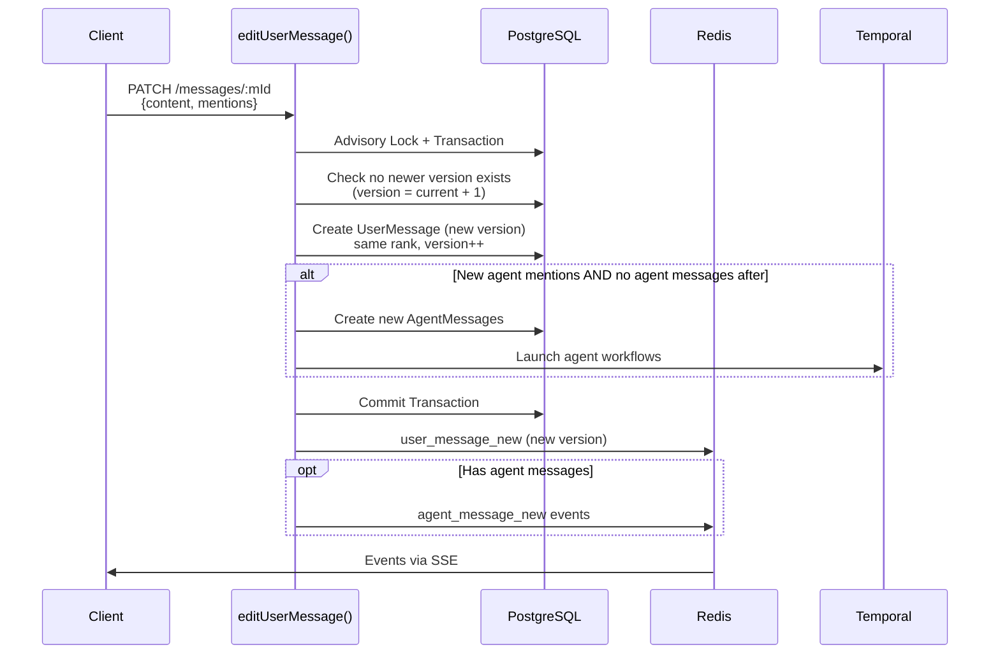

When editing a user message:
1.  Creates a new `UserMessageModel` with `version = previous.version + 1`
2.  Keeps the same `rank` so it appears in the same conversation position
3.  Only creates new agent messages if: (a) there are new @agent mentions AND (b) no agent messages exist after this rank
4.  Publishes `user_message_new` event with the new version

The client displays both versions, allowing users to see edit history.

Sources: [front/lib/api/assistant/conversation.ts:851-1131]()

### Retry Agent Message

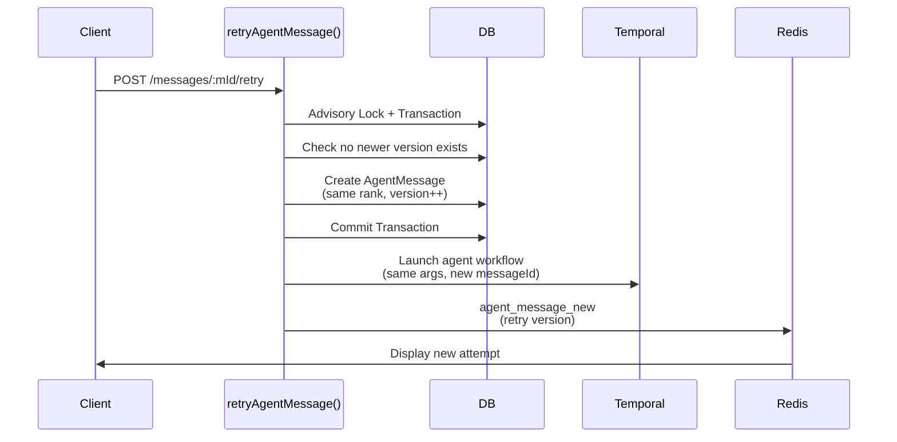

Retry creates a new agent message version at the same rank. The original message remains in the database and conversation history, allowing users to compare different attempts.

Rate limiting uses the parent user message's context to ensure retries count toward the same limits as the original.

Sources: [front/lib/api/assistant/conversation.ts:1180-1272]()

---

## Summary

The message flow and event streaming system provides:

1.  **Transactional Consistency**: Advisory locks ensure correct message ordering; all message creation happens atomically
2.  **Asynchronous Execution**: Agent workflows run in Temporal after transaction commit, decoupling message persistence from execution
3.  **Real-Time Updates**: Redis pub/sub with SSE delivers events to clients with <100ms latency
4.  **Parallel Tool Execution**: Multiple tools execute concurrently with deferred event batching for atomic approval requests
5.  **Fault Tolerance**: SSE `Last-Event-ID` enables client reconnection without missing events; Temporal handles workflow retries

All state changes flow through the event stream, keeping multiple browser tabs synchronized and enabling features like live typing indicators, progress updates, and approval workflows.

---

