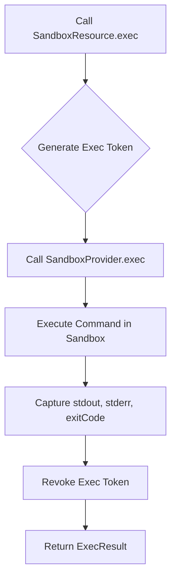
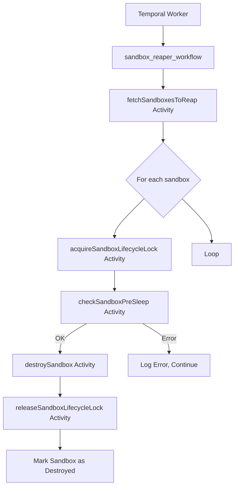

<!-- source: DeepWiki mcp.deepwiki.com · repo dust-tt/dust · page 6.1 Sandbox Infrastructure · fetched 2026-10-26 -->

# Sandbox Infrastructure

<details>
<summary>Relevant source files</summary>

The following files were used as context for generating this wiki page:

- [cli/dust-sandbox/Cargo.lock](cli/dust-sandbox/Cargo.lock)
- [cli/dust-sandbox/Cargo.toml](cli/dust-sandbox/Cargo.toml)
- [cli/dust-sandbox/src/api/client.rs](cli/dust-sandbox/src/api/client.rs)
- [cli/dust-sandbox/src/api/error.rs](cli/dust-sandbox/src/api/error.rs)
- [cli/dust-sandbox/src/api/mod.rs](cli/dust-sandbox/src/api/mod.rs)
- [cli/dust-sandbox/src/api/types.rs](cli/dust-sandbox/src/api/types.rs)
- [cli/dust-sandbox/src/commands/frame/create.rs](cli/dust-sandbox/src/commands/frame/create.rs)
- [cli/dust-sandbox/src/commands/frame/mod.rs](cli/dust-sandbox/src/commands/frame/mod.rs)
- [cli/dust-sandbox/src/commands/frame/register.rs](cli/dust-sandbox/src/commands/frame/register.rs)
- [cli/dust-sandbox/src/commands/mod.rs](cli/dust-sandbox/src/commands/mod.rs)
- [cli/dust-sandbox/src/commands/tools/exec.rs](cli/dust-sandbox/src/commands/tools/exec.rs)
- [cli/dust-sandbox/src/commands/tools/list_servers.rs](cli/dust-sandbox/src/commands/tools/list_servers.rs)
- [cli/dust-sandbox/src/commands/tools/list_tools.rs](cli/dust-sandbox/src/commands/tools/list_tools.rs)
- [cli/dust-sandbox/src/commands/tools/mod.rs](cli/dust-sandbox/src/commands/tools/mod.rs)
- [cli/dust-sandbox/src/commands/tools/offload.rs](cli/dust-sandbox/src/commands/tools/offload.rs)
- [cli/dust-sandbox/src/main.rs](cli/dust-sandbox/src/main.rs)
- [dockerfiles/sandbox-bedrock.Dockerfile](dockerfiles/sandbox-bedrock.Dockerfile)
- [front-api/routes/v1/w/[wId]/sandbox/frames/index.test.ts](front-api/routes/v1/w/[wId]/sandbox/frames/index.test.ts)
- [front-api/routes/v1/w/[wId]/sandbox/frames/index.ts](front-api/routes/v1/w/[wId]/sandbox/frames/index.ts)
- [front-api/routes/v1/w/[wId]/sandbox/frames/register.ts](front-api/routes/v1/w/[wId]/sandbox/frames/register.ts)
- [front-api/routes/w/[wId]/assistant/conversations/[cId]/sandbox/index.ts](front-api/routes/w/[wId]/assistant/conversations/[cId]/sandbox/index.ts)
- [front/lib/api/actions/servers/sandbox/metadata.ts](front/lib/api/actions/servers/sandbox/metadata.ts)
- [front/lib/api/actions/servers/sandbox/tools/index.test.ts](front/lib/api/actions/servers/sandbox/tools/index.test.ts)
- [front/lib/api/actions/servers/sandbox/tools/index.ts](front/lib/api/actions/servers/sandbox/tools/index.ts)
- [front/lib/api/config.ts](front/lib/api/config.ts)
- [front/lib/api/credits/purchase.ts](front/lib/api/credits/purchase.ts)
- [front/lib/api/file_system/sandbox/gcs_sandbox_mount_adapter.test.ts](front/lib/api/file_system/sandbox/gcs_sandbox_mount_adapter.test.ts)
- [front/lib/api/file_system/sandbox/gcs_sandbox_mount_adapter.ts](front/lib/api/file_system/sandbox/gcs_sandbox_mount_adapter.ts)
- [front/lib/api/poke/plugins/workspaces/buy_programmatic_usage_credits.ts](front/lib/api/poke/plugins/workspaces/buy_programmatic_usage_credits.ts)
- [front/lib/api/sandbox/egress.test.ts](front/lib/api/sandbox/egress.test.ts)
- [front/lib/api/sandbox/egress.ts](front/lib/api/sandbox/egress.ts)
- [front/lib/api/sandbox/gcs/token.test.ts](front/lib/api/sandbox/gcs/token.test.ts)
- [front/lib/api/sandbox/gcs/token.ts](front/lib/api/sandbox/gcs/token.ts)
- [front/lib/api/sandbox/hardening.ts](front/lib/api/sandbox/hardening.ts)
- [front/lib/api/sandbox/image/egress/dust-egress-nftables.service](front/lib/api/sandbox/image/egress/dust-egress-nftables.service)
- [front/lib/api/sandbox/image/egress/dust-egress-resolver.service](front/lib/api/sandbox/image/egress/dust-egress-resolver.service)
- [front/lib/api/sandbox/image/egress/egress-nftables.sh](front/lib/api/sandbox/image/egress/egress-nftables.sh)
- [front/lib/api/sandbox/image/index.ts](front/lib/api/sandbox/image/index.ts)
- [front/lib/api/sandbox/image/profile/soffice/pdf_text.py](front/lib/api/sandbox/image/profile/soffice/pdf_text.py)
- [front/lib/api/sandbox/image/profile/soffice/pptx_audit.py](front/lib/api/sandbox/image/profile/soffice/pptx_audit.py)
- [front/lib/api/sandbox/image/profile/soffice/pptx_contrast.py](front/lib/api/sandbox/image/profile/soffice/pptx_contrast.py)
- [front/lib/api/sandbox/image/profile/soffice/pptx_fontmetrics.py](front/lib/api/sandbox/image/profile/soffice/pptx_fontmetrics.py)
- [front/lib/api/sandbox/image/profile/soffice/pptx_geometry.py](front/lib/api/sandbox/image/profile/soffice/pptx_geometry.py)
- [front/lib/api/sandbox/image/profile/soffice/pptx_inspect.py](front/lib/api/sandbox/image/profile/soffice/pptx_inspect.py)
- [front/lib/api/sandbox/image/profile/soffice/pptx_render_boxes.py](front/lib/api/sandbox/image/profile/soffice/pptx_render_boxes.py)
- [front/lib/api/sandbox/image/profile/soffice/pptx_slides.py](front/lib/api/sandbox/image/profile/soffice/pptx_slides.py)
- [front/lib/api/sandbox/image/profile/soffice/pptx_typography.py](front/lib/api/sandbox/image/profile/soffice/pptx_typography.py)
- [front/lib/api/sandbox/image/profile/soffice/render.py](front/lib/api/sandbox/image/profile/soffice/render.py)
- [front/lib/api/sandbox/image/profile/soffice/render_publish.py](front/lib/api/sandbox/image/profile/soffice/render_publish.py)
- [front/lib/api/sandbox/image/profile/soffice/tests/test_audit.py](front/lib/api/sandbox/image/profile/soffice/tests/test_audit.py)
- [front/lib/api/sandbox/image/profile/soffice/tests/test_contrast.py](front/lib/api/sandbox/image/profile/soffice/tests/test_contrast.py)
- [front/lib/api/sandbox/image/profile/soffice/tests/test_geometry.py](front/lib/api/sandbox/image/profile/soffice/tests/test_geometry.py)
- [front/lib/api/sandbox/image/profile/soffice/tests/test_render.py](front/lib/api/sandbox/image/profile/soffice/tests/test_render.py)
- [front/lib/api/sandbox/image/profile/soffice/tests/test_slides.py](front/lib/api/sandbox/image/profile/soffice/tests/test_slides.py)
- [front/lib/api/sandbox/image/registry.test.ts](front/lib/api/sandbox/image/registry.test.ts)
- [front/lib/api/sandbox/image/registry.ts](front/lib/api/sandbox/image/registry.ts)
- [front/lib/api/sandbox/image/sandbox_image.test.ts](front/lib/api/sandbox/image/sandbox_image.test.ts)
- [front/lib/api/sandbox/image/sandbox_image.ts](front/lib/api/sandbox/image/sandbox_image.ts)
- [front/lib/api/sandbox/image/token/dust-gcs-token-firewall.sh](front/lib/api/sandbox/image/token/dust-gcs-token-firewall.sh)
- [front/lib/api/sandbox/image/tool_manifest.test.ts](front/lib/api/sandbox/image/tool_manifest.test.ts)
- [front/lib/api/sandbox/image/tool_manifest.ts](front/lib/api/sandbox/image/tool_manifest.ts)
- [front/lib/api/sandbox/image/types.ts](front/lib/api/sandbox/image/types.ts)
- [front/lib/api/sandbox/instrumentation.ts](front/lib/api/sandbox/instrumentation.ts)
- [front/lib/api/sandbox/lifecycle.test.ts](front/lib/api/sandbox/lifecycle.test.ts)
- [front/lib/api/sandbox/lifecycle.ts](front/lib/api/sandbox/lifecycle.ts)
- [front/lib/api/sandbox/provider.ts](front/lib/api/sandbox/provider.ts)
- [front/lib/api/sandbox/providers/e2b.test.ts](front/lib/api/sandbox/providers/e2b.test.ts)
- [front/lib/api/sandbox/providers/e2b.ts](front/lib/api/sandbox/providers/e2b.ts)
- [front/lib/api/sandbox/providers/e2b_template.test.ts](front/lib/api/sandbox/providers/e2b_template.test.ts)
- [front/lib/api/sandbox/providers/e2b_template.ts](front/lib/api/sandbox/providers/e2b_template.ts)
- [front/lib/api/sandbox/sandbox_child_block.test.ts](front/lib/api/sandbox/sandbox_child_block.test.ts)
- [front/lib/api/sandbox/sandbox_child_block.ts](front/lib/api/sandbox/sandbox_child_block.ts)
- [front/lib/credits/committed.test.ts](front/lib/credits/committed.test.ts)
- [front/lib/credits/committed.ts](front/lib/credits/committed.ts)
- [front/lib/credits/limits.test.ts](front/lib/credits/limits.test.ts)
- [front/lib/credits/limits.ts](front/lib/credits/limits.ts)
- [front/lib/resources/conversation_sandbox_adapter.ts](front/lib/resources/conversation_sandbox_adapter.ts)
- [front/lib/resources/pod_sandbox_adapter.ts](front/lib/resources/pod_sandbox_adapter.ts)
- [front/lib/resources/sandbox_resource.test.ts](front/lib/resources/sandbox_resource.test.ts)
- [front/lib/resources/sandbox_resource.ts](front/lib/resources/sandbox_resource.ts)
- [front/lib/resources/skill/code_defined/global/frames.test.ts](front/lib/resources/skill/code_defined/global/frames.test.ts)
- [front/lib/resources/skill/code_defined/global/frames_v2.ts](front/lib/resources/skill/code_defined/global/frames_v2.ts)
- [front/lib/resources/skill/code_defined/global/pptx.ts](front/lib/resources/skill/code_defined/global/pptx.ts)
- [front/lib/resources/storage/models/sandbox.ts](front/lib/resources/storage/models/sandbox.ts)
- [front/migrations/pre-deploy/20260724155601_add_sandbox_reaper_indexes.sql](front/migrations/pre-deploy/20260724155601_add_sandbox_reaper_indexes.sql)
- [front/migrations/pre-deploy/20260730131801_add_sandbox_reaper_kill_requested_sleeping_index.sql](front/migrations/pre-deploy/20260730131801_add_sandbox_reaper_kill_requested_sleeping_index.sql)
- [front/migrations/pre-deploy/20260826122416_prepare_frames_v2_schema.sql](front/migrations/pre-deploy/20260826122416_prepare_frames_v2_schema.sql)
- [front/scripts/backfill_metronome_credits.ts](front/scripts/backfill_metronome_credits.ts)
- [front/scripts/metronome_initial_contract_setup.ts](front/scripts/metronome_initial_contract_setup.ts)
- [front/scripts/sandbox_security_check.test.ts](front/scripts/sandbox_security_check.test.ts)
- [front/scripts/sandbox_security_check.ts](front/scripts/sandbox_security_check.ts)
- [front/temporal/sandbox_reaper/activities.test.ts](front/temporal/sandbox_reaper/activities.test.ts)
- [front/temporal/sandbox_reaper/activities.ts](front/temporal/sandbox_reaper/activities.ts)
- [front/temporal/sandbox_reaper/config.ts](front/temporal/sandbox_reaper/config.ts)
- [front/temporal/sandbox_reaper/kill_requester/activities.test.ts](front/temporal/sandbox_reaper/kill_requester/activities.test.ts)
- [front/temporal/sandbox_reaper/kill_requester/activities.ts](front/temporal/sandbox_reaper/kill_requester/activities.ts)
- [front/temporal/sandbox_reaper/kill_requester/client.test.ts](front/temporal/sandbox_reaper/kill_requester/client.test.ts)
- [front/temporal/sandbox_reaper/kill_requester/client.ts](front/temporal/sandbox_reaper/kill_requester/client.ts)
- [front/temporal/sandbox_reaper/kill_requester/helpers.ts](front/temporal/sandbox_reaper/kill_requester/helpers.ts)
- [front/temporal/sandbox_reaper/kill_requester/workflows.ts](front/temporal/sandbox_reaper/kill_requester/workflows.ts)
- [front/temporal/sandbox_reaper/worker.ts](front/temporal/sandbox_reaper/worker.ts)
- [front/temporal/sandbox_reaper/workflows.test.ts](front/temporal/sandbox_reaper/workflows.test.ts)
- [front/temporal/sandbox_reaper/workflows.ts](front/temporal/sandbox_reaper/workflows.ts)
- [front/tests/utils/SandboxFactory.ts](front/tests/utils/SandboxFactory.ts)

</details>


This page details the infrastructure supporting the sandboxed code execution environment, focusing on the `SandboxResource` lifecycle, the `E2BSandboxProvider`, the sandbox image registry, integration with the egress proxy, security hardening measures, and the `sandbox_reaper` Temporal workflow. It covers key operations such as `ensureActive` and `exec`, the `GCS mount adapter`, and `nftables` for egress control.

## Sandbox Resource Lifecycle

The `SandboxResource` [front/lib/resources/sandbox_resource.ts:155-156]() manages the state and interactions with a sandboxed execution environment. It provides methods for creating, activating, executing commands within, and destroying sandboxes. The lifecycle is orchestrated through a combination of database state, external provider calls (e.g., E2B), and Temporal workflows.

### States and Transitions

A sandbox can exist in several states, tracked by the `status` field in the `SandboxModel` [front/lib/resources/storage/models/sandbox.ts:19](). Key states include:
*   `running`: The sandbox is active and ready for execution.
*   `sleeping`: The sandbox is paused or hibernating, but its state is preserved.
*   `creating`: The sandbox is being provisioned.
*   `destroying`: The sandbox is being terminated.
*   `failed`: The sandbox encountered an unrecoverable error.
*   `kill_requested`: A request has been made to terminate the sandbox.

The `updateStatus` method [front/lib/resources/sandbox_resource.ts:300-330]() handles state transitions, recording duration metrics for each state change.

### `ensureActive`

The `ensureActive` method [front/lib/api/sandbox/lifecycle.ts:100-260]() is central to the sandbox lifecycle. It ensures that a sandbox is in a `running` state, creating it if it doesn't exist, or waking it up if it's `sleeping`. This operation is protected by a distributed lock to prevent race conditions during concurrent access [front/lib/lock.ts:10-10]().

```mermaid
graph TD
    A[Call ensureActive] --> B{Sandbox exists?};
    B -- No --> C{Acquire Lock};
    C --> D[Create Sandbox];
    D --> E[Initialize Sandbox (Egress, Mounts, Env Vars)];
    E --> F[Set status to running];
    F --> G[Release Lock];
    G --> H[Return Sandbox];

    B -- Yes --> I{Sandbox status?};
    I -- sleeping --> J{Acquire Lock};
    J --> K[Wake Sandbox];
    K --> E;
    J --> L[Release Lock];
    L --> H;

    I -- running --> H;
    I -- creating/destroying/failed/kill_requested --> M[Wait for status change or error];
    M --> H;
```
**Diagram: Sandbox `ensureActive` Flow**
Sources:
- [front/lib/api/sandbox/lifecycle.ts:100-260]()
- [front/lib/resources/sandbox_resource.ts:300-330]()
- [front/lib/lock.ts:10-10]()

The `ensureActive` process involves:
1.  **Lock Acquisition**: A lock is acquired using `executeWithLock` [front/lib/lock.ts:10-10]() to serialize operations on a specific sandbox. The lock has a `SANDBOX_LIFECYCLE_LOCK_TTL_MS` of 5 minutes [front/lib/resources/sandbox_resource.ts:131-131]().
2.  **Sandbox Fetch**: It attempts to fetch an existing sandbox associated with the owner.
3.  **Scope Resolution**: The owner's scope (e.g., conversation ID, space ID) is resolved within the lock [front/lib/resources/sandbox_resource.ts:88-93]().
4.  **Creation/Wake-up**:
    *   If no sandbox exists, a new one is created via the `E2BSandboxProvider` [front/lib/api/sandbox/providers/e2b.ts:100-100]().
    *   If a `sleeping` sandbox exists, it is woken up.
5.  **Initialization**: This includes setting up egress rules, mounting GCS buckets, and injecting environment variables.
6.  **Status Update**: The sandbox's status is updated to `running` [front/lib/resources/sandbox_resource.ts:300-330]().
7.  **Lock Release**: The lock is released.

### `exec`

The `exec` method [front/lib/resources/sandbox_resource.ts:332-369]() allows executing commands within a running sandbox. It takes `ExecOptions` [front/lib/api/sandbox/provider.ts:10-10]() which include the command, working directory, environment variables, and timeout.


**Diagram: Sandbox `exec` Flow**
Sources:
- [front/lib/resources/sandbox_resource.ts:332-369]()
- [front/lib/api/sandbox/provider.ts:10-10]()
- [front/lib/api/sandbox/access_tokens.ts:10-10]()

Key aspects of `exec`:
*   **Execution Tokens**: Each `exec` call generates a short-lived execution token [front/lib/api/sandbox/access_tokens.ts:10-10]() to authenticate the command with the sandbox. These tokens are revoked after execution [front/lib/api/sandbox/access_tokens.ts:10-10]().
*   **Root Execution**: The `execRoot` method [front/lib/resources/sandbox_resource.ts:371-374]() allows executing commands with root privileges, primarily used for system-level setup and hardening.
*   **Output Capture**: `stdout`, `stderr`, and `exitCode` are captured and returned in an `ExecResult` [front/lib/api/sandbox/provider.ts:10-10]().

### `SandboxDeleteOwner` and `withScopeTransition`

The `SandboxDeleteOwner` interface [front/lib/resources/sandbox_resource.ts:109-113]() defines how a sandbox owner can delete a sandbox. The `withScopeTransition` method [front/lib/resources/conversation_sandbox_adapter.ts:100-100]() is used for operations that involve changing the ownership or scope of a sandbox, ensuring that the old sandbox is properly destroyed before a new one is created or associated. This process is also protected by the lifecycle lock [front/lib/resources/sandbox_resource.test.ts:171-202]().

Sources:
- [front/lib/resources/sandbox_resource.ts:54-154]()
- [front/lib/resources/sandbox_resource.test.ts:93-168]()
- [front/lib/resources/sandbox_resource.test.ts:171-202]()
- [front/lib/api/sandbox/lifecycle.ts:100-260]()
- [front/lib/api/sandbox/providers/e2b.ts:100-100]()
- [front/lib/api/sandbox/access_tokens.ts:10-10]()
- [front/lib/api/sandbox/provider.ts:10-10]()
- [front/lib/resources/storage/models/sandbox.ts:19]()
- [front/lib/lock.ts:10-10]()

## E2BSandboxProvider

The `E2BSandboxProvider` [front/lib/api/sandbox/providers/e2b.ts:100-100]() is the concrete implementation that interfaces with the E2B sandbox service. It handles the actual creation, management, and destruction of sandbox instances.

```mermaid
classDiagram
    direction LR
    class SandboxProvider {
        <<interface>>
        +create(image: SandboxImage, envs: Record<string, string>): Promise<Result<Sandbox, Error>>
        +wake(sandboxId: string): Promise<Result<Sandbox, Error>>
        +destroy(sandboxId: string): Promise<Result<void, Error>>
        +exec(sandboxId: string, options: ExecOptions): Promise<Result<ExecResult, Error>>
        +execRoot(sandboxId: string, options: RootExecOptions): Promise<Result<ExecResult, Error>>
        +uploadFile(sandboxId: string, path: string, content: string): Promise<Result<void, Error>>
        +downloadFile(sandboxId: string, path: string): Promise<Result<FileEntry, Error>>
        +readDenyLog(sandboxId: string, offset: number): Promise<Result<{ entries: string[]; newOffset: number }, Error>>
        +getHealth(sandboxId: string): Promise<Result<EgressHealthState, Error>>
    }

    class E2BSandboxProvider {
        -client: E2BClient
        +create(image: SandboxImage, envs: Record<string, string>): Promise<Result<Sandbox, Error>>
        +wake(sandboxId: string): Promise<Result<Sandbox, Error>>
        +destroy(sandboxId: string): Promise<Result<void, Error>>
        +exec(sandboxId: string, options: ExecOptions): Promise<Result<ExecResult, Error>>
        +execRoot(sandboxId: string, options: RootExecOptions): Promise<Result<ExecResult, Error>>
        +uploadFile(sandboxId: string, path: string, content: string): Promise<Result<void, Error>>
        +downloadFile(sandboxId: string, path: string): Promise<Result<FileEntry, Error>>
        +readDenyLog(sandboxId: string, offset: number): Promise<Result<{ entries: string[]; newOffset: number }, Error>>
        +getHealth(sandboxId: string): Promise<Result<EgressHealthState, Error>>
    }

    SandboxProvider <|-- E2BSandboxProvider
```
**Diagram: `SandboxProvider` and `E2BSandboxProvider`**
Sources:
- [front/lib/api/sandbox/provider.ts:10-10]()
- [front/lib/api/sandbox/providers/e2b.ts:100-100]()

The `E2BSandboxProvider` implements the `SandboxProvider` interface [front/lib/api/sandbox/provider.ts:10-10]() and uses an internal `E2BClient` to communicate with the E2B API. It handles:
*   **Sandbox Creation**: `create` [front/lib/api/sandbox/providers/e2b.ts:100-100]() provisions a new sandbox instance, specifying the base image and initial environment variables.
*   **Wake/Sleep**: `wake` [front/lib/api/sandbox/providers/e2b.ts:100-100]() resumes a previously suspended sandbox, while `destroy` [front/lib/api/sandbox/providers/e2b.ts:100-100]() terminates it.
*   **Command Execution**: `exec` and `execRoot` [front/lib/api/sandbox/providers/e2b.ts:100-100]() send commands to the sandbox and retrieve their output.
*   **File Operations**: `uploadFile` and `downloadFile` [front/lib/api/sandbox/providers/e2b.ts:100-100]() facilitate file transfer between the host and the sandbox.
*   **Health Checks**: `getHealth` [front/lib/api/sandbox/providers/e2b.ts:100-100]() checks the status of the sandbox, including egress proxy configuration.

Sources:
- [front/lib/api/sandbox/providers/e2b.ts:100-100]()
- [front/lib/api/sandbox/provider.ts:10-10]()

## Sandbox Image Registry

The sandbox image registry defines the Docker images used for sandboxes and their capabilities. The `getSandboxImageFromRegistry` function [front/lib/api/sandbox/image/registry.ts:209-209]() retrieves image definitions.

```mermaid
graph TD
    A[getSandboxImageFromRegistry({ name: "dust-base" })] --> B[SandboxImage Definition];
    B --> C{Image ID: dust-base:0.8.99};
    B --> D{Base Image: dust-sbx-bedrock:1.11.0};
    B --> E{Capabilities: dust_filesystem};
    B --> F[Operations: Run commands, Copy files];
    F --> G[Hardening Commands];
    F --> H[Python Library Installs];
    F --> I[Egress Configuration];
```
**Diagram: Sandbox Image Registry Overview**
Sources:
- [front/lib/api/sandbox/image/registry.ts:209-209]()
- [front/lib/api/sandbox/image/registry.test.ts:94-104]()

Key images and their components:
*   **`dust-base`**: The primary sandbox image [front/lib/api/sandbox/image/registry.test.ts:94-104](). It's built on `dust-sbx-bedrock` [front/lib/api/sandbox/image/registry.test.ts:99-101]().
*   **`dust-sbx-bedrock`**: A base image providing fundamental OS and runtime components [dockerfiles/sandbox-bedrock.Dockerfile]().
*   **Python Libraries**: A comprehensive set of Python libraries for data analysis, scientific computing, machine learning, and document processing are pre-installed [front/lib/api/sandbox/image/registry.ts:71-129](). These include `pandas`, `numpy`, `scipy`, `scikit-learn`, `plotly`, `requests`, `openpyxl`, `pdfplumber`, `pypdf`, `python-docx`, `python-pptx`, `beautifulsoup4`, `lxml`, `pillow`, `duckdb`, and `markitdown`.
*   **Tools**: Specific tools like `dsbx` CLI [cli/dust-sandbox/Cargo.toml:3](), `dbt` CLI, `Snowflake CLI`, `Litestream`, and `LibreOffice` are included [front/lib/api/sandbox/image/registry.ts:30-58]().
*   **Capabilities**: Images declare capabilities, such as `dust_filesystem` [front/lib/api/sandbox/image/registry.test.ts:103-103](), which indicates support for the GCS mount adapter.

Sources:
- [front/lib/api/sandbox/image/registry.ts:28-209]()
- [front/lib/api/sandbox/image/registry.test.ts:94-104]()
- [dockerfiles/sandbox-bedrock.Dockerfile]()

## Egress Proxy Integration

The sandbox environment integrates with a Rust-based egress proxy [cli/dust-sandbox/src/main.rs]() to control outbound network access. This proxy enforces security policies and logs network activity.

```mermaid
graph TD
    A[Sandbox] --> B[Egress Proxy (dsbx)];
    B --> C{Policy Enforcement};
    C -- Allowed --> D[External Service];
    C -- Denied --> E[Deny Log];
    E --> F[readDenyLogEntries];
    F --> G[Agent Feedback];
```
**Diagram: Egress Proxy Flow**
Sources:
- [front/lib/api/sandbox/egress.ts:31-36]()
- [front/lib/api/sandbox/egress.ts:118-144]()
- [front/lib/api/actions/servers/sandbox/tools/index.ts:111-173]()
- [cli/dust-sandbox/src/main.rs]()

Key components and processes:
*   **`dsbx` CLI**: The `dust-sandbox` Rust binary (`dsbx`) [cli/dust-sandbox/src/main.rs]() acts as the egress forwarder and resolver within the sandbox.
*   **`mintEgressJwt`**: A JWT is minted by the `front` service [front/lib/api/sandbox/egress.ts:118-144]() and passed to the sandbox. This token contains claims about the workspace, owner, and sandbox ID, which the proxy uses for policy enforcement.
*   **`nftables`**: Linux `nftables` rules are configured within the sandbox to redirect all outbound DNS and HTTP/S traffic through the `dsbx` proxy [front/lib/api/sandbox/image/egress/egress-nftables.sh]().
*   **Policy Enforcement**: The proxy checks the JWT claims against configured egress policies (workspace-level, owner-level, and pod-level) to determine if a domain is allowed [front/lib/api/sandbox/egress.ts:118-144]().
*   **Deny Logging**: If a request is denied, an entry is written to a deny log file (`/tmp/dust-egress-denied.log`) [front/lib/api/sandbox/egress.ts:35-35]().
*   **`readNewDenyLogEntries`**: The `readNewDenyLogEntries` function [front/lib/api/sandbox/egress.ts:290-320]() reads and parses these log entries, providing feedback to the agent about blocked domains.
*   **`add_egress_domain` / `request_egress_domain` tools**: Agents can use these tools [front/lib/api/actions/servers/sandbox/tools/index.ts:73-74]() to programmatically add domains to the allowlist or request admin approval for new domains.
*   **MITM CA**: The proxy generates a Man-in-the-Middle (MITM) CA certificate to intercept and inspect HTTPS traffic, ensuring policy compliance [front/lib/api/sandbox/egress.ts:44-59](). This CA is installed in the sandbox's trust store.

Sources:
- [front/lib/api/sandbox/egress.ts:31-36]()
- [front/lib/api/sandbox/egress.ts:118-144]()
- [front/lib/api/actions/servers/sandbox/tools/index.ts:73-74]()
- [front/lib/api/actions/servers/sandbox/tools/index.ts:111-173]()
- [cli/dust-sandbox/src/main.rs]()
- [front/lib/api/sandbox/image/egress/egress-nftables.sh]()

## Security Hardening

Sandbox images and the runtime environment are hardened to minimize attack surface and enforce isolation.

```mermaid
graph TD
    A[Sandbox Image Build] --> B[Root Safe Path Hardening];
    B --> C[Local Account Hardening];
    B --> D[Sudo Removal];
    B --> E[Service Path Permissions];
    A --> F[Egress Control (nftables)];
    A --> G[Trust Environment Variables];
```
**Diagram: Sandbox Security Hardening**
Sources:
- [front/lib/api/sandbox/hardening.ts:10-10]()
- [front/lib/api/sandbox/image/registry.ts:5-5]()
- [front/lib/api/sandbox/image/registry.test.ts:116-144]()
- [front/lib/api/sandbox/image/registry.test.ts:146-171]()
- [front/lib/api/sandbox/trust_env.ts:10-10]()

Key hardening measures include:
*   **Root Safe Path**: The `SANDBOX_ROOT_SAFE_PATH` [front/lib/api/sandbox/hardening.ts:10-10]() script ensures that critical root-owned paths are read-only or have restricted permissions.
*   **Local Account Hardening**: Provider-created local accounts are hardened by locking passwords, disabling login shells, and removing them from privileged groups [front/lib/api/sandbox/image/registry.test.ts:146-171]().
*   **Sudo Removal**: `sudo` is purged from sandbox images to prevent privilege escalation [front/lib/api/sandbox/image/registry.test.ts:146-171]().
*   **Service Path Permissions**: Service-owned runtime paths (e.g., `/home/agent`, `/opt/venv`) have their permissions locked down after package installations, typically making them owned by `root:agent` and removing group/other write access [front/lib/api/sandbox/image/registry.test.ts:116-144]().
*   **`nftables` Egress Control**: As described above, `nftables` rules are used to strictly control outbound network connections [front/lib/api/sandbox/image/egress/egress-nftables.sh]().
*   **Trust Environment Variables**: Sensitive environment variables are managed through `SANDBOX_TRUST_ENV_VARS` [front/lib/api/sandbox/trust_env.ts:10-10]() and injected securely.

Sources:
- [front/lib/api/sandbox/hardening.ts:10-10]()
- [front/lib/api/sandbox/image/registry.ts:5-5]()
- [front/lib/api/sandbox/image/registry.test.ts:116-144]()
- [front/lib/api/sandbox/image/registry.test.ts:146-171]()
- [front/lib/api/sandbox/trust_env.ts:10-10]()
- [front/lib/api/sandbox/image/egress/egress-nftables.sh]()

## GCS Mount Adapter

The `GCS Sandbox Mount Adapter` [front/lib/api/file_system/sandbox/gcs_sandbox_mount_adapter.ts:10-10]() enables sandboxes to interact with Google Cloud Storage (GCS) buckets as if they were local file systems. This is crucial for persistent storage and data exchange.

```mermaid
graph TD
    A[Sandbox] --> B[dsbx CLI (FUSE)];
    B --> C[GCS Sandbox Mount Adapter];
    C --> D[GCS Bucket];
```
**Diagram: GCS Mount Adapter**
Sources:
- [front/lib/api/file_system/sandbox/gcs_sandbox_mount_adapter.ts:10-10]()
- [cli/dust-sandbox/src/main.rs]()
- [cli/dust-sandbox/src/commands/mod.rs]()

Key aspects:
*   **FUSE Integration**: The `dsbx` CLI [cli/dust-sandbox/src/main.rs]() within the sandbox uses FUSE (Filesystem in Userspace) to mount GCS buckets.
*   **`mount_gcs` command**: The `dsbx mount_gcs` command [cli/dust-sandbox/src/commands/mod.rs]() is responsible for initiating the GCS mount.
*   **Authentication**: The adapter handles authentication with GCS, typically using service account credentials.
*   **File Operations**: Standard file system operations (read, write, list, delete) are translated into GCS API calls.
*   **`Litestream`**: `Litestream` [front/lib/api/sandbox/image/registry.ts:56-56]() is used to replicate SQLite databases (e.g., for pod state) to the GCS replica mount, ensuring durability.

Sources:
- [front/lib/api/file_system/sandbox/gcs_sandbox_mount_adapter.ts:10-10]()
- [cli/dust-sandbox/src/main.rs]()
- [cli/dust-sandbox/src/commands/mod.rs]()
- [front/lib/api/sandbox/image/registry.ts:56-56]()

## `sandbox_reaper` Temporal Workflow

The `sandbox_reaper` Temporal workflow [front/temporal/sandbox_reaper/workflows.ts:10-10]() is responsible for managing the lifecycle of sandboxes, particularly for cleaning up inactive or `kill_requested` sandboxes.


**Diagram: `sandbox_reaper` Temporal Workflow**
Sources:
- [front/temporal/sandbox_reaper/workflows.ts:10-10]()
- [front/temporal/sandbox_reaper/activities.ts:10-10]()
- [front/lib/resources/sandbox_resource.ts:140-143]()

The workflow consists of:
*   **`sandbox_reaper_workflow`**: The main workflow definition [front/temporal/sandbox_reaper/workflows.ts:10-10]().
*   **`fetchSandboxesToReap` activity**: This activity [front/temporal/sandbox_reaper/activities.ts:10-10]() queries the database for sandboxes that are `kill_requested` or have been inactive for a long time. It orders them by `killRequestedAt` (ascending) or `lastActivityAt` (descending) [front/lib/resources/sandbox_resource.ts:109-113]().
*   **`acquireSandboxLifecycleLock` activity**: Acquires the distributed lock for a specific sandbox to ensure exclusive access during cleanup [front/temporal/sandbox_reaper/activities.ts:10-10]().
*   **`checkSandboxPreSleep` activity**: Performs a health check on a running sandbox before destruction. This check ensures that any durable state (e.g., SQLite databases replicated by Litestream) has been safely flushed [front/lib/resources/sandbox_resource.ts:75-79](). If this check fails for a `kill_requested` sandbox, the reaper will retry for a `KILL_REQUESTED_FLUSH_GRACE_MS` period (1 hour) before forcing destruction [front/lib/resources/sandbox_resource.ts:140-143]().
*   **`destroySandbox` activity**: Calls the `E2BSandboxProvider` to terminate the sandbox instance [front/temporal/sandbox_reaper/activities.ts:10-10]().
*   **`releaseSandboxLifecycleLock` activity**: Releases the lock after the cleanup operation [front/temporal/sandbox_reaper/activities.ts:10-10]().

Sources:
- [front/temporal/sandbox_reaper/workflows.ts:10-10]()
- [front/temporal/sandbox_reaper/activities.ts:10-10]()
- [front/lib/resources/sandbox_resource.ts:109-113]()
- [front/lib/resources/sandbox_resource.ts:140-143]()

---

